# Lecture 1 — Introduction to Deep Learning: slide-by-slide

Text and figures of all 108 slides of
[`6S191_MIT_DeepLearning_L1.pdf`](https://introtodeeplearning.com/slides/6S191_MIT_DeepLearning_L1.pdf)
(MIT 6.S191 Introduction to Deep Learning, 2026 edition; lecturer Alexander Amini), transcribed
from the deck. Cite these as "slide N", where N is the PDF page number. Diagrams, plots, photographs
and code are described in prose or reproduced, since the KB is read as text.

Many slides are **build steps**: the same slide re-shown with one more element revealed. They are
transcribed individually, so that a citation to any one of them resolves, with a note of what each
adds to the one before.

## Numbering: slide numbers vs PDF pages

The PDF is a flattened export: every page is a single 1280×720 image with no text layer, and no
page prints a slide number. Headings therefore use the PDF page number, and a reader who opens page
N of the PDF sees slide N. The standard footer on every content slide (MIT logo, "MIT Introduction
to Deep Learning", introtodeeplearning.com, @MITDeepLearning, "1/5/26") is not repeated below.
Slides 4–6 are full-bleed images with no footer.

## Contents

| Slides | Section |
| ------ | ------- |
| 1 | Title |
| 2–6 | The pace of the field: generated faces 2015 → 2020, GPT-3/GPT-4, GPU data centres, on-device models, Liquid AI's LFM2-2.6B-Exp benchmarked against GPT-4 |
| 7 | What is deep learning? Artificial intelligence ⊃ machine learning ⊃ deep learning |
| 8–16 | Course logistics: schedule, TensorFlow and PyTorch software labs, labs and prizes, the project pitch competition, support, staff, sponsors |
| 17–19 | Why deep learning, and why now: hierarchical features learned from data; the history timeline; big data, hardware, software |
| 20–32 | The perceptron: forward propagation, the bias, vector form, activation functions and why they are needed, a worked example with a decision boundary |
| 33–43 | Building neural networks with perceptrons: the simplified perceptron, multi-output (dense) layers from scratch in TensorFlow and PyTorch, single-layer and deep networks, `Sequential` code |
| 44–53 | Applying neural networks: "Will I pass this class?", quantifying loss, empirical loss, binary cross-entropy, mean squared error |
| 54–64 | Training neural networks: loss optimization on a 3D loss surface, gradient descent algorithm and code |
| 65–70 | Computing gradients: backpropagation via the chain rule |
| 71–82 | Neural networks in practice, optimization: rugged loss landscapes, setting the learning rate, adaptive learning rates and optimizers, a TensorFlow training loop |
| 83–91 | Neural networks in practice, mini-batches: gradient descent vs stochastic gradient descent vs mini-batch SGD |
| 92–106 | Neural networks in practice, overfitting: underfitting vs overfitting, regularization, dropout, early stopping |
| 107–108 | Core foundation review; Lab 1 announcement |

## Slide 1 — [Title slide]

Introduction to Deep Learning

Alexander Amini
MIT Introduction to Deep Learning
January 5, 2026

Black background; at left a glowing cyan/blue 3D network of nodes (dots) connected by lines, resembling a neural network. A faint large "MIT 6.S191" watermark runs diagonally behind the text. The MIT logo and "MIT EECS" logo appear at the bottom (title-slide footer).

*Figure: yes — decorative cyan neural-network node-and-edge graphic*

## Slide 2 — "Seeing" the progress of deep learning throughout the years

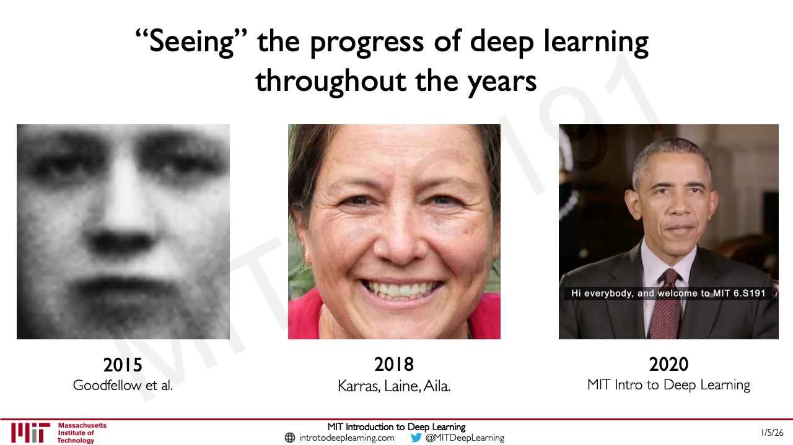

Three square-ish images in a row, each with a year and credit below:
- Left: a blurry, low-resolution black-and-white face image. Caption: "2015" / "Goodfellow et al."
- Middle: a photorealistic close-up colour photo of a smiling middle-aged woman with brown hair and a red top (a synthetic face). Caption: "2018" / "Karras, Laine, Aila."
- Right: a video still of a man in a dark suit, white shirt and dark red patterned tie standing in a formal room with a subtitle bar reading "Hi everybody, and welcome to MIT 6.S191". Caption: "2020" / "MIT Intro to Deep Learning"

Meant to illustrate the progress in realism of deep-learning-generated faces/video over the years.

*Figure: yes — three generated-face images from 2015, 2018, 2020*

## Slide 3 — Language has transformed the way that we interact with deep learning

Two logo images with captions:
- Left: blue gradient square with the white OpenAI logo and the text "GPT-3". Caption: "2022" / "ChatGPT launches (GPT-3)"
- Right: dark square with green binary-digit streaks, a glowing green OpenAI logo and the text "GPT-4". Caption: "2023" / "The GPT-4 "wow" moment"

*Figure: yes — GPT-3 and GPT-4 logo images*

## Slide 4 — [Full-bleed photo of a data center]

No text. A full-slide photo of a long aisle of server racks in a data center, with blinking blue, green and amber lights, white ceiling lights and a tiled floor.

*Figure: yes — photo of data center server racks*

## Slide 5 — [Split photo: data center and smartphone]

No text. Split-screen image. Left half: a darkened, dimmer version of the data-center server racks. Right half: a close-up photo of a person's hands (wearing a mustard-yellow knit sleeve) holding and tapping a smartphone with a blue glowing screen against a blurred, bokeh-lit street background.

*Figure: yes — photo pair: servers (left) and smartphone use (right)*

## Slide 6 — [Tweet about Liquid AI model beating GPT-4, with phone photo]

Split slide, no printed title. Left half: a dark-mode screenshot of an X (Twitter) post by Paul Couvert (verified badge), handle @itsPaulAi, with a "Subscribe" button. Post text:

"That's pretty crazy when you think about it

One of the biggest "wow" moments with ChatGPT was the update from GPT-3.5 to GPT-4.

And now this open-source model with only 2.6B parameters that can run locally on your phone... is BETTER than the original GPT-4.

Unbelievable."

The sentence "And now this open-source model with only 2.6B parameters that can run locally on your phone... is BETTER than the original GPT-4." is boxed in a red rectangle.

Below it an embedded table card titled "Benchmarking LFM2-2.6B-Exp vs. GPT-4":

| Benchmark | LFM2-2.6B-Exp (Liquid AI) | GPT-4 (Original) |
| --- | --- | --- |
| IFEval (Strict Instruction Following) | 88.13 | 79.0 |
| Multi-IF (Complex Instructions) | 73.05 | 65.0 |
| IFBench (Formatting Accuracy) | 44.40 | 24.0 |
| GPQA (PhD-level Reasoning) | 41.31 | 35.7 |
| MMLU-Pro (Hard Expert Knowledge) | 53.87 | 63.7 |
| AIME25 (Olympiad-level Math) | 22.67 | 15.0 |

(In the image the higher value in each row is bold: the LFM2 value in all rows except MMLU-Pro, where GPT-4's 63.7 is bold.) The card has an "Export to Sheets" button. Post footer: "4:27 PM · Dec 25, 2025 · 253.5K Views"; counters: 80 replies, 178 reposts, 2.5K likes, 1.1K bookmarks.

Right half: the smartphone-in-hands photo from the previous slide, with a white speech-bubble graphic (tail pointing at the phone) containing the "Liquid" logo (a stylised dark droplet/flame mark on a scribbled-circle backdrop) with a branching bracket to three icon+labels: a document-with-pencil icon "TEXT", a sound-wave icon "AUDIO", and an image icon "VISION".

*Figure: yes — screenshot of tweet comparing a 2.6B on-phone model with GPT-4, plus Liquid multimodal graphic over phone photo*

## Slide 7 — What is Deep Learning?

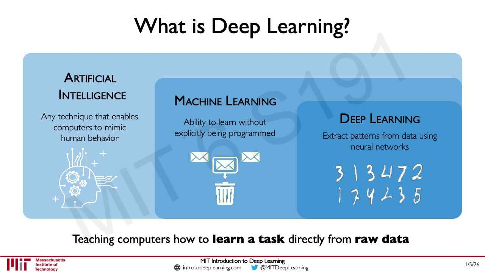

Three nested rounded rectangles in progressively darker blue, left-aligned to the outer one:
- Outer (lightest): "ARTIFICIAL INTELLIGENCE" — "Any technique that enables computers to mimic human behavior". Icon: a white line-art head profile with gears inside and circuit-trace lines coming out.
- Middle: "MACHINE LEARNING" — "Ability to learn without explicitly being programmed". Icon: three envelope icons with the centre one pointing down by an arrow into a trash can (spam filtering).
- Inner (darkest): "DEEP LEARNING" — "Extract patterns from data using neural networks". Image: two rows of handwritten digits "3 1 3 4 7 2" and "1 7 4 2 3 5" (MNIST-style, white on blue).

Bottom caption: "Teaching computers how to **learn a task** directly from **raw data**" (bold "learn a task" and "raw data").

*Figure: yes — nested boxes AI ⊃ ML ⊃ Deep Learning with icons*

## Slide 8 — Lecture Schedule

Dark navy background. Three columns of course-item entries (circular thumbnail, cyan title, then white details), and at right a T-shirt photo and bullet list.

Column 1:
- Intro to Deep Learning — Lecture 1, Jan. 5, 2026, [Slides] [Video] coming soon!
- Deep Computer Vision — Lecture 3, Jan. 6, 2026, [Slides] [Video] coming soon!
- Deep Reinforcement Learning — Lecture 5, Jan. 7, 2026, [Slides] [Video] coming soon!
- AI for Science — Lecture 7, Jan. 8, 2026, [Info] [Slides] [Video] coming soon!
- Guest Lecture — Lecture 9, Jan. 9, 2026, [Slides] [Video] coming soon!

Column 2:
- Deep Sequence Modeling — Lecture 2, Jan. 5, 2026, [Slides] [Video] coming soon!
- Deep Generative Modeling — Lecture 4, Jan. 6, 2026, [Slides] [Video] coming soon!
- New Frontiers — Lecture 6, Jan. 7, 2026, [Slides] [Video] coming soon!
- Secrets to Massively Parallel Training — Lecture 8, Jan. 8, 2026, [Info] [Slides] [Video] coming soon!
- Guest Lecture — Lecture 10, Jan. 9, 2026, [Slides] [Video] coming soon!

Column 3:
- Deep Learning in Python; Music Generation — Software Lab 1, [Code] coming soon!
- Facial Detection Systems — Software Lab 2, [Paper] [Code] coming soon!
- Fine-Tune an LLM, You Must! — Software Lab 3, [Code] coming soon!
- Final Project — Work on final projects
- Project Presentations — Pitch your ideas, awards, and celebration!

Right: photo of a dark grey T-shirt printed with a red MIT-logo-style graphic and "6.S191 DEEP LEARNING". Bullets beneath:
- Jan 5 – Jan 9, 2026
- Lecture Breakdown
- Labs: TensorFlow & PyTorch
- Competitions
- Final Projects + Prizes!

(Each entry's thumbnail is a small round image: e.g. neuron, ECG-like trace, handwritten digit, painting, etc.; not further described.)

*Figure: yes — course schedule grid with T-shirt photo*

## Slide 9 — Software Labs: TensorFlow and PyTorch

Dark background. Left: the orange TensorFlow logo (stylised "TF") with caption "TensorFlow". Right: the red-orange PyTorch flame logo with caption "PyTorch".

*Figure: yes — TensorFlow and PyTorch logos*

## Slide 10 — Labs and Prizes

All due Thursday 1/8 at 11:59pm ET. Instructions: bit.ly/6s191-syllabus (hyperlink, red underlined)

Left: a four-tier pyramid (tiers from the top: palest blue, light blue, medium blue, dark blue); the bottom tier is outlined in red and contains a musical-notes icon. Right: "Music Generation" — "Build a neural network that can learn the genre of Irish folk songs and use it to generate brand new songs!" "Prize:" followed by three product photos: black on-ear Beats headphones, white Apple AirPods in their case, and a pair of black desktop speakers.

*Figure: yes — pyramid highlighting bottom tier (music lab) and prize product photos*

## Slide 11 — Labs and Prizes

All due Thursday 1/8 at 11:59pm ET. Instructions: bit.ly/6s191-syllabus

Build step: same pyramid as slide 10, now the second tier from the bottom is outlined in red and holds an eye icon; the bottom tier is labelled "Music Generation" (text replaces the music-notes icon). Right: "Computer Vision" — "Build a neural network that can detect and mitigate biases in computer vision facial recognition systems!" "Prize:" followed by a photo of a desktop computer monitor showing a landscape wallpaper (mountains and a lake).

*Figure: yes — pyramid highlighting second tier and monitor prize photo*

## Slide 12 — Labs and Prizes

All due Thursday 1/8 at 11:59pm ET. Instructions: bit.ly/6s191-syllabus

Build step: same pyramid as slide 11; now the third tier from the bottom is outlined in red and holds an icon of a monitor displaying an open book; the lower tiers are labelled "Computer Vision" and "Music Generation". Right: "Large Language Models" — "Finetune the Gemma large language model (LLM) in a mystery style and evaluate with an AI judge!" "Prize:" followed by photos of an e-reader (Kindle-style, screen showing "CHAPTER 1" and text) and two dark-grey smart speakers (Echo Dot-style, with blue light rings).

*Figure: yes — pyramid highlighting third tier and e-reader/smart-speaker prize photos*

## Slide 13 — Project Pitch Competition

Friday 1/9. Instructions: bit.ly/6s191-syllabus

Left: the four-tier pyramid; the top tier is outlined in red and contains an icon of a person at a podium with a microphone; the tiers below are labelled "LLMs", "Computer Vision", "Music Generation". Right: heading "Project Pitch Competition"; "Present a novel deep learning research idea or application (5 minutes, strict)"; "Presentations on **Friday, Jan 9**"; "Submit groups by **Wed 1/07 11:59pm ET**"; "Submit slides by **Thu 1/08 11:59pm ET**"; "Instructions: bit.ly/6s191-syllabus". "Prizes:" with three items:
- Gold: NVIDIA 5070 GPU (photo of a graphics card)
- Silver: Smartwatch (photo of a black smartwatch)
- Bronze: HD Monitor (photo of a monitor)

*Figure: yes — pyramid highlighting top tier plus prize photos*

## Slide 14 — Program Support

- All lectures will be held in person in 32-123
- Software labs + office hours in 32-123
- Piazza: piazza.com/mit/spring2026/6s191
  - Course announcements & asking questions
- Program Website: introtodeeplearning.com
  - Lecture schedule
  - Slides and lecture recordings
  - Software labs
- Syllabus: bit.ly/6s191-syllabus
- Labs: github.com/MITDeepLearning/introtodeeplearning
- Email us: introtodeeplearning-staff@mit.edu

(Links are red underlined.) Right: a 3D clip-art figure of a white mannequin figure in a thinking pose beside a large red question mark.

*Figure: yes — clip-art figure with red question mark (decorative)*

## Slide 15 — Program Staff

Left block, four photos with names:
- Alexander Amini — Lead Instructor
- Ava Amini — Lead Instructor
- Anisha Parsan — Lead TA
- Shrika Eddula — Lead TA

Right block, heading "Program TAs & EECS Sponsor", five portrait photos with names: Victory, Benjamin, Vanessa, Jeannie, and (centre, larger) Daniela Rus — Director of CSAIL.

Bottom right, bold: introtodeeplearning-staff@mit.edu

*Figure: yes — portrait photos of staff*

## Slide 16 — Thanks to Sponsors!

Dark background with six sponsor logos in a 3×2 grid: Google (top left), Liquid (top centre), Microsoft (top right); comet (bottom left), CSAIL over MIT (bottom centre), MIT-IBM Watson AI Lab (bottom right).

*Figure: yes — sponsor logos*

## Slide 17 — Why Deep Learning and Why Now?

Section-divider: white text on a solid blue background.

*Figure: no*

## Slide 18 — Why Deep Learning?

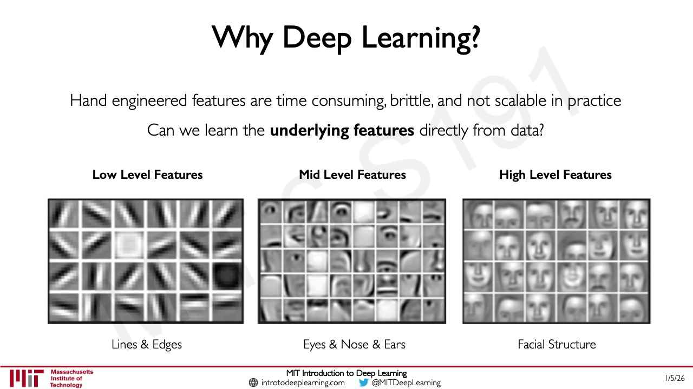

Hand engineered features are time consuming, brittle, and not scalable in practice

Can we learn the **underlying features** directly from data?

Three grayscale image grids side by side, each with a bold heading above and a caption below:
- "Low Level Features" — a grid of small oriented-stripe/edge filter patches (a few blob-like patches too); caption "Lines & Edges"
- "Mid Level Features" — a grid of patches showing parts of faces (eyes, noses, mouths, ears); caption "Eyes & Nose & Ears"
- "High Level Features" — a grid of whole-face images; caption "Facial Structure"

Illustrates a hierarchy of features learned from data, from edges to facial parts to faces.

*Figure: yes — three grids of learned features (edges, face parts, faces)*

## Slide 19 — Why Now?

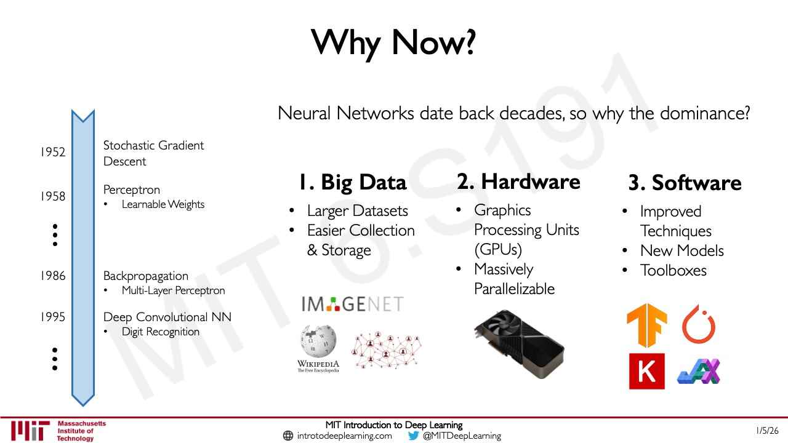

"Neural Networks date back decades, so why the dominance?"

Left: a vertical blue timeline arrow (pointing up) with entries:
- 1952 — Stochastic Gradient Descent
- 1958 — Perceptron; bullet: Learnable Weights
- (three vertical dots)
- 1986 — Backpropagation; bullet: Multi-Layer Perceptron
- 1995 — Deep Convolutional NN; bullet: Digit Recognition
- (three vertical dots)

Three columns:
- "1. Big Data": bullets "Larger Datasets", "Easier Collection & Storage". Logos below: IMAGENET, Wikipedia (The Free Encyclopedia) globe logo, and a red network-graph of connected people icons (social-network graphic).
- "2. Hardware": bullets "Graphics Processing Units (GPUs)", "Massively Parallelizable". Photo of a graphics card.
- "3. Software": bullets "Improved Techniques", "New Models", "Toolboxes". Logos: TensorFlow (orange), PyTorch (red), Keras (red square with white K), JAX (blue/purple).

*Figure: yes — history timeline plus three-reason columns with logos*

## Slide 20 — The Perceptron

The structural building block of deep learning

Section-divider: white text on a solid blue background.

*Figure: no*

## Slide 21 — The Perceptron: Forward Propagation

Diagram, left to right: three blue circles for inputs $x_1$, $x_2$, $x_m$ (vertical dots implied between $x_2$ and $x_m$) with blue arrows labelled $w_1$, $w_2$, $w_m$ into an orange circle containing $\Sigma$; a red arrow to a yellow circle containing a sigmoid-shaped curve; a yellow arrow to a purple circle containing $\hat{y}$. Column labels along the bottom: "Inputs", "Weights", "Sum", "Non-Linearity", "Output".

Right: the equation

$$\hat{y} = g\left(\sum_{i=1}^{m} x_i w_i\right)$$

with annotations: purple arrow from "Output" pointing at $\hat{y}$; red arrow from "Linear combination of inputs" pointing at the sum; yellow arrow from "Non-linear activation function" pointing at $g$.

*Figure: yes — single-perceptron diagram with equation annotations*

## Slide 22 — The Perceptron: Forward Propagation

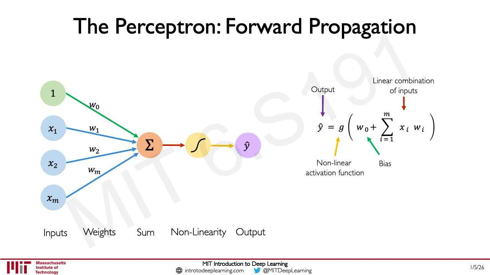

Build step: same as slide 21, adding a bias input. A green circle containing "1" is added above $x_1$, with a green arrow labelled $w_0$ into the $\Sigma$ node; the other inputs are $x_1$, $x_2$, $x_m$ with weights $w_1$, $w_2$, $w_m$. Column labels: "Inputs", "Weights", "Sum", "Non-Linearity", "Output".

Equation:

$$\hat{y} = g\left(w_0 + \sum_{i=1}^{m} x_i w_i\right)$$

Annotations: "Output" (purple arrow to $\hat{y}$), "Linear combination of inputs" (red arrow to the sum), "Non-linear activation function" (yellow arrow to $g$), "Bias" (green arrow to $w_0$).

*Figure: yes — perceptron diagram with bias input*

## Slide 23 — The Perceptron: Forward Propagation

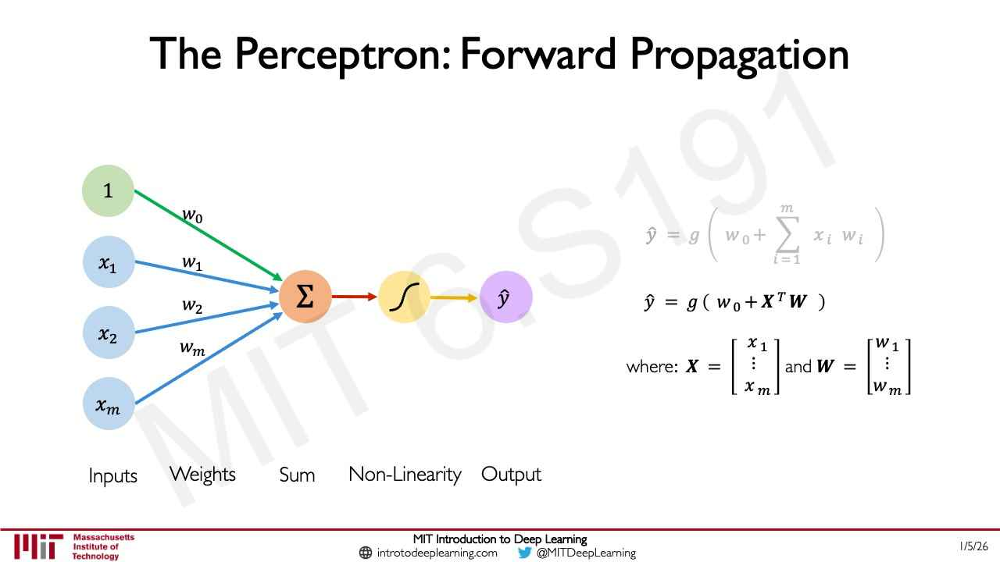

Build step: same diagram as slide 22 (bias input 1 with $w_0$; inputs $x_1$, $x_2$, $x_m$ with $w_1$, $w_2$, $w_m$; $\Sigma$, sigmoid, $\hat{y}$; labels Inputs, Weights, Sum, Non-Linearity, Output). The scalar equation from slide 22 is shown faded grey at top right:

$$\hat{y} = g\left(w_0 + \sum_{i=1}^{m} x_i w_i\right)$$

Below it, in full black, the vectorised form:

$$\hat{y} = g\left(w_0 + \boldsymbol{X}^T \boldsymbol{W}\right)$$

"where:" with column vectors

$$\boldsymbol{X} = \begin{bmatrix} x_1 \cr \vdots \cr x_m \end{bmatrix}$$

and

$$\boldsymbol{W} = \begin{bmatrix} w_1 \cr \vdots \cr w_m \end{bmatrix}$$

*Figure: yes — perceptron diagram with vectorised equation*

## Slide 24 — The Perceptron: Forward Propagation

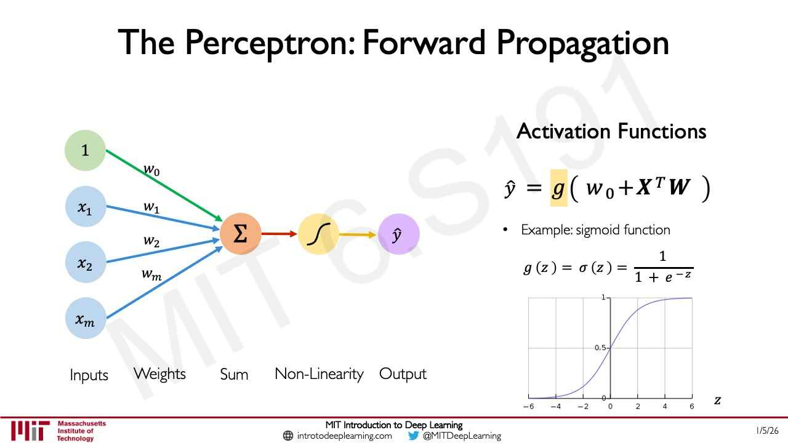

Same perceptron diagram as slide 22 on the left (bias input 1 with $w_0$; inputs $x_1$, $x_2$, $x_m$ with weights $w_1$, $w_2$, $w_m$; $\Sigma$; sigmoid; $\hat{y}$; labels Inputs, Weights, Sum, Non-Linearity, Output).

Right: heading "Activation Functions". Equation

$$\hat{y} = g\left(w_0 + \boldsymbol{X}^T \boldsymbol{W}\right)$$

with $g$ highlighted in a yellow box. Bullet: "Example: sigmoid function". Equation:

$$g(z) = \sigma(z) = \frac{1}{1+e^{-z}}$$

Below, a small plot of the sigmoid curve: x-axis labelled $z$ ticks -6, -4, -2, 0, 2, 4, 6; y-axis ticks 0, 0.5, 1; one purple/blue S-shaped curve rising from about 0 at z = -6 through 0.5 at z = 0 to about 1 at z = 6; gridlines.

*Figure: yes — perceptron diagram plus sigmoid plot*

## Slide 25 — Common Activation Functions

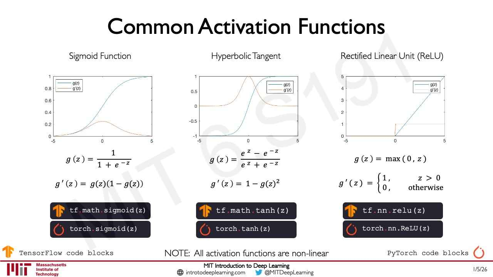

Three columns, each with a title, a plot, equations, and code blocks. Each plot has two series with legend "g(z)" (blue) and "g'(z)" (orange/red).

1. "Sigmoid Function". Plot: x from -5 to 5, y from 0 to 1.
   - g(z) blue: S-shaped curve from about 0 at -5 through 0.5 at 0 to about 1 at 5.
   - g'(z) orange: bell-shaped bump peaking at about 0.25 at z = 0, near 0 at the ends.

   $$g(z) = \frac{1}{1+e^{-z}}$$

   $$g'(z) = g(z)(1-g(z))$$

   Code blocks: TensorFlow icon `tf.math.sigmoid(z)`; PyTorch icon `torch.sigmoid(z)`.

2. "Hyperbolic Tangent". Plot: x from -5 to 5, y from -1 to 1.
   - g(z) blue: S-shaped from about -1 at -5 through 0 at 0 to about 1 at 5.
   - g'(z) orange: bell-shaped bump peaking at 1 at z = 0, about 0 at the ends.

   $$g(z) = \frac{e^{z}-e^{-z}}{e^{z}+e^{-z}}$$

   $$g'(z) = 1-g(z)^2$$

   Code blocks: `tf.math.tanh(z)`; `torch.tanh(z)`.

3. "Rectified Linear Unit (ReLU)". Plot: x from -5 to 5, y from 0 to 5.
   - g(z) blue: 0 for $z \lt 0$, then a straight line of slope 1 reaching 5 at z = 5.
   - g'(z) orange/grey: 0 for $z \lt 0$, then constant 1 for $z \gt 0$ (step at $z = 0$, drawn as a faint horizontal line at y = 1).

   $$g(z) = \max(0, z)$$

   $g'(z) = 1$ for $z \gt 0$ and $0$ otherwise (printed as a two-case brace: "1, z > 0" / "0, otherwise")

   Code blocks: `tf.nn.relu(z)`; `torch.nn.ReLU(z)`.

Bottom: "NOTE: All activation functions are non-linear". Bottom-left label with TensorFlow icon: "TensorFlow code blocks" (the upper dark code box in each column, with orange TF icon); bottom-right label with PyTorch icon: "PyTorch code blocks" (the lower box, with red PyTorch icon).

*Figure: yes — plots of sigmoid, tanh, ReLU and derivatives, with code snippets*

## Slide 26 — Importance of Activation Functions

*The purpose of activation functions is to **introduce non-linearities** into the network*

A scatter plot (axes: x from 0 to 1, y from 0.4 to 1, ticks every 0.1) of two classes of points: red points and green points. Green points form a large irregular blob in the centre; red points surround it (top arc, left side, bottom-right clusters and a red patch between green lobes). Caption below: "What if we wanted to build a neural network to distinguish green vs red points?"

*Figure: yes — scatter plot of red and green points with non-linear class boundary*

## Slide 27 — Importance of Activation Functions

*The purpose of activation functions is to **introduce non-linearities** into the network*

Build step: same scatter plot as slide 26, moved to the left, now with a thick blue straight diagonal line (from about (0.17, 0.4) to (0.75, 1)) as the decision boundary; the region to its upper-left is shaded light red and the lower-right shaded light green. Many points are on the wrong side (green points on the red side, red points in the green region). Caption: "Linear activation functions produce linear decisions no matter the network size"

*Figure: yes — scatter plot with linear decision boundary*

## Slide 28 — Importance of Activation Functions

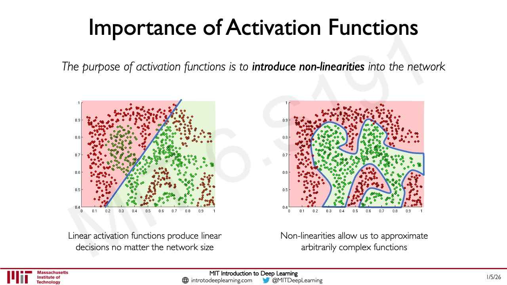

*The purpose of activation functions is to **introduce non-linearities** into the network*

Build step: same as slide 27 (left plot and caption retained), adding a second plot at right with the same scatter data and a thick blue curved, irregular closed decision boundary enclosing the green points; the interior is shaded light green and the exterior light red; the boundary follows the lobes and indentations of the green cluster, separating the classes. Caption under the right plot: "Non-linearities allow us to approximate arbitrarily complex functions"

*Figure: yes — side-by-side linear vs non-linear decision boundaries*

## Slide 29 — The Perceptron: Example

Diagram: green circle "1" with green arrow labelled 1; blue circle $x_1$ with arrow labelled 3; blue circle $x_2$ with arrow labelled $-2$; all into $\Sigma$, then sigmoid, then $\hat{y}$.

Right text: "We have: $w_0 = 1$ and $\boldsymbol{W} = [3, -2]^T$" (the slide writes $\boldsymbol{W}$ as a column vector)

$$\hat{y} = g\left(w_0 + \boldsymbol{X}^T \boldsymbol{W}\right)$$

$$= g\left(1 + \begin{bmatrix} x_1 \cr x_2 \end{bmatrix}^T \begin{bmatrix} 3 \cr -2 \end{bmatrix}\right)$$

$$\hat{y} = g(1 + 3x_1 - 2x_2)$$

A blue curly brace under $1 + 3x_1 - 2x_2$ labelled "This is just a line in 2D!"

*Figure: yes — worked perceptron example with weights 1, 3, -2*

## Slide 30 — The Perceptron: Example

Left: the perceptron diagram from slide 29 (bias 1 with weight 1; $x_1$ with weight 3; $x_2$ with weight $-2$; $\Sigma$; sigmoid; $\hat{y}$).

Right: equation at top

$$\hat{y} = g(1 + 3x_1 - 2x_2)$$

Below it, a 2D coordinate plane with horizontal axis $x_1$ and vertical axis $x_2$ (tick marks, no numbers). A thick blue dashed line with arrowheads at both ends runs from lower left to upper right, crossing the $x_2$ axis slightly above the origin, labelled along the line $1 + 3x_1 - 2x_2 = 0$.

Build step: slides 29 → 30 replaces the right-hand equation text with this plot.

*Figure: yes — perceptron diagram plus decision line plot*

## Slide 31 — The Perceptron: Example

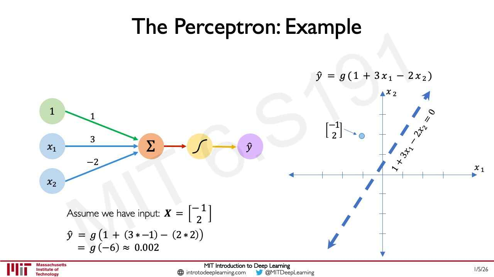

Build step: same as slide 30, adding an example input. A light-blue dot is plotted in the upper-left quadrant of the plane (left of the $x_2$ axis, above the $x_1$ axis), labelled via an arrow with the column vector $[-1, 2]^T$ (drawn as a column). Under the network diagram, text:

"Assume we have input: $\boldsymbol{X} = [-1, 2]^T$" (a column vector on the slide)

$$\hat{y} = g(1 + (3 \ast -1) - (2 \ast 2))$$

$$= g(-6) \approx 0.002$$

The decision line label and top equation $\hat{y} = g(1 + 3x_1 - 2x_2)$ remain.

*Figure: yes — perceptron with example input point and calculation*

## Slide 32 — The Perceptron: Example

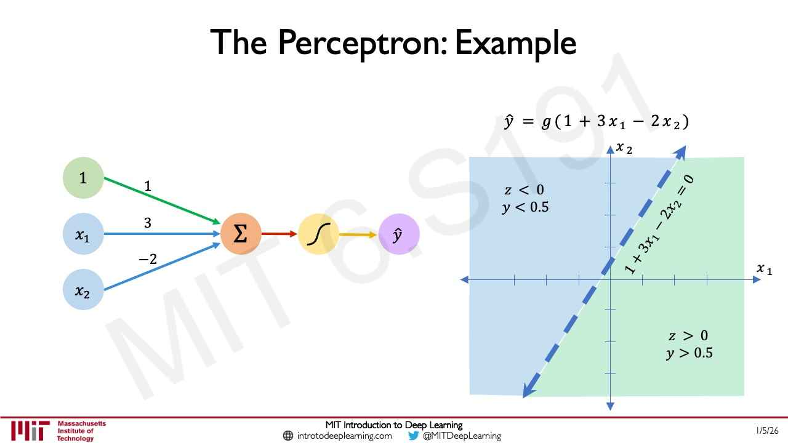

Build step: same as slide 30 (the example point and calculation are removed), now with the plane shaded on both sides of the dashed line $1 + 3x_1 - 2x_2 = 0$: the left/upper side is shaded light blue with text $z \lt 0$ and $y \lt 0.5$; the right/lower side is shaded light green with text $z \gt 0$ and $y \gt 0.5$. Network diagram and top equation $\hat{y} = g(1 + 3x_1 - 2x_2)$ unchanged.

*Figure: yes — decision line with shaded half-planes*

## Slide 33 — Building Neural Networks with Perceptrons

Section-divider: white text on a solid blue background.

*Figure: no*

## Slide 34 — The Perceptron: Simplified

$$\hat{y} = g\left(w_0 + \boldsymbol{X}^T \boldsymbol{W}\right)$$

Centred diagram: green circle "1" with green arrow $w_0$; blue circles $x_1$, $x_2$, $x_m$ with blue arrows $w_1$, $w_2$, $w_m$; all into orange $\Sigma$; red arrow to yellow sigmoid circle; yellow arrow to purple $\hat{y}$. Labels: Inputs, Weights, Sum, Non-Linearity, Output.

*Figure: yes — perceptron diagram*

## Slide 35 — The Perceptron: Simplified

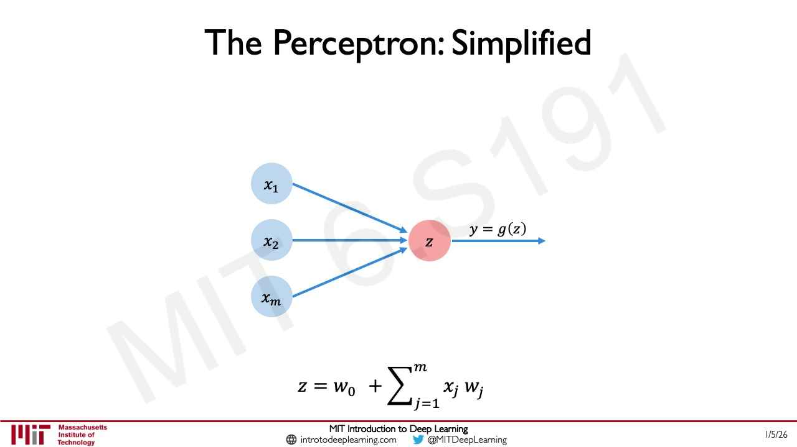

Simplified diagram: blue circles $x_1$, $x_2$, $x_m$ with blue arrows into a single pink/red circle labelled $z$; from $z$ a blue arrow to the right labelled $y = g(z)$. Beneath:

$$z = w_0 + \sum_{j=1}^{m} x_j w_j$$

Build step: bias, weights, and non-linearity circles from slide 34 are collapsed into the single node $z$.

*Figure: yes — simplified perceptron diagram*

## Slide 36 — Multi Output Perceptron

Because all inputs are densely connected to all outputs, these layers are called **Dense** layers

Diagram: three blue input circles $x_1$, $x_2$, $x_m$; two pink output circles $z_1$ and $z_2$; every input has a blue arrow to both $z_1$ and $z_2$ (fully connected). Output arrows to the right labelled $y_1 = g(z_1)$ and $y_2 = g(z_2)$.

$$z_i = w_{0,i} + \sum_{j=1}^{m} x_j w_{j,i}$$

(In the equation the subscript $i$ occurrences, i.e. $z_i$, $w_{0,i}$, $w_{j,i}$, are highlighted in yellow.)

*Figure: yes — multi-output dense layer diagram*


## Slide 37 — Dense layer from scratch

Dark-background slide. A TensorFlow logo (orange) sits top-left and a PyTorch logo (red-orange flame) top-right. Two code listings side by side; the left (TensorFlow) is dimmed/greyed out and the right (PyTorch) is bright and highlighted.

Left (TensorFlow, dimmed):

```python
class MyDenseLayer(tf.keras.layers.Layer):
  def __init__(self, input_dim, output_dim):
    super(MyDenseLayer, self).__init__()

    # Initialize weights and bias
    self.W = self.add_weight([input_dim, output_dim])
    self.b = self.add_weight([1, output_dim])

  def call(self, inputs):
    # Forward propagate the inputs
    z = tf.matmul(inputs, self.W) + self.b

    # Feed through a non-linear activation
    output = tf.math.sigmoid(z)
    return output
```

Right (PyTorch, highlighted):

```python
class MyDenseLayer(nn.Module):
  def __init__(self, input_dim, output_dim):
    super(MyDenseLayer, self).__init__()

    # Initialize weights and bias
    self.W = nn.Parameter(torch.randn(input_dim,
        output_dim, requires_grad=True)
    self.b = nn.Parameter(torch.randn(1, output_dim,
        requires_grad=True)

  def forward(self, inputs):
    # Forward propagate the inputs
    z = torch.matmul(inputs, self.W) + self.b

    # Feed through a non-linear activation
    output = torch.sigmoid(z)
    return output
```

On the PyTorch side, green rounded rectangles outline the "Initialize weights and bias" block and the "Forward propagate the inputs" block (the same two blocks are faintly outlined on the dimmed TensorFlow side).

*Figure: yes — side-by-side TensorFlow and PyTorch code for a dense layer, PyTorch side emphasised*

## Slide 38 — Multi Output Perceptron

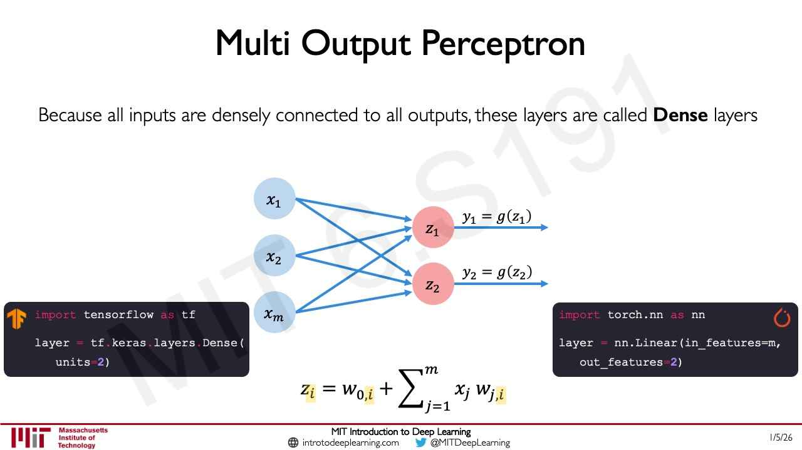

Because all inputs are densely connected to all outputs, these layers are called **Dense** layers

Diagram: three light-blue input nodes $x_1$, $x_2$, $x_m$ at left; two pink/red output nodes $z_1$, $z_2$ at right. Every input is connected by a blue arrow to both $z_1$ and $z_2$ (6 arrows, fully connected). From $z_1$ an arrow exits right labelled $y_1 = g(z_1)$; from $z_2$ an arrow exits right labelled $y_2 = g(z_2)$.

Below: $$z_i = w_{0,i} + \sum_{j=1}^{m} x_j \thinspace w_{j,i}$$ with the subscript $i$ highlighted in yellow in $z_i$, $w_{0,i}$ and $w_{j,i}$.

Code boxes (dark, bottom corners; TensorFlow logo at left, PyTorch logo at right):

Left (TensorFlow):
```python
import tensorflow as tf

layer = tf.keras.layers.Dense(
   units=2)
```

Right (PyTorch):
```python
import torch.nn as nn

layer = nn.Linear(in_features=m,
   out_features=2)
```

Build step: same as the previous Multi Output Perceptron slide (slide 36), adding the TensorFlow and PyTorch code snippets.

*Figure: yes — fully connected multi-output perceptron diagram with Keras and PyTorch code*

## Slide 39 — Single Layer Neural Network

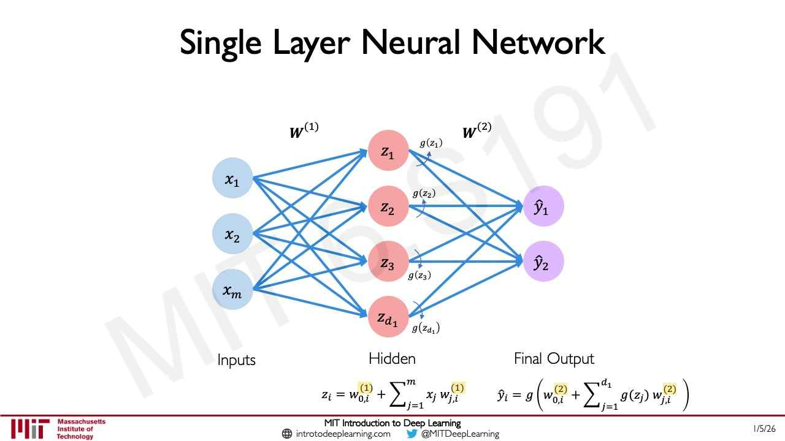

Diagram of a network with three layers of nodes. Inputs (light blue): $x_1$, $x_2$, $x_m$. Hidden (pink/red): $z_1$, $z_2$, $z_3$, $z_{d_1}$ (four nodes). Final Output (purple): $\hat{y}_ 1$, $\hat{y}_ 2$. Every input node is connected by a blue arrow to every hidden node (12 arrows), labelled above as $\boldsymbol{W}^{(1)}$; every hidden node is connected to both output nodes (8 arrows), labelled above as $\boldsymbol{W}^{(2)}$. Small curved arrows at each hidden node carry labels $g(z_1)$, $g(z_2)$, $g(z_3)$, $g(z_{d_1})$ (activation applied to each hidden value). Column labels beneath: "Inputs", "Hidden", "Final Output".

Equations under the hidden and output columns (superscripts $(1)$ and $(2)$ highlighted in yellow):

$$z_i = w_{0,i}^{(1)} + \sum_{j=1}^{m} x_j \thinspace w_{j,i}^{(1)}$$

$$\hat{y}_ i = g\left(w_{0,i}^{(2)} + \sum_{j=1}^{d_1} g(z_j) \thinspace w_{j,i}^{(2)}\right)$$

*Figure: yes — single-hidden-layer neural network diagram (3 inputs, 4 hidden, 2 outputs) with equations*

## Slide 40 — Single Layer Neural Network

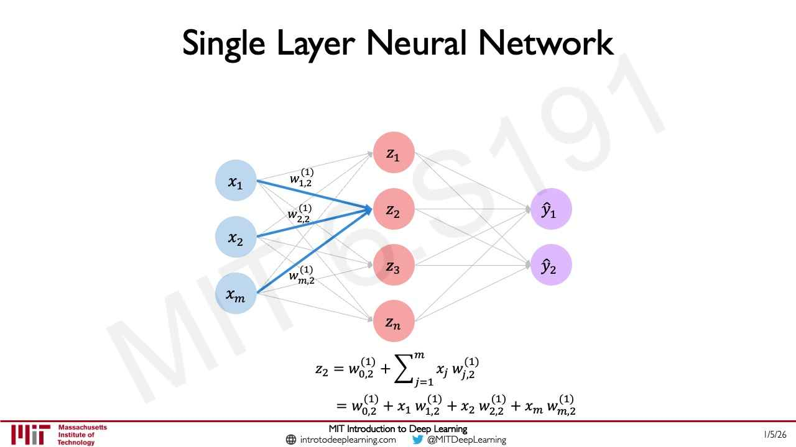

Same network, but now the hidden layer is labelled $z_1$, $z_2$, $z_3$, $z_n$ (last node is $z_n$ rather than $z_{d_1}$). Most connections are faded to light grey; only the three arrows from $x_1$, $x_2$, $x_m$ into $z_2$ are drawn bold blue, labelled $w_{1,2}^{(1)}$, $w_{2,2}^{(1)}$, $w_{m,2}^{(1)}$ respectively. The $W^{(1)}$ and $W^{(2)}$ labels, column labels and $g(z)$ labels are removed.

Equations at the bottom:

$$z_2 = w_{0,2}^{(1)} + \sum_{j=1}^{m} x_j \thinspace w_{j,2}^{(1)}$$

$$= w_{0,2}^{(1)} + x_1 \thinspace w_{1,2}^{(1)} + x_2 \thinspace w_{2,2}^{(1)} + x_m \thinspace w_{m,2}^{(1)}$$

Build step: same network as slide 39, highlighting the connections into hidden node $z_2$ and expanding its equation.

*Figure: yes — single-layer network with the weights into* $z_2$ *highlighted*

## Slide 41 — Multi Output Perceptron

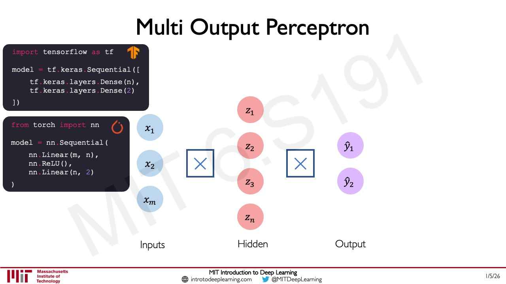

Abstracted network diagram with column labels "Inputs", "Hidden", "Output". Inputs: light-blue nodes $x_1$, $x_2$, $x_m$. Hidden: four pink nodes $z_1$, $z_2$, $z_3$, $z_n$. Output: two purple nodes $\hat{y}_ 1$, $\hat{y}_ 2$. No individual arrows are drawn; instead a blue-outlined square containing a blue "×" sits between Inputs and Hidden, and another between Hidden and Output (each representing a dense layer / weight multiplication).

Two code boxes at upper left (the TensorFlow one at top, the PyTorch one below, partly overlapping the input nodes):

TensorFlow (logo at box right):
```python
import tensorflow as tf

model = tf.keras.Sequential([

    tf.keras.layers.Dense(n),
    tf.keras.layers.Dense(2)
])
```

PyTorch (logo at box right):
```python
from torch import nn

model = nn.Sequential(

    nn.Linear(m, n),
    nn.ReLU(),
    nn.Linear(n, 2)
)
```

*Figure: yes — compact input/hidden/output network with dense-layer boxes and Keras and PyTorch Sequential code*

## Slide 42 — Deep Neural Network

Diagram with column labels "Inputs", "Hidden", "Output". Inputs: $x_1$, $x_2$, $x_m$ (blue). Then a blue-outlined box with "×", then "…", then another "×" box; then the hidden column of four pink nodes $z_{k,1}$, $z_{k,2}$, $z_{k,3}$, $z_{k,n_k}$; then "×" box, "…", "×" box; then output nodes $\hat{y}_ 1$, $\hat{y}_ 2$ (purple). The ellipses represent many stacked layers.

Equation at bottom:

$$z_{k,i} = w_{0,i}^{(k)} + \sum_{j=1}^{n_{k-1}} g(z_{k-1,j}) \thinspace w_{j,i}^{(k)}$$

*Figure: yes — deep network schematic with hidden layer* $k$ *and its equation*

## Slide 43 — Deep Neural Network

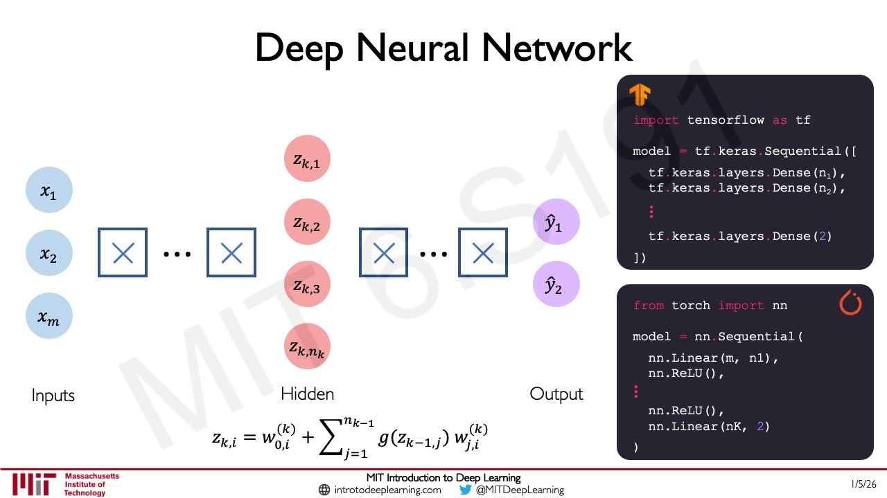

Same deep network diagram as slide 42 (shifted left and scaled slightly): Inputs $x_1$, $x_2$, $x_m$; "×" box, "…", "×" box; hidden nodes $z_{k,1}$, $z_{k,2}$, $z_{k,3}$, $z_{k,n_k}$; "×" box, "…", "×" box; outputs $\hat{y}_ 1$, $\hat{y}_ 2$; labels "Inputs", "Hidden", "Output"; same equation:

$$z_{k,i} = w_{0,i}^{(k)} + \sum_{j=1}^{n_{k-1}} g(z_{k-1,j}) \thinspace w_{j,i}^{(k)}$$

Two code boxes at the right.

TensorFlow (logo top-left of box):
```python
import tensorflow as tf

model = tf.keras.Sequential([

  tf.keras.layers.Dense(n_1),
  tf.keras.layers.Dense(n_2),

  ⋮

  tf.keras.layers.Dense(2)
])
```
(The subscripts are written $n_1$ and $n_2$; the vertical ellipsis "⋮" is drawn in pink.)

PyTorch (logo top-right of box):
```python
from torch import nn

model = nn.Sequential(

  nn.Linear(m, n1),
  nn.ReLU(),

  ⋮

  nn.ReLU(),
  nn.Linear(nK, 2)
)
```

Build step: same as slide 42, shifted left and adding the Keras and PyTorch deep-network code.

*Figure: yes — deep network schematic with Keras and PyTorch Sequential code*

## Slide 44 — [Section divider] Applying Neural Networks

White text "Applying Neural Networks" centred on a solid blue background.

*Figure: no*

## Slide 45 — Example Problem

Will I pass this class?

Let's start with a simple two feature model

$x_1$ = Number of lectures you attend

$x_2$ = Hours spent on the final project

*Figure: no*

## Slide 46 — Example Problem: Will I pass this class?

Scatter plot with two blue arrow axes (no tick marks or numbers). Vertical axis label (top-left): $x_2$ = "Hours spent on the final project". Horizontal axis label (bottom): $x_1$ = "Number of lectures you attend". Legend box at right: "Legend", green dot = "Pass", red dot = "Fail".

Data: 10 points. 7 green (Pass), scattered in the upper and right regions of the plot (roughly: top-left-centre, upper-centre, upper-right, centre-left, right-middle, and two near the bottom-right). 3 red (Fail), clustered at the lower left near the origin.

*Figure: yes — 2D scatter of pass (green) vs fail (red) students by lectures attended and project hours*

## Slide 47 — Example Problem: Will I pass this class?

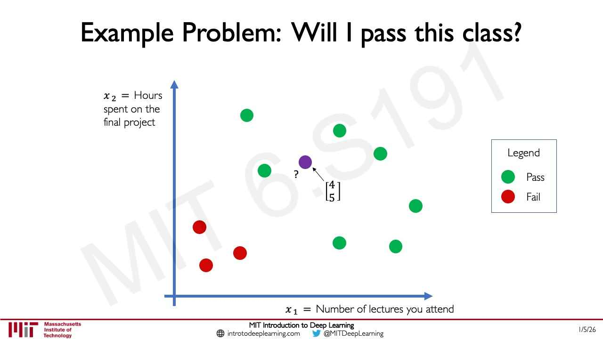

Same scatter plot as slide 46 (axes: $x_1$ = Number of lectures you attend, horizontal; $x_2$ = Hours spent on the final project, vertical; legend green = Pass, red = Fail; 7 green points, 3 red points near the origin). A new purple point is added in the middle of the plot, near the green points, with a "?" to its lower left and a small arrow pointing to it from the column vector $[4, 5]^T$ (drawn as a column).

Build step: same as slide 46, adding the unknown purple point labelled "?" and its coordinates $[4, 5]$ as a column vector.

*Figure: yes — pass/fail scatter plot with an unlabelled query point at (4, 5)*

## Slide 48 — Example Problem: Will I pass this class?

Network diagram, left to right: text $x^{(1)} = [4 \thinspace , 5]$ with two black elbow arrows from the "4" to node $x_1$ and from the "5" to node $x_2$. Input nodes $x_1$, $x_2$ (blue); hidden nodes $z_1$, $z_2$, $z_3$ (pink), each input connected to each hidden node by blue arrows (6 arrows); the three hidden nodes each connect by a blue arrow to a single purple output node $\hat{y}_ 1$. To the right: "Predicted: 0.1".

*Figure: yes — 2-3-1 network applied to input* $x^{(1)} = [4, 5]$ *with predicted 0.1*

## Slide 49 — Example Problem: Will I pass this class?

Same network as slide 48. The right-hand text is now in a salmon/red box: "Predicted: 0.1" and "Actual: 1".

Build step: same as slide 48, adding "Actual: 1" and putting the prediction box on a red background.

*Figure: yes — same 2-3-1 network with predicted 0.1 vs actual 1 in a red box*

## Slide 50 — Quantifying Loss

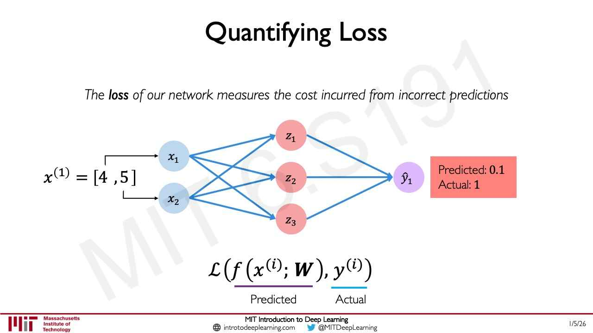

*The **loss** of our network measures the cost incurred from incorrect predictions*

Same network and red "Predicted: 0.1 / Actual: 1" box as slide 49, with input $x^{(1)} = [4 \thinspace , 5]$. Below:

$$\mathcal{L}\left(f\left(x^{(i)}; \boldsymbol{W}\right), y^{(i)}\right)$$

A purple underline beneath $f(x^{(i)}; \boldsymbol{W})$ is labelled "Predicted"; a light-blue underline beneath $y^{(i)}$ is labelled "Actual".

*Figure: yes — network with predicted/actual box and the loss function expression with Predicted/Actual underlines*

## Slide 51 — Empirical Loss

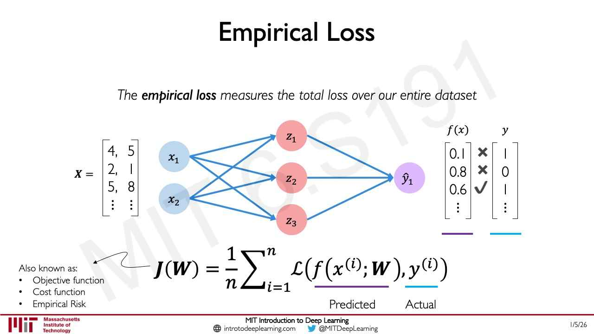

*The **empirical loss** measures the total loss over our entire dataset*

Left: the data matrix

$$\boldsymbol{X} = \begin{bmatrix} 4, & 5 \cr 2, & 1 \cr 5, & 8 \cr \vdots & \vdots \end{bmatrix}$$

Middle: the same 2-3-1 network (inputs $x_1$, $x_2$; hidden $z_1$, $z_2$, $z_3$; output $\hat{y}_ 1$) without the input vector text. Right: two column vectors headed $f(x)$ and $y$: $f(x)$ = (0.1, 0.8, 0.6, ⋮) with a purple underline; $y$ = (1, 0, 1, ⋮) with a light-blue underline. Between them, per-row marks: a cross for row 1 (0.1 vs 1), a cross for row 2 (0.8 vs 0), a check mark for row 3 (0.6 vs 1).

Bottom:

$$\boldsymbol{J}(\boldsymbol{W}) = \frac{1}{n} \sum_{i=1}^{n} \mathcal{L}\left(f\left(x^{(i)}; \boldsymbol{W}\right), y^{(i)}\right)$$

with a purple underline labelled "Predicted" under $f(x^{(i)}; \boldsymbol{W})$ and a light-blue underline labelled "Actual" under $y^{(i)}$. At lower left, a curved arrow from $\boldsymbol{J}(\boldsymbol{W})$ points to the text "Also known as:" with bullets:
- Objective function
- Cost function
- Empirical Risk

*Figure: yes — dataset matrix, network, prediction/label vectors and the empirical loss formula*

## Slide 52 — Binary Cross Entropy Loss

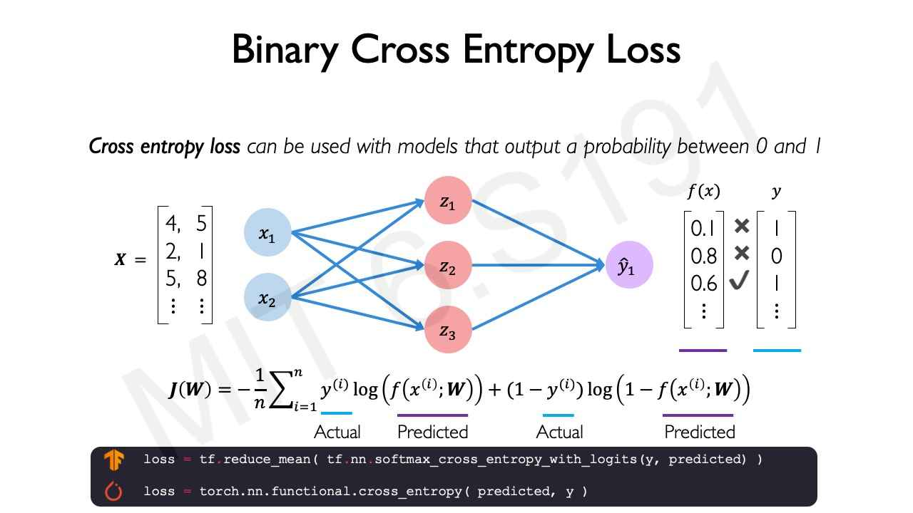

*Cross entropy loss can be used with models that output a probability between 0 and 1* (the words "Cross entropy loss" are bold italic)

Same layout as slide 51: matrix $\boldsymbol{X}$ (rows 4,5 / 2,1 / 5,8 / ⋮), 2-3-1 network, and the $f(x)$ = (0.1, 0.8, 0.6, ⋮) and $y$ = (1, 0, 1, ⋮) vectors with cross, cross, check marks.

Formula:

$$\boldsymbol{J}(\boldsymbol{W}) = -\frac{1}{n} \sum_{i=1}^{n} y^{(i)} \log\left(f\left(x^{(i)}; \boldsymbol{W}\right)\right) + \left(1 - y^{(i)}\right) \log\left(1 - f\left(x^{(i)}; \boldsymbol{W}\right)\right)$$

Underlines and labels, left to right: light-blue "Actual" under $y^{(i)}$ (first term); purple "Predicted" under $f(x^{(i)}; \boldsymbol{W})$ (first term); light-blue "Actual" under $y^{(i)}$ (second term); purple "Predicted" under $f(x^{(i)}; \boldsymbol{W})$ (second term).

Code box at bottom (TensorFlow logo and PyTorch logo at left):

```python
loss = tf.reduce_mean( tf.nn.softmax_cross_entropy_with_logits(y, predicted) )
```
```python
loss = torch.nn.functional.cross_entropy( predicted, y )
```

*Figure: yes — network, data, binary cross entropy formula and TensorFlow/PyTorch loss code*

## Slide 53 — Mean Squared Error Loss

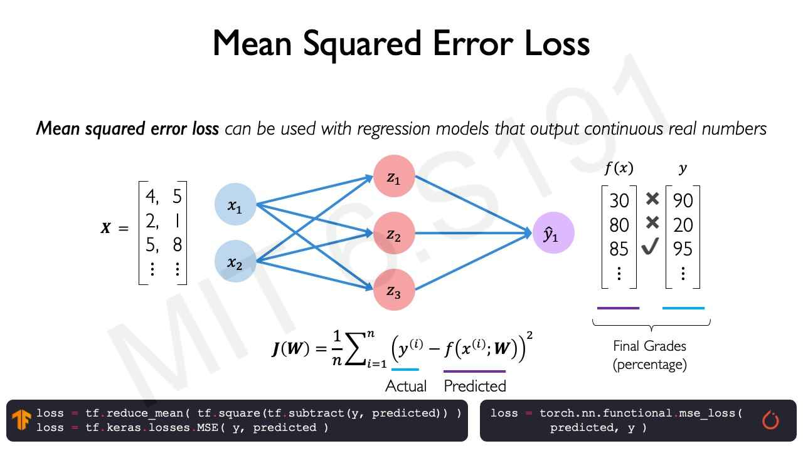

*Mean squared error loss can be used with regression models that output continuous real numbers* (the words "Mean squared error loss" are bold italic)

Same layout as slide 52: data matrix $\boldsymbol{X}$ (rows 4,5 / 2,1 / 5,8 / ⋮) at left, 2-3-1 network (inputs $x_1$, $x_2$; hidden $z_1$, $z_2$, $z_3$; output $\hat{y}_ 1$) in the middle, and at right two column vectors headed $f(x)$ and $y$: $f(x)$ = (30, 80, 85, ⋮) with purple underline; $y$ = (90, 20, 95, ⋮) with light-blue underline; row marks cross, cross, check. A curly brace under both vectors is labelled "Final Grades (percentage)".

Formula:

$$\boldsymbol{J}(\boldsymbol{W}) = \frac{1}{n} \sum_{i=1}^{n} \left(y^{(i)} - f\left(x^{(i)}; \boldsymbol{W}\right)\right)^2$$

with a light-blue underline labelled "Actual" under $y^{(i)}$ and a purple underline labelled "Predicted" under $f(x^{(i)}; \boldsymbol{W})$.

Two code boxes at the bottom. Left (TensorFlow logo):
```python
loss = tf.reduce_mean( tf.square(tf.subtract(y, predicted)) )
loss = tf.keras.losses.MSE( y, predicted )
```
Right (PyTorch logo):
```python
loss = torch.nn.functional.mse_loss(
        predicted, y )
```

*Figure: yes — network, data, regression outputs, MSE formula and TensorFlow/PyTorch code*

## Slide 54 — [Section divider] Training Neural Networks

White text "Training Neural Networks" centred on a solid blue background.

*Figure: no*

## Slide 55 — Loss Optimization

*We want to find the network weights that **achieve the lowest loss*** ("achieve the lowest loss" is bold italic)

$$\boldsymbol{W}^{\ast} = \underset{\boldsymbol{W}}{\mathrm{argmin}} \frac{1}{n} \sum_{i=1}^{n} \mathcal{L}\left(f\left(x^{(i)}; \boldsymbol{W}\right), y^{(i)}\right)$$

$$\boldsymbol{W}^{\ast} = \underset{\boldsymbol{W}}{\mathrm{argmin}} J(\boldsymbol{W})$$

*Figure: no*

## Slide 56 — Loss Optimization

*We want to find the network weights that **achieve the lowest loss***

$$\boldsymbol{W}^{\ast} = \underset{\boldsymbol{W}}{\mathrm{argmin}} \frac{1}{n} \sum_{i=1}^{n} \mathcal{L}\left(f\left(x^{(i)}; \boldsymbol{W}\right), y^{(i)}\right)$$

$$\boldsymbol{W}^{\ast} = \underset{\boldsymbol{W}}{\mathrm{argmin}} J(\boldsymbol{W})$$

A small black arrow points up from a text box to $J(\boldsymbol{W})$. Text box: "Remember:" and

$$\boldsymbol{W} = \lbrace \boldsymbol{W}^{(0)}, \boldsymbol{W}^{(1)}, \cdots \rbrace$$

Build step: same as slide 55, adding the "Remember" annotation that $\boldsymbol{W}$ is the set of all layer weight matrices.

*Figure: no*

## Slide 57 — Loss Optimization

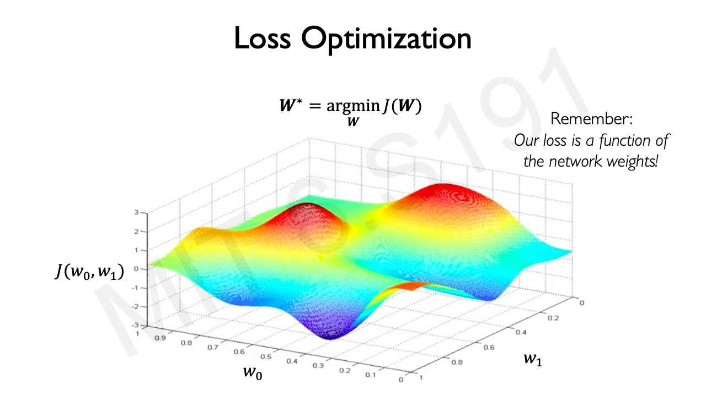

Above the plot: $\boldsymbol{W}^{\ast} = \underset{\boldsymbol{W}}{\mathrm{argmin}} J(\boldsymbol{W})$, and at right "Remember: *Our loss is a function of the network weights!*"

Figure: a 3D surface plot of a loss landscape, rainbow (jet) colormap. Vertical axis labelled $J(w_0, w_1)$ with ticks from -3 to 3; the two horizontal axes are $w_0$ (front-left axis, ticks about 0.1 to 0.9, ranging 0 to 1) and $w_1$ (right axis, ticks 0 to 1 in steps of 0.2). The surface has several hills and valleys: two red peaks (high loss, one at the left-centre top and a larger one at the upper right), a deep purple valley (lowest loss) near the front centre, and cyan/blue-green flat regions at the left and right edges.

*Figure: yes — 3D loss surface* $J(w_0, w_1)$ *with multiple peaks and valleys*

## Slide 58 — Loss Optimization

Text above the plot: "Randomly pick an initial $(w_0, w_1)$"

Same 3D loss-surface plot as slide 57 (axes $J(w_0, w_1)$, $w_0$, $w_1$, rainbow surface). A black "+" marker sits on the red peak at the left-centre of the surface (high loss), marking the randomly chosen initial point. The title equation and "Remember" note are removed.

Build step: same surface as slide 57, adding a black "+" at the initial point on the left red hill.

*Figure: yes — 3D loss surface with initial point marked*

## Slide 59 — Loss Optimization

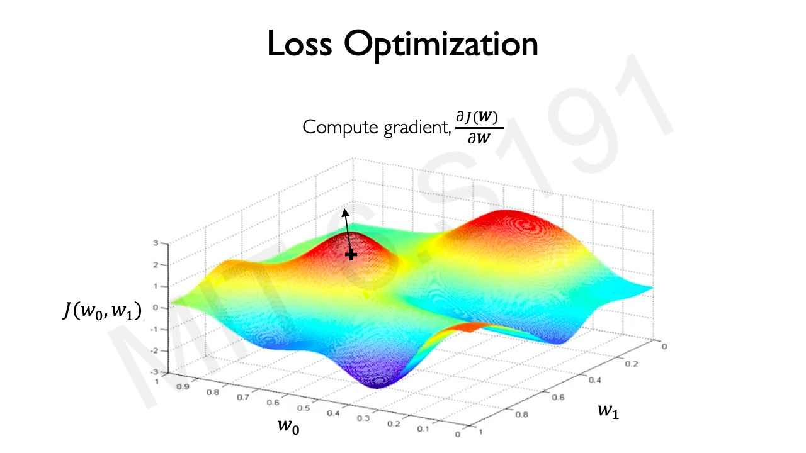

Text above the plot: "Compute gradient, $\frac{\partial J(\boldsymbol{W})}{\partial \boldsymbol{W}}$"

Same 3D loss surface as slides 57 and 58 (axes $J(w_0, w_1)$, $w_0$, $w_1$; rainbow surface). The black "+" initial point is on the left red hill, and a short black arrow starts at it and points upward (direction of the gradient, increasing loss).

Build step: same as slide 58, adding an upward arrow from the point (the gradient).

*Figure: yes — 3D loss surface with gradient arrow at the initial point*

## Slide 60 — Loss Optimization

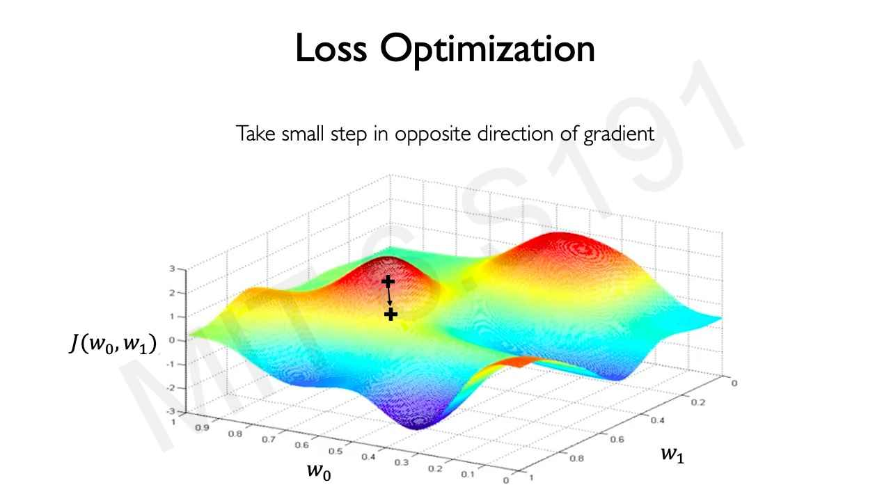

Text above the plot: "Take small step in opposite direction of gradient"

Same 3D loss surface. Two black "+" markers: the original one on the red hill and a second one slightly lower down the slope, joined by a short black arrow pointing from the first to the second (downhill).

Build step: same as slide 59, replacing the gradient arrow with a small downhill step to a second "+" point.

*Figure: yes — 3D loss surface showing one gradient descent step*

## Slide 61 — Gradient Descent

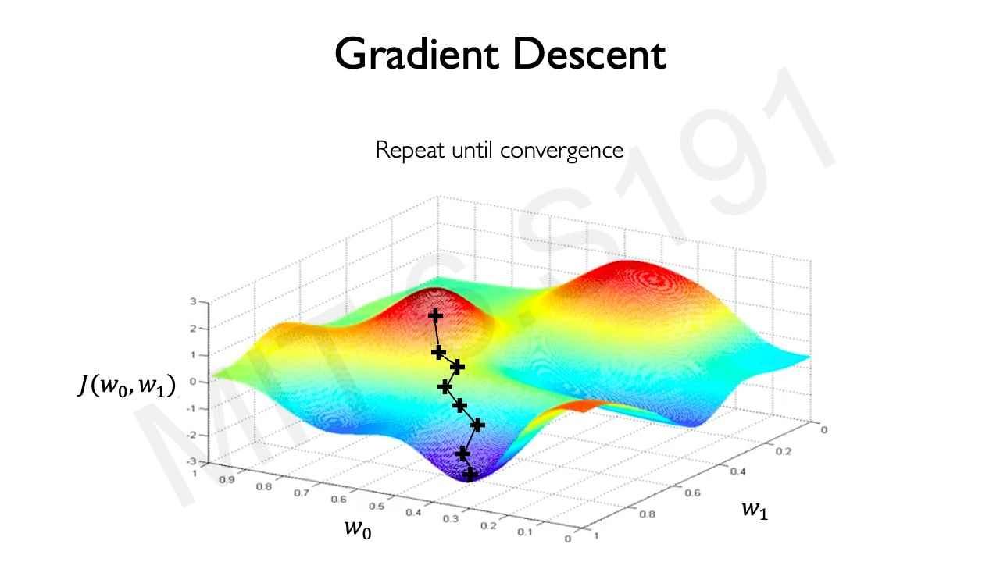

Text above the plot: "Repeat until convergence"

Same 3D loss surface. A black polyline with 8 black "+" markers starts at the left red hill and zig-zags steadily downhill through the yellow, green and cyan regions to the deep purple valley (global minimum) at the front centre of the surface.

Build step: same as slide 60, continuing the steps until the path reaches the minimum.

*Figure: yes — 3D loss surface with full gradient descent trajectory to the minimum*

## Slide 62 — Gradient Descent

**Algorithm**
1. Initialize weights randomly $\sim \mathcal{N}(0, \sigma^2)$
2. Loop until convergence:
3. Compute gradient, $\frac{\partial J(\boldsymbol{W})}{\partial \boldsymbol{W}}$ (indented under step 2)
4. Update weights, $\boldsymbol{W} \leftarrow \boldsymbol{W} - \eta \frac{\partial J(\boldsymbol{W})}{\partial \boldsymbol{W}}$ (indented under step 2)
5. Return weights

*Figure: no*

## Slide 63 — Gradient Descent

The slide is split: left half white with the algorithm, right half dark with TensorFlow code (TensorFlow logo top-right).

Left (same as slide 62):

**Algorithm**
1. Initialize weights randomly $\sim \mathcal{N}(0, \sigma^2)$
2. Loop until convergence:
3. Compute gradient, $\frac{\partial J(\boldsymbol{W})}{\partial \boldsymbol{W}}$
4. Update weights, $\boldsymbol{W} \leftarrow \boldsymbol{W} - \eta \frac{\partial J(\boldsymbol{W})}{\partial \boldsymbol{W}}$
5. Return weights

Right:
```python
import tensorflow as tf

weights = tf.Variable([tf.random.normal()])

while True:   # loop forever
   with tf.GradientTape() as g:
      loss = compute_loss(weights)
      gradient = g.gradient(loss, weights)

   weights = weights - lr * gradient
```

Build step: same as slide 62, shrunk into the left half with TensorFlow code added on the right.

*Figure: yes — algorithm next to TensorFlow gradient descent code*

## Slide 64 — Gradient Descent

Same as slide 63 (algorithm on the left, TensorFlow code on the right), except that step 3's $\frac{\partial J(\boldsymbol{W})}{\partial \boldsymbol{W}}$ is highlighted with a yellow/gold rounded box and the code line `gradient = g.gradient(loss, weights)` is highlighted with a matching gold box, linking the gradient step to its code.

Build step: same as slide 63, adding the gold highlights on the gradient computation (math and code).

*Figure: yes — algorithm next to TensorFlow code with gradient step highlighted*

## Slide 65 — Computing Gradients: Backpropagation

Chain diagram, left to right: light-blue node $x$, blue arrow labelled $w_1$ to pink node $z_1$, blue arrow labelled $w_2$ (inside a yellow highlight box) to purple node $\hat{y}$, blue arrow to the text $J(\boldsymbol{W})$.

Caption (italic on the slide): How does a small change in one weight (ex. $\boldsymbol{w_2}$) affect the final loss $\boldsymbol{J(W)}$?

*Figure: yes — one-neuron-per-layer chain* $x \to z_1 \to \hat{y} \to J(\boldsymbol{W})$ *with weights* $w_1$, $w_2$

## Slide 66 — Computing Gradients: Backpropagation

Same chain diagram as slide 65 ($w_2$ highlighted yellow). The caption is replaced by the equation

$$\frac{\partial J(\boldsymbol{W})}{\partial w_2} =$$

with the $w_2$ in the denominator highlighted in yellow. A thin blue arrow from the text "Let's use the chain rule!" points to that highlighted $w_2$.

Build step: same as slide 65, replacing the caption with the start of the derivative and the note "Let's use the chain rule!".

*Figure: yes — chain diagram with the derivative* $\partial J / \partial w_2$ *being set up*

## Slide 67 — Computing Gradients: Backpropagation

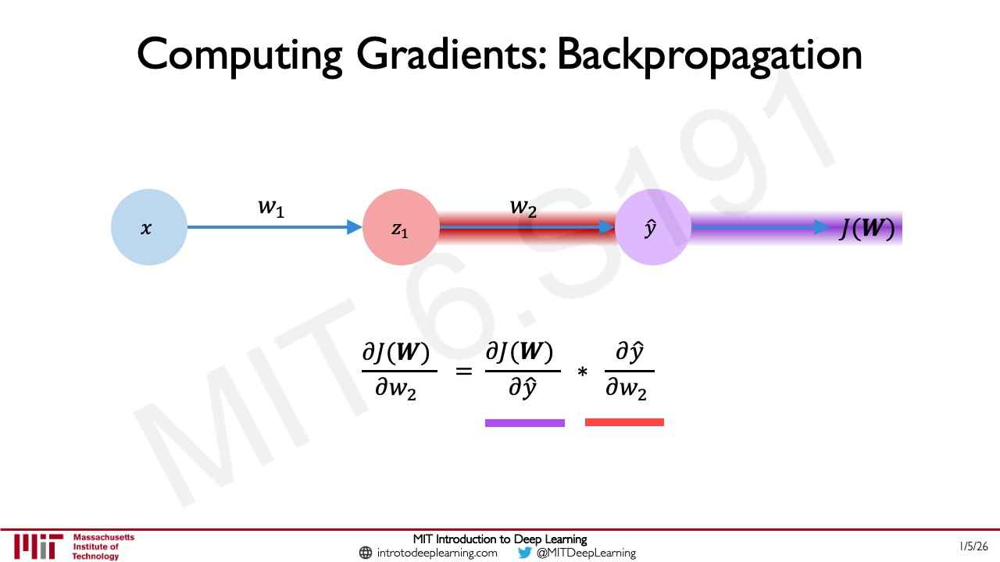

Same chain diagram, but the arrow from $z_1$ to $\hat{y}$ (carrying $w_2$) is glowing red and the arrow from $\hat{y}$ to $J(\boldsymbol{W})$ is glowing purple; the yellow highlight is gone. Equation:

$$\frac{\partial J(\boldsymbol{W})}{\partial w_2} = \frac{\partial J(\boldsymbol{W})}{\partial \hat{y}} \ast \frac{\partial \hat{y}}{\partial w_2}$$

A purple bar sits under the first factor $\frac{\partial J(\boldsymbol{W})}{\partial \hat{y}}$ (matching the purple arrow) and a red bar under the second factor $\frac{\partial \hat{y}}{\partial w_2}$ (matching the red arrow).

Build step: same as slide 66, completing the chain rule for $w_2$ with colour-coded links to the diagram.

*Figure: yes — chain diagram with colour-coded segments and chain-rule expansion for* $w_2$

## Slide 68 — Computing Gradients: Backpropagation

Same diagram as slide 67 except that now $w_1$ (on the arrow from $x$ to $z_1$) is highlighted in yellow and $w_2$ is not. Red glow on the $z_1 \to \hat{y}$ arrow and purple glow on the $\hat{y} \to J(\boldsymbol{W})$ arrow remain. Equation:

$$\frac{\partial J(\boldsymbol{W})}{\partial w_1} = \frac{\partial J(\boldsymbol{W})}{\partial \hat{y}} \ast \frac{\partial \hat{y}}{\partial w_1}$$

with a purple bar under the first factor and a red bar under the second. Two annotations "Apply chain rule!" with thin blue arrows: one pointing to the $w_1$ in the left-hand denominator (highlighted yellow), one pointing to the second factor $\frac{\partial \hat{y}}{\partial w_1}$.

Build step: same as slide 67 but for the earlier weight $w_1$, with notes that the chain rule is applied again.

*Figure: yes — chain diagram with* $\partial J / \partial w_1$ *being expanded*

## Slide 69 — Computing Gradients: Backpropagation

Same chain diagram, now with the $x \to z_1$ arrow glowing light blue, the $z_1 \to \hat{y}$ arrow glowing red, and the $\hat{y} \to J(\boldsymbol{W})$ arrow glowing purple. Equation:

$$\frac{\partial J(\boldsymbol{W})}{\partial w_1} = \frac{\partial J(\boldsymbol{W})}{\partial \hat{y}} \ast \frac{\partial \hat{y}}{\partial z_1} \ast \frac{\partial z_1}{\partial w_1}$$

Coloured bars beneath the three factors: purple (first), red (second), light blue (third).

Build step: same as slide 68, expanding the chain rule into three factors and colouring the first arrow.

*Figure: yes — chain diagram with three-factor chain rule for* $w_1$

## Slide 70 — Computing Gradients: Backpropagation

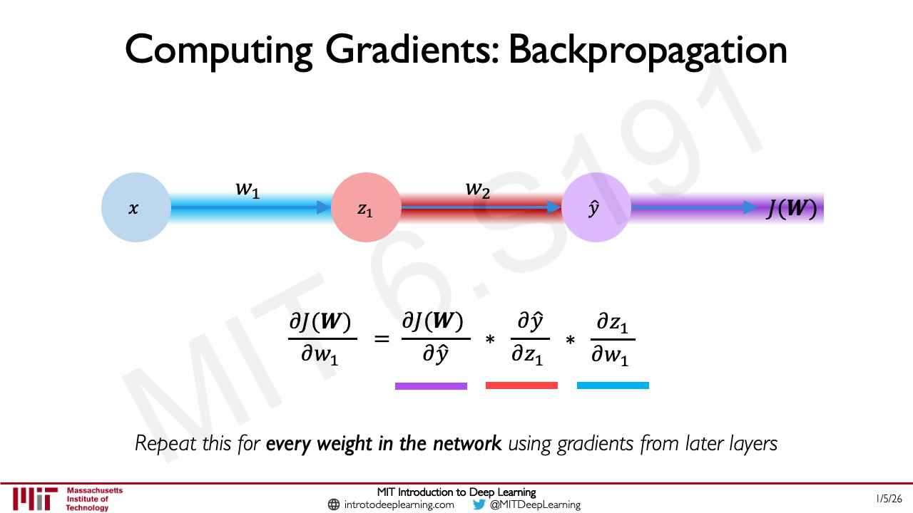

Same diagram and equation as slide 69:

$$\frac{\partial J(\boldsymbol{W})}{\partial w_1} = \frac{\partial J(\boldsymbol{W})}{\partial \hat{y}} \ast \frac{\partial \hat{y}}{\partial z_1} \ast \frac{\partial z_1}{\partial w_1}$$

(purple, red, light-blue bars under the three factors; three coloured glowing arrows). Added caption at the bottom: *Repeat this for **every weight in the network** using gradients from later layers*

Build step: same as slide 69, adding the closing caption.

*Figure: yes — chain diagram with chain rule and closing caption*

## Slide 71 — [Section divider] Neural Networks in Practice: Optimization

White text "Neural Networks in Practice: Optimization" (two lines) centred on a solid blue background.

*Figure: no*

## Slide 72 — Training Neural Networks is Difficult

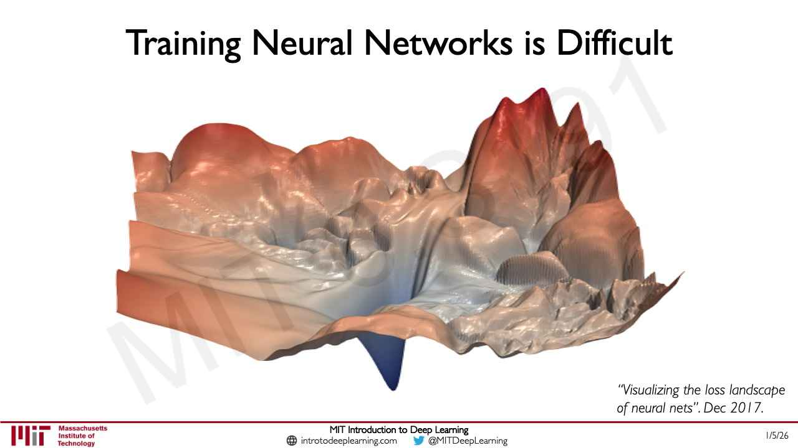

A rendered 3D loss-landscape surface of a real neural network, shaded from red/orange (high loss; tall jagged peaks at upper right and a broad hill at upper left) through white/grey to blue (low loss). A single narrow deep blue pit (the minimum) at the bottom centre, surrounded by rugged, bumpy terrain with many small ridges and local dips. It illustrates how non-convex and rough real loss surfaces are. No axes or labels.

Caption at bottom right (small italic): "Visualizing the loss landscape of neural nets". Dec 2017.

*Figure: yes — 3D rendering of a rugged neural-network loss landscape*

## Slide 73 — Loss Functions Can Be Difficult to Optimize

**Remember:**
Optimization through gradient descent

$$\boldsymbol{W} \leftarrow \boldsymbol{W} - \eta \frac{\partial J(\boldsymbol{W})}{\partial \boldsymbol{W}}$$

Centered text and the gradient descent update equation only; no other figure.

*Figure: no*

## Slide 74 — Loss Functions Can Be Difficult to Optimize

**Remember:**
Optimization through gradient descent

$$\boldsymbol{W} \leftarrow \boldsymbol{W} - \eta \frac{\partial J(\boldsymbol{W})}{\partial \boldsymbol{W}}$$

The $\eta$ in the equation is highlighted with a yellow box. A blue arrow points up from the label "How can we set the learning rate?" (two lines, below the equation) to the highlighted $\eta$.

Build step: same as slide 73, adding the yellow highlight on $\eta$ and the blue arrow with the label "How can we set the learning rate?".

*Figure: no*

## Slide 75 — Setting the Learning Rate

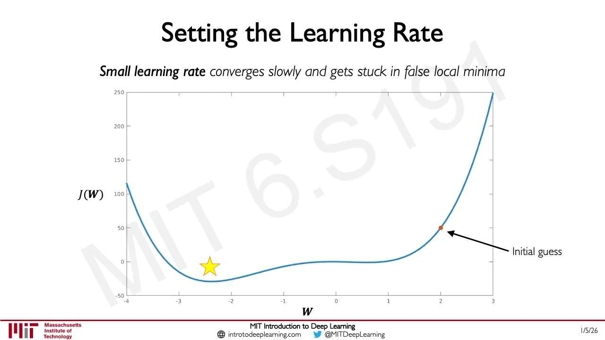

*Small learning rate* converges slowly and gets stuck in false local minima

Plot of a one-dimensional loss curve. X-axis label: $\boldsymbol{W}$, ticks from -4 to 3 (labelled -4, -3, -2, -1, 0, 1, 2, 3). Y-axis label: $J(\boldsymbol{W})$, ticks from -50 to 250 (labelled -50, 0, 50, 100, 150, 200, 250). One series:
- Blue curve: starts at about 115 at W = -4, falls to a global minimum of about -30 near W = -2.4, rises slightly to a flat local bump of about 0 near W = 0, dips to a very shallow local minimum of about -1 near W = 0.6, then rises steeply to about 250 at W = 3.
- An orange/red dot on the curve at W = 2, J(W) about 50, with a black arrow from the label "Initial guess" (right of the plot) pointing to it.
- A yellow star at about W = -2.4 marking the global minimum (at the bottom of the left basin).

*Figure: yes — loss curve J(W) vs W with initial guess at W=2 and star at the global minimum; illustrates a small learning rate*

## Slide 76 — Setting the Learning Rate

*Large learning rates* overshoot, become unstable and diverge

Same plot as slide 75: x-axis $\boldsymbol{W}$ (-4 to 3), y-axis $J(\boldsymbol{W})$ (-50 to 250), one blue curve with global minimum near W = -2.4 (about -30), a flat local region near W = 0 to 0.6, rising to 250 at W = 3; orange dot "Initial guess" at W = 2, J about 50 with black arrow; yellow star at the global minimum.

Build step: same as slide 75 with only the subtitle changed to the large-learning-rate message.

*Figure: yes — loss curve J(W) vs W with initial guess and star; illustrates a large learning rate*

## Slide 77 — Setting the Learning Rate

*Stable learning rates* converge smoothly and avoid local minima

Same plot as slides 75 and 76: x-axis $\boldsymbol{W}$ (-4 to 3), y-axis $J(\boldsymbol{W})$ (-50 to 250), one blue curve with global minimum near W = -2.4, orange "Initial guess" dot at W = 2 with black arrow, yellow star at the global minimum.

Build step: same as slide 76 with only the subtitle changed to the stable-learning-rate message.

*Figure: yes — loss curve J(W) vs W with initial guess and star; illustrates a stable learning rate*

## Slide 78 — How to deal with this?

**Idea 1:**
Try lots of different learning rates and see what works "just right"

*Figure: no*

## Slide 79 — How to deal with this?

Idea 1 (greyed out): Try lots of different learning rates and see what works "just right"

**Idea 2:**
Do something smarter!
Design an adaptive learning rate that "adapts" to the landscape

Build step: same as slide 78, with Idea 1 faded to light grey and Idea 2 added below in full black.

*Figure: no*

## Slide 80 — Adaptive Learning Rates

- Learning rates are no longer fixed
- Can be made larger or smaller depending on:
  - how large gradient is
  - how fast learning is happening
  - size of particular weights
  - etc...

*Figure: no*

## Slide 81 — Gradient Descent Algorithms

A table with four columns: Algorithm (bulleted list), TF Implementation, Torch Implementation, Reference. The implementation entries are shown as dark rounded code boxes, each with a TensorFlow logo (orange) or PyTorch logo (red-orange flame) at the left.

| Algorithm | TF Implementation | Torch Implementation | Reference |
| --- | --- | --- | --- |
| SGD | tf.keras.optimizers.SGD | torch.optim.SGD | Kiefer & Wolfowitz, 1952. |
| Adam | tf.keras.optimizers.Adam | torch.optim.Adam | Kingma et al., 2014. |
| Adadelta | tf.keras.optimizers.Adadelta | torch.optim.Adadelta | Zeiler et al., 2012. |
| Adagrad | tf.keras.optimizers.Adagrad | torch.optim.Adagrad | Duchi et al., 2011. |
| RMSProp | tf.keras.optimizers.RMSProp | torch.optim.RMSProp | (none given) |

Additional details: http://ruder.io/optimizing-gradient-descent/ (red underlined link)

*Figure: yes — table of optimizers with TF/Torch class names and references (logos in code boxes)*

## Slide 82 — Putting it all together

Dark-background slide with a TensorFlow logo at the top right. Code (syntax-highlighted):

```python
import tensorflow as tf

model = tf.keras.Sequential([...])

# pick your favorite optimizer
optimizer = tf.keras.optimizer.SGD()

while True: # loop forever

    # forward pass through the network
    prediction = model(x)

    with tf.GradientTape() as tape:
        # compute the loss
        loss = compute_loss(y, prediction)

    # update the weights using the gradient
    grads = tape.gradient(loss, model.trainable_variables)
    optimizer.apply_gradients(zip(grads, model.trainable_variables)))
```

(Code reproduced as printed. `tf.keras.optimizer.SGD()` lacks the "s" of the module name that slide 81 prints as `tf.keras.optimizers.SGD`, and the last line closes one parenthesis more than it opens.)

The two lines "# pick your favorite optimizer" and "optimizer = tf.keras.optimizer.SGD()" are enclosed in a blue rounded rectangle. A blue arrow points left to it from a blue cloud-shaped callout containing a cartoon light-bulb character giving a thumbs-up, with the text "Can replace with any TensorFlow optimizer!"

*Figure: yes — TensorFlow training-loop code with highlighted optimizer line and callout*

## Slide 83 — [Section divider] Neural Networks in Practice: Mini-batches

White text on a solid blue background: "Neural Networks in Practice:" / "Mini-batches".

*Figure: no*

## Slide 84 — Gradient Descent

**Algorithm**
1. Initialize weights randomly $\sim\mathcal{N}(0, \sigma^2)$
2. Loop until convergence:
3. Compute gradient, $\frac{\partial J(\boldsymbol{W})}{\partial \boldsymbol{W}}$ (indented under step 2)
4. Update weights, $\boldsymbol{W} \leftarrow \boldsymbol{W} - \eta \frac{\partial J(\boldsymbol{W})}{\partial \boldsymbol{W}}$ (indented under step 2)
5. Return weights

Right: a 3D rainbow-coloured loss surface (red peaks high, blue valleys low) with axes ticks roughly 0 to 1 on the two horizontal axes and -3 to 3 on the vertical axis, no axis labels. A black line with + markers shows a descent path starting at the top of a red hill and stepping down in a zig-zag to the blue valley bottom.

*Figure: yes — 3D loss surface with a gradient descent path from a peak to a minimum*

## Slide 85 — Gradient Descent

Same as slide 84 (algorithm steps 1 to 5 and 3D surface with descent path). Additionally, the gradient $\frac{\partial J(\boldsymbol{W})}{\partial \boldsymbol{W}}$ in step 3 is highlighted with a yellow box, with a thin blue arrow (from a vertical line below) pointing to it from the callout "Can be very **computationally intensive** to compute!" (bold: "computationally intensive").

Build step: same as slide 84, adding the yellow highlight on the step-3 gradient and the callout "Can be very computationally intensive to compute!".

*Figure: yes — 3D loss surface with gradient descent path*

## Slide 86 — Stochastic Gradient Descent

**Algorithm**
1. Initialize weights randomly $\sim\mathcal{N}(0, \sigma^2)$
2. Loop until convergence:
3. Pick single data point $i$
4. Compute gradient, $\frac{\partial J_i(\boldsymbol{W})}{\partial \boldsymbol{W}}$
5. Update weights, $\boldsymbol{W} \leftarrow \boldsymbol{W} - \eta \frac{\partial J(\boldsymbol{W})}{\partial \boldsymbol{W}}$
6. Return weights

(As printed: step 5 writes the full gradient $\frac{\partial J(\boldsymbol{W})}{\partial \boldsymbol{W}}$, although step 4 computes the single-point gradient $\frac{\partial J_i(\boldsymbol{W})}{\partial \boldsymbol{W}}$; the lecturer describes stepping against that one point's gradient, transcript ≈47:05. Slide 87 repeats the slip.)

Right: same 3D rainbow loss surface with black + path from the red peak to the blue valley as in slide 84.

*Figure: yes — 3D loss surface with descent path*

## Slide 87 — Stochastic Gradient Descent

Same as slide 86. The step-4 gradient $\frac{\partial J_i(\boldsymbol{W})}{\partial \boldsymbol{W}}$ is highlighted with a yellow box, and a thin blue arrow points to it from the callout "Easy to compute but **very noisy** (stochastic)!" (bold: "very noisy").

Build step: same as slide 86, adding the highlight and callout.

*Figure: yes — 3D loss surface with descent path*

## Slide 88 — Stochastic Gradient Descent

**Algorithm**
1. Initialize weights randomly $\sim\mathcal{N}(0, \sigma^2)$
2. Loop until convergence:
3. Pick batch of $B$ data points
4. Compute gradient, $\frac{\partial J(\boldsymbol{W})}{\partial \boldsymbol{W}} = \frac{1}{B}\sum_{k=1}^{B} \frac{\partial J_k(\boldsymbol{W})}{\partial \boldsymbol{W}}$
5. Update weights, $\boldsymbol{W} \leftarrow \boldsymbol{W} - \eta \frac{\partial J(\boldsymbol{W})}{\partial \boldsymbol{W}}$
6. Return weights

Right: same 3D rainbow loss surface with black + descent path.

Build step: changes slide 87's steps 3 and 4 from a single data point to a batch of $B$ data points averaged.

*Figure: yes — 3D loss surface with descent path*

## Slide 89 — Stochastic Gradient Descent

Same as slide 88. The step-4 equation $\frac{\partial J(\boldsymbol{W})}{\partial \boldsymbol{W}} = \frac{1}{B}\sum_{k=1}^{B} \frac{\partial J_k(\boldsymbol{W})}{\partial \boldsymbol{W}}$ is highlighted with a yellow box, with a black arrow pointing up to it from the callout "Fast to compute and a much better estimate of the true gradient!"

Build step: same as slide 88, adding the highlight and callout.

*Figure: yes — 3D loss surface with descent path*

## Slide 90 — Mini-batches while training

**More accurate estimation of gradient**
Smoother convergence
Allows for larger learning rates

*Figure: no*

## Slide 91 — Mini-batches while training

Previous block (greyed out): More accurate estimation of gradient / Smoother convergence / Allows for larger learning rates

**Mini-batches lead to fast training!**
Can parallelize computation + achieve significant speed increases on GPU's

Build step: same as slide 90, with the first block faded to grey and a second block added below.

*Figure: no*

## Slide 92 — [Section divider] Neural Networks in Practice: Overfitting

White text on a solid blue background: "Neural Networks in Practice:" / "Overfitting".

*Figure: no*

## Slide 93 — The Problem of Overfitting

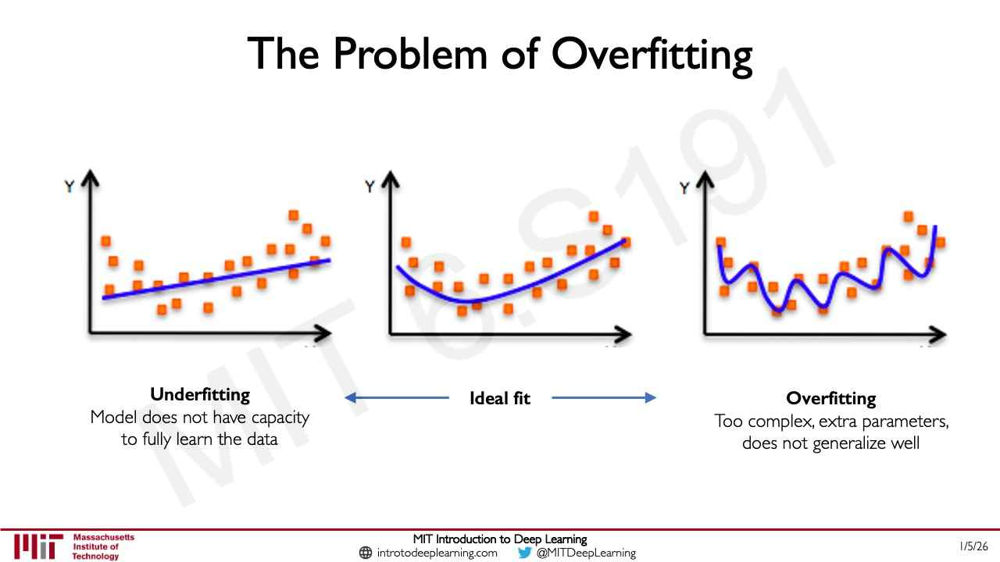

Three small scatter plots side by side, each with a black "Y" labelled vertical axis arrow and a horizontal axis arrow (horizontal axis unlabelled), orange square data points (about 20 per plot, the same cloud, trending upward to the right with noise) and a blue fitted curve:
- Left: a nearly straight, gently rising blue line that misses most points (underfit). Caption below: **Underfitting** / Model does not have capacity to fully learn the data
- Middle: a smooth U-shaped blue curve (dips slightly on the left then rises to the right) following the trend of the points. Caption below: **Ideal fit**
- Right: a very wiggly blue curve that passes through or near almost every point with many oscillations. Caption below: **Overfitting** / Too complex, extra parameters, does not generalize well

A blue double-headed arrow spans from the "Underfitting" caption to the "Overfitting" caption, passing through the label "Ideal fit" (a blue arrow points left from "Ideal fit" and one points right).

*Figure: yes — three scatter plots showing underfitting, ideal fit and overfitting curves*

## Slide 94 — Regularization

*What is it?*
*Technique that constrains our optimization problem to discourage complex models*

*Figure: no*

## Slide 95 — Regularization

Previous block (greyed out): What is it? Technique that constrains our optimization problem to discourage complex models

*Why do we need it?*
*Improve generalization of our model on unseen data*

Build step: same as slide 94, with the first block faded to grey and a second block added below.

*Figure: no*

## Slide 96 — Regularization 1: Dropout

- During training, randomly set some activations to 0

Network diagram (fully connected, blue arrows pointing left to right): input layer of 3 light-blue nodes $x_1, x_2, x_3$; first hidden layer of 4 pink/red nodes $z_{1,1}, z_{1,2}, z_{1,3}, z_{1,4}$; second hidden layer of 4 pink/red nodes $z_{2,1}, z_{2,2}, z_{2,3}, z_{2,4}$; output layer of 2 purple nodes $\hat{y}_ 1, \hat{y}_ 2$. Every node in a layer is connected to every node in the next layer (all nodes active).

*Figure: yes — fully connected network 3-4-4-2 with all nodes active*

## Slide 97 — Regularization 1: Dropout

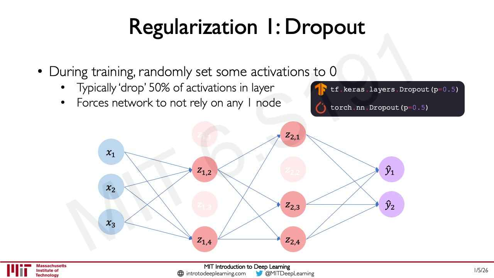

- During training, randomly set some activations to 0
  - Typically 'drop' 50% of activations in layer
  - Forces network to not rely on any 1 node

Top right: a dark code box with a TensorFlow logo and a PyTorch logo:

```
tf.keras.layers.Dropout(p=0.5)
torch.nn.Dropout(p=0.5)
```

Network diagram as in slide 96 (3-4-4-2, nodes $x_1..x_3$, $z_{1,1}..z_{1,4}$, $z_{2,1}..z_{2,4}$, $\hat{y}_ 1, \hat{y}_ 2$), but with some hidden nodes dropped: $z_{1,1}$, $z_{1,3}$ (first hidden layer) and $z_{2,2}$ (second hidden layer) are drawn faded/near-transparent with no connections. Active nodes $z_{1,2}$, $z_{1,4}$, $z_{2,1}$, $z_{2,3}$, $z_{2,4}$ keep their blue connections to adjacent-layer active nodes.

Build step: same network as slide 96, adding two sub-bullets, the code box, and a random dropout mask.

*Figure: yes — network with a random subset of hidden nodes dropped*

## Slide 98 — Regularization 1: Dropout

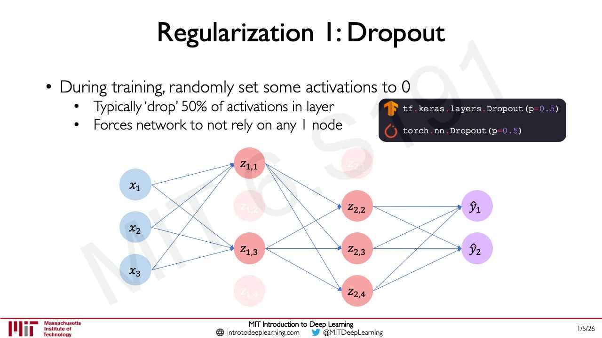

Same text and code box as slide 97.

Network diagram as in slide 97, but with a different dropout mask: faded (dropped) nodes are $z_{1,2}$, $z_{1,4}$ (first hidden layer) and $z_{2,1}$ (second hidden layer). Active nodes: $z_{1,1}$, $z_{1,3}$, $z_{2,2}$, $z_{2,3}$, $z_{2,4}$, with their connections drawn between active nodes only.

Build step: same as slide 97, with a different random set of nodes dropped.

*Figure: yes — network with a different random subset of hidden nodes dropped*

## Slide 99 — Regularization 2: Early Stopping

- Stop training before we have a chance to overfit

Empty plot: black axes with arrowheads; vertical axis labelled "Loss", horizontal axis labelled "Training Iterations". No curves yet.

*Figure: yes — empty loss vs training iterations axes*

## Slide 100 — Regularization 2: Early Stopping

- Stop training before we have a chance to overfit

Plot with axes "Loss" (vertical) and "Training Iterations" (horizontal), no tick values. A legend box at right (titled "Legend") shows a light-blue line labelled "Testing" and a green line labelled "Training". Two series, each so far with 2 points joined by a descending curve near the left of the plot:
- Testing (light blue): from a point high near the y-axis down to a lower point slightly to the right.
- Training (green): starts slightly below the blue start point and descends to a point lower than the blue one.
Training loss is below testing loss at both points.

Build step: same as slide 99, adding the first two points of the Testing and Training loss curves and the legend.

*Figure: yes — start of training/testing loss curves*

## Slide 101 — Regularization 2: Early Stopping

- Stop training before we have a chance to overfit

Same plot and legend as slide 100, with a third point added to each curve: both Testing (light blue) and Training (green) continue to decrease; training stays below testing.

Build step: same as slide 100, adding the third point on each curve.

*Figure: yes — training/testing loss curves, both still decreasing*

## Slide 102 — Regularization 2: Early Stopping

- Stop training before we have a chance to overfit

Same axes ("Loss" vertical, "Training Iterations" horizontal) and legend (Testing = light blue, Training = green) as slide 101. Each curve now has 4 points:
- Testing (light blue): descends from high at the y-axis, then flattens out at the fourth point (still decreasing slightly or levelling).
- Training (green): descends and flattens, staying below Testing throughout.

Build step: same as slide 101, adding the fourth point on each curve.

*Figure: yes — training/testing loss curves with 4 points each*

## Slide 103 — Regularization 2: Early Stopping

- Stop training before we have a chance to overfit

Same axes and legend. Each curve now has 5 points:
- Testing (light blue): decreases to a minimum at the fourth point, then the fifth point is higher (test loss starts rising).
- Training (green): continues to decrease monotonically, staying below Testing.

Build step: same as slide 102, adding the fifth point on each curve.

*Figure: yes — training/testing loss curves with 5 points each*

## Slide 104 — Regularization 2: Early Stopping

- Stop training before we have a chance to overfit

Same axes and legend. Each curve now has 6 points:
- Testing (light blue): U-shaped: decreases to a minimum at the fourth point, then rises through the fifth and sixth points.
- Training (green): keeps decreasing gradually towards a low flat level, always below Testing.

Build step: same as slide 103, adding the sixth point on each curve.

*Figure: yes — complete training/testing loss curves diverging*

## Slide 105 — Regularization 2: Early Stopping

- Stop training before we have a chance to overfit

Same complete plot as slide 104 (6 points per curve, Testing light blue U-shaped, Training green decreasing). Added: a vertical dashed blue line through the fourth point (the testing-loss minimum), and a label "Stop training here!" with a short blue arrow pointing to that point on the Testing curve.

Build step: same as slide 104, adding the dashed vertical line and the "Stop training here!" annotation.

*Figure: yes — loss curves with early-stopping point marked*

## Slide 106 — Regularization 2: Early Stopping

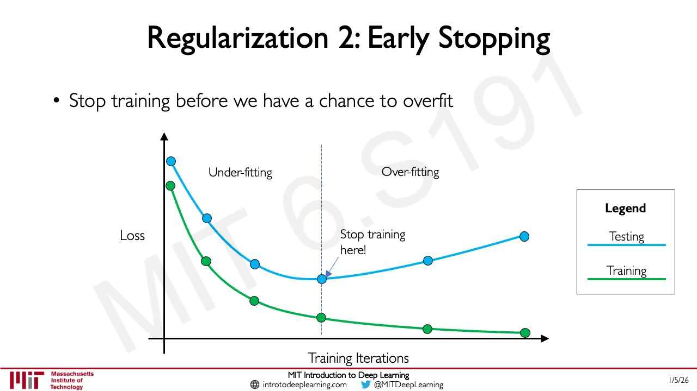

- Stop training before we have a chance to overfit

Same plot as slide 105, with two region labels added at the top of the plot: "Under-fitting" to the left of the dashed vertical line and "Over-fitting" to the right of it.

Build step: same as slide 105, adding the "Under-fitting" and "Over-fitting" labels.

*Figure: yes — loss curves with under-fitting and over-fitting regions labelled*

## Slide 107 — Core Foundation Review

Three blue rounded header boxes, each with bullets and a small figure below:

- **The Perceptron**
  - Structural building blocks
  - Nonlinear activation functions
  - Figure: perceptron diagram: three light-blue input nodes $x_1$, $x_2$, $x_m$ with blue arrows into an orange node containing a sum sign ($\Sigma$), then a red arrow to a yellow node containing a sigmoid-shaped curve, then a yellow arrow to a purple output node $\hat{y}$.
- **Neural Networks**
  - Stacking Perceptrons to form neural networks
  - Optimization through backpropagation
  - Figure: compact deep-network diagram: input nodes $x_1$, $x_2$, $x_m$ (light blue), then a blue "x" box, "...", another "x" box, then a column of pink nodes $z_{k,1}$, $z_{k,2}$, $z_{k,3}$, $z_{k,n_k}$, then a blue "x" box, "...", another "x" box, then two purple output nodes $\hat{y}_ 1$, $\hat{y}_ 2$. (The small labels are only partly legible.)
- **Training in Practice**
  - Adaptive learning
  - Batching
  - Regularization
  - Figure: the rainbow 3D loss surface with black + gradient-descent path from the earlier gradient-descent slides.

*Figure: yes — three small illustrations (perceptron, deep network schematic, loss surface with descent path)*

## Slide 108 — MIT Introduction to Deep Learning (Lab 1)

White text on a black background, with a rainbow-coloured audio waveform along the bottom:

MIT Introduction to Deep Learning
Lab 1: Introduction to Deep Learning in Python and Music Generation with RNNs

Link to download labs:
http://introtodeeplearning.com#schedule

1. Open the lab in Google Colab
2. Start executing code blocks and filling in the #TODOs
3. Need help? Come to 32-123!

*Figure: yes — decorative rainbow audio waveform along the bottom edge*
