# Lecture 6 — Language Models and New Frontiers: slide-by-slide

Text and figures of all 81 slides of
[`6S191_MIT_DeepLearning_L6.pdf`](https://introtodeeplearning.com/slides/6S191_MIT_DeepLearning_L6.pdf)
(MIT 6.S191 Introduction to Deep Learning, 2026 edition; lecturer Ava Amini), transcribed from the
deck. The catalog lists this lecture as "Language Models and New Frontiers"; the title slide reads "Deep
Learning Limitations and New Frontiers", and the class schedule on slide 3 calls it "New Frontiers".
Cite these as "slide N", where N is the PDF page number. Diagrams, photographs, plots and equations are
described in prose or reproduced, since the KB is read as text.

Many slides are **build steps**: the same slide re-shown with one more element revealed. They are
transcribed individually, so that a citation to any one of them resolves, with a note of what each
adds to the one before.

## Numbering: slide numbers vs PDF pages

The PDF is a flattened export: every page is a single 1280×720 image with no text layer, and no
page prints a slide number. Headings therefore use the PDF page number, and a reader who opens page
N of the PDF sees slide N. The standard footer on content slides (MIT logo, "MIT Introduction to
Deep Learning", introtodeeplearning.com, @MITDeepLearning, "1/7/26") is not repeated below; citations
printed beside it are, as "Footer credit" lines. A faint diagonal "MIT 6.S191" watermark sits behind
every content slide and is not repeated either. Pages 80 and 81 are byte-for-byte copies of pages 78
and 79.

## Images

24 slides carry their page image under the heading: 14, 18, 22, 26, 28–31, 34, 42, 49–51, 53, 54, 61,
64–66, 69, 71, 72, 75 and 76 — every slide with a distinct figure. The rest are the title (1); logistics,
prize, staff and guest-lecturer slides (2–8) and the closing lab and announcement slides (78–81); section
dividers (9, 15, 47, 67); news, stock and product imagery whose text is transcribed (10, 11, 32, 33, 43,
68); slide 12's unlabelled network drawing; slides of text, equations or generic icons transcribed
exactly (13, 36–41, 44–46, 73, 74, 77); build steps contained in an included slide (16–17 and 19 → 18,
20–21 → 22, 23–25 → 26, 27 → 28, 35 → 34, 48 → 49, 52 → 53, 55–60 → 61) and slide 70, which slide 72
repeats; and two full-frame noise frames (62, 63). Use only an image path that appears below; slides
without one have no image.

## Contents

| Slides | Section |
| ------ | ------- |
| 1 | Title: "Deep Learning Limitations and New Frontiers" |
| 2–8 | Logistics: T-shirts, the class schedule, labs and prizes, the final class project (two options), guest lectures, thanks |
| 9–14 | So far in the course: the rise of deep learning, data to decision, the universal approximation theorem and its caveats, AI "hype" in historical perspective |
| 15–28 | Limitations: rethinking generalization (randomized labels), the capacity of deep neural networks, neural networks as function approximators and what happens away from the training data |
| 29–33 | "Deep Learning = Alchemy?"; failure modes I and II (colorizing a dog, an autopilot crash); uncertainty in deep learning |
| 34–42 | Failure modes III: adversarial examples, gradient descent versus the adversarial-image update, robust 3D adversarial examples |
| 43–46 | Algorithmic bias; the list of neural network limitations |
| 47–49 | New Frontiers I: Generative AI & Diffusion Models; the landscape of generative modeling |
| 50–54 | Diffusion models: one-shot versus iterative generation, the diffusion process, forward noising, reverse denoising |
| 55–63 | Sampling brand new generations, step by step; two full-frame noise frames |
| 64–66 | Text-to-image generation; beyond images: molecular design |
| 67–72 | New Frontiers II: Large Language Models: LLMs and the world, what LLMs are, how GPT-style models are trained, next-token prediction, generating text |
| 73–77 | Capabilities and limitations of LLMs; emergent abilities with scale; foundation models |
| 78–81 | Lab 3 and announcements (80–81 repeat 78–79) |

## Slide 1 — Deep Learning Limitations and New Frontiers

Text: "Deep Learning / Limitations and New Frontiers" (two lines). Below: "Ava Amini", "MIT Introduction to Deep Learning", "January 7, 2026". Bottom centre: "MIT Introduction to Deep Learning", "introtodeeplearning.com", "@MITDeepLearning"; the MIT logo (red) at bottom left and the "MIT EECS" logo at bottom right.

Title slide on a black background. At the left edge is a glowing blue network of nodes joined by lines, drawn as a decorative abstract neural-network graphic.

*Figure: no*

## Slide 2 — T-shirts! Tomorrow!

Text: "T-shirts! Tomorrow!"

A photograph of a dark grey T-shirt, centred. On its chest is the course logo: the letters "MIT" built from red neural-network column graphics (one column in white), "6.S191" printed vertically at the right of the logo and "DEEP LEARNING" beneath it, in white.

*Figure: yes — photograph of the grey 6.S191 course T-shirt with the course logo*

## Slide 3 — Class Schedule

Text: "Class Schedule". The slide is on a dark navy background and lists the course as three columns of round icons with a cyan title, a bold line and a date line, plus a T-shirt photograph and three bullets at the right.

Column 1:

- "Intro to Deep Learning" — "Lecture 1", "Jan. 5, 2026", "[Slides] [Video] coming soon!"
- "Deep Computer Vision" — "Lecture 3", "Jan. 6, 2026", "[Slides] [Video] coming soon!"
- "Deep Reinforcement Learning" — "Lecture 5", "Jan. 7, 2026", "[Slides] [Video] coming soon!"
- "AI for Science" — "Lecture 7", "Jan. 8, 2026", "[Info] [Slides] [Video] coming soon!"
- "The Three Laws of AI" — "Lecture 9", "Jan. 9, 2026", "[Info] [Slides] [Video] coming soon!"

Column 2:

- "Deep Sequence Modeling" — "Lecture 2", "Jan. 5, 2026", "[Slides] [Video] coming soon!"
- "Deep Generative Modeling" — "Lecture 4", "Jan. 6, 2026", "[Slides] [Video] coming soon!"
- "New Frontiers" — "Lecture 6", "Jan. 7, 2026", "[Slides] [Video] coming soon!"
- "Secrets to Massively Parallel Training" — "Lecture 8", "Jan. 8, 2026", "[Info] [Slides] [Video] coming soon!"
- "Guest Lecture" — "Lecture 10", "Jan. 9, 2026", "[Slides] [Video] coming soon!"

Column 3:

- "Deep Learning in Python; Music Generation" — "Software Lab 1", "[Code]"
- "Facial Detection Systems" — "Software Lab 2", "[Paper] [Code]"
- "Fine-Tune an LLM, You Must!" — "Software Lab 3", "[Code]"
- "Final Project" — "Work on final projects"
- "Project Presentations" — "Pitch your ideas, awards, and celebration!"

At right: the T-shirt photograph from slide 2, and three bullets: "Lab competition: 1/9/26 – extended!", "Proposal slides: 1/9/26", "Proposal pitch: 1/9/26".

*Figure: no*

## Slide 4 — Labs and Prizes

Text: "Labs and Prizes". Three column headings: "Lab 1: Music Generation", "Lab 2: Computer Vision", "Lab 3: Large Language Models".

Product photographs under each heading (prizes): under Lab 1 a pair of black over-ear headphones and a pair of white wireless earbuds in their charging case; under Lab 2 a computer monitor showing a mountain-and-meadow landscape; under Lab 3 two e-readers (one showing "CHAPTER 1" text) and two dark grey smart speakers.

Below: "Lab submission: 1/9/26 at 11:00am ET – extended deadline!", "Instructions: bit.ly/6s191-syllabus" (link), "github.com/MITDeepLearning/introtodeeplearning/" (link).

*Figure: yes — stock product photographs of the lab prizes (headphones, earbuds, monitor, e-readers, smart speakers)*

## Slide 5 — Final Class Project

Text: "Final Class Project".

Left column: "Option 1: Proposal Presentation", with bullets:

- "At least 1 registered student to be prize eligible"
- "Present a novel deep learning research idea or application"
- "5 minutes (strict)"
- "Presentations on **Friday, Jan 9**"
- "Submit groups by **Thu 1/8 by 11:59pm ET** to be eligible"
- "Final slides by **Fri 1/9 1:00pm ET**"
- "Instructions: bit.ly/6s191-syllabus" (link)

Right column bullets: "Judged by a panel of judges", "Opportunity to give TEDx talk!", "Top winners are awarded:". Below, photographs with captions: a graphics card labelled "RTX 5080" on the card, caption "NVIDIA 5070 GPU"; four smartwatches, caption "Smartwatches"; three computer monitors showing a waterfall landscape, caption "Display Monitors".

Printed slip kept: the card in the photograph reads "RTX 5080" while the caption reads "NVIDIA 5070 GPU".

*Figure: yes — product photographs of the prizes (graphics card, smartwatches, monitors)*

## Slide 6 — Final Class Project

Build step: adds Option 2 to slide 5 and fades Option 1. This frame is caught mid-animation: the Option 1 text on the left is shown faded to light grey, and it differs from slide 5 (it appears to be an earlier version of the text, printed under the new state).

Text: "Final Class Project".

Left, faded: "Option 1: Proposal Presentation", bullets "At least 1 registered student to be prize eligible", "Present a novel deep learning research idea or application", "3 minutes (strict)", "Presentations on Friday, Jan 29", "Submit groups by Wednesday 11:59pm ET to be eligible", "Submit slide by Thursday 11:59pm ET to be eligible", "Instructions:".

Right, in full black: "Option 2: Write a 1-page review of a deep learning/AI paper", with bullets:

- "Grade is based on clarity of writing and technical communication of main ideas"
- "Due Fri Jan 9 1:00pm ET"
- "Instructions: bit.ly/6s191-syllabus" (link)

*Figure: no*

## Slide 7 — Program Guest Lectures

Text: "Program Guest Lectures". Four columns, each a portrait photograph, a bold name, an affiliation and a company logo:

- "Chris Bishop" — "Microsoft" — Microsoft four-square logo with the word "Microsoft".
- "Mathias Lechner" — "Liquid AI" — black "Liquid" logo with a droplet-shaped mark.
- "Douglas Blank" — "Comet ML" — "comet" logo with an orange-yellow swoosh.
- "Matt Johnson" — "Google DeepMind" — "Google" logo.

*Figure: yes — portrait photographs of the four guest lecturers and the company logos of their affiliations*

## Slide 8 — Thank You!

Text: "Thank You!". Portrait photographs with captions:

- "John Werner" — "Community & Strategy" (grey subtitle)
- "Anisha Parsan" — "Lead TA"
- "Shrika Eddula" — "Lead TA"
- Five further photographs with first names only: "Victory", "Benjamin", "Vanessa", "Adrian", "Jeannie".

Bottom right, bold: "introtodeeplearning-staff@mit.edu".

*Figure: yes — portrait photographs of the course staff and TAs*

## Slide 9 — So far in Introduction to Deep Learning… (divider)

Text: "So far in Introduction to Deep Learning…" (title given as printed; white text centred on a plain blue background, no footer). Divider slide.

*Figure: no*

## Slide 10 — The Rise of Deep Learning

Text: "The Rise of Deep Learning".

A collage of overlapping screenshots of news and web-article headlines and stock images, many partly covered by others. Text that is readable, in roughly top-left to bottom-right order:

- "'Deep Voice' Software Can Clone Anyone's Voice With Just 3.7 Seconds of Audio" with the sub-line "Using snippets of voices, Baidu's 'Deep Voice' can generate new speech, accents, and tones." (photograph of two microphones facing an audience)
- "Let There Be Sight: How Deep Learning Is Helping the Blind 'See'" (photograph of a hand holding a smartphone)
- "AI Can Help In Predicting Cryptocurrency Value" (photograph of a laptop with code)
- "DEEPMIND ... STARCRAFT TRIUMPH FO..." (partly covered headline; a StarCraft game screenshot below it)
- "...chnology outpacing security ...ures" (partly covered)
- "AI beats docs in cancer spotti..." with the sub-line "A new study provides a fresh example of machine learning as an imports... diagnostic tool. Paul Biegler reports." (photograph of a surgeon in green)
- "'Creative' AlphaZero leads way for chess computers and, maybe, science" with the sub-line "Former chess world champion Garry Kasparov likes what he sees of computer that could be used to find cures for diseases" (image of chess pieces on a board)
- "How an A.I. 'Cat-and-Mouse Game' Generates Believable Fake Photos" (with a generated portrait of a woman's face below it)
- "Stock Predictions Based On AI: Is the Market Truly Predictable?" (chart image)
- "Neural networks everywhere" with the sub-line "New chip reduces neural networks' power consumption by up to 95 percent, making them practical for battery-powered devices." (smartphones over a blue network graphic)
- "...e faces show how far AI image generation has ...nced in just four years" (grid of grey face images and two portrait photographs)
- "After Millions of Trials, These Simulated Humans Learned to Do Perfect Backflips and Cartwheels" (image of a simulated humanoid)
- "Researchers introduce a deep learning method that converts mono audio recordings into 3D sounds using video scenes"
- "Google's DeepMind aces protein folding" (protein structure image; a byline and date "Dec. 6, 2018" are small)
- "Automation And Algorithms: De-Risking Manufacturing With Artificial Intelligence" (with a small tweet embedded at the bottom)
- Other pieces: a photograph of a robot hand holding a cube marked "ON", a self-driving-car photograph, and fragments with "Deep L" and "Faked Data".

The collage is a set of third-party news screenshots and photographs; many are cropped or hidden, and only the text listed above is legible.

*Figure: yes — collage of news headlines and images about deep learning applications (voice cloning, StarCraft, AlphaZero, protein folding, fake faces, robotics)*

## Slide 11 — So far in Introduction to Deep Learning…

Text: "So far in Introduction to Deep Learning…".

A black slide with a central image of a glowing blue human brain: the left half is lit by flowing light streams entering from the left, the right half is made of binary digits and continues into circuit-board traces at the right. A long white arrow above the image points left; a long white arrow below the image points right.

At left, bold "Data" with bullets "Signals", "Images", "Sensors" and "…". At right, bold "Decision" with bullets "Prediction", "Detection", "Action" and "…".

*Figure: yes — brain-and-circuit image between "Data" (left) and "Decision" (right), with arrows in both directions*

## Slide 12 — Power of Neural Nets

Text: "Power of Neural Nets". Subtitle: "Universal Approximation Theorem". Statement, in italics: "A feedforward network with a single layer is sufficient to approximate, to an arbitrary precision, any continuous function."

Footer credit: Hornik+ *Neural Networks* 1989.

Below, a fully connected network diagram with light-blue circular nodes in five columns, left to right: 8 nodes, 9 nodes, 9 nodes, 9 nodes, and 4 nodes, each node joined to every node of the next column by thin grey lines. It is unlabelled.

*Figure: yes — fully connected feedforward network diagram with three wide hidden columns*

## Slide 13 — Power of Neural Nets

Build step: replaces the network diagram of slide 12 with caveats.

Text: "Power of Neural Nets". Subtitle: "Universal Approximation Theorem". Statement, in italics: "A feedforward network with a single layer is sufficient to approximate, to an arbitrary precision, any continuous function."

Footer credit: Hornik+ *Neural Networks* 1989.

A blue bar labelled "Caveats:" with two black curved arrows leaving its centre, one to the left and one to the right. Left caveat, in italics: "The number of hidden units may be infeasibly large". Right caveat, in italics: "The resulting model may not generalize".

*Figure: no*

## Slide 14 — Artificial Intelligence "Hype": Historical Perspective

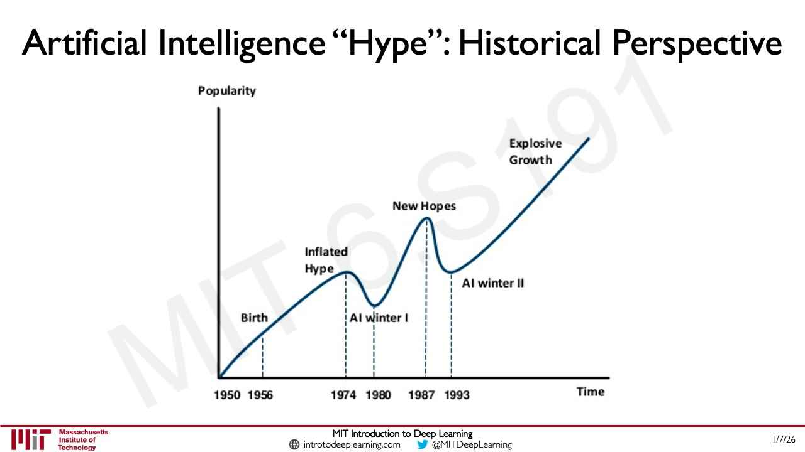

Text: "Artificial Intelligence “Hype”: Historical Perspective".

A line chart. Vertical axis: "Popularity" (no tick values). Horizontal axis: "Time", with labelled years "1950", "1956", "1974", "1980", "1987", "1993". One dark-blue curve (one series), with dashed vertical lines dropping from labelled points to the axis:

- It starts at the origin (1950) and rises steadily; the label "Birth" sits at 1956 on the rising line.
- It reaches a first plateau-like peak at 1974, labelled "Inflated Hype".
- It then falls to a trough at 1980, labelled "AI winter I".
- It rises sharply to a higher peak at 1987, labelled "New Hopes".
- It falls to a second trough at 1993, labelled "AI winter II".
- It then rises steadily to the upper right, labelled "Explosive Growth", ending at the highest point on the chart.

*Figure: yes — line chart of AI popularity over time with two peaks, two "AI winter" troughs and a final steep rise*

## Slide 15 — Limitations (divider)

Text: "Limitations" (white text centred on a plain blue background, no footer). Divider slide.

*Figure: no*

## Slide 16 — Rethinking Generalization

Text: "Rethinking Generalization". Quoted subtitle: "“Understanding Deep Neural Networks Requires Rethinking Generalization”".

Footer credit: Zhang+ *ICLR* 2017.

Four photographs in a row with labels beneath: a German-shepherd-type dog's head in profile on grass, labelled "dog"; two bananas, labelled "banana"; a thin brown dog standing on paving, labelled "dog"; a green tree in a field, labelled "tree".

*Figure: yes — four labelled photographs (dog, banana, dog, tree)*

## Slide 17 — Rethinking Generalization

Build step: adds a row of four blue dice faces under slide 16's labels.

Text: "Rethinking Generalization". Quoted subtitle: "“Understanding Deep Neural Networks Requires Rethinking Generalization”".

Footer credit: Zhang+ *ICLR* 2017.

The four photographs and their labels are as on slide 16 ("dog", "banana", "dog", "tree"). Under each label is a rounded blue square die face with white pips: under "dog" (first) three pips on a diagonal (3); under "banana" five pips (4 corners and centre, 5); under the second "dog" one centred pip (1); under "tree" five pips (5). The dice are unlabelled.

*Figure: yes — four labelled photographs with a die face under each*

## Slide 18 — Rethinking Generalization

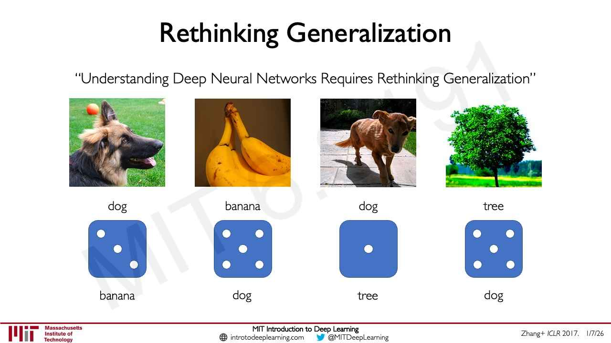

Build step: adds a second row of labels under the dice of slide 17.

Text: "Rethinking Generalization". Quoted subtitle: "“Understanding Deep Neural Networks Requires Rethinking Generalization”".

Footer credit: Zhang+ *ICLR* 2017.

The four photographs, their labels and the four dice are as on slide 17. Beneath each die is a new label: under the 3-pip die "banana"; under the 5-pip die "dog"; under the 1-pip die "tree"; under the second 5-pip die "dog". So the new labels differ from the original labels printed above the dice ("dog", "banana", "dog", "tree").

*Figure: yes — four photographs with original labels, a die face under each, and a second, different set of labels below*

## Slide 19 — Rethinking Generalization

Build step: replaces the dice of slide 18 with strike-throughs and arrows.

Text: "Rethinking Generalization". Quoted subtitle: "“Understanding Deep Neural Networks Requires Rethinking Generalization”".

Footer credit: Zhang+ *ICLR* 2017.

The four photographs are as before. Under each photograph the original label is struck through with a red line: "dog", "banana", "dog", "tree". Under each, a grey downward arrow points to a new label in a green oval: "banana", "dog", "tree", "dog" (left to right). The dice of slides 17-18 are gone.

*Figure: yes — four photographs whose original labels are crossed out and replaced, by arrows, with different labels*

## Slide 20 — Capacity of Deep Neural Networks

Text: "Capacity of Deep Neural Networks".

Footer credit: Zhang+ *ICLR* 2017.

A bar chart. Vertical axis: "accuracy", with tick labels "100%" (top) and "0%" (bottom). Horizontal axis: no axis title; labels "original labels" (under the first pair of bars), "randomization" (under the middle) and "completely random" (under the last pair). Six groups of bars. Legend at the bottom: a blue square "Training Set" and a green square "Testing Set". In this frame only the green (Testing Set) series is drawn; the blue (Training Set) series is not yet shown (build step: the blue bars appear on slide 21).

Series (1 drawn, green "Testing Set"), approximate heights left to right: about 87%, 71%, 55%, 33%, 22%, 17%, falling steadily from "original labels" to "completely random".

*Figure: yes — bar chart (test accuracy only) falling as labels become more random*

## Slide 21 — Capacity of Deep Neural Networks

Build step: adds the blue Training Set bars to slide 20.

Text: "Capacity of Deep Neural Networks".

Footer credit: Zhang+ *ICLR* 2017.

Same axes, labels and legend as slide 20 ("accuracy", 100% / 0%; "original labels", "randomization", "completely random"; legend "Training Set" in blue, "Testing Set" in green). Two series, six groups:

- Blue "Training Set": every one of the six bars is at 100%.
- Green "Testing Set": about 87%, 71%, 55%, 33%, 22%, 17% (as on slide 20).

*Figure: yes — bar chart: training accuracy stays at 100% while test accuracy falls from about 87% to about 17% as labels become random*

## Slide 22 — Capacity of Deep Neural Networks

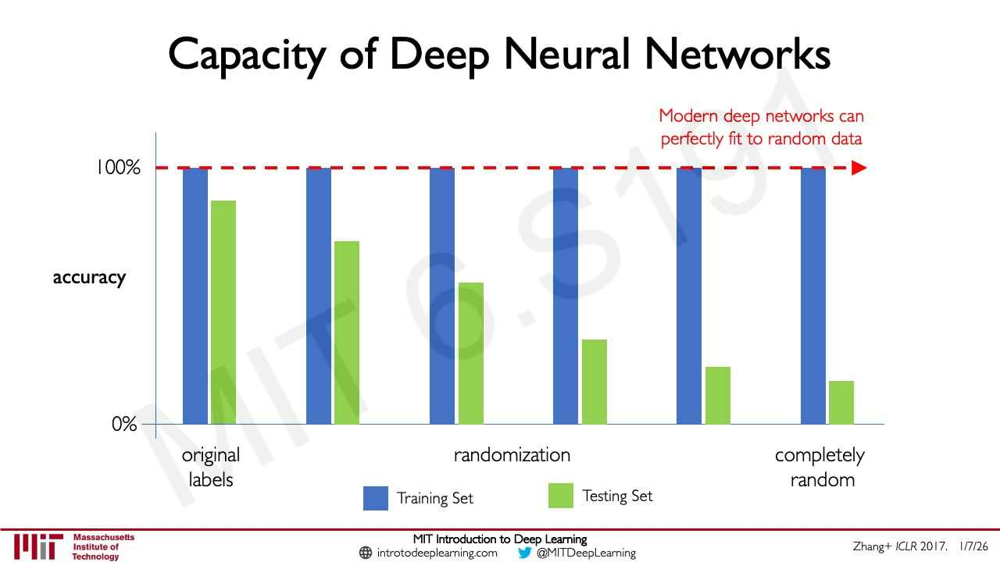

Build step: adds a callout and dashed line to slide 21.

Text: "Capacity of Deep Neural Networks".

Footer credit: Zhang+ *ICLR* 2017.

The chart of slide 21 is unchanged (blue Training Set bars all at 100%; green Testing Set bars about 87%, 71%, 55%, 33%, 22%, 17%). New: a red dashed horizontal line with an arrowhead at the right, at the 100% level, running across the tops of the blue bars, with red text above its right end: "Modern deep networks can perfectly fit to random data". The dashed line and text are an annotation, not a third series.

*Figure: yes — same bar chart with a red dashed line at 100% labelled "Modern deep networks can perfectly fit to random data"*

## Slide 23 — Neural Networks as Function Approximators

Text: "Neural Networks as Function Approximators". Subtitle: "Neural networks are **excellent** function approximators" (the word "excellent" is in a heavier weight).

A coordinate plane with a vertical axis and a horizontal axis (both blue, arrowheads at the top and right, unlabelled, no tick marks). The vertical axis crosses the horizontal one at about the middle of the plot. A cloud of 17 blue dots lies mostly left of and just right of the vertical axis, trending up to the right with a dip just right of the vertical axis, then rising to the upper right.

*Figure: yes — scatter plot of blue points on blank axes*

## Slide 24 — Neural Networks as Function Approximators

Build step: adds a fitted curve to slide 23.

Text: "Neural Networks as Function Approximators". Subtitle: "Neural networks are **excellent** function approximators".

Same axes and blue dots as slide 23. New: a thin red curve passing close to the dots: it rises to a local peak just left of the vertical axis, dips just right of the axis, then rises steeply through the dots at the upper right. It covers only the horizontal range of the dots.

*Figure: yes — scatter plot with a thin red curve fitted through the points*

## Slide 25 — Neural Networks as Function Approximators

Build step: adds a purple arrow and "?" to slide 24.

Text: "Neural Networks as Function Approximators". Subtitle: "Neural networks are **excellent** function approximators".

Same scatter plot and red curve as slide 24. New: a short purple upward arrow sitting on the horizontal axis just left of the vertical axis, with a purple "?" below it. It marks a query x-position within the range of the dots.

*Figure: yes — scatter plot with fitted red curve and a purple arrow with "?" on the x-axis*

## Slide 26 — Neural Networks as Function Approximators

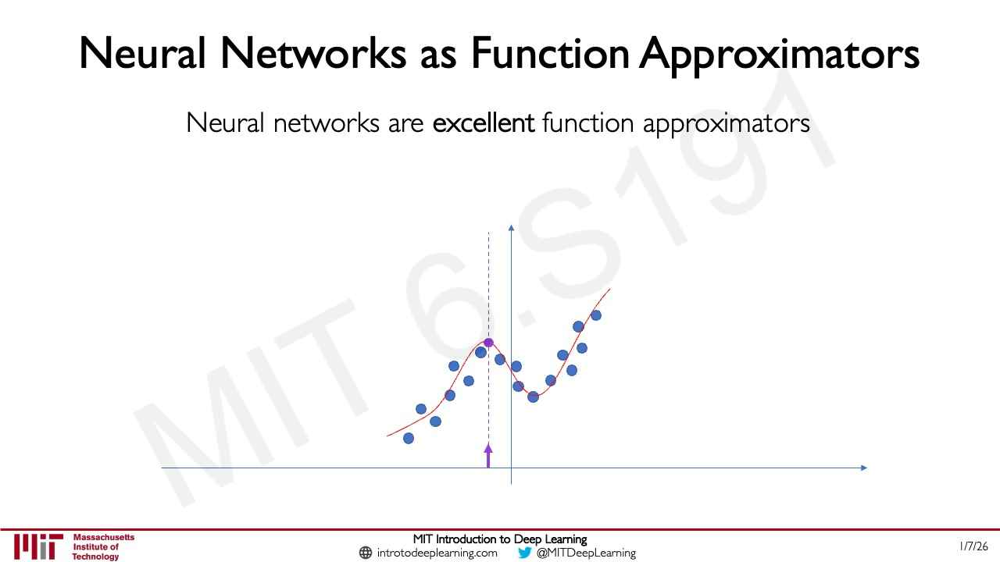

Build step: adds a vertical dashed line and a point to slide 25.

Text: "Neural Networks as Function Approximators". Subtitle: "Neural networks are **excellent** function approximators".

Same plot as slide 25 except that the "?" is gone. The purple arrow at the x-axis position now has a thin vertical dashed purple line rising from it to the red curve, ending in a purple dot on the curve at the curve's local peak.

*Figure: yes — scatter plot with fitted curve, and a purple dashed line from the x-axis to a purple point on the curve*

## Slide 27 — Neural Networks as Function Approximators

Build step: extends the red curve of slide 26 far beyond the data and removes the purple marker.

Text: "Neural Networks as Function Approximators". Subtitle: "Neural networks are **excellent** function approximators".

The blue dots and the red curve over their range are as on slide 24 (no purple arrow, line or point). The red curve is now extended on both sides: to the left, past the data, it dips and then shoots up to a tall sharp peak near the left of the slide, then drops to the left end at about the height of the lowest dots; to the right, past the last dot, it continues upward and flattens into a gently rising line that ends near the right of the plot, well above the dots. There are no data points in either extended region.

*Figure: yes — scatter plot with red curve that behaves wildly outside the range of the data*

## Slide 28 — Neural Networks as Function Approximators

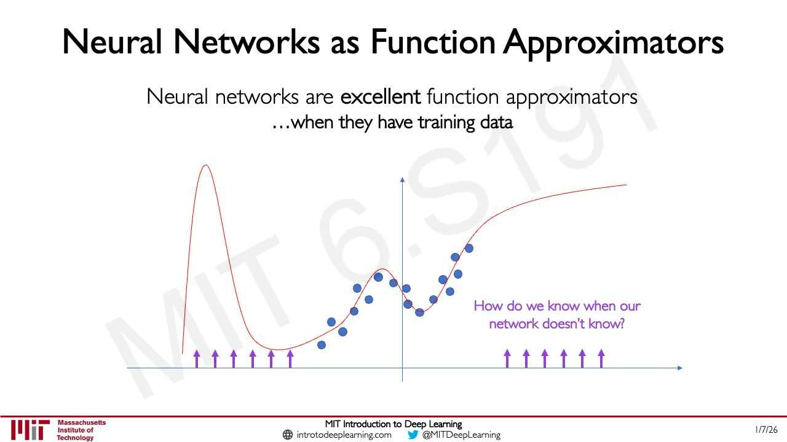

Build step: adds a subtitle line, purple arrows and a purple question to slide 27.

Text: "Neural Networks as Function Approximators". Subtitle: "Neural networks are **excellent** function approximators" (the word "excellent" in bold) and, on a second line in regular black type, "…when they have training data".

Plot with no axis labels or tick numbers. A blue horizontal axis with an arrowhead at the right and a blue vertical axis with an arrowhead at the top, crossing near the centre. The same 17 blue dots as slide 23 form a rough wavy band in the middle of the plot, just left and right of the vertical axis (a bump, a dip, then a rise). One red curve passes through the dots: from the far left it starts low, shoots up to a tall sharp peak well above the dots, falls to a shallow trough, rises gently through the dots (small peak, dip, then a steeper rise), and flattens into a slowly rising line toward the upper right. Outside the span of the dots the red curve is not near any data. Two groups of six purple upward-pointing arrows stand on the horizontal axis: one group at the far left under the tall peak and trough, one group at the right of the dots. Purple text between and above the right group: "How do we know when our network doesn't know?"

*Figure: yes — a curve fit through scattered data points, with wild behaviour outside the data and purple arrows marking the regions without training data*

## Slide 29 — Deep Learning = Alchemy?

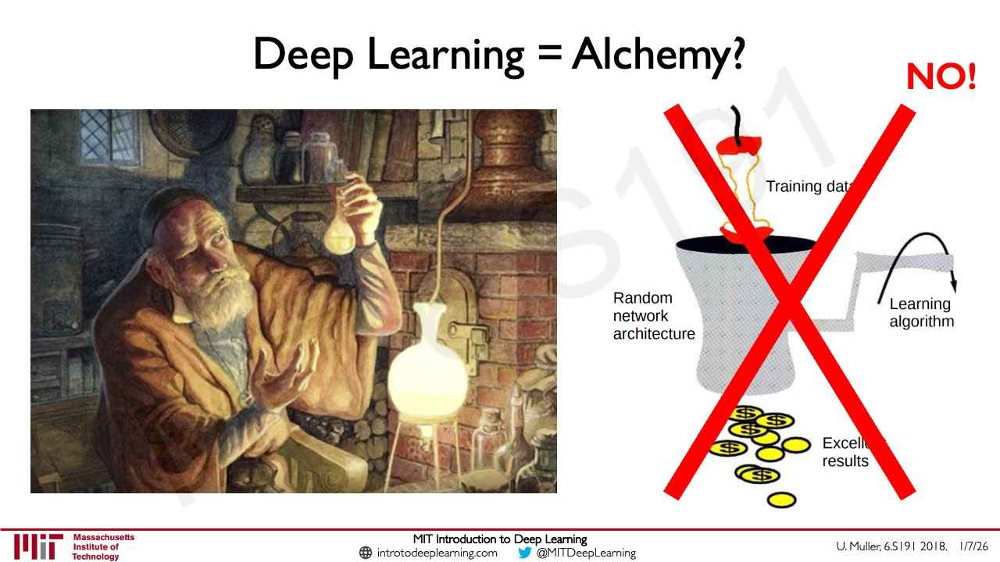

Text: "Deep Learning = Alchemy?". A red bold "NO!" at the top right.

Footer credit: U. Muller, 6.S191 2018.

Left: a painting of a bearded old man in a brown robe and cap holding up a flask of pale liquid in a cluttered alchemist's workshop (shelves of bottles and books, a copper still, a glowing flask over a flame, a brick furnace). Right: a cartoon diagram crossed out by a large red X. It shows a funnel-shaped grey hopper with a red object at the top feeding thread-like lines into it, labelled "Training data" (the end of the word is covered by the red X, so it reads "Training dat"); a label to its left "Random network architecture"; a crank-like arm at the right, labelled "Learning algorithm"; and gold coins at the bottom labelled "Excellent results" (printed "Excelle... results", partly hidden behind the red X, so "Excellent" is cut off).

*Figure: yes — a painting of an alchemist beside a cartoon of a data-in, coins-out machine crossed out with a red X*

## Slide 30 — Neural Network Failure Modes, Part 1

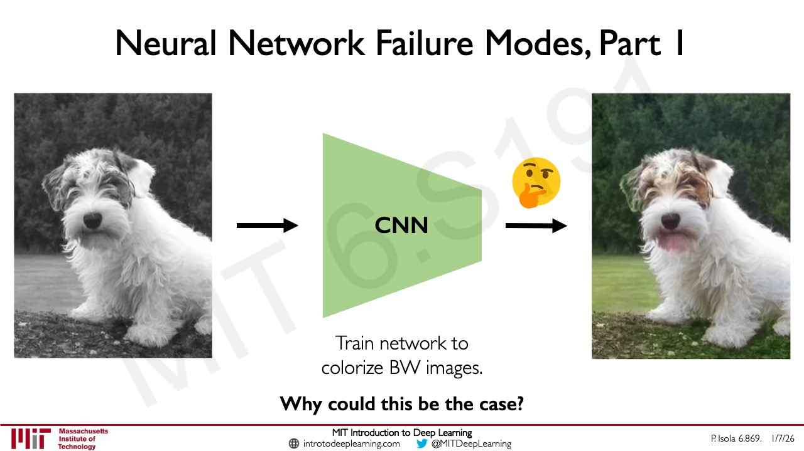

Text: "Neural Network Failure Modes, Part 1".

Footer credit: P. Isola 6.869.

Left: a grayscale photograph of a small shaggy white and grey dog sitting on grass in front of trees. A black arrow points right to a green trapezoid (wide on the left, narrowing to the right) labelled "CNN". A second black arrow points right from it, with a thinking-face emoji above the arrow, to a colourised version of the same photograph: the dog is white with brown patches around its eyes and on its right ear, its left ear (at the viewer's left) is tinted green, and the grey patch below its nose in the input has come out pink; the background trees are dark green and the grass is green. Below the CNN, text on two lines: "Train network to" / "colorize BW images." Below that, in bold: "Why could this be the case?"

*Figure: yes — a black-and-white dog photograph passing through a CNN to a colourised output with a green-tinted ear and a pink patch below the nose*

## Slide 31 — What Happens During Training…

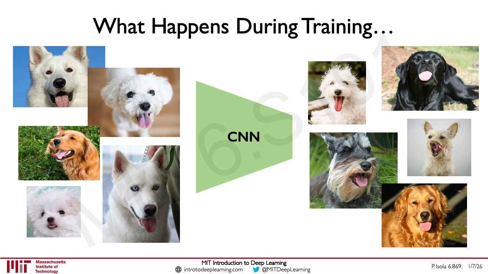

Text: "What Happens During Training…".

Footer credit: P. Isola 6.869.

Left: a collage of five photographs of dogs, all with open mouths and tongues out: a white dog on a blue background, a white fluffy dog on a brown background, a golden dog on grass looking sideways, a small white fluffy dog, and a white dog with a leash. In the centre, a green trapezoid labelled "CNN" (no arrows). Right: a collage of five more dog photographs, all with tongues out: a white shaggy dog, a black dog lying down, a grey schnauzer-like dog, a pale small dog licking its nose, and a golden dog. (The slide text itself does not state a conclusion.)

*Figure: yes — collages of dog photographs with tongues out on either side of a "CNN" trapezoid*

## Slide 32 — Neural Network Failure Modes, Part II

Text: "Neural Network Failure Modes, Part II".

Footer credit: ABC News.

A news collage. Top left: an ABC News headline "Tesla car was on autopilot prior to fatal crash in California, company says", italic subhead "The crash near Mountain View, California, last week killed the driver.", byline "By Mark Osborne", date "March 31, 2018, 1:57 AM • 5 min read", with the "abc NEWS" logo to the right. Below left: a photograph of a wrecked dark blue Tesla SUV against a concrete highway barrier, with firefighters and a fire truck behind it. Top right: a news video frame of a blue car, with the caption text "7-10 TIMES THE CAR WOULD SWIVEL TOWARD THAT SAME EXACT BARRIER", lower-third "DEADLY DISASTER" / "HIGHWAY CRASH" / "TESLA: AUTOPILOT WAS ON BEFORE MODEL X ACCIDENT", "ABC NEWS.com #WORLDNEWSTONIGHT", with a player bar reading "00:49 / 01:37". Bottom right: two side-by-side photographs, credited "COURTESY OF TESLA": left labelled "GOOGLE STREET VIEW" showing a highway divider with a white car, right labelled "THURSDAY, MARCH 22, 2018" showing the same divider end with a yellow-black chevron barrier and an orange cone, damaged.

*Figure: yes — news screenshots and photographs of a fatal Tesla autopilot crash into a highway barrier*

## Slide 33 — Uncertainty in Deep Learning

Text: "Uncertainty in Deep Learning".

Left row labels (bold): "Safety-critical applications" (top row) and "Sparse and/or noisy datasets" (bottom row).

Top row, three photographs with black caption tags in white text at the bottom: the wrecked Tesla photograph, tag "Autonomous Vehicles"; a doctor in white coat holding up a sheet of MRI scans to the light, tag "Medicine"; a crowd photograph with green face-detection boxes and small yellow confidence numbers (e.g. "1.000", "0.977"), tag "Facial Recognition".

Bottom row: a scatter plot with a black outline and tag "Imbalance" showing coloured clusters: a large salmon cluster at centre, a green-olive cluster at left, a mustard cluster at lower left, small teal, light-green and blue clusters at the top and bottom right, and a few purple points at left; and a photograph tagged "Data Noise" of a sunset with strong lens flare over a street and trees.

*Figure: yes — example photographs and plots for safety-critical applications and for imbalanced or noisy data*

## Slide 34 — Neural Network Failure Modes, Part III

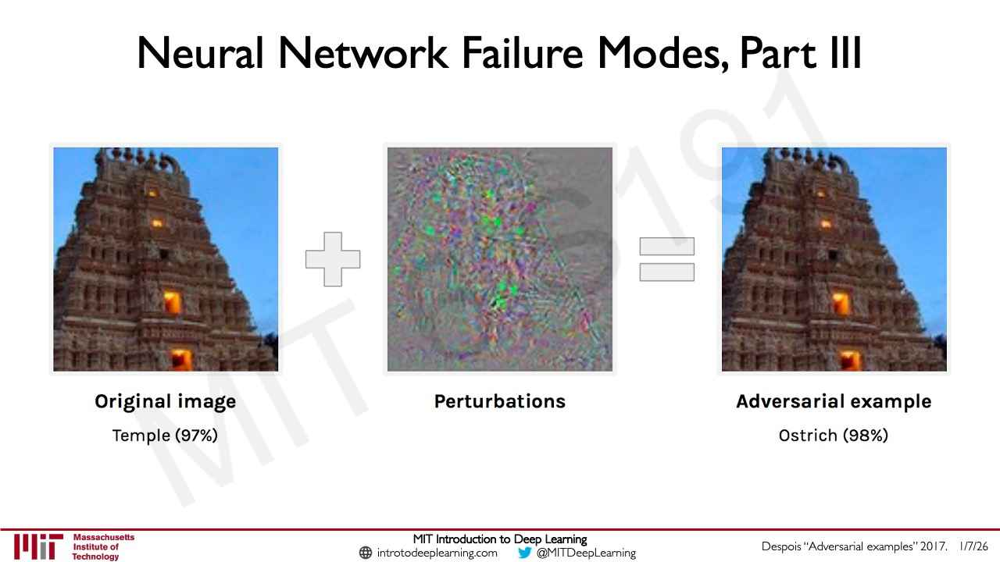

Text: "Neural Network Failure Modes, Part III".

Footer credit: Despois "Adversarial examples" 2017.

Three images joined by a plus sign and an equals sign (both drawn as light grey outlined shapes). Left: a photograph of a tall carved stone temple tower (gopuram) against a blue sky, with a few lit orange windows; caption in bold "Original image", below it "Temple (97%)". Middle: a square of grey noise with coloured speckles (green, purple, pink, blue) that vaguely forms a blob in the centre; caption in bold "Perturbations". Right: a photograph that looks the same as the left temple; caption in bold "Adversarial example", below it "Ostrich (98%)".

*Figure: yes — a temple photograph plus a noise pattern equals a visually identical image labelled Temple (97%) versus Ostrich (98%)*

## Slide 35 — Adversarial Attacks on Neural Networks

Build step: changes slide 34 (new title, the temple images faded, the perturbation image kept in full).

Text: "Adversarial Attacks on Neural Networks".

The three images and the plus and equals signs of slide 34 are shown. The left temple image with its caption "Original image" / "Temple (97%)", the plus and equals signs, and the right temple image with "Adversarial example" / "Ostrich (98%)" are faded almost to white. The middle noise image and its bold caption "Perturbations" are in full strength.

*Figure: yes — the perturbation noise image highlighted between two faded temple images*

## Slide 36 — Adversarial Attacks on Neural Networks

Text: "Adversarial Attacks on Neural Networks". Bold: "Remember:". Then "We train our networks with gradient descent". Equation:

$$W \leftarrow W - \eta \frac{\partial J(W, x, y)}{\partial W}$$

Italic quotation: "How does a small change in weights decrease our loss"

*Figure: no*

## Slide 37 — Adversarial Attacks on Neural Networks

Build step: adds green highlights to slide 36.

Text: as slide 36 ("Remember:", "We train our networks with gradient descent", the update rule $W \leftarrow W - \eta \frac{\partial J(W, x, y)}{\partial W}$, and the quotation "How does a small change in weights decrease our loss"). Four occurrences of $W$ are highlighted with light-green boxes: the $W$ on the left of the arrow, the $W$ after the arrow, the $W$ inside $J(W, x, y)$, and the $W$ in the denominator $\partial W$.

*Figure: no*

## Slide 38 — Adversarial Attacks on Neural Networks

Build step: adds a red highlight, a callout and an underline to slide 37.

Text: as slide 37, with the four $W$ highlights in light green. New: the $x, y$ inside $J(W, x, y)$ is highlighted in light red, with a red line and arrowhead from a bracket at the right pointing to it; the red-lined callout text at the right, on two lines: "Fix your image $x$," / "and true label $y$". The word "weights" in the quotation "How does a small change in weights decrease our loss" is underlined in green.

*Figure: no*

## Slide 39 — Adversarial Attacks on Neural Networks

Text: "Adversarial Attacks on Neural Networks". Bold: "Adversarial Image:". Then "Modify image to increase error". Equation:

$$x \leftarrow x + \eta \frac{\partial J(W, x, y)}{\partial x}$$

Italic quotation: "How does a small change in the input increase our loss"

Footer credit: Goodfellow+ *NIPS* 2014.

*Figure: no*

## Slide 40 — Adversarial Attacks on Neural Networks

Build step: adds green highlights and an underline to slide 39.

Text: as slide 39 ("Adversarial Image:", "Modify image to increase error", $x \leftarrow x + \eta \frac{\partial J(W, x, y)}{\partial x}$, and the quotation "How does a small change in the input increase our loss"). Four occurrences of $x$ are highlighted with light-green boxes: the $x$ left of the arrow, the $x$ after the arrow, the $x$ inside $J(W, x, y)$, and the $x$ in the denominator $\partial x$. The word "input" in the quotation is underlined in green.

*Figure: no*

## Slide 41 — Adversarial Attacks on Neural Networks

Build step: adds red highlights and a callout to slide 40.

Text: as slide 40, with the four $x$ highlights in light green and the underline under "input". New: the $W$ and the $y$ inside $J(W, x, y)$ are highlighted in light red, with two red arrowheads from a red bracket line running right to a callout on two lines: "Fix your weights $\boldsymbol{\theta}$," / "and true label $\boldsymbol{y}$". (The formula prints $W$ for the weights while the callout says $\theta$.)

*Figure: no*

## Slide 42 — Synthesizing Robust Adversarial Examples

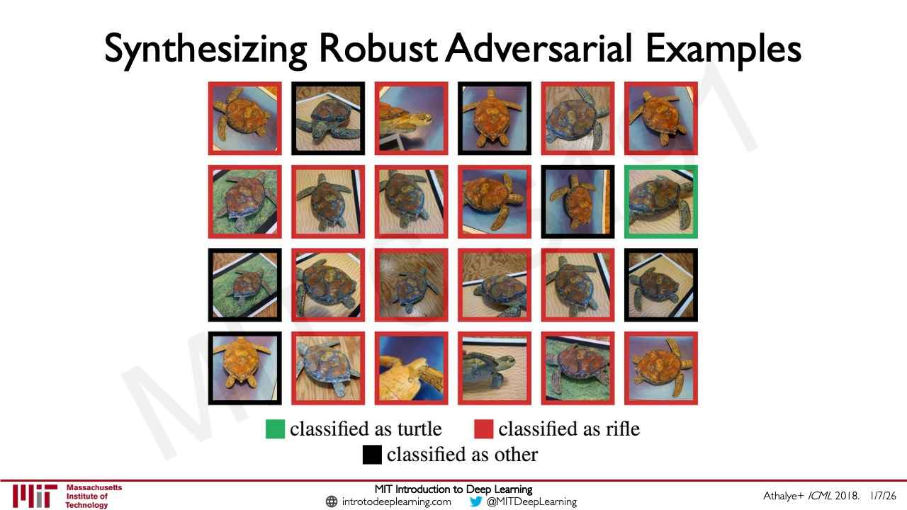

Text: "Synthesizing Robust Adversarial Examples".

Footer credit: Athalye+ *ICML* 2018.

A grid of 24 photographs (4 rows of 6), each a small image of a 3D-printed turtle seen from a different angle and against different backgrounds (sand, grass, blue backdrop, paper), each with a thick coloured border. Legend below: a green square "classified as turtle", a red square "classified as rifle", a black square "classified as other". Borders by row, left to right:

- Row 1: red, black, red, black, red, red.
- Row 2: red, red, red, red, black, green.
- Row 3: black, red, red, red, red, black.
- Row 4: black, red, red, red, red, red.

Counted from the page: 1 green, 17 red, 6 black.

*Figure: yes — a 24-image grid of a turtle from different viewpoints, mostly bordered red for "classified as rifle", one green for "turtle", six black for "other"*

## Slide 43 — Algorithmic Bias

Text: "Algorithmic Bias". A collage of news headlines in different fonts and sizes, as printed:

- "Overcoming Racial Bias In AI Systems And Startlingly Even In AI Self-Driving Cars"
- "AI expert calls for end to UK use of 'racially biased' algorithms"
- "Racial bias in a medical algorithm favors white patients over sicker black patients"
- "AI Bias Could Put Women's Lives At Risk - A Challenge For Regulators"
- "Gender bias in AI: building fairer algorithms"
- "Bias in AI: A problem recognized but still unresolved"
- "Amazon, Apple, Google, IBM, and Microsoft worse at transcribing black people's voices than white people's with AI voice recognition, study finds"
- "Millions of black people affected by racial bias in health-care algorithms" with the sub-line "Study reveals rampant racism in decision-making software used by US hospitals – and highlights ways to correct it."
- "When It Comes to Gorillas, Google Photos Remains Blind" with the sub-line "Google promised a fix after its photo-categorization software labeled black people as gorillas in 2015. More than two years later, it hasn't found one."
- "The Week in Tech: Algorithmic Bias Is Bad. Uncovering It Is Good."
- "Google 'fixed' its racist algorithm by removing gorillas from its image-labeling tech"
- "Artificial Intelligence has a gender bias problem – just ask Siri"
- "The Best Algorithms Struggle to Recognize Black Faces Equally" with the sub-line "US government tests find even top-performing facial recognition systems misidentify blacks at rates five to 10 times higher than they do whites."

At the lower right, an orange star with the bold label "6.S191 Lab".

*Figure: yes — a collage of news headlines about algorithmic bias*

## Slide 44 — Neural Network Limitations…

Text: "Neural Network Limitations…". Bullets (bold as printed):

- Very **data hungry** (eg. often millions of examples)
- **Computationally intensive** to train and deploy (tractably requires GPUs)
- Easily fooled by **adversarial examples**
- Can be subject to **algorithmic bias**
- Poor at **representing uncertainty** (how do you know what the model knows?)
- Uninterpretable **black boxes**, difficult to trust
- Often require **expert knowledge** to design, fine tune architectures
- Difficult to **encode structure** and prior knowledge during learning
- **Extrapolation**: struggle to go beyond the data

*Figure: no*

## Slide 45 — Neural Network Limitations…

Build step: highlights three bullets of slide 44 and fades the rest.

Text: the same nine bullets as slide 44. Six are faded to light grey (data hungry; computationally intensive; adversarial examples; expert knowledge; encode structure; extrapolation). "Can be subject to **algorithmic bias**" sits in a blue rounded bar. "Poor at **representing uncertainty** (how do you know what the model knows?)" and "Uninterpretable **black boxes**, difficult to trust" sit together in a green rounded bar. At the lower right, an orange star with the bold label "6.S191 Lab".

*Figure: no*

## Slide 46 — Neural Network Limitations…

Build step: changes the highlighting of slide 45.

Text: the same nine bullets as slide 44. Seven are faded to light grey (data hungry; computationally intensive; adversarial examples; algorithmic bias; representing uncertainty; black boxes; expert knowledge). "Difficult to **encode structure** and prior knowledge during learning" sits in an orange rounded bar and "**Extrapolation**: struggle to go beyond the data" in a yellow rounded bar.

*Figure: no*

## Slide 47 — New Frontiers I: Generative AI & Diffusion Models

Text (section divider, white on a blue background): "New Frontiers I:" and, on a second line, "Generative AI & Diffusion Models". (No footer; this slide's title is the divider text.)

*Figure: no*

## Slide 48 — The Landscape of Generative Modeling

Text: "The Landscape of Generative Modeling".

Left, a rounded blue-outlined panel with the heading "**Lecture 4:**" and "VAEs and GANs". Inside it two small architecture sketches. Top: a light-blue vertical bar, a green trapezoid narrowing to the right, a small salmon square, a purple trapezoid widening to the right, and a blue vertical bar (an encoder-decoder shape). Bottom: a salmon square feeding a purple trapezoid widening to the right and a blue bar; a light-blue bar above it; curved black lines from the blue bars to a green trapezoid narrowing to a small yellow circle (a generator and discriminator shape).

Middle, bold "Limitations" with three emoji-led items: "Mode collapse" (starburst), "Generating OOD" (light bulb), "Hard to train" (clasped hands).

Right, bold "Challenges" with four items: "Stability" (a balance-scale icon), "Efficiency" (lightning bolts), "Quality" (flexed arm), "Novelty" (a head with a thought bubble).

*Figure: yes — encoder-decoder and GAN schematics in a "Lecture 4" panel beside lists of limitations and challenges*

## Slide 49 — The Landscape of Generative Modeling

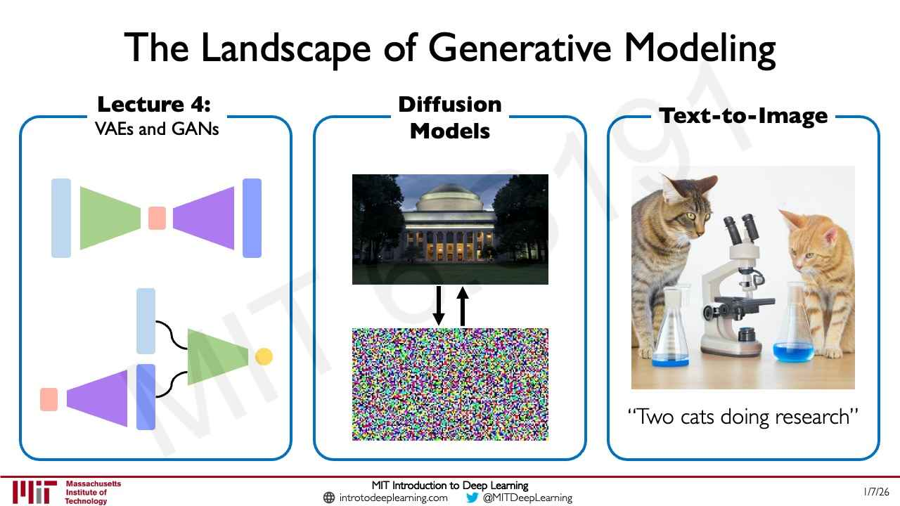

Build step: replaces the Limitations and Challenges lists of slide 48 with two new panels.

Text: "The Landscape of Generative Modeling". Three rounded blue-outlined panels side by side.

- Left panel: "**Lecture 4:**" / "VAEs and GANs", with the same two architecture sketches as slide 48.
- Middle panel: heading "**Diffusion Models**". A photograph of the MIT Great Dome building at dusk, a pair of black arrows below it (one pointing down, one pointing up), and below those a square of multicoloured random pixel noise.
- Right panel: heading "**Text-to-Image**". An image of two cats (a tabby and an orange cat) at a table with a microscope and two glass flasks with blue liquid, apparently a generated picture. Caption: "Two cats doing research"

*Figure: yes — three panels: VAE/GAN schematics, a photograph and noise image linked by up and down arrows, and a generated cats-with-microscope image captioned "Two cats doing research"*

## Slide 50 — Diffusion Models

Text: "Diffusion Models". Two rounded blue-outlined panels.

Left panel: "**VAEs/GANs:** Generating samples <u>in one-shot</u> directly from low-dimensional latent variables" ("in one-shot" underlined). Diagram: a small salmon block labelled $z$, with the caption "noisy latent vector" in salmon below; a single large purple trapezoid widening to the right; a tall blue bar labelled $x$, caption "generated sample" in blue.

Right panel: "**Diffusion:** Generating samples <u>iteratively</u> by repeatedly refining and removing noise" ("iteratively" underlined). Diagram, left to right: a tall salmon bar labelled $x_T$ (caption "noisy sample"); a purple hourglass-shaped block (wide at both ends, narrow in the middle); a tall pinkish-mauve bar labelled $x_i$ (caption "less noisy"); a second purple hourglass block; a light purple bar labelled $x_j$ (caption "even less noisy"); a third purple hourglass block; a tall blue bar labelled $x_0$ (caption "generated sample"). Captions are in the colour of their bar.

*Figure: yes — a one-step latent-to-sample network versus a chain* $x_T \to x_i \to x_j \to x_0$ *of three denoising blocks*

## Slide 51 — The Diffusion Process

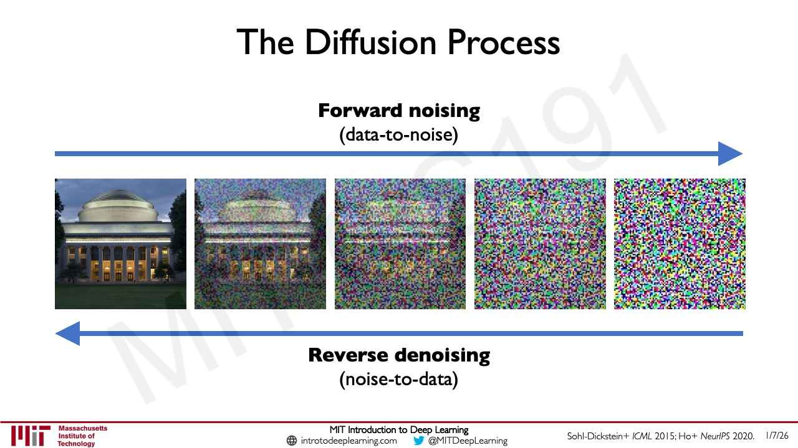

Text: "The Diffusion Process". Top: bold "Forward noising" and "(data-to-noise)" above a long blue arrow pointing right. Bottom: a long blue arrow pointing left, with bold "Reverse denoising" and "(noise-to-data)" below it.

Footer credit: Sohl-Dickstein+ *ICML* 2015; Ho+ *NeurIPS* 2020.

Between the arrows, a row of five square images: a photograph of the MIT Great Dome building at dusk; the same photograph with moderate coloured pixel noise; the same with heavy noise, the building barely visible; two nearly pure random-colour noise squares.

*Figure: yes — five images of a building photograph progressively replaced by noise, with forward-noising and reverse-denoising arrows*

## Slide 52 — Forward Noising

Text: "Forward Noising". "**Step 1:** Given an image (left), sample a random noise pattern (right)"

Left: a photograph of the MIT Great Dome building at dusk with lit windows. Right: a square of random multicoloured pixel noise of the same size.

*Figure: yes — a building photograph beside a random colour-noise image*

## Slide 53 — Forward Noising

Text: "Forward Noising". "**Step 2:** Progressively add more and more of the noise to your image"

Five square images in a row, each with a coloured border and a label above in bold. Below each image, two lines: the first in blue "N% image", the second in dark red "N% noise".

| Label | Border | Image | Blue line | Red line |
| --- | --- | --- | --- | --- |
| T = 0 | blue | the clean building photograph | 100% image | 0% noise |
| T = 1 | dark blue | building with light noise | 75% image | 25% noise |
| T = 2 | purple | building faintly visible under heavier noise | 50% image | 50% noise |
| T = 3 | magenta | almost pure noise | 25% image | 75% noise |
| T = 4 | red | pure noise | 0% image | 100% noise |

*Figure: yes — five images from the clean building photograph (T = 0) to pure noise (T = 4), with image and noise percentages*

## Slide 54 — Reverse Denoising

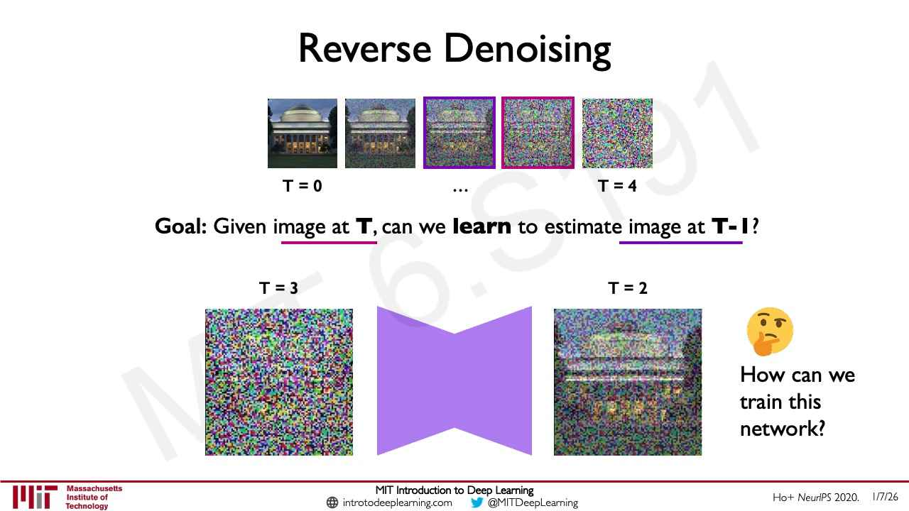

Text: "Reverse Denoising".

Footer credit: Ho+ *NeurIPS* 2020.

Top: a row of five small images: the clean building photograph; the building with light noise; a noisier image with a purple border; a noisier still image with a magenta border; and pure noise. Labels below, in bold: "T = 0" under the first, "…" under the middle, and "T = 4" under the last.

Then: "**Goal:** Given image at **T**, can we **learn** to estimate image at **T-1**?" "image at T," (with the T and the comma) is underlined in magenta and "image at T-1" in purple; the two colours match the borders of the third and fourth images above.

Bottom: a square noisy image labelled "T = 3" (heavy noise, building barely visible), then a purple hourglass-shaped block (wide at both ends, narrow in the middle), then a square image labelled "T = 2" (the building more visible under noise). To the right, a thinking-face emoji with the text "How can we train this network?" on three lines.

*Figure: yes — a noising sequence and a denoising network block mapping the T = 3 image to the T = 2 image*

## Slide 55 — Sampling Brand New Generations

Text: "Sampling Brand New Generations"

Above the image, the bold label "T". Centred below it, one large square image of pure multicoloured pixel noise (random coloured pixels in green, magenta, yellow, blue, cyan, black and white; no recognisable content). Nothing else is printed.

*Figure: yes — a single square of random coloured pixel noise labelled "T"*

## Slide 56 — Sampling Brand New Generations

Build step: adds a network and a second image to slide 55 (the layout is rearranged).

Text: "Sampling Brand New Generations"

Left: a square multicoloured noise image labelled "T" above it. Centre: a purple bow-tie shape (wide at both outer edges, narrowing to a waist in the middle; a symbol for the denoising network). Right: a second square noise image labelled "T-1" above it; it is still mostly noise, with a faint, slightly smoother patch near the centre. No arrows are printed.

*Figure: yes — noise image at T, a purple network shape, and a slightly less noisy image at T-1*

## Slide 57 — Sampling Brand New Generations

Build step: advances slide 56 by one step. The frame is caught mid-animation: the whole row is shifted left, so the "T-1" image sits in the left position and a second purple shape is partly visible at the far left edge.

Text: "Sampling Brand New Generations"

Left edge: the cut-off right half of a purple bow-tie shape. Left: a square noise image labelled "T-1" above it. Centre: a purple bow-tie shape. Right: a square image labelled "T-2" above it; it is noisy but a darker blotchy structure (a vague shape with lighter bands) is visible in it. No arrows are printed.

*Figure: yes — noise image at T-1, a purple network shape, and a slightly more structured image at T-2*

## Slide 58 — Sampling Brand New Generations

Build step: advances slide 57 by one step. Caught mid-animation in the same shifted layout: a cut-off purple shape at the far left edge.

Text: "Sampling Brand New Generations"

Left edge: the cut-off right half of a purple bow-tie shape. Left: a square image labelled "T-2" above it (noisy, with a darker blotchy structure). Centre: a purple bow-tie shape. Right: a square image labelled "T-3" above it; a photograph of a dog's face (ears up, snout and two front paws at the bottom) is now recognisable but still covered in coloured pixel noise. No arrows are printed.

*Figure: yes — noisy image at T-2 and a noisy but recognisable dog image at T-3 with a purple network shape between*

## Slide 59 — Sampling Brand New Generations

Build step: advances slide 58 by one step. Caught mid-animation in the same shifted layout: a cut-off purple shape at the far left edge.

Text: "Sampling Brand New Generations"

Left edge: the cut-off right half of a purple bow-tie shape. Left: a square image labelled "T-3" above it (the noisy dog). Centre: a purple bow-tie shape. Right: a square image labelled "T-4" above it; the dog (a black, white and brown dog with open mouth and tongue out, paws on a ledge) is clear with only light residual pixel noise. No arrows are printed.

*Figure: yes — noisy dog at T-3 and a mostly denoised dog at T-4 with a purple network shape between*

## Slide 60 — Sampling Brand New Generations

Build step: advances slide 59 by one step. Caught mid-animation in the same shifted layout: a cut-off purple shape at the far left edge.

Text: "Sampling Brand New Generations"

Left edge: the cut-off right half of a purple bow-tie shape. Left: a square image labelled "T-4" above it (the dog with light residual noise). Centre: a purple bow-tie shape. Right: a square image labelled "T0 (end)" above it: a clean, sharp photograph of the dog with a blurred golden-brown background. No arrows are printed.

*Figure: yes — dog with light noise at T-4 and the clean final dog image at "T0 (end)" with a purple network shape between*

## Slide 61 — Sampling Brand New Generations

Build step: shows the whole sequence of slides 55-60 on one row.

Text: "Sampling Brand New Generations"

A single row of six square images, with a purple bow-tie shape between each neighbouring pair (five shapes). Labels above the images, left to right: "T", "T-1", "T-2", "T-3", "T-4", "T-5 (end)". Images: pure coloured noise at T; noise with a faint centre smoothing at T-1; noise with a blotchy dog-like structure at T-2; a noisy but recognisable dog at T-3; a dog with light noise at T-4; the clean dog photograph at T-5 (end). The lower half of the slide is empty. No arrows are printed. (This slide labels the final image "T-5 (end)", whereas slide 60 labels it "T0 (end)".)

*Figure: yes — the full denoising chain from pure noise at T to a clean dog image at T-5 (end), with a network shape between each step*

## Slide 62 — Full-frame noise (no title, no footer)

The slide has no title, so this title is descriptive. It has no printed text and no footer. The entire 1280x720 page is filled edge to edge with multicoloured pixel noise (fine-grained random colour speckle in muted green, purple, blue, pink and white; no recognisable content). It looks like a single frame of a noise animation or video.

*Figure: no*

## Slide 63 — Full-frame noise (no title, no footer)

The slide has no title, so this title is descriptive. It has no printed text and no footer. As on slide 62, the entire 1280x720 page is filled with multicoloured pixel noise (a slightly different noise pattern from slide 62, with a few faint lighter patches near the centre; no recognisable content). It looks like another frame of the same noise animation or video.

*Figure: no*

## Slide 64 — Generating Images from Natural Language

Text: "Generating Images from Natural Language"

Footer credit: Ramesh+ *arXiv* 2022 (printed at the lower right of the left half, just above the footer line, because the photograph covers the right half of the slide; the standard footer text is shifted left to fit the left half and no date is printed).

Left half: below the title, the quoted prompt in monospaced type on two lines: "“A photo of an astronaut" / "riding a horse.”". A blue down arrow points from the prompt into a rounded light-blue box that contains a small black neural-network icon (three columns of circles joined by lines). The right half of the slide, full height, is one photograph-style image running to the slide edge: a pale grey-white astronaut in a spacesuit and helmet riding a pale grey-white horse that is mid-stride, against a black starry sky with a few small bright stars. Both figures have a rough, statue-like texture.

*Figure: yes — the prompt "A photo of an astronaut riding a horse." into a neural network box, and the generated image of an astronaut on a horse in space*

## Slide 65 — Text-to-Image Generation

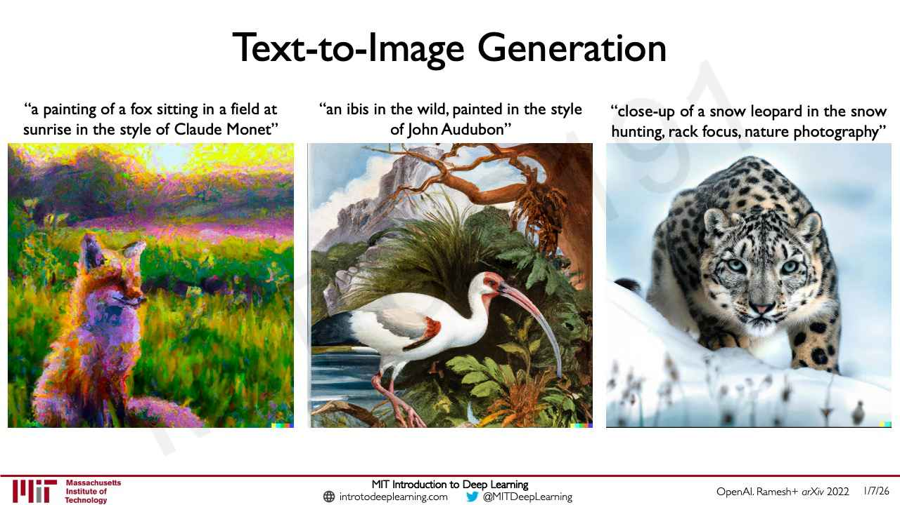

Text: "Text-to-Image Generation"

Footer credit: OpenAI. Ramesh+ *arXiv* 2022

Three images side by side, each with its prompt printed above it in quotation marks:

- Left: "“a painting of a fox sitting in a field at" / "sunrise in the style of Claude Monet”". The image is an impressionist-style painting of an orange-and-purple fox sitting in a green field with a yellow-pink sunrise sky, in short thick brush strokes.
- Centre: "“an ibis in the wild, painted in the style" / "of John Audubon”". The image is a detailed illustrated painting of a white ibis with a long curved red-tinged bill standing at the edge of water, among green plants, with a tree branch above and a rocky mountain behind.
- Right: "“close-up of a snow leopard in the snow" / "hunting, rack focus, nature photography”". The image is a photograph-style close-up of a snow leopard with pale blue eyes crouched in snow, looking at the viewer, the snowy background blurred.

*Figure: yes — three text-to-image examples with their prompts: a Monet-style fox, an Audubon-style ibis and a snow leopard photograph*

## Slide 66 — Beyond Images: Molecular Design

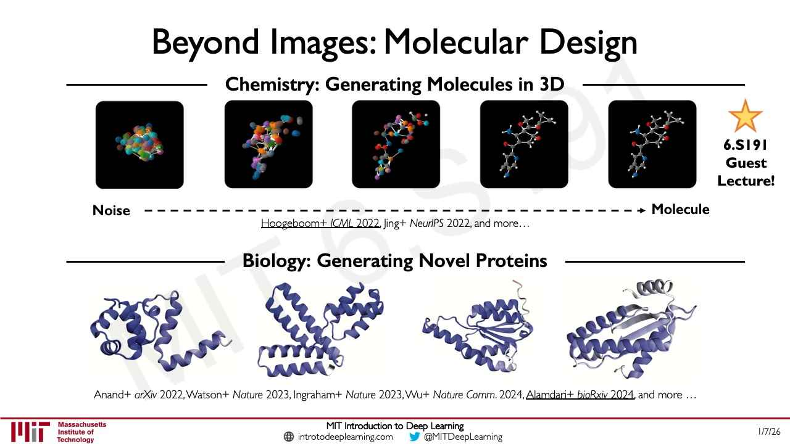

Text: "Beyond Images: Molecular Design"

Upper section, with the heading "Chemistry: Generating Molecules in 3D" (bold, with a horizontal rule on each side). Below it a row of five black rounded squares, each showing a 3D ball-and-stick structure, left to right: (1) a tight cluster of overlapping coloured balls (noise); (2) a looser, more spread cluster of coloured balls; (3) a spread-out chain-like structure of coloured balls with some bonds; (4) a recognisable molecule drawn in grey, red, blue and white balls and sticks; (5) the same molecule, almost identical to the fourth. Beneath the row, a bold "Noise" at left and a bold "Molecule" at right joined by a black dashed arrow pointing right. Under the arrow, the citation line: "Hoogeboom+ *ICML* 2022, Jing+ *NeurIPS* 2022, and more…" (the part "Hoogeboom+ ICML 2022" is underlined). At the right of this section, an orange star with the bold text "6.S191" / "Guest" / "Lecture!".

Lower section, with the heading "Biology: Generating Novel Proteins" (bold, with a horizontal rule on each side). Below it a row of four renderings of protein structures as blue-purple ribbon (helices and sheets) on white: (1) a compact bundle of helices with a short loop; (2) a branching arrangement of long helices; (3) a flat sheet with helices around it and a thin loop tail; (4) a lighter-purple sheet with helices on both sides. Beneath, the citation line: "Anand+ *arXiv* 2022, Watson+ *Nature* 2023, Ingraham+ *Nature* 2023, Wu+ *Nature Comm.* 2024, Alamdari+ *bioRxiv* 2024, and more …" (the part "Alamdari+ bioRxiv 2024" is underlined).

*Figure: yes — a noise-to-molecule sequence of five 3D molecule renderings, and four generated protein structure ribbons*

## Slide 67 — New Frontiers II: Large Language Models

Section divider. Text, white on a solid blue background and centred: "New Frontiers II:" and, in a smaller second line, "Large Language Models". No footer is printed.

*Figure: no*

## Slide 68 — Large Language Models (LLMs) and the World

Text: "Large Language Models (LLMs) and the World"

Two panels side by side under the title, and a logo below them.

- Left panel (dark grey-blue, a screenshot of the ChatGPT start page): heading "ChatGPT". Three columns, each with a small icon and a heading, and three rounded boxes. Column 1, sun icon, "Examples": "\"Explain quantum computing in simple terms\" →", "\"Got any creative ideas for a 10 year old's birthday?\" →", "\"How do I make an HTTP request in Javascript?\" →". Column 2, lightning-bolt icon, "Capabilities": "Remembers what user said earlier in the conversation", "Allows user to provide follow-up corrections", "Trained to decline inappropriate requests". Column 3, warning-triangle icon, "Limitations": "May occasionally generate incorrect information", "May occasionally produce harmful instructions or biased content", "Limited knowledge of world and events after 2021".
- Right panel (bright green with the serif text "GPT-4" at top left): a graphic of horizontal bars on a black field, in green and white of different lengths in about fifteen rows, arranged like lines of text with gaps. It carries no other labels.
- Below the panels, centred: the OpenAI logo (a knot-like emblem) with the word "OpenAI" in purple.

*Figure: yes — a ChatGPT start-page screenshot, a green "GPT-4" graphic of black, white and green bars, and the OpenAI logo*

## Slide 69 — What are LLMs?

Text: "What are LLMs?"

Three nested rounded rectangles in graduated shades of blue, each inside the previous one and aligned to the bottom edge, so the largest is lightest.

- Outer (lightest), heading in small capitals "Artificial Intelligence": "Any technique that enables computers to mimic human behavior". Icon: a head in profile containing gears, with circuit-line traces and small plus signs.
- Middle, heading "Deep Learning": "Extract patterns from data using neural networks". Icon: a white neural-network diagram of circles joined by lines.
- Inner (darkest), heading "Large Language Models": "Very, very large neural networks trained on very, very large sets of text". Below it a block of letters in three rows: "A B C D E F" / "G H I J K L" / "M N O P Q R".

Below the inner box: three gold stars and the bold text "6.S191 Lab & Guest Lectures!".

*Figure: yes — nested boxes showing LLMs inside deep learning inside artificial intelligence, with icons*

## Slide 70 — How do LLMs like GPT work?

Text: "How do LLMs like GPT work?"

"Training:" at upper left. A row from left to right: a blue document icon and a blue database (stacked cylinders) icon, together captioned "Dataset" with the two lines "Common Crawl, WebText, etc" and "Split into chunks – “tokens”"; a blue right arrow; a blue neural-network icon captioned "Model" with the two lines "GPT" and "175B parameters (GPT3)"; then a large blue curly brace opening to the right, beside the text block: "Task and Objective:" (black), "Given a sequence of tokens, predict the next token." (blue), "Update model parameters given how good next-token prediction is." (black).

At the bottom, centred, the question "How does next token prediction work?" followed by a thinking-face emoji.

*Figure: yes — dataset to GPT model diagram with the training objective, next-token prediction*

## Slide 71 — Next Token Prediction

Text: "Next Token Prediction"

A flow diagram with bold row labels at left, top to bottom: "Raw text", "Tokenization and embedding" (on two lines, "Tokenization" / "and embedding"), "Next-token prediction" (two lines), "Token probabilities" (two lines).

- Raw text: a white box with a black border containing "MIT deep learning is so awesome".
- Tokenization and embedding: five coloured rounded boxes in a row: "MIT" (peach), "deep" (light blue), "learning" (light yellow), "is" (light green), "so" (lilac). The "so" box is outlined by a red square.
- A black arrow runs from the raw text box down to the token row (to "learning"), and another from the token row down to a wide dark-blue box with white bold text "Large language model (LLM)".
- A black arrow from the LLM box points down to the next-token row: five boxes "deep", "learning", "is", "so", "awesome". All but "so" are faded to pale colours; "so" is shown in full lilac.
- A short black arrow runs from "so" down to a small bar chart (no labels or numbers) inside a red square: two black axes with four lilac bars; the bars are, left to right, medium, tallest, shortest, medium-short (so the second bar is the highest).
- At the right, a red box with bold black text "Cross entropy loss" ("Cross" / "entropy" / "loss"). A red arrow runs from the red square around "so" in the token row to the right and down into the "Cross entropy loss" box. A second red arrow runs from the red square around the bar chart to the right and up into the same box.

*Figure: yes — next-token-prediction pipeline from raw text through tokens and an LLM to token probabilities and a cross entropy loss*

## Slide 72 — Using LLMs to Generate Text

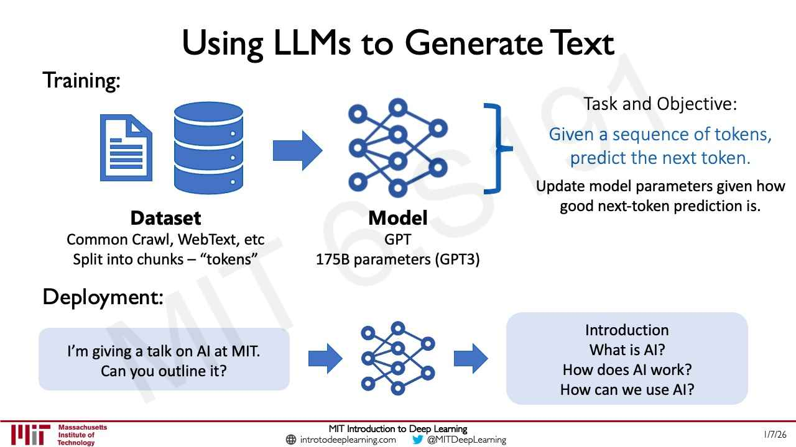

Text: "Using LLMs to Generate Text"

Upper part, "Training:" at upper left, repeats slide 70 in a more compact layout: blue document and database icons captioned "Dataset" (bold) with "Common Crawl, WebText, etc" and "Split into chunks – “tokens”"; a right arrow; a blue neural-network icon captioned "Model" (bold) with "GPT" and "175B parameters (GPT3)"; a curly brace and the text "Task and Objective:", "Given a sequence of tokens, predict the next token." (blue), "Update model parameters given how good next-token prediction is."

Lower part, "Deployment:" at left. A row: a light-blue rounded box with "I’m giving a talk on AI at MIT." / "Can you outline it?"; a blue right arrow; a blue neural-network icon; a blue right arrow; a light-blue rounded box with four lines "Introduction" / "What is AI?" / "How does AI work?" / "How can we use AI?".

*Figure: yes — training diagram and a deployment example: a prompt into a network producing a talk outline*

## Slide 73 — What capabilities do LLMs have?

Text: "What capabilities do LLMs have?"

Subtitle: "Capabilities that are feasible and reliable now:"

Three blue-icon columns, each with a blue heading above its icon:

- "Knowledge Retrieval": an open book with a magnifying glass over its left page and a picture (mountains) on the right page, with a cable running from the magnifier to a computer mouse.
- "Writing Co-Pilot": a document with text lines and a fountain pen with a signature squiggle beneath it.
- "Planning Co-Pilot": a smaller version of the knowledge-retrieval book, magnifier and mouse icon, beside three test tubes in a rack.

Bottom, centred: "LLMs like GPT have shown mastery over natural language."

*Figure: yes — three icon groups for knowledge retrieval, writing co-pilot and planning co-pilot*

## Slide 74 — Limitations of LLMs

Text: "Limitations of LLMs"

Four columns, each with a heading and an icon:

- "Robustness: How confident?" (two lines). A rounded box with the text "Cn @uN66rN you translate ths from Spanish to English?" where "Cn @uN66rN" and "ths" are in red and the rest is black. Beneath it the credit "Wang+ *arXiv* 2023."
- "“Hallucinations”: Confidently wrong" (two lines). A thought-bubble cloud with trailing small circles, containing "“GPT is a language model that…”".
- "Guardrails and Jailbreaks" (two lines). A person icon above and a computer monitor icon below, joined by two curved black arrows forming a loop (up on the right, down on the left), with the text "Model-level guardrails" in the centre.
- "Logic and Numerics" (two lines). An abacus icon.

Bottom, two centred lines: "Key challenges motivated by the high-level thinking process:" / "robustness + confidence; long-term planning; logic and discovery".

*Figure: yes — four icons for robustness (a garbled prompt), hallucinations, guardrails and jailbreaks, and logic and numerics*

## Slide 75 — What can LLMs do? Emergent Abilities with Scale.

Text: "What can LLMs do?" / "Emergent Abilities with Scale." (two title lines). Subtitle: "An ability is **emergent** if it is not present in smaller models but is present in larger models." ("emergent" bold and underlined).

Footer credit: Wei+ TMLR 2022.

Three line charts side by side, each with a title above, a log-scale x-axis labelled "Model Scale" and a pink dashed horizontal line (the chance or zero baseline). Marker positions are approximate readings.

Chart 1, "Structuring Language". Y-axis "Accuracy (%)", ticks 0 to 70 in steps of 10. X-axis ticks $10^{20}$, $10^{22}$, $10^{24}$. The dashed line is at 25. Three series:

- Green line with diamond markers: about 26 at near $10^{21}$, about 27 at about $10^{21.6}$, about 29 at $10^{22}$, then about 60 at about $10^{23.5}$.
- Brown line with triangle markers: about 25 at about $10^{21.6}$, about 28 at $10^{22}$, then about 67 at about $10^{23.5}$.
- Purple line with square markers: about 26 at about $10^{21.7}$, about 25 at $10^{22}$, about 26 at about $10^{22.3}$, then about 44 at about $10^{23.4}$.

Chart 2, "Understanding Phonetics". Y-axis "BLEU (%)", ticks 0 to 50 in steps of 10. X-axis ticks $10^{18}$, $10^{20}$, $10^{22}$, $10^{24}$. The dashed line is at 0. Two series:

- Blue line with circle markers: about 0 from about $10^{18.5}$ up to about $10^{22.2}$ (about 1 there), then about 15 at about $10^{23}$ and about 22 at about $10^{23.6}$.
- Purple line with square markers: about 0 up to about $10^{21}$, rising slowly to about 2 at $10^{21.7}$, about 4 and 5 at about $10^{22}$ and $10^{22.3}$, then about 23 at about $10^{23.5}$.

Chart 3, "Performing Arithmetic". Y-axis "Accuracy (%)", ticks 0 to 50 in steps of 10. X-axis ticks $10^{18}$, $10^{20}$, $10^{22}$, $10^{24}$. The dashed line is at 0. Two series:

- Purple line with square markers: about 0 to 1 up to about $10^{22}$ (about 1.5), about 9 at about $10^{22.4}$, then about 33 at about $10^{23.5}$.
- Blue line with circle markers: about 0 to 1 up to about $10^{22.4}$, about 8 at about $10^{23}$, then about 16 at about $10^{23.6}$.

No legends are printed.

*Figure: yes — three line charts showing accuracy or BLEU staying flat near baseline for small models and rising sharply at large model scale*

## Slide 76 — Emergent Abilities: Towards Intelligence

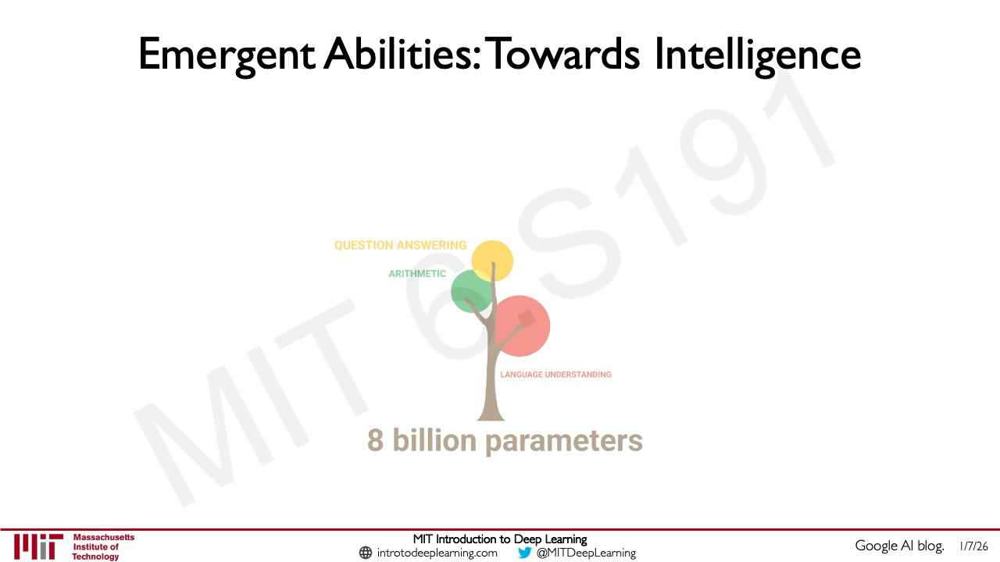

Text: "Emergent Abilities: Towards Intelligence"

Footer credit: Google AI blog.

Centred is a small flat illustration of a tree with a brown trunk and three branches ending in circular crowns: a yellow circle labelled "QUESTION ANSWERING" (at upper left, in yellow), a green circle labelled "ARITHMETIC" (in green), and a red circle labelled "LANGUAGE UNDERSTANDING" (in red, small, at the lower right of the red circle). Below the trunk, in large tan bold type: "8 billion parameters". The whole illustration is drawn in pale, washed-out colours. It looks like one frame of an animation in which the tree grows with model size.

*Figure: yes — a tree illustration with three coloured crowns (question answering, arithmetic, language understanding) above "8 billion parameters"*

## Slide 77 — Foundation Models Spawn a Powerful Idea

Text, white on a black background, on the right half of the slide, title on two lines: "Foundation Models" / "Spawn a Powerful Idea". Bold subtitle on two lines: "Towards a central reasoning system for" / "general-purpose AI". Bullets:

- "Can generative foundation models provide a central reasoning system?"
- "Design AI to improve and evolve AI itself"
- "Generative AI across images, biology, language, and more -- power and caution"

Bold closing lines: "Relationships and connections between" / "artificial and human intelligence".

The left third of the slide is a decorative photograph of a glowing blue network of nodes and lines (a 3D mesh of points joined by thin lines) on black. No footer is printed.

*Figure: no*

## Slide 78 — Lab 3: Fine-Tune an LLM, You Must!

Text, white on a black background, centred. First line: "MIT Introduction to Deep Learning". Second line: "Lab 3: Fine-Tune an LLM, You Must!". Third line, in red and underlined (a link): "github.com/MITDeepLearning/introtodeeplearning/tree/master/lab3". No footer is printed.

Below the text, a wide still image (a film frame in a green-teal tint) of the puppet-like green character Yoda, with large pointed ears and a wrinkled face, in a swampy setting with twisted tree roots, one hand raised to his chest. Yellow subtitle text at the bottom of the frame: "Do.   Or do not.  There is no try."

*Figure: yes — a film still of the character Yoda with the subtitle "Do. Or do not. There is no try."*

## Slide 79 — T-Shirts Coming Tomorrow!

Text, white on a black background, right side. Title: "T-Shirts Coming Tomorrow!". Then, in order:

- "**SYLLABUS:** bit.ly/6s191-syllabus" (the label bold and white, the link red and underlined).
- "1.   Project sign-ups due **TMRW 1/8 11:59pm ET**" (the last part bold).
- "2.   Lab competitions and prizes!" followed on the next line by "EXTENDED DEADLINE:  Friday 1/9 11:00am ET" (the deadline line has no number; "Friday 1/9 11:00am ET" is bold).
- "3. **Project and lab submission links on syllabus!**" (bold except the number).

At the left, a photograph of a dark-grey heathered t-shirt with a design in red and white: a row of tall boxes with criss-crossing lines spelling a stylised logo (red, one white), the vertical text "6.S191" at the right of it, and below it "DEEP LEARNING" in white small capitals. No footer is printed.

*Figure: yes — a photograph of the grey 6.S191 Deep Learning t-shirt*

## Slide 80 — Lab 3: Fine-Tune an LLM, You Must!

Identical to slide 78.

*Figure: yes — a film still of the character Yoda with the subtitle "Do. Or do not. There is no try."*

## Slide 81 — T-Shirts Coming Tomorrow!

Identical to slide 79.

*Figure: yes — a photograph of the grey 6.S191 Deep Learning t-shirt*
