# Lecture 9 — Secrets of Massively Parallel Training: slide-by-slide

Text and figures of all 22 slides of
[`6S191_MIT_DeepLearning_L9.pdf`](https://introtodeeplearning.com/slides/6S191_MIT_DeepLearning_L9.pdf)
(MIT 6.S191 Introduction to Deep Learning, 2026 edition; guest lecturer Mathias Lechner, co-founder and
CTO of Liquid AI), transcribed from the deck. The catalog lists this lecture as "Secrets of Massively
Parallel Training"; the title slide reads "Massively Parallel Training". Cite these as "slide N", where N
is the PDF page number. Diagrams, charts and equations are described in prose or reproduced, since the KB
is read as text.

The agenda (slide 2) ends with "Case Study: Training LFM2", but the deck has no slide for it: it ends with
the summary on slide 22. LFM2 models appear only on slides 6 and 17.

## Numbering: slide numbers vs PDF pages

The PDF is a flattened export: every page is a single 3524×1984 image with no text layer, and no page
prints a slide number. Headings therefore use the PDF page number, and a reader who opens page N of the
PDF sees slide N. The slides use one dark template with an upper-case title and a blue rule beneath it,
and carry no logos, footer, date or watermark (slide 2's Liquid AI logo is part of its content). Slide 4
is a build step of slide 5, transcribed separately.

## Images

12 slides carry their page image under the heading: 5, 7–9, 11 and 13–19 — every slide with a distinct
figure. They are 1400×789 downscales of the deck's 3524×1984 page images. The rest are the title, with a
decorative grid (1); the agenda (2); comparison cards, a concept diagram, tiles and summary lists whose text
the transcription reproduces exactly (3, 6, 12, 21, 22); slide 4, a build step of slide 5; and slides of
text or a table (10, 20). Use only an image path that appears below; slides without one have no image.

## Contents

| Slides | Section |
| ------ | ------- |
| 1 | Title: "Massively Parallel Training — Training Neural Networks at the Scale of Thousands of GPUs" |
| 2 | Agenda: about Liquid AI; why, what and how we scale; the (absent) LFM2 case study |
| 3–6 | Why we scale: GPUs against CPUs, larger datasets and larger models (Llama 2 training curves), the scaling imperative |
| 7 | Data parallelism |
| 8–11 | Memory: the memory needed for training, activation checkpointing, offloading to CPU memory, memory and network bandwidth in a cluster |
| 12–13 | Sharding; optimizer state sharding |
| 14–17 | Model parallelism: pipeline, tensor, sequence and context parallelism; mixture of experts and expert parallelism |
| 18–20 | Frameworks: DeepSpeed ZeRO, FSDP, Megatron-LM |
| 21–22 | Putting it all together (5D parallelism, a 2048-GPU example); summary |

## Slide 1 — Massively Parallel Training

Text: "MASSIVELY PARALLEL TRAINING" (title, blue-to-purple gradient). "Training Neural Networks at the Scale of Thousands of GPUs". "Mathias Lechner" (bold, blue). "Co-founder and CTO @ Liquid AI".

Title slide on a near-black navy background. Below the text is a decorative grid of rounded rectangles outlined in different colours (blue, green, orange, purple, teal, red, pink, yellow), each with a dark fill of its own hue: 16 columns by 8 rows, 128 cells, unlabelled. Five cells are lit with a bright glow: three red (row 1 column 6, row 2 column 10, row 7 column 7), one blue (row 4 column 7) and one orange (row 4 column 13). The glowing cells carry no labels.

*Figure: yes — decorative, unlabelled 16 × 8 grid of coloured cells, five of them lit*

## Slide 2 — Agenda

Text: "AGENDA". A rounded box with the Liquid AI logo (a white flame/drop shape) at its left: "About Liquid AI", "Foundation model company & MIT spin-off (2023)", "Recently released the LFM2 series of on-device optimized language models". Below: "Today's Talk". Three boxes side by side, joined by grey arrows pointing right (blue box to green box to orange box): blue box "Why We Scale" with "GPU vs CPU performance", "Scaling laws", "Data & model scaling"; green box "What We Scale" with "Data parallelism", "Model parallelism", "Sharding strategies"; orange-brown box "How We Scale" with "DeepSpeed ZeRO", "FSDP", "Megatron-LM". Beneath the three boxes, centred, an orange-outlined box: "Case Study: Training LFM2".

The agenda is a flow of three boxes with arrows between them, plus a separate case-study box under the middle one with no arrow.

*Figure: no*

## Slide 3 — Why Train on GPUs?

Text: "WHY TRAIN ON GPUS?". "2011: AlexNet — Start of the Deep Learning Revolution" (orange). "Trained on 2× GTX 580 GPUs". "Training a Neural Network is Matrix Multiplication". In a panel with a blue left edge, in monospace: "[256 × 4096] × [4096 × 4096] = 8.6 GFLOP" (the result "8.6 GFLOP" in blue).

Three cards in a row, each with a caption above, a name, a large TFLOPS figure, a precision and a time:

| Caption | Border colour | Name | Rate | Precision | Time |
| --- | --- | --- | --- | --- | --- |
| CPU (2011) | orange | Intel i7-3960X | 0.1 TFLOPS | FP32 | ≈ 86 ms |
| GPU (2011) | blue | GTX 580 | 1.58 TFLOPS | FP32 | ≈ 5.4 ms |
| GPU (2022) | green | NVIDIA H100 | 989 TFLOPS | BF16 | ≈ 8.7 µs |

Under the cards: "16× faster" (centred between the first two cards) and "~1000× since 2011" (centred under the third card, the H100, only). At the right, "Key Takeaway", "Training DNNs is", "compute intensive" (bold), "GPUs excel at parallel matrix operations".

*Figure: yes — comparison cards of CPU and GPU throughput and time for one 8.6 GFLOP matrix multiply*

## Slide 4 — Why Train on Larger Datasets?

Text: "WHY TRAIN ON LARGER DATASETS?". "Llama 2 7B — Meta's open-source large language model (2023)" ("Llama 2 7B" bold). Chart legend title "Llama-2", legend entry "7B". Y axis title "Train PPL"; X axis title "Processed Tokens (Billions)". Banner: "More training data → Lower loss → Better fit to the data". Below: "Kaplan et al. (2020) formalized this observation:" (italic "Kaplan et al. (2020)") and "Loss decreases as a **power law** with dataset size" ("power law" bold).

Chart on a white panel with a light lavender plot area and white grid lines. Linear axes. Y axis "Train PPL", ticks 1.4, 1.5, 1.6, 1.7, 1.8, 1.9, 2.0, 2.1, 2.2 (range about 1.4 to 2.2). X axis "Processed Tokens (Billions)", ticks 0, 250, 500, 750, 1000, 1250, 1500, 1750, 2000. The legend box holds a red line labelled "7B" and has empty space beneath it where the other entries are not shown. The chart is the same as slide 5's with three of the four curves faded to very faint thin lines (blue, green, pink), unlabelled in this version, so there is one emphasised series:

- Red, thick, labelled 7B: starts above 2.2 at 0 tokens, drops steeply to about 1.95 by 100, then about 1.92 at 250, 1.88 at 500, 1.83 at 1000, 1.78 at 1500 and about 1.75 at 2000. Monotonically decreasing, noisy.
- Three faint unlabelled curves below it (blue, green, pink), ending at about 1.67, 1.57 and 1.50 at 2000; they are the 13B, 34B and 70B curves of the next slide.

*Figure: yes — Llama 2 7B training perplexity falling with processed tokens, other model sizes faded*

## Slide 5 — Why Train Larger Models?

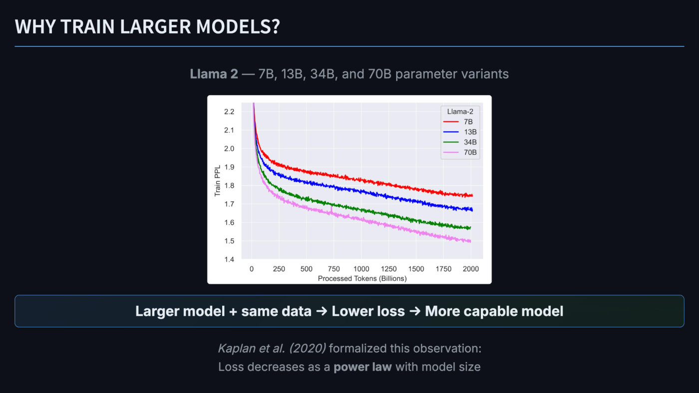

Text: "WHY TRAIN LARGER MODELS?". "Llama 2 — 7B, 13B, 34B, and 70B parameter variants" ("Llama 2" bold). Legend title "Llama-2", entries "7B", "13B", "34B", "70B". Y axis "Train PPL"; X axis "Processed Tokens (Billions)". Banner: "Larger model + same data → Lower loss → More capable model". Below: "Kaplan et al. (2020) formalized this observation:" and "Loss decreases as a **power law** with model size".

Build step: adds the three other curves (13B, 34B, 70B) and their legend entries, at full strength, to slide 4.

Chart as on slide 4 (white panel, linear axes, Y ticks 1.4 to 2.2 in steps of 0.1, X ticks 0 to 2000 in steps of 250). Four series, all decreasing and noisy, all starting above 2.2 at 0 tokens; approximate values:

| Series (colour) | 250 | 500 | 1000 | 1500 | 2000 |
| --- | --- | --- | --- | --- | --- |
| 7B (red) | 1.92 | 1.88 | 1.83 | 1.78 | 1.75 |
| 13B (blue) | 1.86 | 1.82 | 1.77 | 1.72 | 1.67 |
| 34B (green) | 1.77 | 1.73 | 1.68 | 1.62 | 1.57 |
| 70B (pink/violet) | 1.72 | 1.68 | 1.62 | 1.55 | 1.50 |

The curves never cross: larger models sit lower throughout. The pink curve shows one small spike near 750 billion tokens.

*Figure: yes — Llama 2 training perplexity versus tokens for 7B, 13B, 34B and 70B, larger models lower*

## Slide 6 — Recap: The Scaling Imperative

Text: "RECAP: THE SCALING IMPERATIVE". "Scaling Laws (Kaplan et al., 2020) + Chinchilla (Hoffmann et al., 2022)". A blue-outlined box "Larger Models" / "↑ Parameters"; a green-outlined box "More Data" / "↑ Tokens"; a central blue-outlined box "Better Performance" / "= Larger Models + More Data". Thin grey lines join the central box to each of the two side boxes (no arrowheads). Below, three dark cards: "GPT-3" (purple) "(2020)" "175B params, 300B tokens"; "LLaMA 2" (green) "(2023)" "70B params, 2T tokens"; "LFM2.5-1.2B" (orange) "(2026)" "1.2B params, 28T tokens".

*Figure: yes — small concept diagram (larger models and more data give better performance) above three cards listing parameters and tokens for GPT-3, LLaMA 2 and LFM2.5-1.2B*

## Slide 7 — Data Parallelism

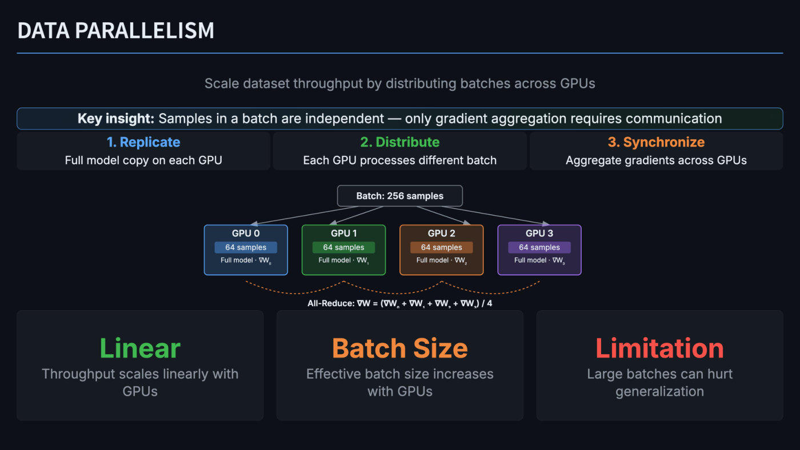

Text: "DATA PARALLELISM". "Scale dataset throughput by distributing batches across GPUs". Banner: "**Key insight:** Samples in a batch are independent — only gradient aggregation requires communication". Three step cards: "1. Replicate" (blue) "Full model copy on each GPU"; "2. Distribute" (green) "Each GPU processes different batch"; "3. Synchronize" (orange) "Aggregate gradients across GPUs".

Diagram: a box "Batch: 256 samples" at the top with four grey arrows fanning down, one to each of four GPU boxes in a row. Each GPU box has a title, a coloured bar and a line of small text:

| Box (border colour) | Bar | Line |
| --- | --- | --- |
| GPU 0 (blue) | 64 samples | Full model · ∇W₀ |
| GPU 1 (green) | 64 samples | Full model · ∇W₁ |
| GPU 2 (orange) | 64 samples | Full model · ∇W₂ |
| GPU 3 (purple) | 64 samples | Full model · ∇W₃ |

(The subscripts are printed small, as "∇W" followed by a subscript 0, 1, 2, 3.) Beneath the boxes an orange dashed curve links GPU 0 to GPU 1, GPU 1 to GPU 2 and GPU 2 to GPU 3 (three scallops), and below it the label "All-Reduce: ∇W = (∇W₀ + ∇W₁ + ∇W₂ + ∇W₃) / 4", which touches the cards beneath, so the bottoms of its subscripts are cut off.

Three cards at the bottom: "Linear" (green) "Throughput scales linearly with GPUs"; "Batch Size" (orange) "Effective batch size increases with GPUs"; "Limitation" (red) "Large batches can hurt generalization".

*Figure: yes — diagram of a 256-sample batch split into four 64-sample shards on four GPUs, with an all-reduce averaging the four gradients*

## Slide 8 — Memory Requirements for Training

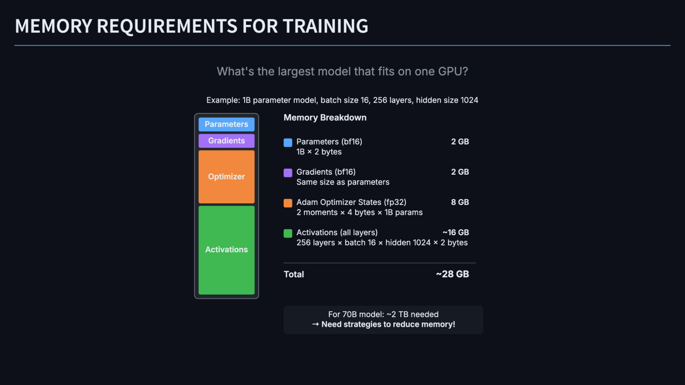

Text: "MEMORY REQUIREMENTS FOR TRAINING". "What's the largest model that fits on one GPU?". "Example: 1B parameter model, batch size 16, 256 layers, hidden size 1024". "Memory Breakdown".

At left, a vertical stack in a rounded outline, top to bottom: a blue block "Parameters" (short), a purple block "Gradients" (short), an orange block "Optimizer" (tall), a green block "Activations" (tallest). Block heights are roughly in the ratio of the sizes at right (2, 2, 8, ~16 GB). At right, a list with a colour square matching each block:

| Colour | Item | Size | Working |
| --- | --- | --- | --- |
| blue | Parameters (bf16) | 2 GB | 1B × 2 bytes |
| purple | Gradients (bf16) | 2 GB | Same size as parameters |
| orange | Adam Optimizer States (fp32) | 8 GB | 2 moments × 4 bytes × 1B params |
| green | Activations (all layers) | ~16 GB | 256 layers × batch 16 × hidden 1024 × 2 bytes |

A rule, then "Total" "~28 GB". In a box at the bottom right: "For 70B model: ~2 TB needed" and "→ Need strategies to reduce memory!" (second line bold).

*Figure: yes — stacked memory bar and itemised breakdown of training memory for a 1B-parameter model*

## Slide 9 — Activation Checkpointing

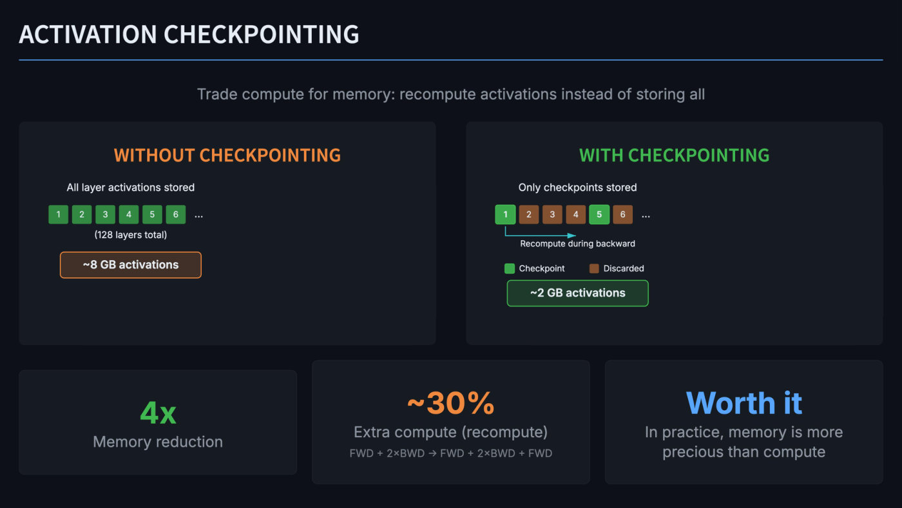

Text: "ACTIVATION CHECKPOINTING". "Trade compute for memory: recompute activations instead of storing all". Two panels.

Left panel "WITHOUT CHECKPOINTING" (orange): "All layer activations stored"; a row of six small green numbered squares "1" "2" "3" "4" "5" "6" followed by "..."; "(128 layers total)"; an orange-outlined box "~8 GB activations".

Right panel "WITH CHECKPOINTING" (green): "Only checkpoints stored"; a row of six numbered squares followed by "...": squares 1 and 5 are green, squares 2, 3, 4 and 6 are brown; a teal arrow running right from beneath square 1, labelled "Recompute during backward"; a legend "Checkpoint" (green square) and "Discarded" (brown square); a green-outlined box "~2 GB activations".

Three cards at the bottom: "4x" (green) "Memory reduction"; "~30%" (orange) "Extra compute (recompute)" and, in small grey type, "FWD + 2×BWD → FWD + 2×BWD + FWD"; "Worth it" (blue) "In practice, memory is more precious than compute".

Note on the deck: this slide prints "128 layers total" and "~8 GB activations" while slide 8 gives 256 layers and ~16 GB of activations.

*Figure: yes — two rows of numbered layer boxes contrasting all activations stored (~8 GB) with only checkpoints stored (~2 GB)*

## Slide 10 — Offloading to CPU Memory

Text: "OFFLOADING TO CPU MEMORY". Left column, three cards. A blue-outlined card: "**Idea:** Push infrequently used data to slower but larger memory tier". Card "WHAT TO OFFLOAD?" (green) with bullets: "**Optimizer states** — only needed during parameter update"; "**Inactive layer parameters** — fetch when needed"; "**Activations** — stored for backward pass". Card "WHY IT CAN WORK" (blue): "Data is accessed *infrequently* → transfer overhead amortized over many compute operations".

Right column. An orange-edged card "⚠ THE BANDWIDTH PROBLEM" (a warning-sign triangle icon precedes the heading) holding two sub-cards: "3.35 TB/s" (green) "HBM (H100)" and "64 GB/s" (orange) "PCIe 5.0"; beneath them "**52× slower** to fetch from CPU memory" and "Must pass through PCIe bus + DDR memory". Card "NICHE APPLICATIONS" (purple) with bullets: "**Fine-tuning very large models** on limited hardware"; "**Context length extension** (long sequences)"; "Scenarios where *very little training* is needed".

*Figure: no*

## Slide 11 — Memory & Network Bandwidth

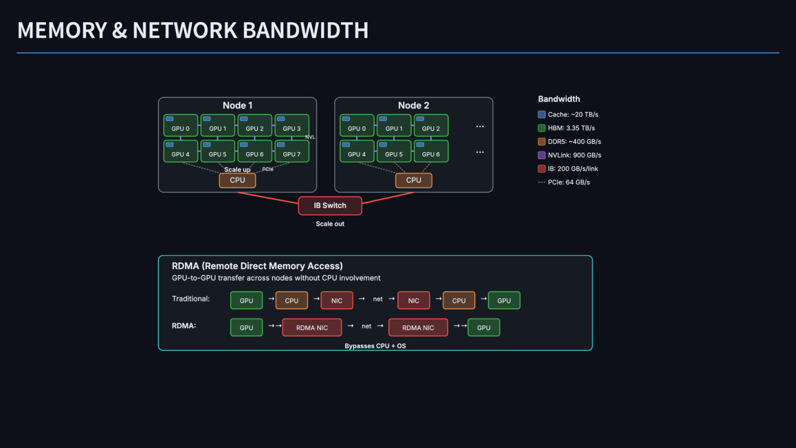

Text: "MEMORY & NETWORK BANDWIDTH". Legend, titled "Bandwidth": blue square "Cache: ~20 TB/s"; green square "HBM: 3.35 TB/s"; brown square "DDR5: ~400 GB/s"; purple square "NVLink: 900 GB/s"; red square "IB: 200 GB/s/link"; grey dashed line "PCIe: 64 GB/s".

Top diagram: two rounded node boxes side by side.

- "Node 1" holds eight green-outlined GPU boxes in two rows of four: "GPU 0", "GPU 1", "GPU 2", "GPU 3" above "GPU 4", "GPU 5", "GPU 6", "GPU 7". Each GPU box has a small blue rectangle (cache) in its top-left corner. Short purple connectors join horizontally adjacent GPUs and vertically adjacent GPUs (each GPU above its partner below); a small label "NVL" sits at the right edge beside GPU 3. Grey dashed lines run from GPU 4, GPU 5, GPU 6 and GPU 7 down to an orange-outlined "CPU" box at the bottom centre of the node; small labels "Scale up" (bold, white) and "PCIe" lie on those lines.
- "Node 2" holds six GPU boxes in two rows of three ("GPU 0", "GPU 1", "GPU 2" above "GPU 4", "GPU 5", "GPU 6"), the same blue cache rectangles and purple connectors, then to the right of them two ellipses "..." (one per row). Grey dashed lines run from GPU 4, GPU 5 and GPU 6 to an orange "CPU" box.

A red line runs from the bottom border of each node (just below its CPU box) down to a dark red box "IB Switch" between and below the nodes, with the bold label "Scale out" under it.

Bottom panel (teal outline): "RDMA (Remote Direct Memory Access)" and "GPU-to-GPU transfer across nodes without CPU involvement". Two rows of boxes joined by arrows:

- "Traditional:" "GPU" (green) → "CPU" (orange) → "NIC" (red) → "net" → "NIC" (red) → "CPU" (orange) → "GPU" (green).
- "RDMA:" (bold) "GPU" (green) →→ "RDMA NIC" (dark red) → "net" → "RDMA NIC" (dark red) →→ "GPU" (green).

Under the RDMA row, centred on the panel's lower edge: "Bypasses CPU + OS" (bold).

*Figure: yes — two eight-/six-GPU nodes with NVLink, PCIe and InfiniBand links and their bandwidths, plus a traditional versus RDMA transfer path*

## Slide 12 — Sharding

Text: "SHARDING". A blue-outlined box: "Definition: Sharding" (bold) and "Partition data across multiple machines to distribute compute and memory". A grey arrow points down from it to "For Neural Network Training" (bold). Below, four coloured tiles touching in a row, each with a bold title and a smaller line: blue "Model Weights" / "Parameters W, b"; orange "Optimizer States" / "Adam: m, v"; green "Activations" / "Forward pass outputs"; purple "Data / Gradients" / "Batches, dL/dW". Then an orange-outlined box: "Key Trade-off" (bold) and "Sharding reduces memory per device, but requires communication to gather data".

*Figure: yes — four coloured tiles naming what can be sharded in neural network training*

## Slide 13 — Optimizer State Sharding

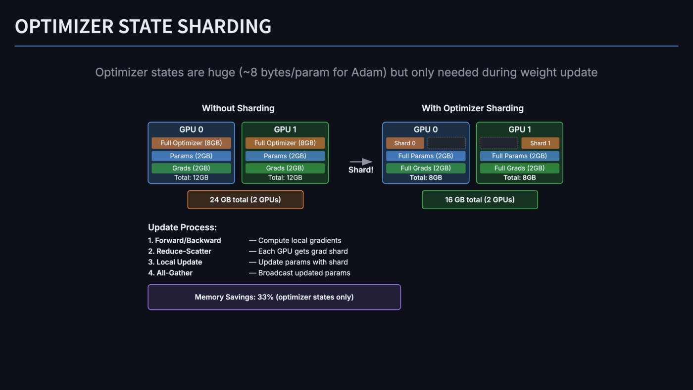

Text: "OPTIMIZER STATE SHARDING". "Optimizer states are huge (~8 bytes/param for Adam) but only needed during weight update". Two column headings "Without Sharding" and "With Optimizer Sharding", an arrow between them labelled "Shard!".

Without Sharding: two GPU boxes (GPU 0 blue-outlined, GPU 1 green-outlined), each containing three bars and a total, identical in both:

- "Full Optimizer (8GB)" (orange-brown bar)
- "Params (2GB)" (blue bar)
- "Grads (2GB)" (green bar)
- "Total: 12GB"

Beneath them an orange-outlined box "24 GB total (2 GPUs)".

With Optimizer Sharding: two GPU boxes. GPU 0 holds a top row of two half-width slots: an orange-brown "Shard 0" and an empty dashed slot; then "Full Params (2GB)" (blue), "Full Grads (2GB)" (green), "Total: 8GB". GPU 1 holds a top row with an empty dashed slot on the left and an orange-brown "Shard 1" on the right; then "Full Params (2GB)", "Full Grads (2GB)", "Total: 8GB". Beneath them a green-outlined box "16 GB total (2 GPUs)".

"Update Process:" (bold), four rows (step in bold, then text):

| Step | Description |
| --- | --- |
| 1. Forward/Backward | — Compute local gradients |
| 2. Reduce-Scatter | — Each GPU gets grad shard |
| 3. Local Update | — Update params with shard |
| 4. All-Gather | — Broadcast updated params |

A purple-outlined box: "Memory Savings: 33% (optimizer states only)".

*Figure: yes — per-GPU memory bars with and without optimizer-state sharding across two GPUs (12 GB each versus 8 GB each)*

## Slide 14 — Pipeline Parallelism

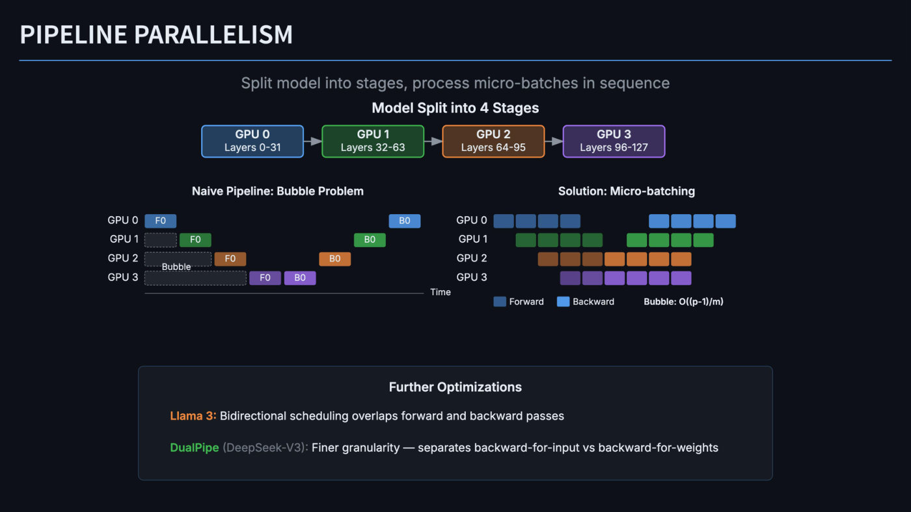

Text: "PIPELINE PARALLELISM". "Split model into stages, process micro-batches in sequence". "Model Split into 4 Stages" (bold). Four boxes joined left to right by grey arrows: "GPU 0" "Layers 0-31" (blue); "GPU 1" "Layers 32-63" (green); "GPU 2" "Layers 64-95" (orange); "GPU 3" "Layers 96-127" (purple).

Left diagram "Naive Pipeline: Bubble Problem": four rows labelled "GPU 0" to "GPU 3" and a time axis (a horizontal line ending in the label "Time") beneath. One block per row for forward and one for backward, drawn left to right in time:

- GPU 0: "F0" (blue) at the far left; "B0" (light blue) at the far right.
- GPU 1: a dashed empty slot (one block wide), then "F0" (green); later "B0" (green) left of GPU 0's B0.
- GPU 2: a dashed empty slot (two blocks wide), then "F0" (orange); later "B0" (orange).
- GPU 3: a dashed empty slot (three blocks wide), then "F0" (purple) immediately followed by "B0" (lighter purple).

The word "Bubble" straddles the bottom edge of GPU 2's dashed slot and sits just above GPU 3's slot. The B0 blocks step back toward the left as the GPU number rises (GPU 3's first, GPU 0's last), the mirror image of the forwards.

Right diagram "Solution: Micro-batching": four rows labelled "GPU 0" to "GPU 3", no block text. Each row has darker blocks (forward) then lighter blocks (backward), staggered so each lower GPU starts one block later:

- GPU 0: 4 dark blue blocks, a gap, then 4 light blue blocks.
- GPU 1: 4 dark green blocks (starting one slot later), a gap, then 4 light green blocks.
- GPU 2: 3 dark brown blocks, then 4 lighter orange blocks.
- GPU 3: 2 dark purple blocks, then 4 lighter purple blocks.

Legend: dark blue square "Forward", light blue square "Backward", then "Bubble: O((p-1)/m)" (bold).

Bottom panel "Further Optimizations": "**Llama 3:** Bidirectional scheduling overlaps forward and backward passes" ("Llama 3:" orange); "**DualPipe** (DeepSeek-V3): Finer granularity — separates backward-for-input vs backward-for-weights" ("DualPipe" green, "(DeepSeek-V3):" grey).

*Figure: yes — pipeline schedules for four GPUs, naive with idle bubbles versus micro-batched*

## Slide 15 — Tensor Parallelism

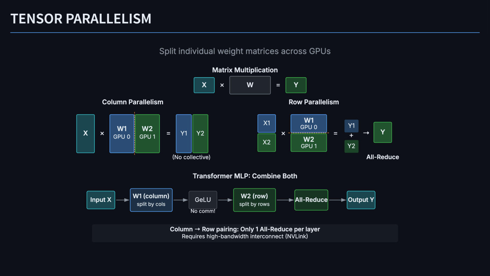

Text: "TENSOR PARALLELISM". "Split individual weight matrices across GPUs". "Matrix Multiplication" (bold). Equation boxes: "X" (teal) "×" "W" (grey) "=" "Y" (green).

Column Parallelism (left): "X" (a tall teal block) "×" then two tall blocks side by side, touching, separated by a dashed orange vertical line: "W1" "GPU 0" (blue) and "W2" "GPU 1" (green); "=" then two tall blocks "Y1" (blue) and "Y2" (green) side by side. Caption beneath: "(No collective)".

Row Parallelism (right): two stacked blocks "X1" (blue) over "X2" (green); "×"; two stacked blocks separated by a dashed orange horizontal line: "W1" "GPU 0" (blue) over "W2" "GPU 1" (green); "="; "Y1" (blue), "+", "Y2" (green) stacked vertically; "→"; "Y" (green). Label beneath: "All-Reduce" (bold).

"Transformer MLP: Combine Both" (bold). A row of boxes joined by grey arrows: "Input X" (teal) → "W1 (column)" / "split by cols" (blue) → "GeLU" (grey; the label "No comm!" is printed beneath it) → "W2 (row)" / "split by rows" (green) → "All-Reduce" (green) → "Output Y" (teal).

Bottom box: "Column → Row pairing: Only 1 All-Reduce per layer" (bold) and "Requires high-bandwidth interconnect (NVLink)".

*Figure: yes — column-parallel and row-parallel matrix splits across two GPUs and their pairing in a transformer MLP*

## Slide 16 — Sequence & Context Parallelism

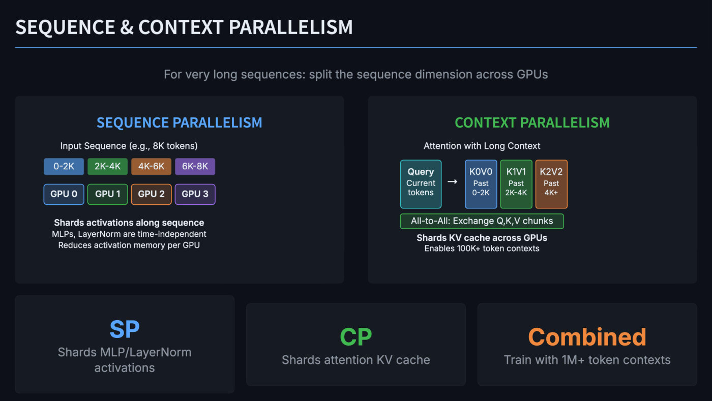

Text: "SEQUENCE & CONTEXT PARALLELISM". "For very long sequences: split the sequence dimension across GPUs". Two panels.

Left panel "SEQUENCE PARALLELISM" (blue): "Input Sequence (e.g., 8K tokens)". A row of four coloured chips "0-2K" (blue), "2K-4K" (green), "4K-6K" (orange), "6K-8K" (purple); beneath it, aligned under each chip, four boxes "GPU 0" (blue), "GPU 1" (green), "GPU 2" (orange), "GPU 3" (purple). Then "**Shards activations along sequence**" (bold), "MLPs, LayerNorm are time-independent", "Reduces activation memory per GPU".

Right panel "CONTEXT PARALLELISM" (green): "Attention with Long Context". A teal box "Query" (bold) / "Current" / "tokens", then a right arrow "→", then three boxes: "K0V0" / "Past" / "0-2K" (blue); "K1V1" / "Past" / "2K-4K" (green); "K2V2" / "Past" / "4K+" (orange). Beneath, a green-outlined bar "All-to-All: Exchange Q,K,V chunks". Then "**Shards KV cache across GPUs**" (bold) and "Enables 100K+ token contexts".

Three cards at the bottom: "SP" (blue) "Shards MLP/LayerNorm activations"; "CP" (green) "Shards attention KV cache"; "Combined" (orange) "Train with 1M+ token contexts".

*Figure: yes — chips of an 8K-token sequence mapped to four GPUs (sequence parallelism) and query versus past key-value chunks (context parallelism)*

## Slide 17 — Mixture of Experts (MoE)

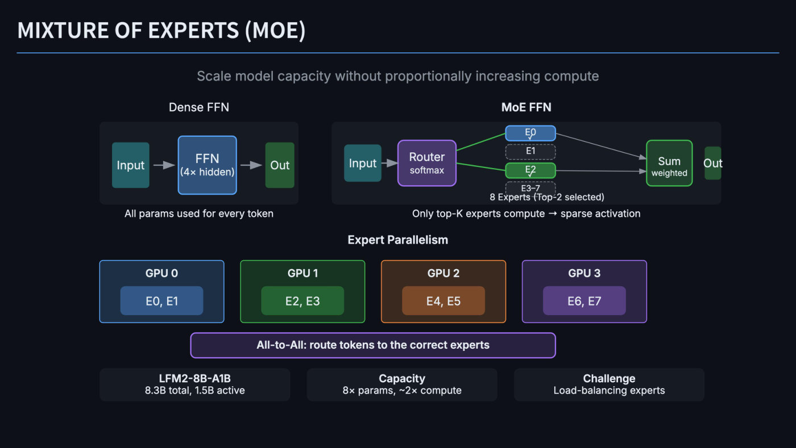

Text: "MIXTURE OF EXPERTS (MOE)". "Scale model capacity without proportionally increasing compute". Some labels overlap one another in the drawing, as described below (this is a layout overlap in the picture, not an animation).

"Dense FFN" (above a dark panel): "Input" (teal) → "FFN" / "(4× hidden)" (blue) → "Out" (green), joined by grey arrows. Under the panel: "All params used for every token".

"MoE FFN" (above a dark panel): "Input" (teal) → "Router" / "softmax" (purple). Two green lines run from the router to two expert boxes in a vertical stack: "E0" (blue, solid, with a small check mark printed over the lower part of the "0") and "E2" (green, solid, with a check mark printed over the lower part of the "2"). Between and below them are two dashed grey boxes, "E1" and "E3–7". A caption "8 Experts (Top-2 selected)" is printed across the bottom of the "E3–7" box, overlapping its lower edge and its text. Grey arrows run from E0 and from E2 to a green box "Sum" / "weighted", which is followed by a narrow green box "Out" that ends flush with the panel's right edge; the word "Out" is wider than the box and overflows it on both sides, running slightly past the panel edge. (The dense FFN's "Out" box is not clipped.) Under the panel: "Only top-K experts compute → sparse activation".

"Expert Parallelism" (bold). Four boxes in a row, each holding one inner box: "GPU 0" (blue) "E0, E1"; "GPU 1" (green) "E2, E3"; "GPU 2" (orange) "E4, E5"; "GPU 3" (purple) "E6, E7". Beneath, a purple-outlined bar: "All-to-All: route tokens to the correct experts".

Three cards: "LFM2-8B-A1B" (bold) "8.3B total, 1.5B active"; "Capacity" (bold) "8× params, ~2× compute"; "Challenge" (bold) "Load-balancing experts".

*Figure: yes — dense FFN versus top-2 routed MoE FFN, and eight experts placed two per GPU across four GPUs*

## Slide 18 — DeepSpeed ZeRO

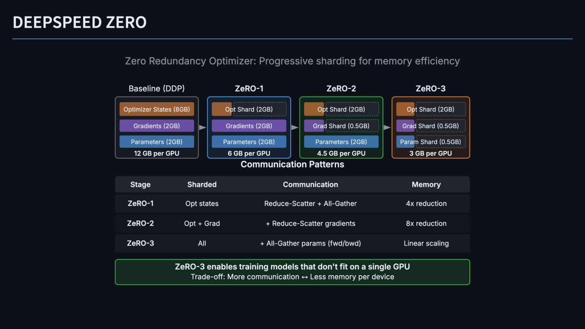

Text: "DEEPSPEED ZERO". "Zero Redundancy Optimizer: Progressive sharding for memory efficiency". Four columns of memory boxes joined by grey right-pointing arrows, titled "Baseline (DDP)" (regular weight), "ZeRO-1", "ZeRO-2", "ZeRO-3" (bold). Each box stacks three rows (top to bottom optimizer, gradients, parameters) and a bottom line. Where a row is sharded, the printed label is drawn across a solid coloured stub at the left and a dashed outline for the shard.

| Column (border) | Optimizer row | Gradients row | Parameters row | Bottom line |
| --- | --- | --- | --- | --- |
| Baseline (DDP) (grey) | Optimizer States (8GB) | Gradients (2GB) | Parameters (2GB) | 12 GB per GPU |
| ZeRO-1 (blue) | Opt Shard (2GB) | Gradients (2GB) | Parameters (2GB) | 6 GB per GPU |
| ZeRO-2 (green) | Opt Shard (2GB) | Grad Shard (0.5GB) | Parameters (2GB) | 4.5 GB per GPU |
| ZeRO-3 (orange) | Opt Shard (2GB) | Grad Shard (0.5GB) | Param Shard (0.5GB) | 3 GB per GPU |

Rows are colour-coded: orange-brown for optimizer, purple for gradients, blue for parameters. "Communication Patterns" (bold heading, directly below the columns, with a small gap). Table:

| Stage | Sharded | Communication | Memory |
| --- | --- | --- | --- |
| ZeRO-1 | Opt states | Reduce-Scatter + All-Gather | 4x reduction |
| ZeRO-2 | Opt + Grad | + Reduce-Scatter gradients | 8x reduction |
| ZeRO-3 | All | + All-Gather params (fwd/bwd) | Linear scaling |

Green-outlined box: "ZeRO-3 enables training models that don't fit on a single GPU" (bold) and "Trade-off: More communication ↔ Less memory per device".

Note on the deck: the table's "4x reduction" (ZeRO-1) and "8x reduction" (ZeRO-2) do not match the columns above, where the per-GPU total falls from 12 GB to 6 GB (2×) and 4.5 GB (about 2.7×); ZeRO-3's 3 GB is 4×. The shard sizes (8 GB / 4 = 2 GB, 2 GB / 4 = 0.5 GB) imply four GPUs, which the slide does not state.

*Figure: yes — per-GPU memory bars for baseline DDP and ZeRO stages 1 to 3, with a communication table*

## Slide 19 — Fully Sharded Data Parallel (FSDP)

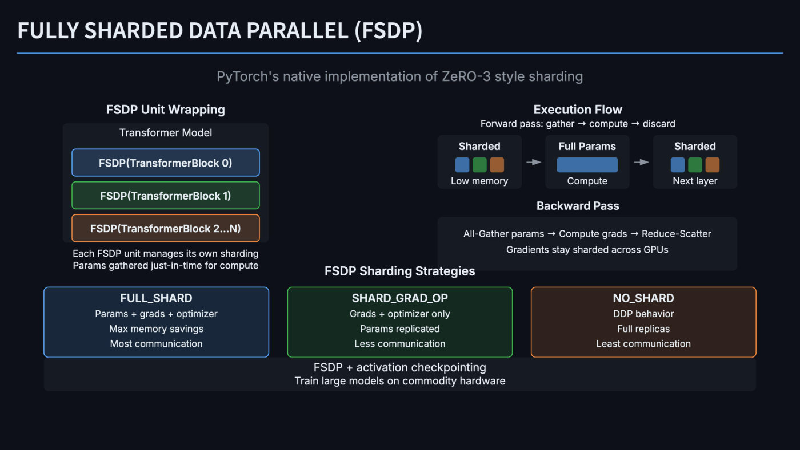

Text: "FULLY SHARDED DATA PARALLEL (FSDP)". "PyTorch's native implementation of ZeRO-3 style sharding".

Left, "FSDP Unit Wrapping" (bold): a panel "Transformer Model" containing three stacked boxes: "FSDP(TransformerBlock 0)" (blue), "FSDP(TransformerBlock 1)" (green), "FSDP(TransformerBlock 2...N)" (orange). Under it: "Each FSDP unit manages its own sharding" and "Params gathered just-in-time for compute".

Right, "Execution Flow" (bold): "Forward pass: gather → compute → discard". Three cards joined by grey arrows: "Sharded" with three small squares (blue, green, orange) and "Low memory"; "Full Params" with one wide blue bar and "Compute"; "Sharded" with three small squares (blue, green, orange) and "Next layer". Then "Backward Pass" (bold) and a panel: "All-Gather params → Compute grads → Reduce-Scatter" and "Gradients stay sharded across GPUs".

"FSDP Sharding Strategies" (bold; the heading's right end runs into the lower-left corner of the Backward Pass panel). Three boxes:

- "FULL_SHARD" (blue): "Params + grads + optimizer", "Max memory savings", "Most communication".
- "SHARD_GRAD_OP" (green): "Grads + optimizer only", "Params replicated", "Less communication".
- "NO_SHARD" (orange): "DDP behavior", "Full replicas", "Least communication".

A bottom bar, touching the three boxes: "FSDP + activation checkpointing" and "Train large models on commodity hardware".

*Figure: yes — FSDP unit wrapping, forward gather-compute-discard flow, and the three sharding strategies*

## Slide 20 — Megatron-LM

Text: "MEGATRON-LM". "NVIDIA's framework for training large transformer models". "Distributed Training Frameworks" (bold). Three boxes in a row: "DeepSpeed ZeRO" / "Microsoft" (orange-outlined); "FSDP" / "Meta (PyTorch)" (blue-outlined); "Megatron-LM" / "NVIDIA" (green-outlined). "Feature Comparison" (bold). Table:

| Aspect | DeepSpeed ZeRO | FSDP | Megatron |
| --- | --- | --- | --- |
| Focus | Memory | Memory | Parallelism |
| PP / TP | Limited | No | Native |
| Philosophy | Wrap model | nn.Module | "MPU" |
| Ease of use | config.yaml | PyTorch native | Custom code |

The last table row sits against the bottom edge of the page.

*Figure: no*

## Slide 21 — Putting It All Together

Text: "PUTTING IT ALL TOGETHER". "In practice: combine techniques based on model size and cluster topology". A green banner "Memory" over four green-outlined cards: "Activation Checkpointing" / "Recompute vs store"; "Mixed Precision" / "bf16/fp8 for activations"; "FSDP / ZeRO Sharding" / "Params, grads, optimizer"; "Offloading" / "CPU / NVMe for cold data".

A brown banner "Throughput: 5D Parallelism" over a grid of six cards, three per row, five orange-outlined and one grey:

| Row | Card 1 | Card 2 | Card 3 |
| --- | --- | --- | --- |
| 1 | Data Parallel (DP) — Split batch across replicas; Sync gradients via all-reduce | Tensor Parallel (TP) — Shard matrices within layer; NVLink within node | Pipeline Parallel (PP) — Split layers into stages; Micro-batches to fill pipe |
| 2 | Sequence/Context (SP/CP) — Split sequence across devices; For long-context training | Expert Parallel (EP) — Distribute MoE experts; Route tokens to experts | + Optimizations (grey) — Fused kernels, FlashAttention; Comm/compute overlap |

A purple-outlined box "Example: 2048 GPU Training Run" (bold) containing a row of coloured chips: "DP = 8" (blue) "×" "TP = 8" (brown) "×" "PP = 4" (green) "×" "EP = 8" (teal) "=" "2048 GPUs" (bold); and beneath, "TP within node (NVLink) • PP across nodes • DP for throughput • EP for MoE layers".

*Figure: yes — layered overview of memory techniques and five parallelism dimensions, with a 2048-GPU example product (8 x 8 x 4 x 8)*

## Slide 22 — Summary

Text: "SUMMARY". Three boxes in a row.

- "Why Scale?" (blue box, blue bullets): "Scaling laws: bigger → better"; "More data → lower loss"; "GPUs: ~600× faster than CPUs"; "One GPU can’t fit big models".
- "Memory Solutions" (green box, green bullets): "Activation checkpointing"; "CPU/NVMe offloading"; "ZeRO / FSDP sharding"; "Mixed precision (bf16/fp8)".
- "Parallelism Strategies" (orange box, orange bullets): "Data parallel: split batch"; "Tensor parallel: shard tensors"; "Pipeline parallel: split stages"; "Expert parallel: split MoE".

A purple-outlined box: "Key Principle" (bold) and "Match parallelism strategy to your bandwidth hierarchy". A panel "Communication Cost Hierarchy" (bold) with a row of chips separated by ">" signs: "Cache" (blue) > "HBM" / "(GPU memory)" (green) > "NVLink" / "(within node)" (brown) > "InfiniBand" / "(within cluster)" (red) > "..." (grey, empty-looking chip). In the HBM, NVLink and InfiniBand chips the two label lines are tightly spaced, the second line in grey. A wide banner at the bottom: "No single strategy suffices — **combine them** based on model size, cluster topology, and batch requirements".

*Figure: yes — three summary lists and a ranked chain of memory and network tiers (Cache > HBM > NVLink > InfiniBand > ...)*
