# Lecture 2 — Recurrent Neural Networks, Transformers, and Attention

**MIT 6.S191, 2026 edition. Lecturer: Ava Amini. Delivered 5 January 2026.**
[Video](https://www.youtube.com/watch?v=d02VkQ9MP44) ·
[Slides (PDF)](https://introtodeeplearning.com/slides/6S191_MIT_DeepLearning_L2.pdf) ·
[Slide-by-slide transcription](../raw/slides/02-rnns-transformers-attention.md) ·
[Transcript](../raw/transcripts/02-rnns-transformers-attention.md) ·
[Verbatim captions](../raw/transcripts/original/02-rnns-transformers-attention.md)

This lecture (its title slide reads "Deep Sequence Modeling") takes the feed-forward networks of
[lecture 1](01-introduction.md) to data that unfolds in time. It builds the recurrent neural network
(RNN) step by step from the perceptron: a network that keeps an internal state, updates it at every
time step, and is trained by backpropagation through time. Using next-word prediction as the running
example, it sets out what any sequence model must do, shows where RNNs fall short (an encoding
bottleneck, no parallelism, short memory, and vanishing gradients), and then introduces the idea that
replaced recurrence: **self-attention**, built from a query, a key and a value, which is the core of
the transformer architecture behind GPT and BERT.

Timestamps such as (≈15:23) point into the [transcript](../raw/transcripts/02-rnns-transformers-attention.md);
"slide N" is page N of the PDF (the deck prints no slide numbers).

## 1. Why sequences? (0:00–3:49)

Amini opens with a ball in a 2D space and asks where it will go next (slides 2–3). Given only its
current position, any answer is "a random proposal". Given its past positions as well, the problem
becomes much easier, and everyone can agree on its most likely next path (slides 4–5, ≈1:32). That is
the core idea of sequence modeling: data that is resolved in time, or can be modeled as a sequence,
used to predict the state of the system (≈2:18).

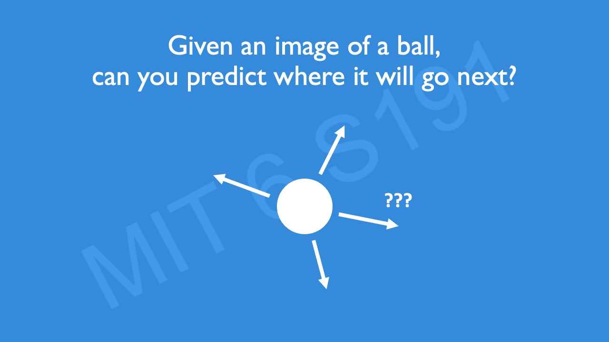

*Slide 3 — from a single snapshot, the ball could be heading anywhere.*

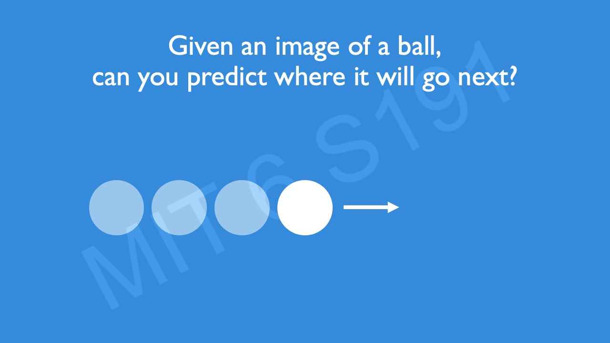

*Slide 5 — with its history of positions, the next move is obvious.*

Sequential data is "truly all around us" (slides 6–7, ≈2:18–3:04): audio, which can be split into
chunks of sound waves; text, which can be broken into characters or words; medical signals; financial
time series such as the stock market; biological sequences; patterns of movement; video; and weather.

## 2. Sequence modeling tasks (3:49–5:22)

Lecture 1's "Will I pass this class?" was a **one-to-one** problem: one input, one yes-or-no output.
Sequences open up three more shapes (slide 8, ≈3:49–4:36):

- **Many to one**: a sequence in, a single label out — for example, assigning an emotion or sentiment
  to a tweet. The slide's example is a 2018 tweet praising the course, labelled with a smiling face.
- **One to many**: one input, a sequence out — for example, image captioning, where a network is given
  an image and produces text describing it ("A baseball player throws a ball.").
- **Many to many**: a sequence in and a sequence out — for example, translating text or audio from one
  language to another, such as English into Mandarin.

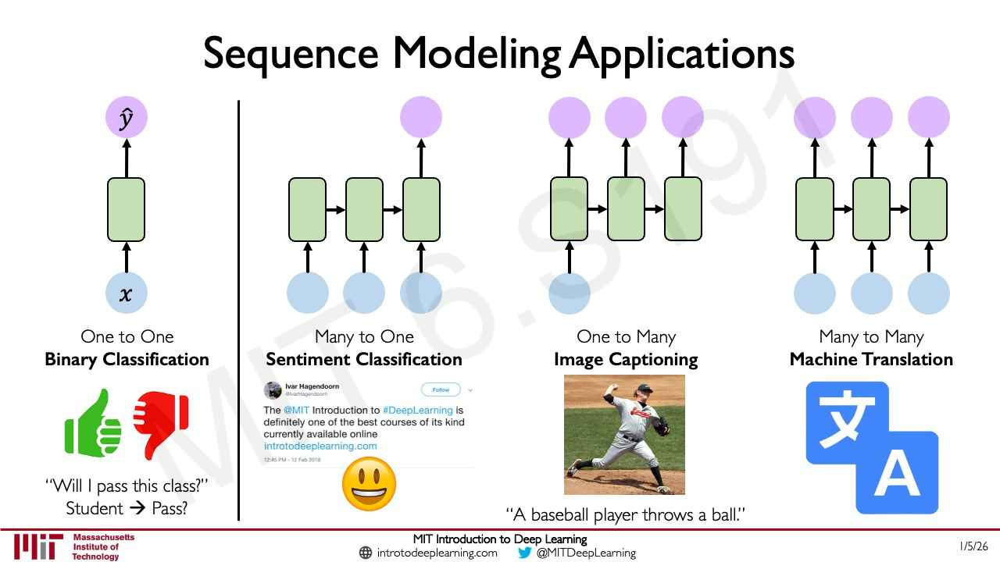

*Slide 8 — one to one, many to one, one to many and many to many: inputs in blue, network units in green, outputs in purple.*

She returns to the same four shapes after defining RNNs (slide 29, ≈20:46–21:32), now labelled with
applications: one to one is a "vanilla" network for binary classification; many to one is sentiment
classification; one to many is text generation and image captioning; many to many is translation and
forecasting, and music generation. Language modeling, machine translation and much of natural
language processing can be formulated as many-to-many problems (≈21:32).

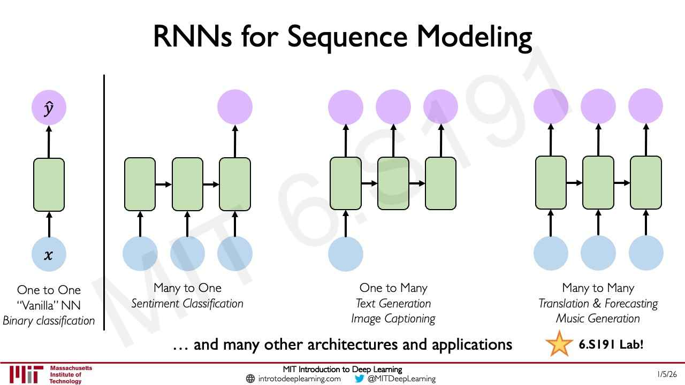

*Slide 29 — the four input/output configurations of an RNN, with applications under each.*

## 3. From the perceptron to recurrence (5:22–13:51)

Amini builds recurrence from the [perceptron](perceptron.md), the building block from lecture 1: inputs
$x^{(1)}, \dots, x^{(m)}$, each multiplied by a weight, summed into $z$, and passed through a non-linear
activation $g$ to give the output $\hat{y}$ (slide 10, ≈6:07). Stacking perceptrons gives a
[layer](neural-network-layers.md) that maps an input $\boldsymbol{x} \in \mathbb{R}^m$ to an output
$\hat{\boldsymbol{y}} \in \mathbb{R}^n$ (slide 11, ≈6:54). Even with many inputs, this has no notion of
time steps or sequence.

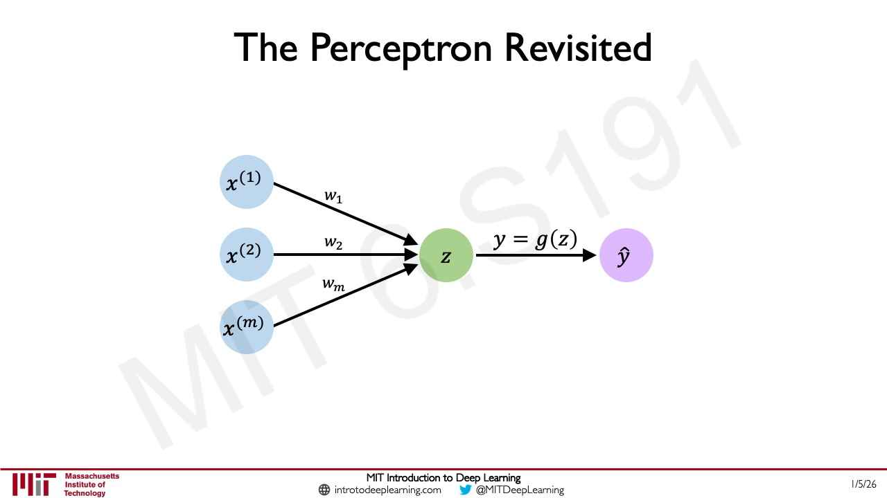

*Slide 10 — the perceptron from lecture 1, the starting point for recurrence.*

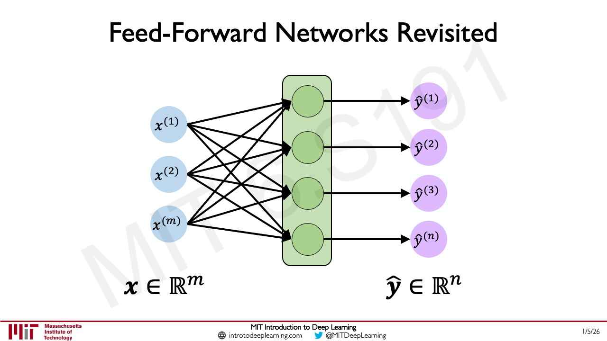

*Slide 11 — a layer of perceptrons maps an* $m$-*dimensional input to an* $n$-*dimensional output*.

She then collapses the layer into a single green block that takes the input $x_t$ at one time step $t$
and produces $\hat{y}_ t$ (slide 12, ≈7:41), and turns it on its side, 90° (≈8:27). Applying this same
feed-forward model to each time step in turn gives an output at every step, but the steps are
isolated: each prediction is $\hat{y}_ t = f(x_t)$, a function of that step's input alone (slide 13,
≈8:27–9:14). With sequential data, though, the inputs at time $t$ are related to those at $t-1$,
$t-2$ and so on. The prediction at $t = 2$ should depend on $x_0$ and $x_1$ too, just as the ball's
past trajectory informs where it goes next (≈9:14–10:01).

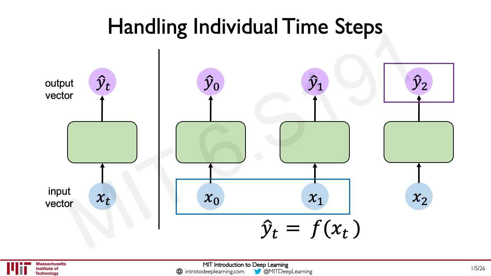

*Slide 13 — a feed-forward model applied step by step: the boxes are not connected, so* $\hat{y}_ 2$ *cannot see* $x_0$ *or* $x_1$.

The fix is to link the computation across time with an **internal state** $h$, maintained by the
network itself and passed from one time step to the next — "a sort of memory" (slide 14, ≈10:47). The
prediction at time $t$ then depends on the current input and on the past memory:

$$\hat{y}_ t = f(x_t, h_{t-1})$$

where $\hat{y}_ t$ is the output, $x_t$ the input and $h_{t-1}$ the past memory (slide 14, ≈11:33).
Amini stresses that this is still one network, not a new network per time step: the information from
past computations is simply connected into the prediction at each step (≈12:19). Drawn as a loop, the
state $h_t$ is fed back into the same cell at every step; drawn "unrolled", the same cell appears once
per time step, which she finds the clearer picture (slide 15, ≈12:19–13:06). Maintaining an internal
state, updating it at each time step and using it to inform the output is the core idea of
**recurrent neural networks (RNNs)** (≈13:06).

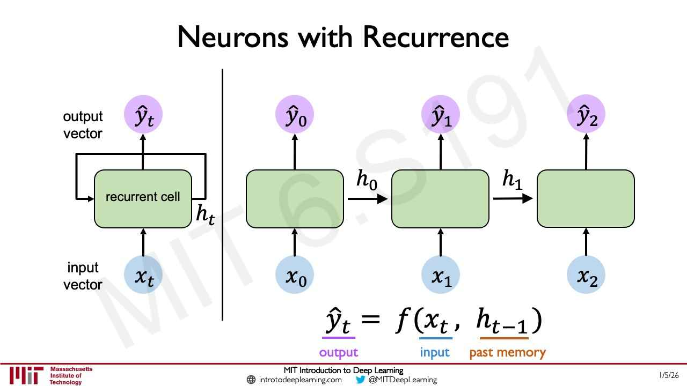

*Slide 15 — the recurrent cell with its feedback loop (left) and the same cell unrolled over three time steps (right).*

## 4. The RNN: recurrence relation, state update and output (13:51–20:46)

An RNN applies a **recurrence relation** at every time step to process a sequence (slide 17,
≈13:51–14:38):

$$h_t = f_W(x_t, h_{t-1})$$

Here $h_t$ is the cell state, $f_W$ is a function with weights $W$, $x_t$ is the input, and $h_{t-1}$
is the old state. As with any network in the course, the update is defined by learnable weights, and
**the same function and the same set of parameters are used at every time step** (slide 17, ≈14:38).

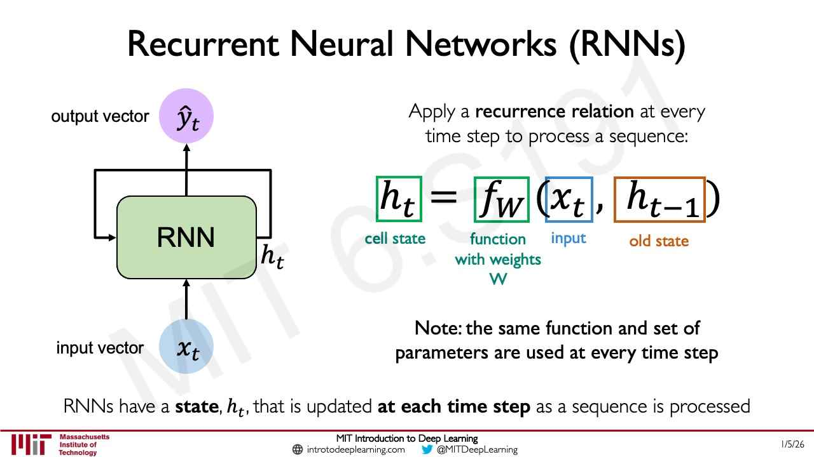

*Slide 17 — the recurrence relation: the new cell state is a function, with weights* $W$, *of the input and the old state*.

**Pseudocode** (slides 18–20, ≈15:23–16:56). The state is initialized to zeros (the slide's
`hidden_state = [0, 0, 0, 0]`). The task is next-word prediction: the sentence is broken into words,
`["I", "love", "recurrent", "neural"]`, and the loop calls the RNN on each word in turn, returning a
prediction and an updated hidden state each time. After the last word, the RNN's output at that final
step is the prediction for the next word — on the slide, "networks!".

```python
my_rnn = RNN()
hidden_state = [0, 0, 0, 0]

sentence = ["I", "love", "recurrent", "neural"]

for word in sentence:
    prediction, hidden_state = my_rnn(word, hidden_state)

next_word_prediction = prediction
# >>> "networks!"
```

**The equations** (slides 21–24, ≈16:56–17:43). An RNN must both update its state and predict an
output. Given the input vector $x_t$, the hidden state is updated by multiplying the previous state and
the input by their own weight matrices, summing, and applying a non-linear activation, here the
hyperbolic tangent ([activation functions](activation-functions.md)):

$$h_t = \tanh(\boldsymbol{W}_ {hh}^T h_{t-1} + \boldsymbol{W}_ {xh}^T x_t)$$

The output is a third weight matrix applied to the new state:

$$\hat{y}_ t = \boldsymbol{W}_ {hy}^T h_t$$

$\boldsymbol{W}_ {hh}$ maps the previous hidden state, $\boldsymbol{W}_ {xh}$ maps the input into the
hidden state, and $\boldsymbol{W}_ {hy}$ maps the hidden state to the output. All three are learned:
initialized, then updated during training by [gradient descent](gradient-descent.md) and the related
algorithms of lecture 1 (≈17:43). Amini notes that this "looks a little intimidating at first" but is
"very similar" to lecture 1's operations: multiplications by weight matrices, a sum, a non-linearity.

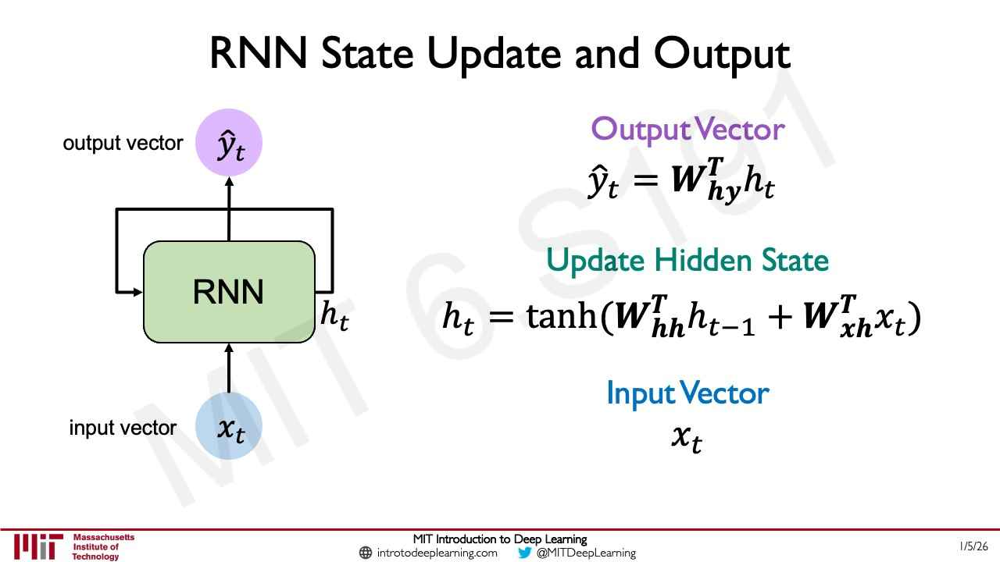

*Slide 24 — input vector, hidden-state update and output vector, beside the recurrent cell.*

**Unrolled across time** (slides 25–26, ≈18:28–19:15). Unrolling the loop from time step 0 to time
step $t$ makes the weight matrices explicit: $\boldsymbol{W}_ {xh}$ on every input, $\boldsymbol{W}_ {hh}$
between consecutive states, $\boldsymbol{W}_ {hy}$ on every output, with "the **same weight matrices**"
re-used at every step. Because there is a prediction at every step, there is a [loss](loss-functions.md)
at every step, $L_0, L_1, L_2, \dots$, and these are summed into one total loss $L$ for the whole
sequence. (The slide labels the last column's loss $L_3$, although its input and output are $x_t$ and
$\hat{y}_ t$.)

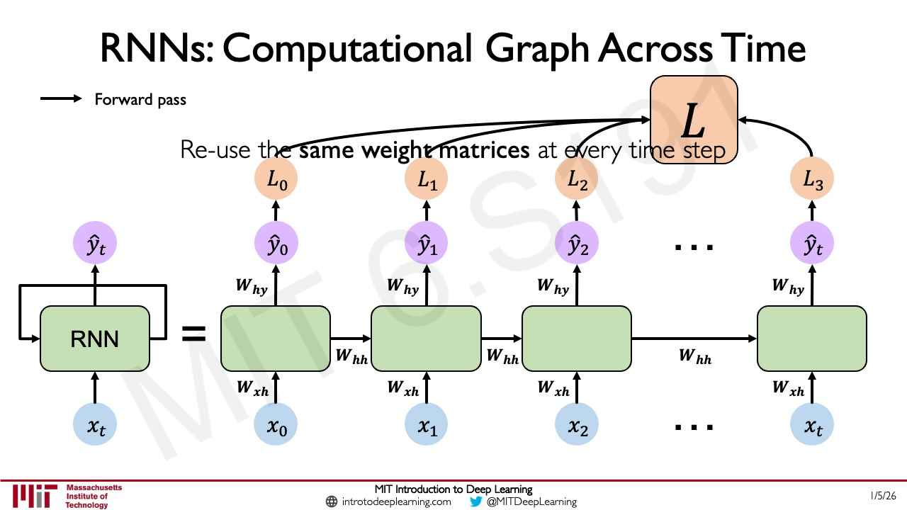

*Slide 26 — the RNN unrolled: shared weights at every step, and per-step losses summed into the total loss* $L$.

**In code** (slides 27–28, ≈20:01–20:46). Slide 27 builds an RNN cell from scratch in TensorFlow: the
constructor creates the three weight matrices and a zero hidden state, and the `call` method — "how you
call the neural network" — updates the state and computes the output, returning both:

```python
class MyRNNCell(tf.keras.layers.Layer):
  def __init__(self, rnn_units, input_dim, output_dim):
    super(MyRNNCell, self).__init__()

    # Initialize weight matrices
    self.W_xh = self.add_weight([rnn_units, input_dim])
    self.W_hh = self.add_weight([rnn_units, rnn_units])
    self.W_hy = self.add_weight([output_dim, rnn_units])

    # Initialize hidden state to zeros
    self.h = tf.zeros([rnn_units, 1])

  def call(self, x):
    # Update the hidden state
    self.h = tf.math.tanh( self.W_hh * self.h + self.W_xh * x )

    # Compute the output
    output = self.W_hy * self.h

    # Return the current output and hidden state
    return output, self.h
```

The slide writes the matrix products with `*`; the code is reproduced as printed. In practice, Amini
says, you will "very rarely" or "almost never" build an RNN unit from scratch: TensorFlow and PyTorch
have built-in RNN layers (slide 28 prints `SimpleRNN(rnn_units)` for TensorFlow and
`RNN(input_size, rnn_units)` from `torch.nn` for PyTorch), and software lab 1 gives hands-on practice
(≈20:46).

## 5. What a sequence model needs: next-word prediction (21:32–30:04)

Amini turns to the problem that is "the basis for basically all language models, large language models,
small language models": **next-word prediction** (≈21:32–22:20). She uses it to work through the design
criteria any sequence architecture has to meet, and recommends the same habit for your own projects:
relate the problem to design criteria, then choose the architecture. The example sentence is "This
morning I took my cat for a walk.": given "This morning I took my cat for a", predict "walk" (slides
32–34, ≈23:08).

**Criterion: represent language as numbers** (slides 35–36, ≈23:08–27:46). What goes wrong if we just
pass the word "deep" into a network and ask it to predict "learning"? A student suggested tokenizing the
words. Amini's answer goes a step earlier: neural networks "cannot interpret words"; they operate on
numerical data, so language has to become a vector or array of numbers, and the network's numerical
prediction has to be mapped back to a word (≈24:43). Ideally this numerical representation, an
**embedding** (or encoding), captures meaning: "learning" and "education" should map closer together
than "learning" and "tennis" (≈25:28). Slide 36 lays out the steps:

1. **Vocabulary**: the corpus of words.
2. **Indexing**: map each word to a unique index ("a" → 1, "cat" → 2, …, "walk" → N).
3. **Embedding**: map each index to a vector of fixed size.

The naive embedding is **one-hot**: a vector of zeros with a single 1 at the word's index ("cat" =
[0, 1, 0, 0, 0, 0]). It identifies the word but captures nothing of its meaning or of the structure of
language (≈26:14). A **learned embedding** captures semantic relationships instead: on the slide's
sketch, "run" and "walk" sit together, as do "dog" and "cat", "day" and "sun", "happy" and "sad". Popular
schemes in today's language models map chunks of words that frequently occur together to nearby parts
of the embedding space (≈27:01). The point she wants to land: in every example in the course, whatever
the data modality, neural networks operate on numerical inputs (≈27:46).

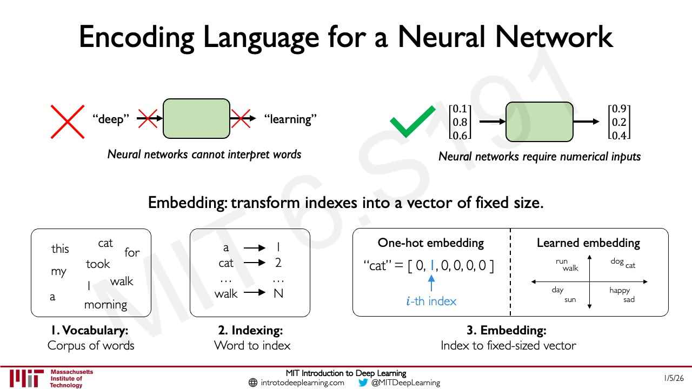

*Slide 36 — vocabulary, word-to-index, and two embeddings: one-hot (a single 1 at the word's index) and learned (similar words close together).*

**Criterion: handle variable-length sequences** (slide 37, ≈28:32). Short, medium or long sentences —
"The food was great", "We visited a restaurant for lunch", "We were hungry but cleaned the house before
eating" — should all work. Feed-forward networks break down here because they take a fixed number of
inputs; a state-based model like an RNN, which processes the data step by step, handles variable length
by design.

**Criterion: track long-term dependencies** (slide 38, ≈28:32–29:17). Often core information early in a
sentence informs a prediction much later. The slide's example: "**France** is where I grew up, but I now
live in Boston. I speak fluent ___." — we need information from "the distant past" to predict the word.

**Criterion: capture order** (slide 39, ≈29:17). "The food was good, not bad at all" and "The food was
bad, not good at all" contain exactly the same words; flipping their order flips the meaning.

Slides 30 and 40 list the criteria as handle **variable-length** sequences, track **long-term**
dependencies, maintain information about **order**, and **share parameters** across the sequence, and
state that "RNNs meet these sequence modeling design criteria". Aloud, Amini counts the numerical
encoding as "design criteria number one" (≈27:46), which the slide list does not include. RNNs meet
the criteria because the internal state handles variable lengths and preserves information about
dependencies, step-by-step processing gives a notion of order, and weight sharing lets memory build up
over time (≈30:04).

## 6. Training RNNs: backpropagation through time (30:04–34:43)

RNNs are trained with [backpropagation](backpropagation.md), lecture 1's core training algorithm.
Recall it for a feed-forward model: a forward pass from input to output gives a prediction and a loss;
then gradients are propagated back through the network — take the derivative of the loss with respect
to each parameter, and shift the parameters to minimize the loss (slide 42, ≈30:50).

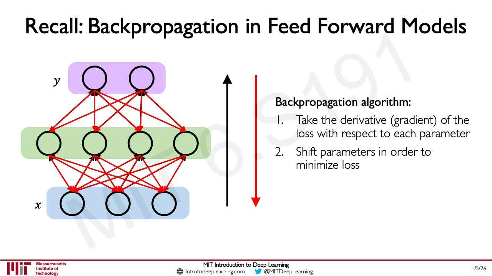

*Slide 42 — backpropagation in a feed-forward network: forward pass up, gradients back down.*

An RNN makes a prediction, and so has a loss, at every time step; the total loss is their sum. To update
the network, errors are back-propagated through each time step's network and then **across time
steps**, from where we are currently in the sequence all the way back to the beginning. Because the
error flows back through time, the algorithm is called **backpropagation through time (BPTT)** (slides
43–44, ≈31:37–32:24; slide 44 credits Mozer, *Complex Systems*, 1989).

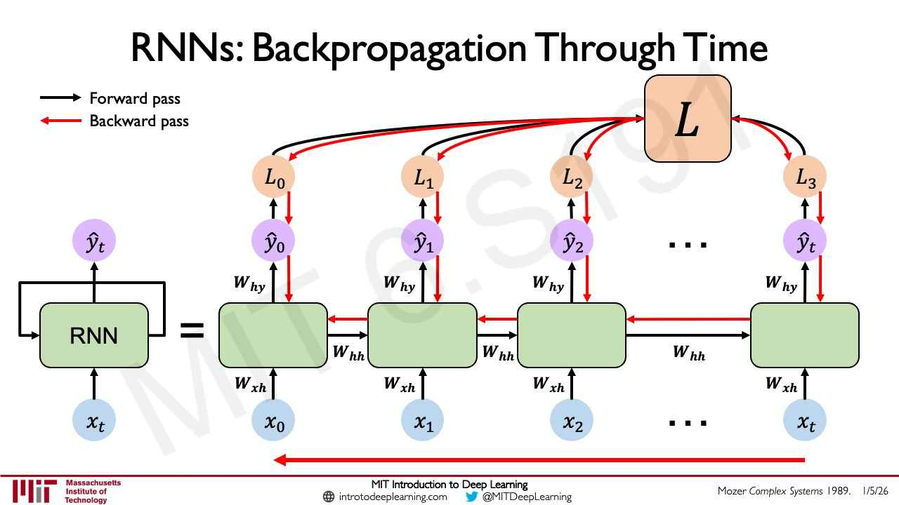

*Slide 44 — forward pass in black, backward pass in red: the error flows back from every loss and back through the chain of states to the first time step.*

**Exploding and vanishing gradients** (slides 45–48, ≈32:24–33:57). Following the gradients back
through the chain of states means many repeated multiplications by the weight matrix
$\boldsymbol{W}_ {hh}$: computing the gradient with respect to $h_0$ involves "many factors of
$W_{hh}$ + repeated gradient computation" (slide 46). Two things can go wrong:

- If the values are large (many values $\gt 1$), the gradient blows up very quickly: **exploding
  gradients**. In practice the gradients are often clipped to some maximum, **gradient clipping**, to
  scale big gradients back (slide 47, ≈33:10).
- If the values are small (many values $\lt 1$), repeated multiplication shrinks the gradient until
  there is very little signal to learn from: **vanishing gradients** (≈33:57). Amini says there are
  practical tricks to mitigate it without going through them; slide 48 lists three areas: the
  activation function, weight initialization and the network architecture.

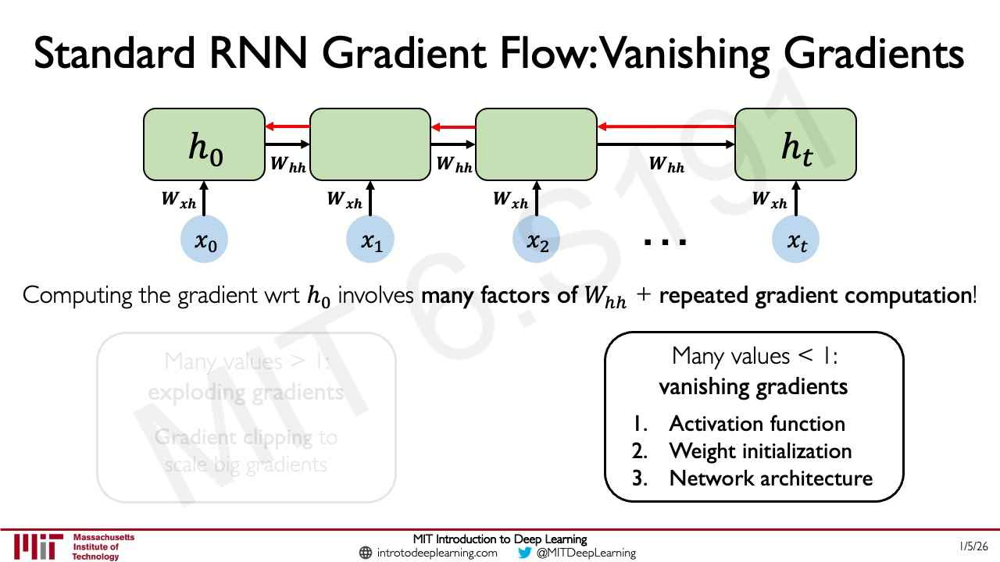

*Slide 48 — every step back multiplies by* $W_{hh}$ *again: many values above 1 explode (left, clip them), many below 1 vanish (right)*.

A student asked whether $h_0$ is a parameter. Amini's answer: $h_0$ is neither an explicit parameter nor
an input; it is an internal state variable, which depends on computation involving the weight matrices
$W$ and on the input (≈33:57–34:43).

## 7. Long-term dependencies and gated cells (34:43–36:15)

The vanishing gradient has a real consequence for tracking long-term dependencies (≈34:43). Multiplying
many small numbers together means errors from time steps further back have smaller and smaller
gradients, which biases the model toward capturing short-term dependencies (slide 49). Short-term
dependencies are captured effectively, but when the relevant input lies many time steps back, the RNN
struggles to keep track of it (≈35:30). The slides illustrate the contrast: in "The clouds are in the
___", the needed words are only a few steps back, while in "I grew up in France, … and I speak fluent
___" the clue is far back in the sequence (slides 50–53). Amini says she won't spend much time on this,
and these examples are not discussed aloud.

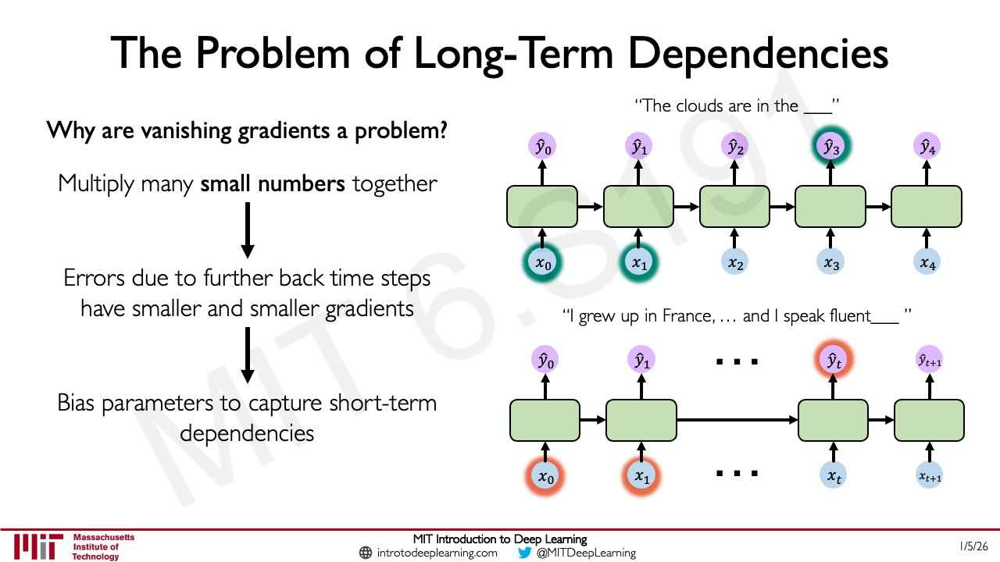

*Slide 53 — a short gap ("The clouds are in the ___") versus a long one ("I grew up in France, … and I speak fluent ___").*

Much architecture work has gone into making the RNN's internal computation more complex, to better
control the flow of information and the state update itself (≈35:30). One pioneering solution, from a
group led by Jürgen Schmidhuber many years ago, is the **long short-term memory (LSTM)**, "a
foundational advance" in controlling these state updates (≈36:15). Slide 54 states the idea: use
**gates** to selectively **add** or **remove** information within each recurrent unit; a gate is a
sigmoid neural-net layer followed by a pointwise multiplication, and "gates optionally let information
through the cell". LSTMs rely on such a gated cell to track information across many time steps; the
slide names LSTMs and GRUs as gated cells. The lecture does not go into the LSTM's equations.

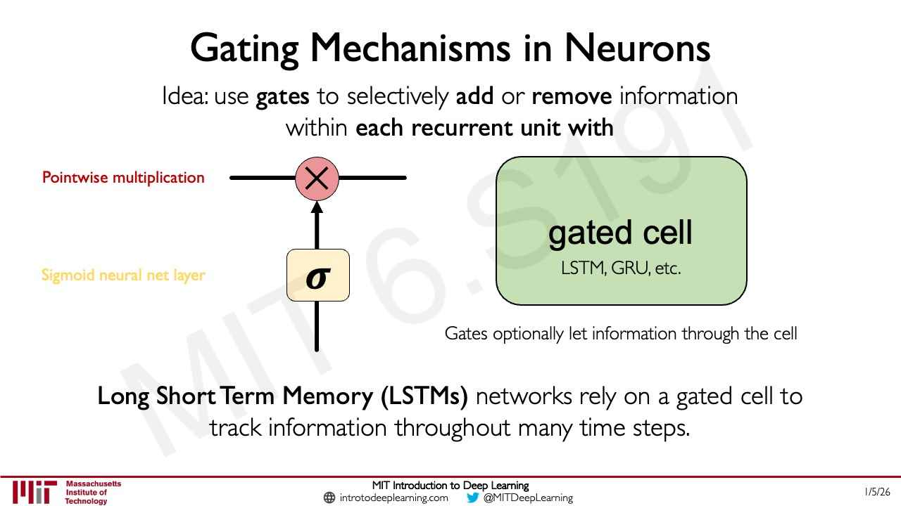

*Slide 54 — a gate is a sigmoid layer feeding a pointwise multiplication; gated cells such as LSTMs and GRUs are built from them.*

## 8. Applications: music generation and sentiment (36:15–37:50)

Software lab 1 is a music-generation problem (≈36:15). The slide's model takes sheet music as input and
predicts the next character in the sheet music; each predicted note is fed back in as the next input
(slide 56). Amini's favourite example: Franz Schubert left a symphony he called his Unfinished Symphony,
and a few years ago a recurrent-based model was trained on his music to generate new music and finish
it. She played a sample of the AI-generated third movement (≈36:15–37:50) and notes that the quality of music
generation has continued to improve since.

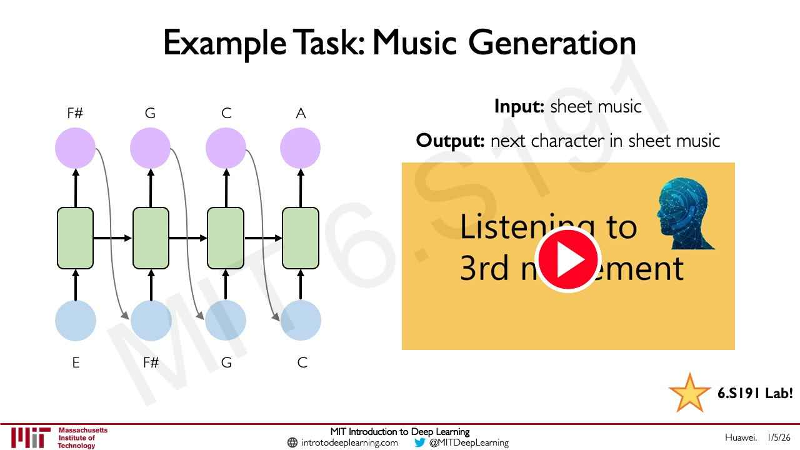

*Slide 56 — a many-to-many RNN over notes (E, F#, G, C in; F#, G, C, A out), each output fed back as the next input.*

Slides 57–58 add sentiment classification, a many-to-one task: the input is a sequence of words ("I love
this class!"), the output is the probability of positive sentiment, read from the last time step; the
slide gives a TensorFlow cross-entropy loss and cites Socher et al., EMNLP 2013. Amini leaves the
applications there "for the purposes of time" (≈37:50), and these slides are not discussed aloud.

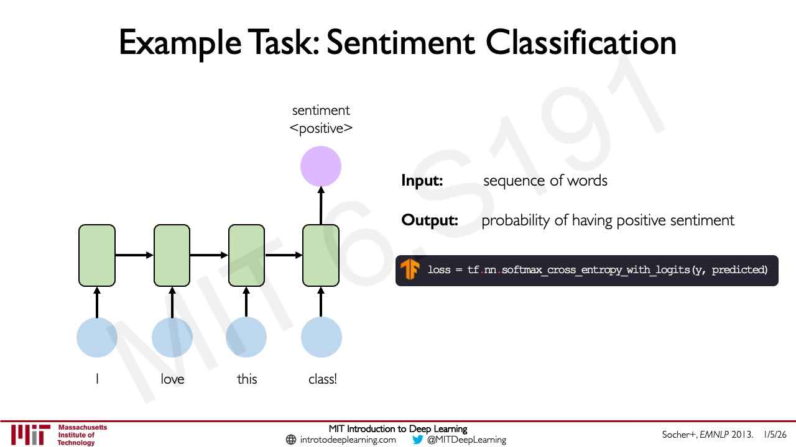

*Slide 57 — a many-to-one RNN reads "I love this class!" and outputs a single sentiment.*

## 9. Limitations of RNNs (37:50–40:58)

In the last 15 minutes Amini steps back to the design criteria and asks what limits RNNs technically
(slides 59–61, ≈37:50–39:25):

- **Encoding bottleneck.** Everything the model learns about the structure of the data has to be packed
  into the internal state $h_t$ and carried forward step by step.
- **Slow, no parallelization.** The data is processed one time step at a time, as individual slices, so
  the computation cannot be parallelized.
- **Not long memory.** Mostly because of the encoding bottleneck, an RNN quickly runs into limits on how
  long a dependency it can capture.

The goal of sequence modeling is to take a sequence of inputs, learn a sequence of features, and map
them to a sequence of outputs; RNNs do it through recurrence, step by step (slide 60, ≈39:25). Ideally
we would have instead (slide 62, ≈40:12): a **continuous stream** — no encoding bottleneck, the sequence
seen globally while still capturing local dependencies; **parallelization**, rather than handling the
sequence one time step at a time; and **long memory**.

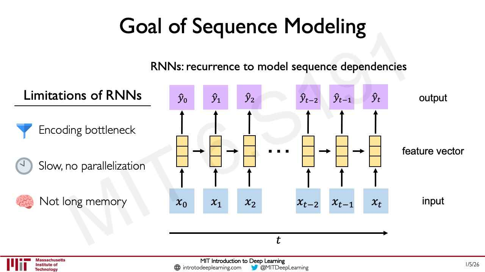

*Slide 61 — an RNN carries features step by step from input to output; beside it, the three limitations.*

## 10. Can we eliminate recurrence? (40:58–42:32)

The thought experiment: what if we got rid of recurrence entirely (slide 62)? The naive approach is to
concatenate the data from all time points into one input vector, feed it into a dense network, and
compute features and outputs from it (slide 63, ≈40:58). There is no recurrence and no step-by-step
processing, but this is **not scalable** — a dense network over the whole sequence gets very large as
the sequence grows — it loses the **order** information, and with no temporal dependency there is no
way to build **long memory** (slide 64, ≈41:46). What is missing is a way to pick out and attend to the
parts of the input that matter. The slide's closing line is the idea that follows: "Identify and attend
to what's important."

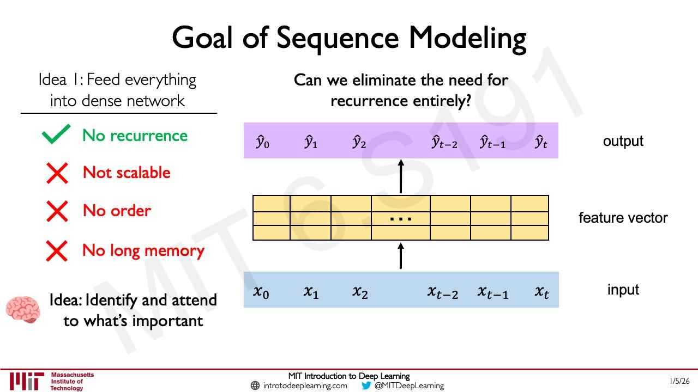

*Slide 64 — Idea 1, feed everything into a dense network: no recurrence, but not scalable, no order, no long memory.*

## 11. The intuition behind attention: search (42:32–47:10)

The breakthrough, several years ago, was a mathematical way for the network to learn to identify the
dependencies, local and global, that matter in a sequence: **attention** (slide 65, "Attention Is All
You Need"; ≈41:46–42:32). It is the backbone of the transformer: the "T" in GPT and BERT stands for
transformer, and attention is the foundational mechanism behind transformers (≈42:32).

Its core question: can a network learn which parts of an input, within itself, matter most for
representing that input? Looking at a picture of Iron Man, we do not scan it pixel by pixel; we pick out
the important parts at once (slide 66, ≈43:18). Attention has two steps: **identify which parts to
attend to**, then **extract the features with high attention**. The first step is the core, and it is
"very similar to this notion of search" (≈44:03).

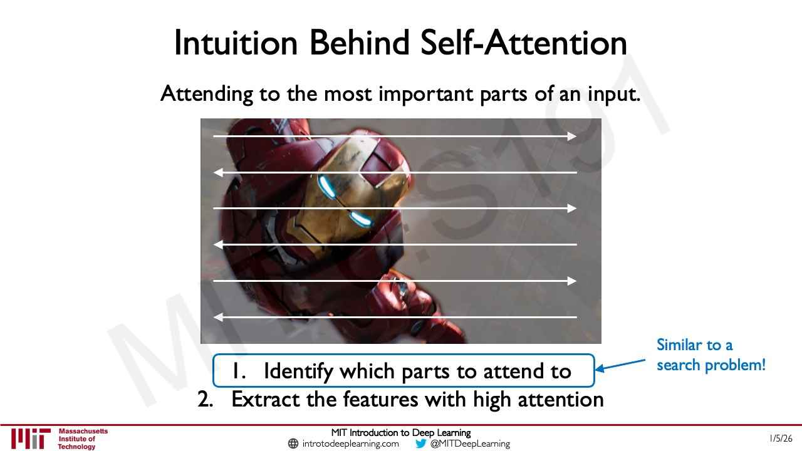

*Slide 66 — scanning an image line by line is not how we find what matters in it; attention picks out the important parts directly.*

The search example (slides 67–69, ≈44:03–46:22): you want to learn about neural networks, so you search
YouTube, a giant database of videos.

- Your search term, "deep learning", is the **query** ($Q$).
- Each video has a title, which plays the role of a **key** ($K$).
- Searching means finding the semantic overlap between the query and each key: compute how similar each
  key is to the query, a weighting or **attention mask**. A video of sea turtles is "very elegant and
  natural" but not similar to the query; a lecture introducing deep learning from six years ago is
  relevant; a video about Kobe Bryant's fadeaway is "also very important but not relevant".
- Then extract what you wanted from the matching item, the video itself: the **value** ($V$).

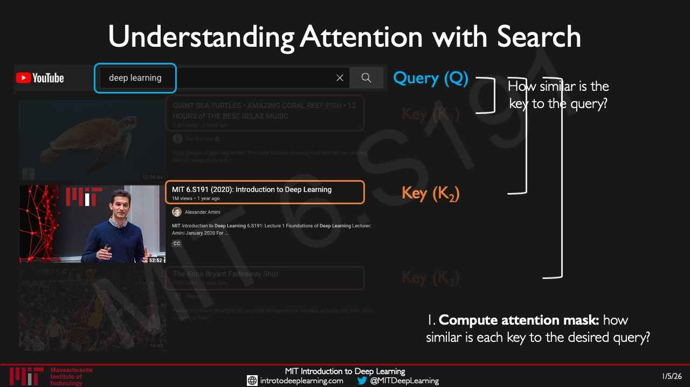

*Slide 68 — step 1, compute the attention mask: how similar is each key (video title) to the query?*

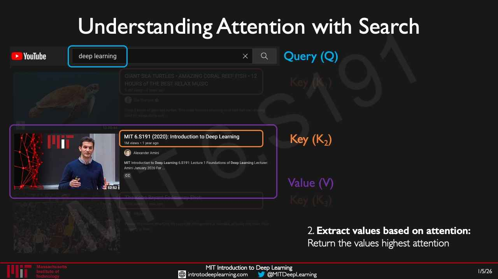

*Slide 69 — step 2, extract the value of the item with the highest attention.*

## 12. Self-attention, step by step (47:10–53:22)

In a neural network the goal is the same: identify and attend to the important parts of an input such as
a sequence (≈47:10). In **self-attention**, the relationships being found are within a single input
sequence itself (≈48:43). The running example is the sentence "He tossed the tennis ball to serve", and
the procedure has four steps (slide 70).

**Step 1: encode position** (slides 70–71, ≈47:10–47:57). Without recurrence, the data is fed in all at
once, so information about order has to be preserved some other way. Attention uses a **positional
embedding** — on slide 71, each token's embedding is combined with position information
$p_0, \dots, p_6$ to give a position-aware encoding. Amini does not go into how this encoding is implemented; the
takeaway is that it preserves information about the positional relationships in the sequence.

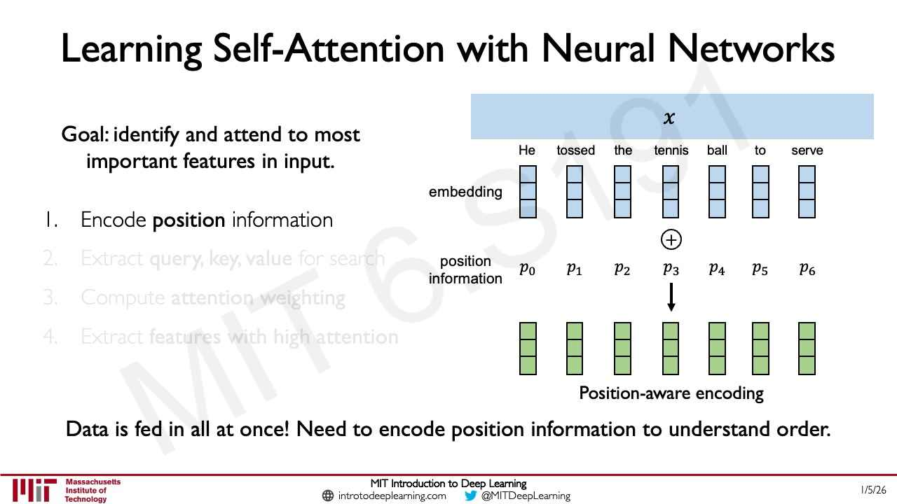

*Slide 71 — each word's embedding is combined with position information to give a position-aware encoding.*

**Step 2: extract query, key and value** (slide 72, ≈48:43–49:29). The positional embedding is
transformed three times, by three separate learned layers, into a **query** matrix, a **key** matrix and
a **value** matrix. The input to all three is the same positional embedding, but the three layers, and
therefore their outputs, are different and capture different information.

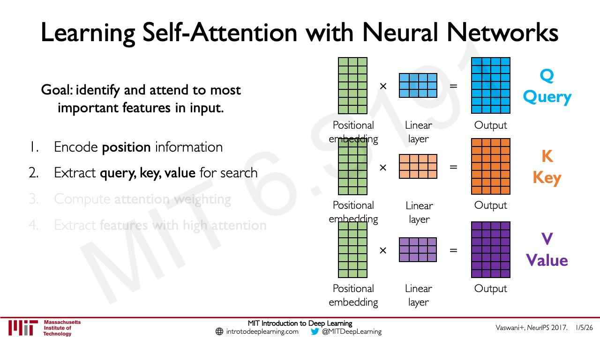

*Slide 72 — the same positional embedding passes through three different linear layers to give Q, K and V.*

**Step 3: compute the attention weighting** (slides 73–75, ≈49:29–51:50). How similar is each query to
each key? Represent the query and key as vectors in space; their **dot product** measures how aligned
they are. Scaling the dot product gives a similarity metric, which the slide and the lecturer also call
the "cosine similarity" (slide 73, ≈50:16). The same operation applies to whole matrices (slide 74):

$$\frac{Q \cdot K^T}{\text{scaling}}$$

The slide writes the denominator only as "scaling" and does not say what it is.

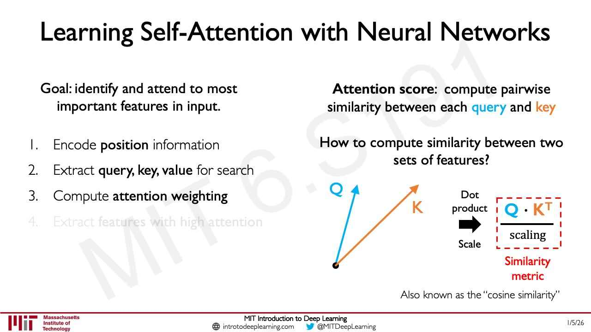

*Slide 73 — the dot product of a query vector and a key vector, scaled, is the similarity metric.*

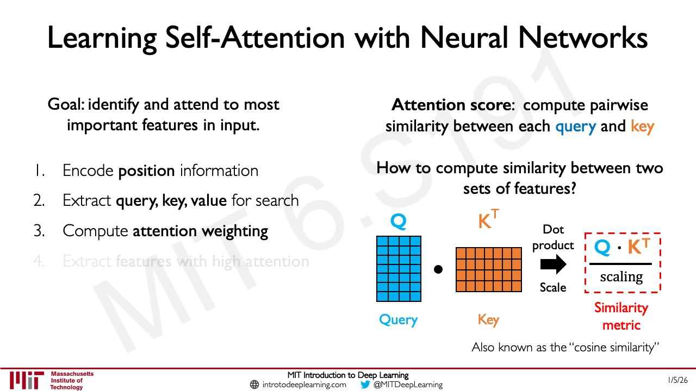

*Slide 74 — the same similarity computed for all queries and keys at once, as a product of matrices.*

For "He tossed the tennis ball to serve", this gives a score for every pair of positions (slide 75,
≈51:02). The diagonal scores highest, because each word is identical to itself, but words that are
semantically or relationally related also score high — for example "ball" and "tossed". A **softmax**
then squashes the scores to values between zero and one, giving the **attention weighting**, whose
entries express the relative importance of the parts of the sequence to each other (≈51:50):

$$\text{softmax}\left(\frac{Q \cdot K^T}{\text{scaling}}\right)$$

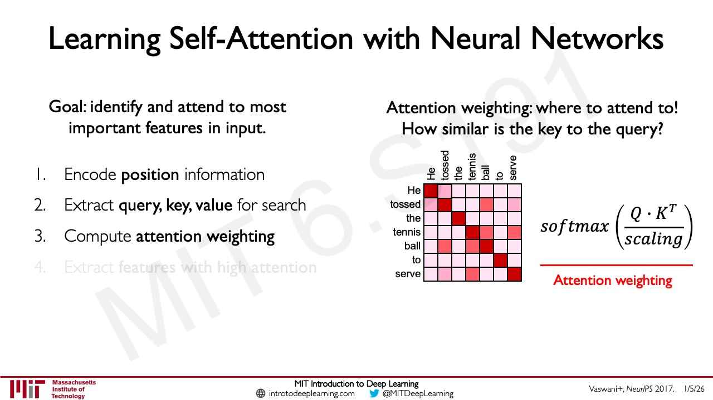

*Slide 75 — the attention weighting for "He tossed the tennis ball to serve": darkest on the diagonal, with related words such as "tossed" and "ball" also strongly linked.*

**Step 4: extract features with high attention** (slide 76, ≈51:50–52:36). Multiplying the attention
weighting by the value matrix extracts the features, giving the output:

$$\text{softmax}\left(\frac{Q \cdot K^T}{\text{scaling}}\right) \cdot V = A(Q, K, V)$$

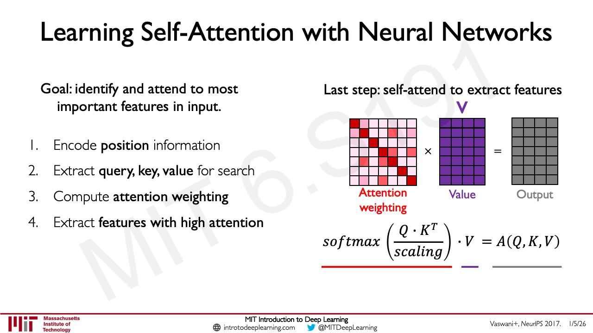

*Slide 76 — attention weighting × value = output: the final step of self-attention.*

**The attention head** (slide 77, ≈52:36–53:22). Put together: take the positional encoding; pass three
copies through three learned layers to get the query, key and value; compute the similarity of query and
key, scale it, and apply the softmax to get the attention weights; multiply by the value to extract the
features with high attention. These operations form a **self-attention head** that can plug into a
larger network.

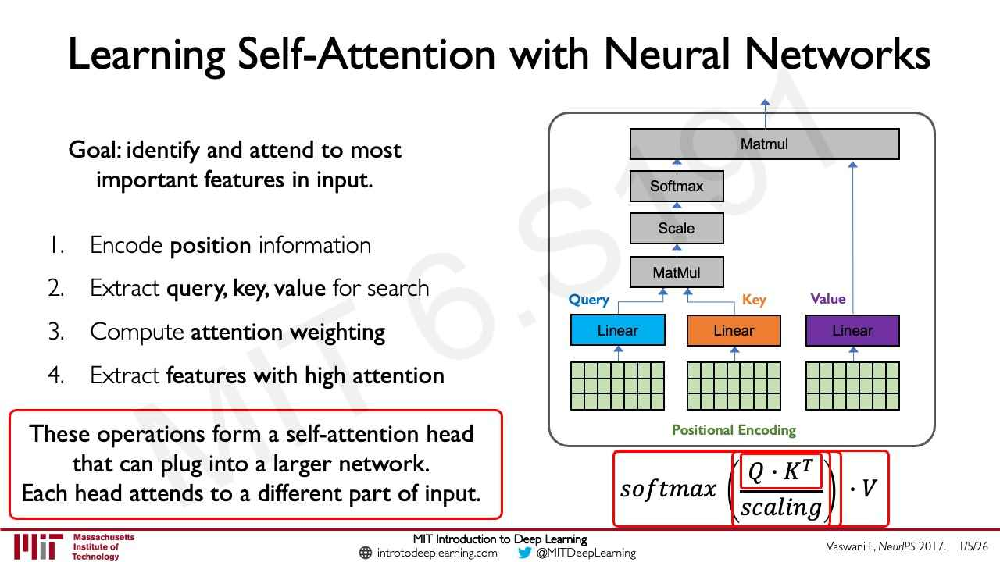

*Slide 77 — one self-attention head: Linear layers for query, key and value; MatMul, Scale and Softmax; a final MatMul with the value.*

## 13. Multiple heads and the transformer (53:22–55:41)

Attention is "the foundational building block of the **Transformer** architecture" (slide 78), and
modern transformers use it to learn patterns of importance in sequential data (≈53:22). What makes it
powerful is that it is very parallelizable. Several attention heads can also be stacked within one
network, each learning a different pattern of importance (≈54:09). Amini's intuitive example on the Iron
Man image: one head picks out Iron Man, another the building he is "hopefully not going to crash into",
and another the alien spaceship looming in the background (slide 79). She stresses that this is an
intuition to ground the idea, but that stacking heads is very practical for building transformers.

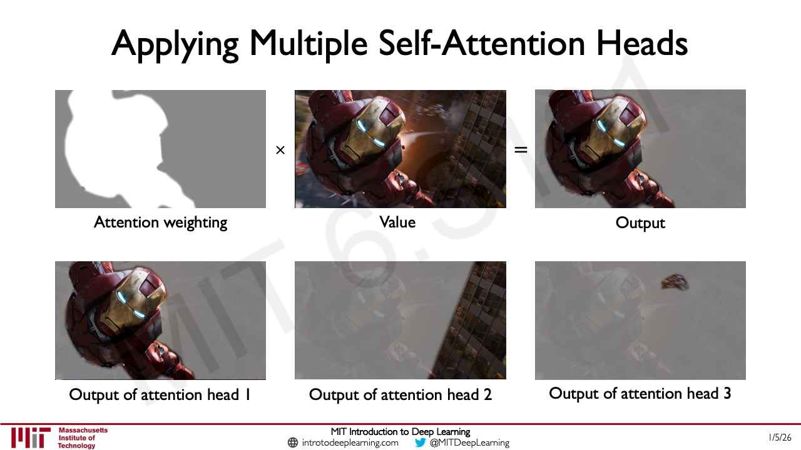

*Slide 79 — attention weighting × value = output on one image, and the different regions picked out by three attention heads.*

The architecture has spread well beyond language (slide 80, ≈54:54): transformer language models such
as BERT and GPT; biological sequences such as proteins and DNA, with protein structure models; and
computer vision, where vision transformers have become "perhaps the dominant architecture", which she
says lecture 3 will cover. [Lecture 3](03-convolutional-neural-networks.md), as delivered, covers
convolutional neural networks and does not mention vision transformers.

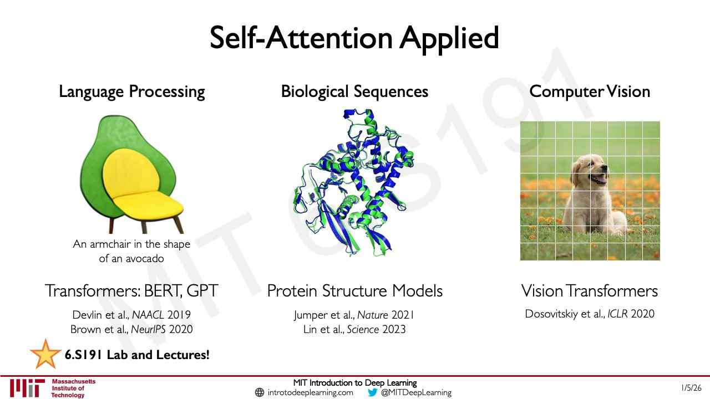

*Slide 80 — self-attention in language processing (BERT, GPT), biological sequences (protein structure models) and computer vision (vision transformers).*

## 14. Summary, and logistics (55:41–57:34)

Slide 81 summarizes: RNNs are well suited to sequence modeling tasks; they model sequences through a
recurrence relation; they are trained with backpropagation through time; they power music generation,
classification, machine translation and more; self-attention models sequences without recurrence; and
self-attention is the basis for many large language models — "stay tuned!" (≈55:41). Lab 1 (slide 82)
is deep learning in Python and music generation with RNNs, in Google Colab. The final hour each day, 3 to
4 pm, is office hours for questions and the software labs, and the kickoff social is at 5:00 pm at 1
Kendall Square (≈56:26–57:14; slide 83 thanks John Werner and Link Ventures for hosting).

## Related pages

- [Sequence modeling](sequence-modeling.md) — tasks, design criteria and embeddings.
- [Recurrent neural networks](recurrent-neural-networks.md) — the recurrence relation, BPTT, vanishing
  and exploding gradients, gated cells, limitations.
- [Attention and transformers](attention-and-transformers.md) — self-attention, query, key and value,
  attention heads.
- [Backpropagation](backpropagation.md), [activation functions](activation-functions.md),
  [loss functions](loss-functions.md) — lecture 1 topics this lecture builds on.
