# Lecture 3 — Convolutional Neural Networks

**MIT 6.S191, 2026 edition. Lecturer: Alexander Amini. Delivered 6 January 2026.**
[Video](https://www.youtube.com/watch?v=pqIcoskUuWs) ·
[Slides (PDF)](https://introtodeeplearning.com/slides/6S191_MIT_DeepLearning_L3.pdf) ·
[Slide-by-slide transcription](../raw/slides/03-convolutional-neural-networks.md) ·
[Transcript](../raw/transcripts/03-convolutional-neural-networks.md) ·
[Verbatim captions](../raw/transcripts/original/03-convolutional-neural-networks.md)

This lecture, the first of day two, is about computer vision (its title slide, and the course
schedule, call it "Deep Computer Vision"). It starts from what an image is to a computer — a matrix of
numbers — and argues that recognizing what is in an image comes down to detecting **features** and
composing them. Rather than hand-engineering those features, or flattening the image into the fully
connected network of [lecture 1](01-introduction.md), it builds the **convolution**: a small filter of
weights slid across the image, producing a feature map that is large wherever the filter's pattern
appears. Convolution, a ReLU non-linearity and pooling together make a **convolutional neural network
(CNN)**. Its feature-learning half can be kept while its output half is swapped, so the same
architecture does classification, object detection, semantic segmentation and the steering of a
self-driving car.

Timestamps such as (≈23:57) point into the [transcript](../raw/transcripts/03-convolutional-neural-networks.md);
"slide N" is page N of the PDF (the deck prints no slide numbers). Lecture 2 said vision transformers
would come up "in lecture three tomorrow" ([lecture 2](02-rnns-transformers-attention.md), ≈54:54);
neither this lecture's slides nor its talk mention them.

## 1. What vision is (0:05–3:56)

Amini opens day two with sight, the sense "most of us probably take extremely for granted" (≈0:05).
Vision is "to know what is where by looking" (slide 2). But it is more than recognizing what is in an
image: it is understanding the dynamics of a scene (≈0:53). In the street scene on slide 3 there are two
cars, and they are not the same. The one on the road has probably stopped for a causal reason —
pedestrians are about to cross — and will probably move again soon; the one at the far left is probably
parked (≈0:53–1:39). Slide 3's banner states the goal: "To discover from images what is present in the
world, where things are, what actions are taking place, to predict and anticipate events in the world".

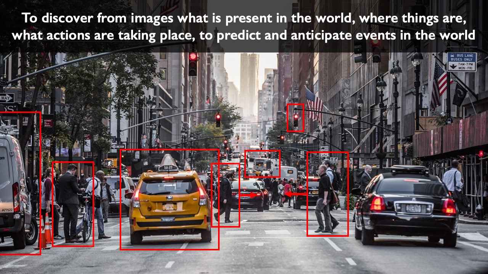

*Slide 3 — vision as more than labels: boxes around every car, person and light, and arrows for where the pedestrians are heading.*

Deep learning has brought a new wave of computer vision, from robotics and mobile computing to biology,
healthcare, medicine, autonomous driving and accessibility (slide 4, ≈2:24). Its first applications were
recognition rather than behaviour, largely industrial: facial **detection** first, which finds a face,
and then facial **recognition**, which goes one step further and relates that face to a particular
person or identity (slide 5, ≈2:24–3:10).

The self-driving car on slide 6 was built "in this building" and "lives right downstairs", as part of
what the captions give as an MIT–Toyota collaboration (≈3:10; the slide credits Amini+ *ICRA* 2019). It
is driven entirely by a single end-to-end computer vision system, with no mapping in the car. In that
sense it drives more like a human, who does not rely on HD maps but on two eyes and a low-dimensional
map, such as Google Maps on a phone (≈3:10–3:56). Section 20 returns to how it works.

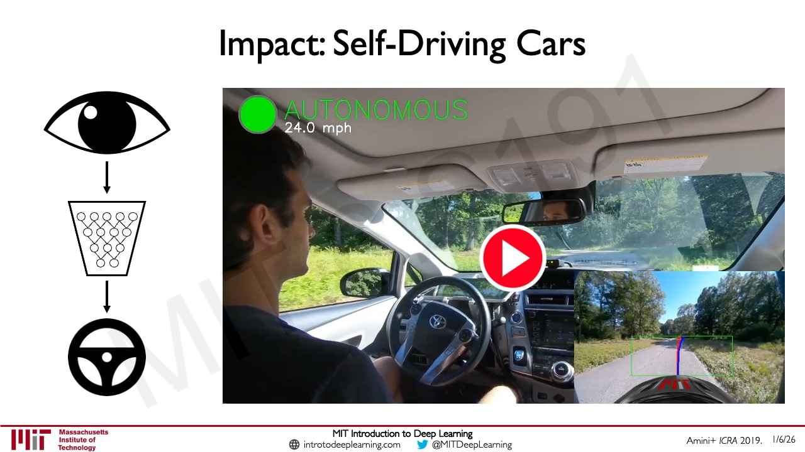

*Slide 6 — the MIT-built car driving itself from camera input (eye → network → steering wheel).*

Healthcare and medicine — diagnosing disease directly from X-rays and other medical scans — complete the
list (≈3:56); slide 7 shows breast cancer, COVID-19 and skin cancer examples. Slide 8, on accessibility
(credited to Google Project Guideline: a runner following a painted line, with the line detected on a
phone), is shown but not described aloud.

## 2. What computers "see" (3:56–7:00)

Computers "don't see in color space, they see in numbers" (≈3:56). To a computer an image is a matrix:
in the picture of Abraham Lincoln on slides 10–12, each cell of a 2D matrix holds one value, the
brightness of that pixel (≈4:43). Amini describes brightness as "ranging from zero to one with one being
the most bright"; slide 12 prints "An image is just a matrix of numbers [0,255]!", and its matrix holds
whole numbers between 0 and 255. This simple representation already covers every grayscale image. A
colour image stacks three such matrices, one each for red, green and blue: grayscale images are 2D
matrices, and RGB images are three-dimensional matrices "where the third dimension is exactly size
three" (≈5:28). Slide 12's example size is "1080x1080x3 for an RGB image".

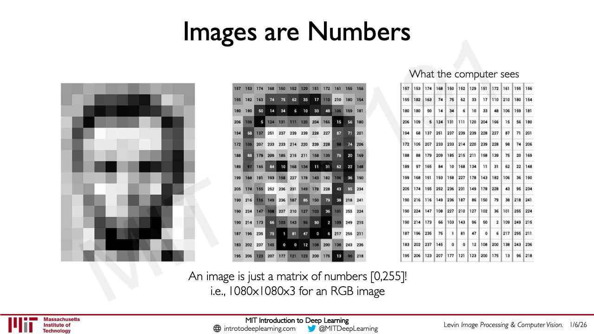

*Slide 12 — a low-resolution portrait, the same portrait with each pixel's value printed on it, and the matrix alone: what the computer sees.*

As on day one, the two kinds of task are **regression**, where the output takes a continuous value, and
**classification**, where it takes a class label and can be a probability of belonging to each class
(slide 13, ≈5:28–6:14). Amini starts with classification: given the Lincoln image, decide which of four
people it shows — Lincoln, Washington, Jefferson or Obama. That maps a two-dimensional input to a
one-dimensional vector of fixed size, one entry per known category (≈6:14). Slide 13's output vector is
Lincoln 0.8, Washington 0.1, Jefferson 0.05, Obama 0.05.

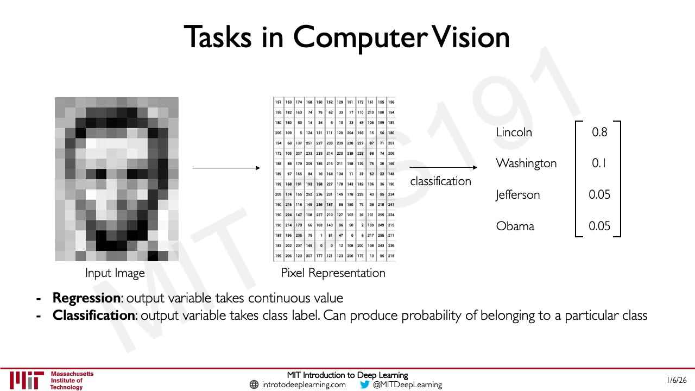

*Slide 13 — input image, its pixel representation, and a classification into four classes with probabilities.*

## 3. Features: engineered by hand, or learned (7:00–11:39)

To tell the four apart, a model has to know what is unique about each, which means detecting what is
relevant at the level of **features** (≈7:00). This is the theme of the whole lecture: "classification
is simply done by detecting these lower level features and then composing them together in order to
detect and classify the higher level groups" (≈7:00–7:46). To find a face you might look for eyes, noses
and ears; for a car, wheels, license plates and headlights; for a house, doors and windows (slide 14
lists "Nose, Eyes, Mouth", "Wheels, License Plate, Headlights" and "Door, Windows, Steps"). These
decompose further: to detect a door you may look for a rectangle with four corners (≈7:46).

The traditional approach uses domain knowledge to define those lower-level features, then builds a
pipeline that detects them and, through them, the higher-level structure (slide 15, ≈8:32). The problem
is that we take vision for granted, so even saying what makes up a house is hard, and houses vary
enormously: in viewpoint, in illumination, in size, both within a class and across classes (≈9:18).
Slide 16 shows seven such sources of variation — viewpoint, illumination conditions, scale,
deformation, background clutter, occlusion and intra-class variation — and slide 17 highlights the last
step of the pipeline, "Detect features to classify". The real question becomes how to find lower-level
features that are representative across a whole class yet still distinguish it from other classes, and
humans "are just not very good at clearly defining what those lower-level features should be" (≈9:18–10:05).

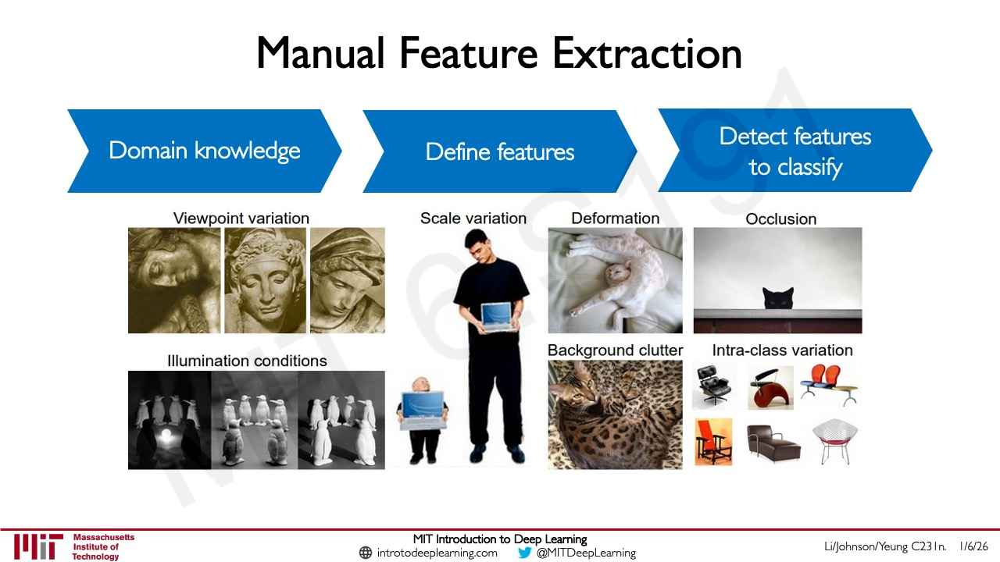

*Slide 16 — why hand-defined features break: viewpoint, illumination, scale, deformation, clutter, occlusion and intra-class variation.*

The answer is to extract features and, at the same time, **learn** what the good features should be,
directly from data (slide 18, ≈10:05). A neural network learns a hierarchy of features through the depth
of its layers, each layer identifying something key from the image, "basically doing subclassification
problems" as it goes deeper (≈10:51).
Shown many houses, a network should uncover the very low-level features common to all of them and
compose them into higher-level ones. Slide 18's three panels are low-level features (edges, dark
spots), mid-level features (eyes, ears, nose) and high-level features (facial structure). It is the same
paradigm as lecture 1's fully connected networks and lecture 2's sequence models (≈10:51–11:39); slide 50
(section 15) shows the same panels as the layers of a CNN.

## 4. Why not a fully connected network? (11:39–13:57)

Lecture 1's fully connected network goes from a one-dimensional input to a one-dimensional output, which
for classification is fine on the output side (slide 20, ≈11:39). The problem is the input. To feed it a
two-dimensional image you **flatten** the image into one dimension (slide 21, ≈12:24). That immediately
kills all of the spatial information in the image: "you've really killed or you've lobotomized so much
of the learning capacity of this model just by flattening this input", handicapping the model before it
has started (≈12:24–13:10).

It also costs a great many parameters. A 100 by 100 pixel image flattens to a 10,000-dimensional vector,
and because every input connects to every neuron of the hidden layer, the first matrix multiply is
already 10,000 by some other big number (≈13:10). "It's not feasible in practice to operate like this"
(≈13:10–13:57). Slide 21 sums up the fully connected approach: "Connect neuron in hidden layer to all
neurons in input layer", "No spatial information!", "And many, many parameters!"; slide 22 asks the
question the rest of the lecture answers: "How can we use **spatial structure** in the input to inform
the architecture of the network?"

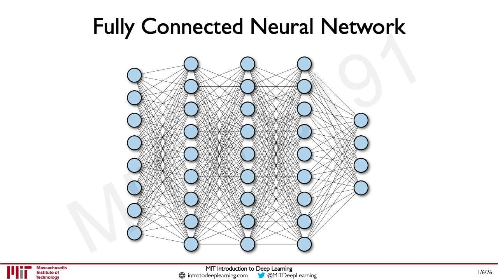

*Slide 20 — the fully connected network of lecture 1, every node joined to every node in the next layer.*

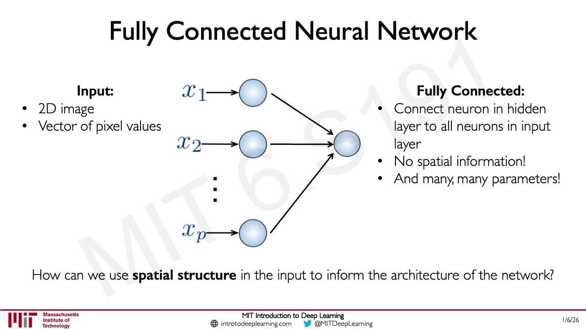

*Slide 22 — a flattened image's pixels all feeding one hidden neuron: no spatial information, and many parameters.*

## 5. Using spatial structure: patches and a sliding window (13:57–16:17)

Instead, keep the image as a two-dimensional array of pixel values, and connect **only a patch** of
pixels to each neuron of the next layer (slide 23, ≈13:57–14:45). Because each neuron looks only at a
small receptive field, the network is encouraged to use spatial relationships; and it stays efficient,
because no neuron is forced to look at everything. "This neuron has no influence from anything else in
the rest of the image" (≈14:45). To cover the whole image, do this for every patch: slide the patch
across the image, so that every neuron of the hidden layer receives information locally from one patch
of the input (slide 24, ≈15:30). Slide 24's text: "Connect patch in input layer to a single neuron in
subsequent layer. Use a sliding window to define connections. How can we **weight** the patch to detect
particular features?"

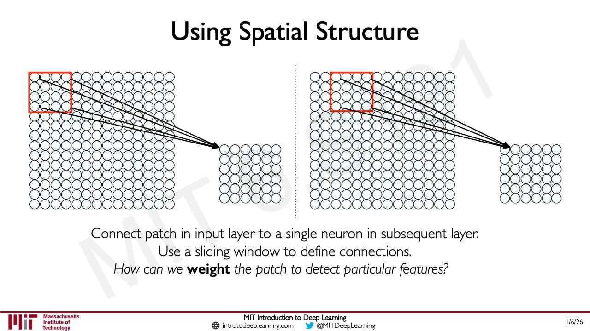

*Slide 24 — a 4 by 4 patch of the input feeds one neuron of the next layer; slid two pixels right, it feeds the next neuron.*

## 6. The convolution (16:17–18:35)

This patch-based operation — sliding patches across the image instead of looking at all of it — is a
**convolution** (≈16:17). Slide 25 makes it concrete: a filter of size $4 \times 4$ has 16 different weights; the
same filter is applied to every $4 \times 4$ patch of the input; and the next patch is 2 pixels over. The 16
weights meet 16 input pixels and undergo the operation of lectures 1 and 2: element-wise multiplied by
the inputs, plus a bias, through a non-linearity. "The only difference is that now we just do this
repeatedly across the entire input" (≈17:04–17:50). (The captions have the filter "defined by 14
numbers" twice, then "these 16 numbers" a moment later; slide 25 prints 16 weights.)

Slide 25's three points, repeated on slide 42, are the summary of what a convolution does:

1. Apply a set of weights — a filter — to extract **local features**.
2. Use **multiple filters** to extract different features.
3. **Spatially share** parameters of each filter.

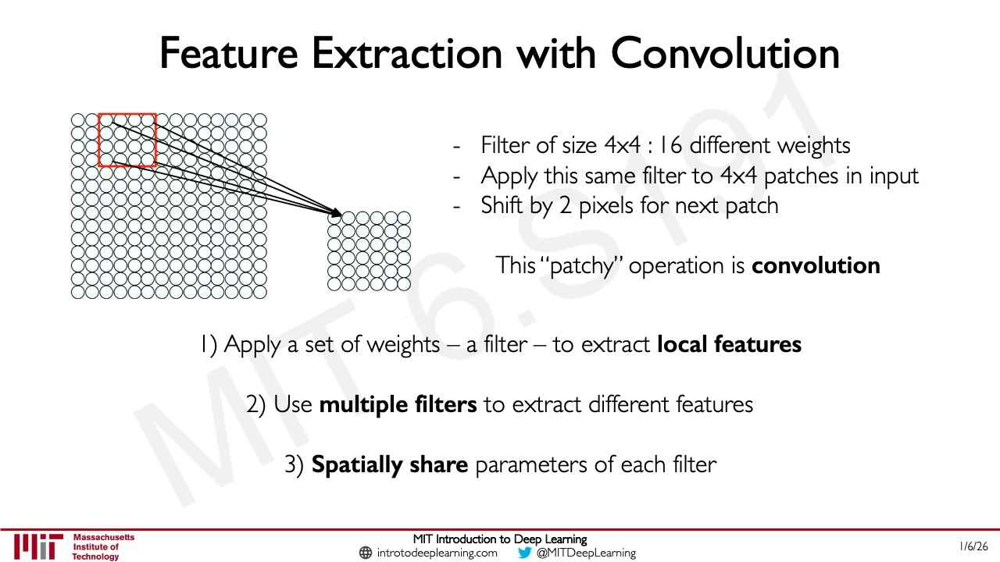

*Slide 25 — a 4 by 4 filter (16 weights) applied to every 4 by 4 patch, shifting 2 pixels at a time: "This 'patchy' operation is convolution".*

## 7. A case study: X or X? (18:35–20:54)

How do 16 numbers relate to features such as a door? Amini makes it concrete with images of the letter X,
black or white only: a black pixel is −1 and a white pixel +1 (≈18:35). Slide 27 shows two $9 \times 9$ images of
X, one clean and one shifted and deformed. Both are X's, but "they're clearly very different if you just
look at their equality" (≈18:35–19:22). As slide 27 puts it, "computers are literal!", and "We want to be
able to classify an X as an X even if it's shifted, shrunk, rotated, deformed."

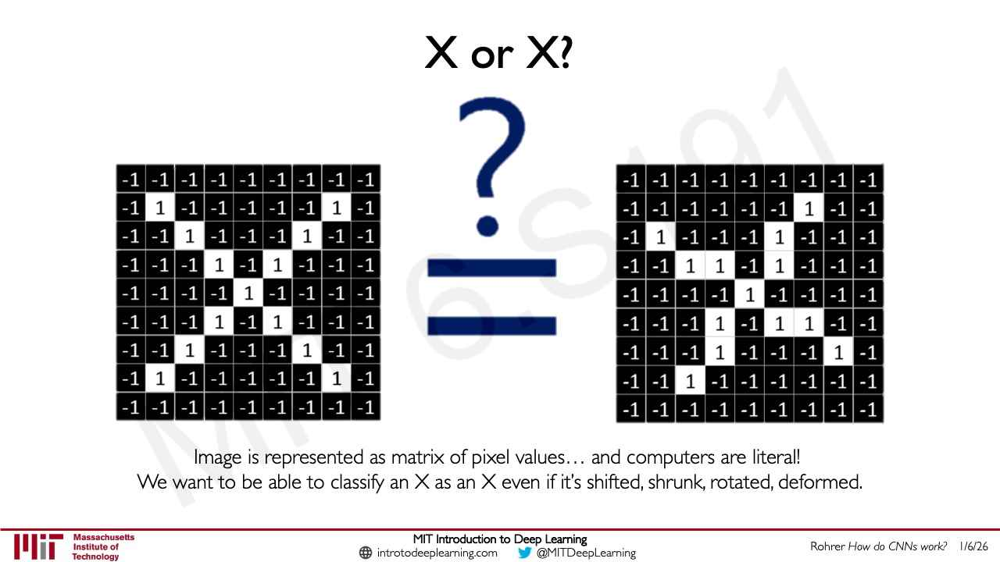

*Slide 27 — two X's as grids of −1 and 1: equal as letters, unequal pixel by pixel.*

So look patch by patch for features instead (slide 28, ≈19:22). One feature is a 45° diagonal in one
orientation, another is a crossing, and the third is the diagonal in the other orientation, and each
appears in both images: "even though these images are quite different in pixel space, at the feature
space, they're actually very, very aligned", and "that's the key point to take away from today's
lecture" (≈20:08).

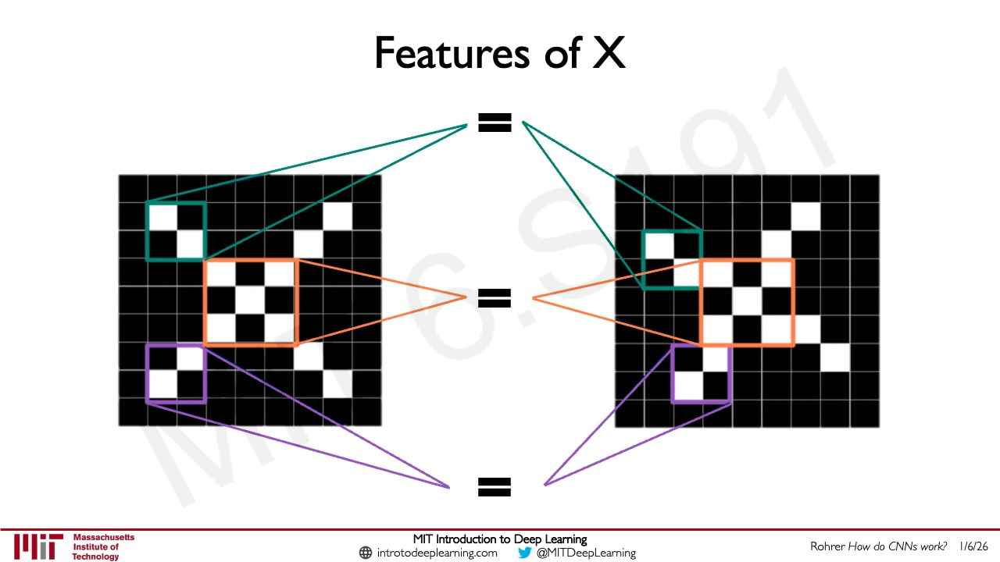

*Slide 28 — the same three small patterns (two diagonals and a crossing) occur in both X's.*

Every filter "is actually nothing more than just a miniature image" — a small two-dimensional array of
values (≈20:08). Slide 29 gives the three $3 \times 3$ filters for the X, a diagonal, the crossing and the other
diagonal:

$$\begin{bmatrix} 1 & -1 & -1 \cr -1 & 1 & -1 \cr -1 & -1 & 1 \end{bmatrix} \qquad \begin{bmatrix} 1 & -1 & 1 \cr -1 & 1 & -1 \cr 1 & -1 & 1 \end{bmatrix} \qquad \begin{bmatrix} -1 & -1 & 1 \cr -1 & 1 & -1 \cr 1 & -1 & -1 \end{bmatrix}$$

If an image contains all three, it is probably an X rather than another letter (≈20:08–20:54).

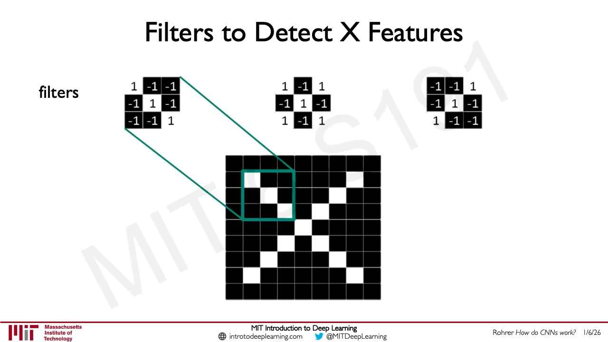

*Slide 29 — the three 3 by 3 filters, and the first one laid over the top-left arm of an X.*

## 8. The convolution operation, worked through (20:54–24:44)

The operation that plugs a filter into an image is the convolution, which "preserves the spatial
relationships between pixels by learning these image features in small patches instead of the entire
image" (≈20:54–21:40). For each patch: multiply every input of the patch element-wise with the matching
weight of the filter, add a bias and apply a non-linearity. The worked examples leave out the bias and
the non-linearity (≈21:40). Their weights were written down by hand from looking at the image; in a
network they are learned (≈21:40).

On slide 30 the diagonal filter sits over a patch of the clean X that it matches exactly. Every product is
1 — a −1 times a −1 and a 1 times a 1 are both 1 — so the nine products add up to 9. "Very positive means
strong match"; very negative means an inverted match (≈22:25).

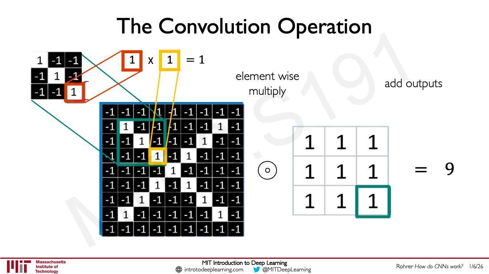

*Slide 30 — filter times matching patch, element by element, gives nine 1s, which add up to 9.*

Then the full operation: convolving a $5 \times 5$ image with a $3 \times 3$ filter (slide 31, ≈22:25–23:12), with the
filter covering the image entirely by sliding across it:

$$\text{image} = \begin{bmatrix} 1 & 1 & 1 & 0 & 0 \cr 0 & 1 & 1 & 1 & 0 \cr 0 & 0 & 1 & 1 & 1 \cr 0 & 0 & 1 & 1 & 0 \cr 0 & 1 & 1 & 0 & 0 \end{bmatrix} \qquad \text{filter} = \begin{bmatrix} 1 & 0 & 1 \cr 0 & 1 & 0 \cr 1 & 0 & 1 \end{bmatrix}$$

Start in the top-left corner: multiply the $3 \times 3$ patch there element-wise by the filter and add up the
results (slide 32, ≈23:12):

$$1 \cdot 1 + 1 \cdot 0 + 1 \cdot 1 + 0 \cdot 0 + 1 \cdot 1 + 1 \cdot 0 + 0 \cdot 1 + 0 \cdot 0 + 1 \cdot 1 = 4$$

That 4 is the first entry of the next layer's image. Move the filter over one slot and repeat, "and now
you have a three in the next slot" (slide 33, ≈23:57), and so on point by point (slides 34–40), until the
whole output is filled:

$$\text{feature map} = \begin{bmatrix} 4 & 3 & 4 \cr 2 & 4 & 3 \cr 2 & 3 & 4 \end{bmatrix}$$

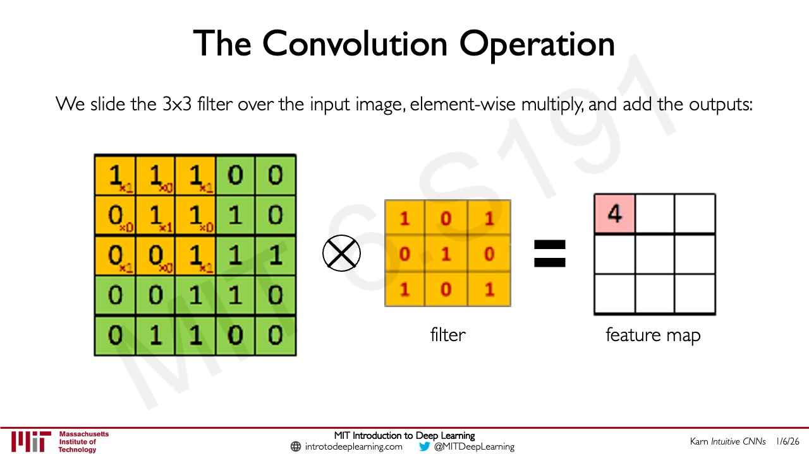

*Slide 32 — the filter on the top-left patch, each pixel tagged with the weight it is multiplied by: the first output is 4.*

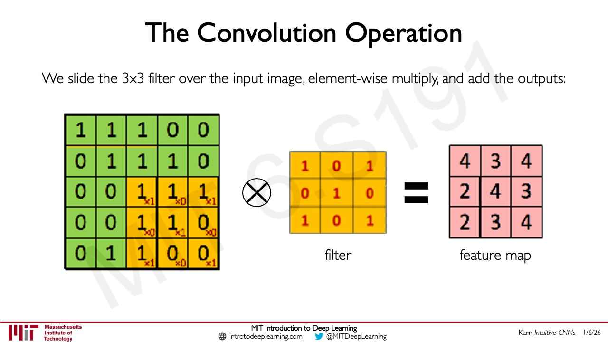

*Slide 40 — the filter at its last position and the completed 3 by 3 feature map.*

The output is an image in the next layer: an input image on the left, a filter of weights, and an output
image on the right (≈23:12). This hidden image is the **feature map**. It shows where the filter's
feature is in the input — "where are they spiking?" — so very positive values mark strong matches
between patch and filter (≈23:57). (Here Amini says a very negative value means "there's no match
there"; on slide 30 he called it an inverted match.) In this example the filter moves one pixel at a
time, and the $3 \times 3$ output is smaller than the $5 \times 5$ input.

## 9. Questions: learned weights, overlap and scale (24:44–26:16)

Three questions from the room settle points the lecture comes back to:

- **How are the filter's weights decided?** "Like the weights of any part of a neural network. They're
  learned." So far they have been set by hand, to show what the forward pass does (≈24:44).
- **Why do successive positions of the filter overlap?** It is a design choice, and some networks do
  not overlap. Overlap often helps: something may be cut off in the middle of a filter, and "there's no
  reason why we should assume that things are perfectly obeying exactly where the filters lay"
  (≈24:44–25:30).
- **What about scale?** "This is why you have depth in your network." A first-layer filter is tiny and
  detects very small features; but the feature map is smaller than the input image, so as you go
  deeper the images get smaller and the filter's relative size gets bigger (≈25:30–26:16).

## 10. Different filters, different feature maps (26:16–28:33)

Slide 41 convolves one image with three filters written by hand (≈26:16–27:47). A **sharpening** filter
has a positive number in the middle, negative numbers on the edges and zeros in the corners, and
sharpens the image. An **edge detection** filter has "the opposite type of trend", a very negative number
in the middle and positive ones on the edges, and its feature map picks out edges; a "strong" edge
detector is also shown:

$$\text{Sharpen} = \begin{bmatrix} 0 & -1 & 0 \cr -1 & 5 & -1 \cr 0 & -1 & 0 \end{bmatrix} \qquad \text{Edge Detect} = \begin{bmatrix} 0 & 1 & 0 \cr 1 & -4 & 1 \cr 0 & 1 & 0 \end{bmatrix} \qquad \text{“Strong” Edge Detect} = \begin{bmatrix} -1 & -2 & -1 \cr 0 & 0 & 0 \cr 1 & 2 & 1 \end{bmatrix}$$

Before convolutional neural networks existed, people wrote the weights of such filters out by hand to
create effects and detect features, and there are papers "literally just defining singular filters
for edge detection" (≈27:47). Now the weights are learned; the hand-written filters show what learned
ones represent.

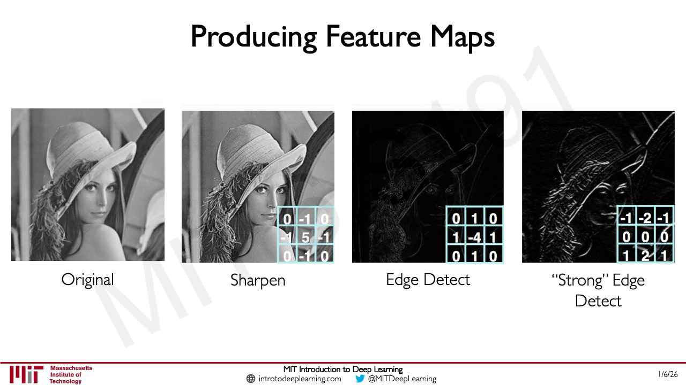

*Slide 41 — one photograph through three different 3 by 3 filters: sharpen, edge detect and "strong" edge detect.*

Amini then sums the section up (slide 42, ≈27:47–28:33): apply a set of weights to individual patches
rather than the whole image, to extract local features; repeat across the image; and use multiple
filters to detect different features. Nothing limits a layer to one filter — "You could learn 100
different filters on that one image" — and the X example already needed three.

## 11. CNNs: convolution, non-linearity, pooling (29:21–31:39)

A CNN is "literally just a convolutional neural network" (≈29:21). For image classification, its goal is
to learn features directly from the input image and use them to classify it. It has three main
operations (slide 44, ≈30:06):

1. **Convolution**, "the main workhorse": apply filters to generate feature maps. It is very like a
   fully connected layer, except done at patch level.
2. **Non-linearity**, often ReLU, for the same reason as on day one: the real world is non-linear.
3. **Pooling**, the one new part: downsampling after every convolution, on each feature map.

Why downsample? At the start of the model there is a big gap in scale between the image and the
filters, so the filters find only very small-scale features. Downscaling the image layer by layer lowers
the ratio between the size of the image and the size of the filter, so deeper layers detect higher-level
features (≈30:52). Training the model means learning the numbers in each filter of every convolutional
layer (≈30:52; slide 44: "Train model with image data. Learn weights of filters in convolutional
layers."). Slide 44 gives the building blocks in both frameworks: `tf.keras.layers.Conv2D`,
`tf.keras.activations.*` and `tf.keras.layers.MaxPool2D`; `torch.nn.Conv2d`, `torch.nn.ReLU` and
`torch.nn.MaxPool2d`.

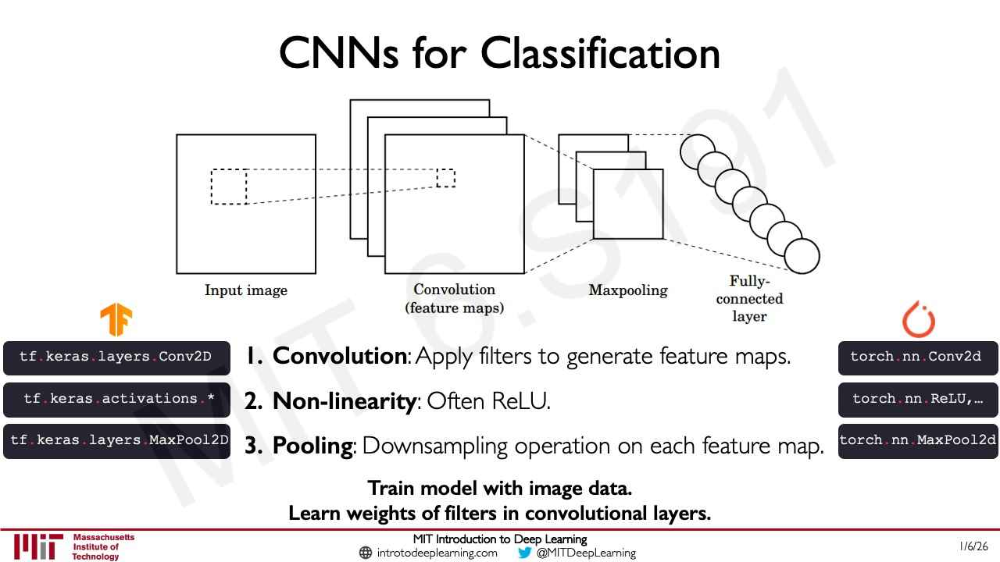

*Slide 44 — input image, convolution into feature maps, max pooling, a fully connected layer; the three operations and their TensorFlow and PyTorch layers.*

## 12. Convolutional layers and the output volume (31:39–33:12)

As in lecture 1, each neuron in a hidden layer computes a weighted sum of its inputs, adds a bias and is
activated by a non-linearity. What is special is **local connectivity**: only the inputs inside its patch
influence a neuron, and the neuron next to it is influenced by the patch slid over (slides 45–46,
≈31:39). For a $4 \times 4$ filter, a matrix of weights $w_{ij}$, the neuron at position $(p, q)$ in the hidden
layer computes (slide 46)

$$\sum_{i=1}^{4} \sum_{j=1}^{4} w_{ij} \thinspace x_{i+p, \thinspace j+q} + b$$

where $x$ are the input pixels, $i$ and $j$ run over the filter's rows and columns, and $b$ is the bias.
Slide 46 lists the three steps: "applying a window of weights", "computing linear combinations",
"activating with non-linear function".

A layer usually has many filters, because at one layer you may want to detect many different features
(≈32:26). Each filter produces its own feature map, so the layer goes from an image to a **volume**,
"where every slice of that volume is a single output feature map" (slide 47, ≈32:26–33:12). Slide 47
gives the layer's dimensions as $h \times w \times d$, where $h$ and $w$ are the spatial dimensions and the
depth $d$ is the number of filters. The **stride** is the filter's step size. A neuron's **receptive
field** is the set of locations in the input image it is connected to: every point of the output volume
depends on just a small patch of input pixels (≈33:12). The slide's code:

```python
tf.keras.layers.Conv2D( filters=d, kernel_size=(h,w), strides=s )
torch.nn.Conv2d( in_channels=3, out_channels=d, kernel_size=(h,w), stride=s )
```

The PyTorch layer needs the input dimensionality, `in_channels=3` for the slide's $32 \times 32 \times 3$ input
("Need to specify input dimensionality!").

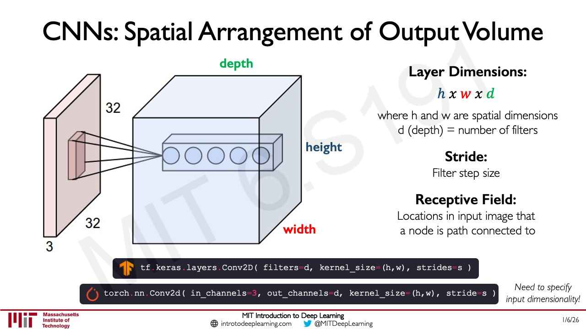

*Slide 47 — a patch of a 32 by 32 by 3 input feeding a column of neurons through the depth of the output volume (height × width × depth).*

## 13. Non-linearity: ReLU (33:12–34:44)

Because data is highly non-linear, CNNs apply a non-linearity after every convolution (slide 48,
≈33:12). The common choice is the rectified linear unit,

$$g(z) = \max(0, z)$$

a pixel-by-pixel operation that squashes anything negative to zero and keeps anything positive as it
is. Another way to see it is as a threshold at zero (≈33:58). On slide 48, an input feature map (black
negative, white positive) becomes a rectified feature map with only non-negative values. The layers are
`tf.keras.layers.ReLU` and `torch.nn.ReLU`. See [activation functions](activation-functions.md).

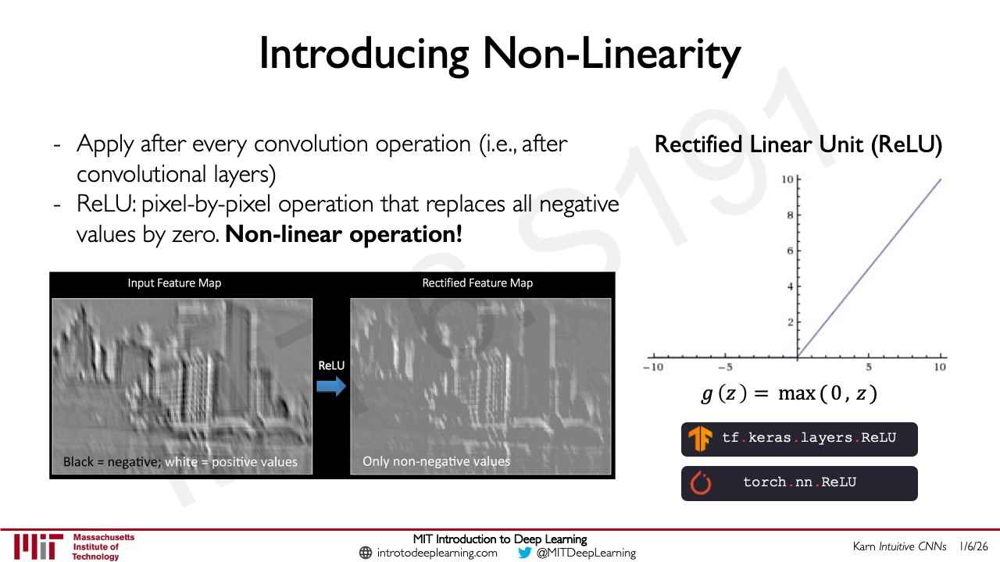

*Slide 48 — a feature map before and after ReLU, and the ReLU curve.*

## 14. Pooling (34:44–37:49)

Pooling reduces the dimensionality of the feature maps (≈33:58–34:44). It matters for two reasons: to
preserve spatial invariance, and to cover different scales of feature detection, since "by scaling down
the images, you're scaling up the relative size of what you search for" (≈34:44). The common way is
**max pooling**: take a patch and keep its maximum value. On slide 49, max pooling with $2 \times 2$ filters and
stride 2 takes a $4 \times 4$ feature map to a $2 \times 2$ one:

$$\begin{bmatrix} 1 & 1 & 2 & 4 \cr 5 & 6 & 7 & 8 \cr 3 & 2 & 1 & 0 \cr 1 & 2 & 3 & 4 \end{bmatrix} \longrightarrow \begin{bmatrix} 6 & 8 \cr 3 & 4 \end{bmatrix}$$

The top-left $2 \times 2$ block holds 1, 1, 5 and 6, so its output is 6 (≈34:44–35:29). Max pooling is simple and
fast to implement, but Amini encourages thinking about other ways to downsample, "because it's very
flexible and there is a lot of tuning that you could do there" (≈35:29); slide 49 asks "How else can we
downsample and preserve spatial invariance?" Its code is `tf.keras.layers.MaxPool2D(pool_size=(2,2),
strides=2)` and `torch.nn.MaxPool2d(kernel_size=(2,2), stride=2)`.

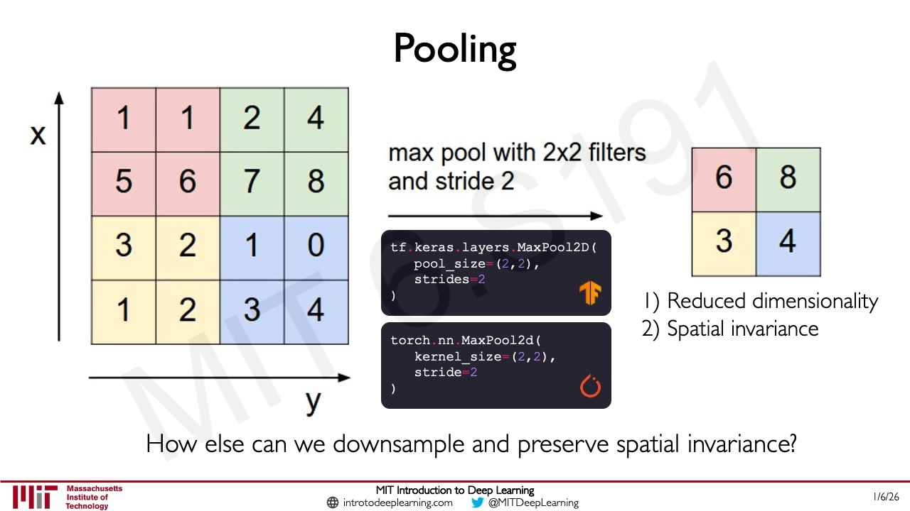

*Slide 49 — max pooling with 2 by 2 filters and stride 2: each coloured block of the 4 by 4 map keeps its largest value.*

A student asked whether the patches already downsample the image, and whether bigger patches would
downsample more (≈35:29–36:15). There is a trade-off. Convolution does shrink the image slightly,
because the filter has to stop at the edges. But growing the patch kills the point of looking locally:
small patches capture very detailed information, and pooling is how the results of each feature map are
then combined into higher-level compositions (≈36:15). Another student put max pooling as "just
essentially lowering the resolution"; Amini agreed — "but doing so in a very structured way", keeping
the features that were maximally identified and carrying them to the next feature map (≈37:02).

## 15. The learned hierarchy, and classification (37:49–40:56)

Put together, the layers learn a hierarchy (≈37:49). Small patches at the start let low-level features
emerge. Every pooling step scales up the relative size and compositionality of what the features
represent, so features from earlier layers combine: lines and edges into corners and curves, and those
into shapes and objects. Slide 50 shows learned features at three convolutional layers (Lee+ *ICML*
2009): edges and dark spots in layer 1, eyes, ears and noses in layer 2, and facial structure in layer 3.

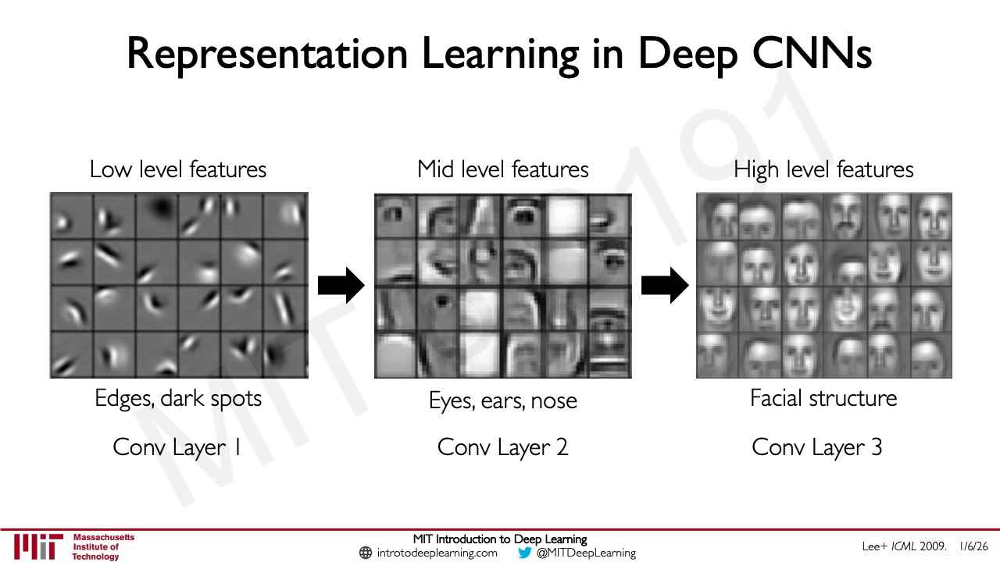

*Slide 50 — what three convolutional layers learn on faces: edges and dark spots, then facial parts, then whole faces.*

A CNN for image classification has two parts (slides 51–52, ≈37:49–38:35):

- **Feature learning**: convolutions, non-linearities and pooling, in sequence. These output high-level
  features of the input.
- **Classification**: the high-level features are finally flattened and fed into a fully connected
  layer, "because eventually you do need to go to that one-dimensional classification head". As on day
  one, it is trained with a classification loss and a softmax output, to give a categorical distribution
  over the classes (≈38:35).

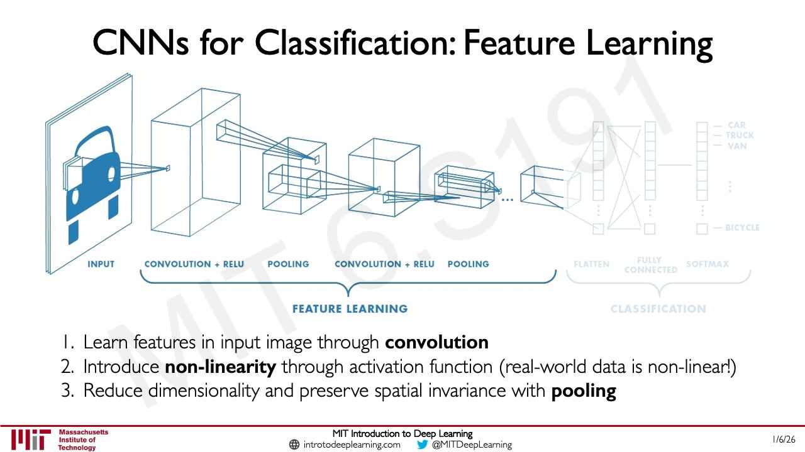

*Slide 51 — a full CNN with the feature-learning stages (convolution + ReLU, pooling, repeated) highlighted.*

The softmax turns the fully connected layer's outputs $y_i$ into the probability of the image belonging
to each class $i$ (slide 52):

$$\text{softmax}(y_i) = \frac{e^{y_i}}{\sum_j e^{y_j}}$$

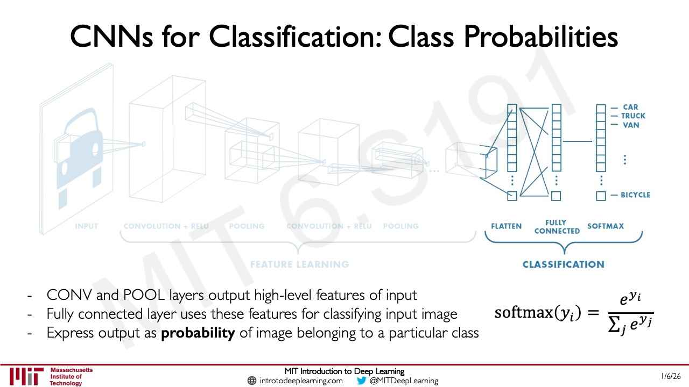

*Slide 52 — the same CNN with the classification stages highlighted: flatten, fully connected, softmax over car, truck, van, …, bicycle.*

A student asked whether different architectures are meant for different purposes, and whether a CNN
could be used for language (≈38:35–39:23; the question is partly garbled in the captions). Yes:
different architectures are meant first of all for different data **modalities**. Convolution suits input
that is two-dimensional and spatial — not necessarily images; sequential input calls for an RNN or a
sequence model. But there are exceptions: convolving patches across a one-dimensional vector — "that's also a valid
sequence model" — and the same ideas extend to 3D, for volumetric scans (≈39:23–40:56). See
[sequence modeling](sequence-modeling.md).

## 16. A CNN in code (40:56–43:15)

The TensorFlow model on slide 53 (≈40:56–42:29), reproduced as printed:

```python
import tensorflow as tf

def generate_model():
   model = tf.keras.Sequential([
      # first convolutional layer
      tf.keras.layers.Conv2D(32, filter_size=3, activation='relu’),
      tf.keras.layers.MaxPool2D(pool_size=2, strides=2),

      # second convolutional layer
      tf.keras.layers.Conv2D(64, filter_size=3, activation='relu’),
      tf.keras.layers.MaxPool2D(pool_size=2, strides=2),

      # fully connected classifier
      tf.keras.layers.Flatten(),
      tf.keras.layers.Dense(1024, activation='relu’),
      tf.keras.layers.Dense(10, activation=‘softmax’)  # 10 outputs
   ])
   return model
```

The first convolution learns 32 filters, each of size 3, so $3 \times 3$ patches, with a ReLU activation, followed
by max pooling. The second takes the features detected by the first as its input, rather than the
original image, and looks for 64 features. Its filters are also $3 \times 3$, but since the image has been scaled
down by a factor of two, "it's not 3 by 3 in the original space" (≈41:43). The dense part is the
classification head (≈41:43–42:29).

The PyTorch version on slide 54 (≈42:29), also as printed:

```python
import torch

def generate_model():
   model = nn.Sequential([
      # first and second convolutional layer
      torch.nn.Conv2d(in_channels=3,out_channels=32, filter_size=3),
      torch.nn.ReLU(),
      torch.nn.MaxPool2d(kernel_size=2, stride=2),

      torch.nn.Conv2d(in_channels=32, out_channels=64, filter_size=3),
      torch.nn.ReLU(),
      torch.nn.MaxPool2d(kernel_size=2, stride=2),

      # fully connected classifier
      torch.nn.Flatten(),
      torch.nn.Linear(64*6*6, 1024), # flattened dim after 2 conv layers
      torch.nn.ReLU(),
      torch.nn.Linear(1024, 10),  # 10 outputs
   ])
   return model
```

The input has three channels because it is an RGB image, and the 32 output channels are the 32 features
learned by that layer (≈42:29). Three things are as printed on the slides: both models pass the filter
size as `filter_size`, where slide 47's code uses `kernel_size`; slide 54 imports only `torch` but calls
`nn.Sequential`; and slide 53 mixes straight and typographic quotes around its activation names.

A student asked what max pooling reduces in an image that has height, width and depth (≈42:29–43:15). It
reduces only the spatial dimensions, height and width, and not the depth: "if you start with 32 features
in the feature map, you maintain 32 after max pooling" (≈43:15).

## 17. One architecture, many applications (43:15–45:34)

Convolutions apply to far more than image classification (≈43:15). The split into a feature-detection
part and a classifier part is "a really nice abstraction", because the feature-detection part can stay
the same across many applications: the outputs of the convolutional layers are very general-purpose
features, reusable for classification, prediction, forecasting and more (≈44:02). Only the second part
changes with the task (slide 56, ≈44:47). The slide lists classification, object detection, segmentation
and probabilistic control.

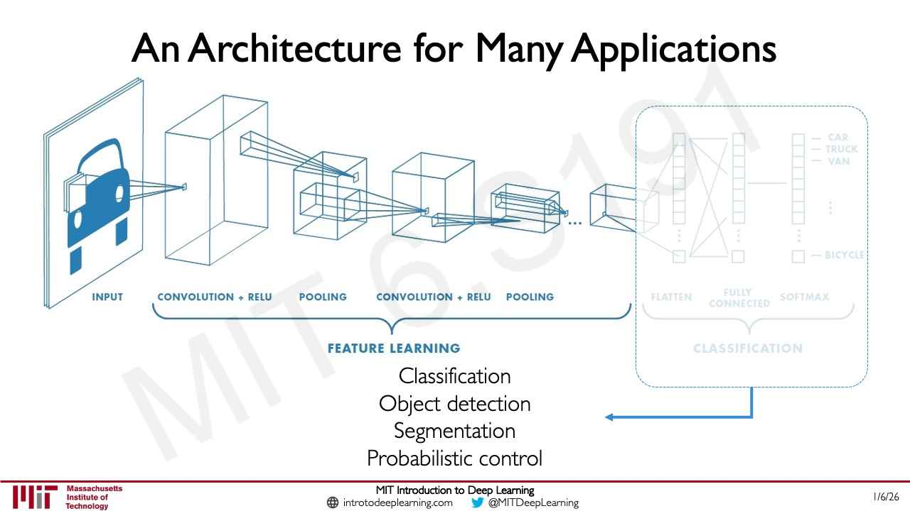

*Slide 56 — keep the feature-learning part, swap the head: classification, object detection, segmentation, probabilistic control.*

For classification, Amini picks healthcare, where a model can take a scan of a patient and analyze it for
many kinds of classification (≈44:47). Slide 57's paper (McKinney+ *Nature* 2020, "International
evaluation of an AI system for breast cancer screening") showed that a "CNN-based system outperformed
expert radiologists at detecting breast cancer from mammograms"; Amini adds that it is "paper from some
time ago" and "we've gone much farther than this" (≈45:34). The slide plots sensitivity against
1 − specificity for the AI system and for MD readers, and shows a "Breast cancer case missed by
radiologist but detected by AI".

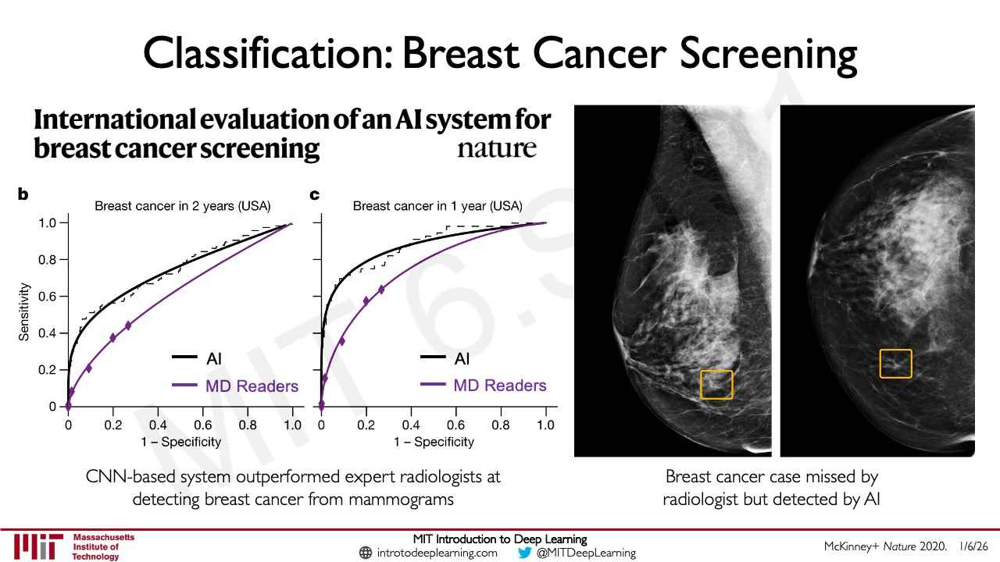

*Slide 57 — the AI system's curve against the readers' operating points, and a mammogram case the AI caught.*

## 18. Object detection (45:34–51:00)

Classification gives one label for the whole image; **object detection** also localizes (slide 58,
≈45:34–46:21). From an image of a taxi, classification outputs the label "taxi"; detection outputs, for
every object in the image, a bounding box — the x and y coordinates of the box, its height and width —
and a class for that box (slide 58 labels it "Label (x, y, w, h)"). The front of the network is still
convolutional, but the back has to change: there may be many objects, so the output must be able to hold
any number of boxes with their predictions (slide 59, ≈46:21–47:10). Variable-sized output is "something
that we actually haven't seen in the class so far" (≈47:10).

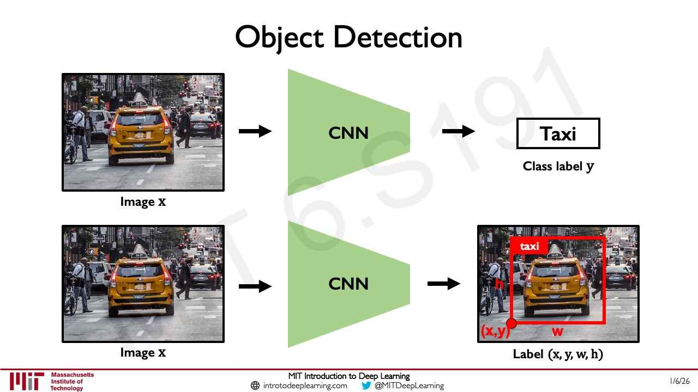

*Slide 58 — the same taxi image into a CNN, once for a class label and once for a labelled bounding box (x, y, w, h).*

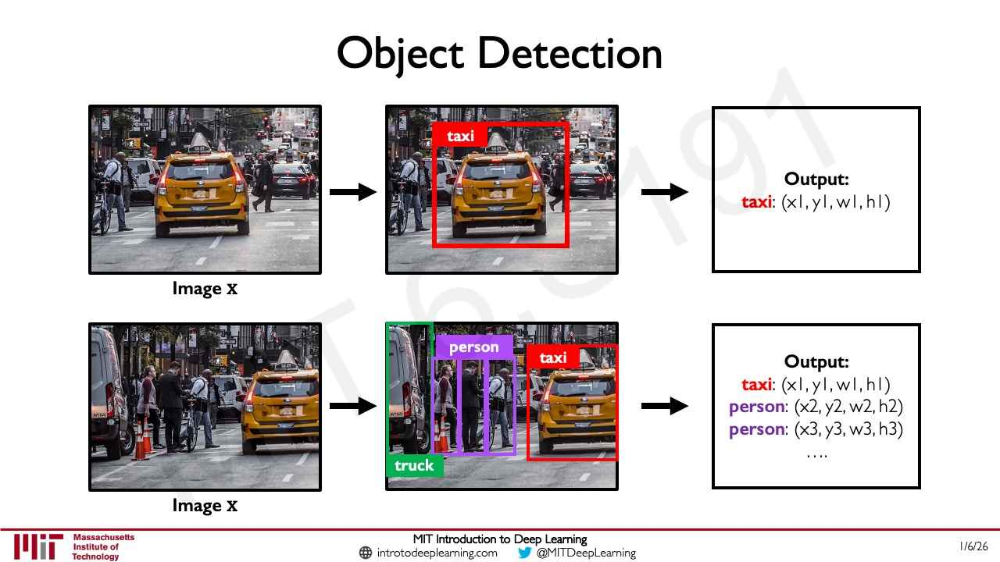

*Slide 59 — one object gives one box; a busy street gives a truck, several people and a taxi, each with its own box.*

This is hard because boxes can be anywhere and of any size. The naive solution is to take a random box,
pass it through the classifier, and repeat with more random boxes (slide 60, ≈47:10). It is very
expensive: way too many inputs, scales, sizes and aspect ratios (≈47:55; slide 60: "**Problem**: Way too
many inputs! This results in too many scales, positions, sizes!").

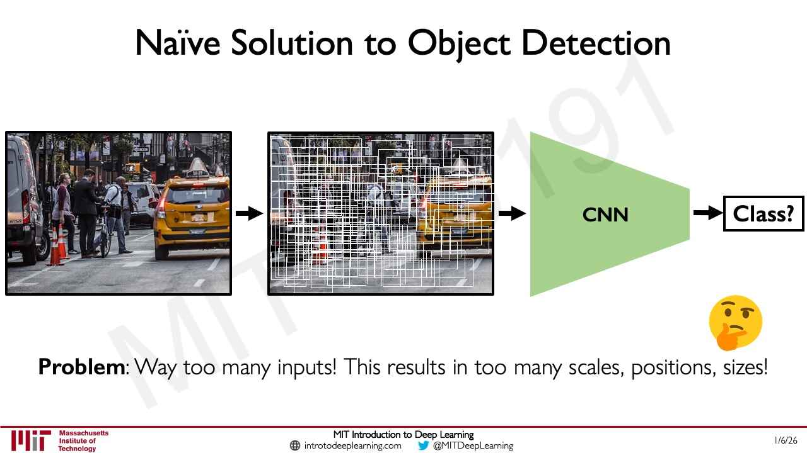

*Slide 60 — the naive approach: many candidate boxes, each sent through the CNN to ask "Class?".*

Better is to use a heuristic — a method that is not machine learning — to find blobs where something is
happening in the image, draw boxes around them, and feed only those to the CNN (≈47:55–48:43). Slide 61
calls this the R-CNN algorithm (Girshick+ *CVPR* 2014; Amini does not name it aloud): input image,
extract region proposals (~2k), compute CNN features on each warped region, classify the regions. It is
much better than random boxes but has two key problems (≈48:43): it is **slow**, because it relies on a
first, usually non-learned model and still has to go over many boxes, most of them irrelevant; and it is
**brittle**, because the boxes are defined manually rather than learned, which "kind of defeats the whole
purpose of deep learning as a field".

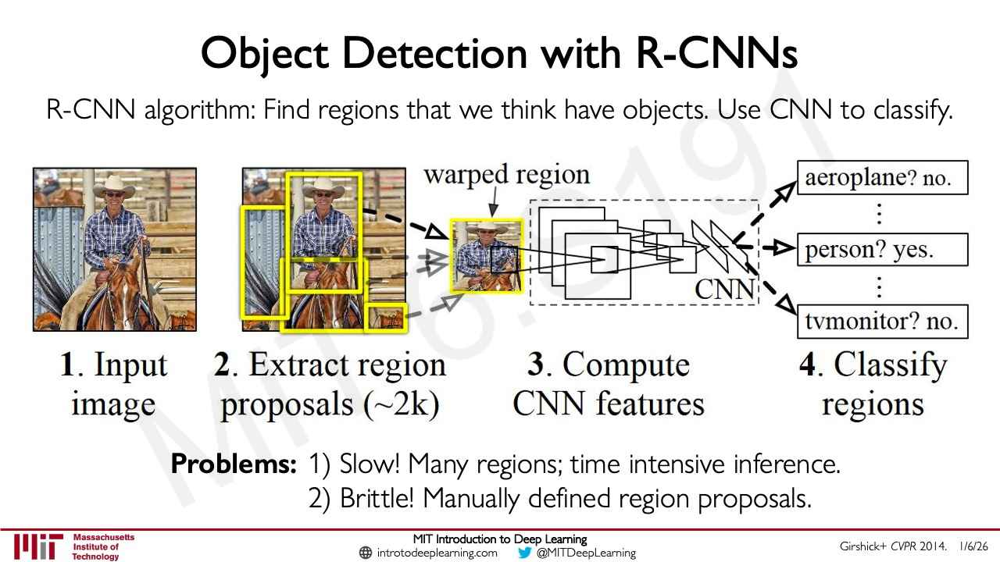

*Slide 61 — R-CNN: about 2,000 region proposals, each warped and classified by a CNN.*

Object detection is foundational — a backbone for self-driving and many real-world tasks — and Amini
describes one solution "very widely used in practice" (slide 62, which names Faster R-CNN, Ren+ *IEEE*
2016; ≈49:29–51:00). Feed the entire image once through the convolutional feature extractor, which is
fast. Its output is a feature map, with no boxes yet. Use those features to propose candidate boxes — the
**proposal** step — since they are already detecting where things are. Then extract features from each
proposed box and classify it. The key point is that you can backpropagate through the entire model, from
the classifier's answer all the way back to the input image: if the boxes were bad, the model learns to
propose better ones. Unlike the previous model, this one is "fully end-to-end differentiable" (≈50:15–51:00).

One difference between talk and slide: aloud, Amini says the boxes around blobs in the features can be
found with heuristic-based approaches, such as thresholding (≈50:15), while slide 62 describes a "Region
proposal network to learn candidate regions" that is "Learned, data-driven". Slide 62 is the first build
of its diagram, with only the image and the convolutional layers drawn; the deck does not continue it.

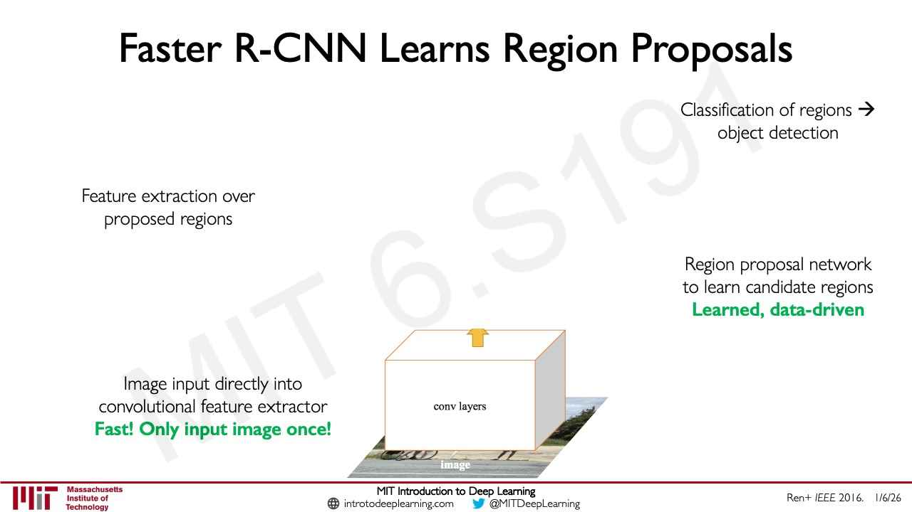

*Slide 62 — Faster R-CNN: the image goes through the convolutional layers once, and a region proposal network learns the candidate regions.*

## 19. Semantic segmentation (51:00–52:32)

Sometimes you want not a box but a **pixel-level** labelling of the image (≈51:00). This is an
image-to-image task: input the full RGB image and output, for every pixel, the class it belongs to —
on slide 63, a picture of cows becomes a map of cow, grass, sky and background (spoken: "cows, trees,
sky, grass", ≈51:46). The input side is the same as before, convolutional layers followed by pooling and
non-linearities; only the output side changes. Since it must produce a new image, the downsampling
operations are followed by **upsampling** operations that generate it, pixel by pixel. It is trained as a
classifier, "so in some sense this is actually an image classification task as well", one whose output
is an image rather than a one-dimensional vector (≈51:46–52:32).

Slide 63 names this a fully convolutional network (FCN, Long+ *CVPR* 2015): "Network designed with all
convolutional layers, with **downsampling** and **upsampling** operations", from an input of size
$3 \times H \times W$ to predictions of size $H \times W$. Its upsampling layers are
`tf.keras.layers.Conv2DTranspose` and `torch.nn.ConvTranspose2d`, which the lecture does not discuss
aloud.

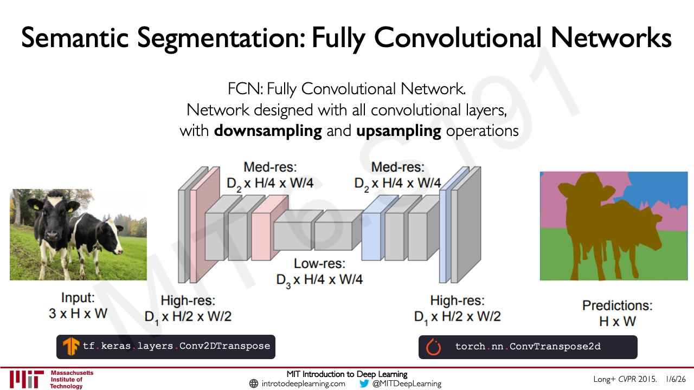

*Slide 63 — a fully convolutional network: downsample the cow photograph, then upsample to a class for every pixel.*

## 20. Continuous control: navigation from vision (52:32–54:49)

The final example is the self-driving car of section 1 (slides 64–65, Amini+ *ICRA* 2019). The model goes
from raw perception — camera images — together with a noisy street-view map: a top-down map, even
sparser than Google Maps, which is "actually an image" too (≈52:32–53:17). Every input, each camera and
the map, goes through its own convolutional layers; the features are concatenated; and from them the
network learns the control commands. "The entire model here can be trained as a large CNN" (≈53:17).
Slide 65 adds that it is "trained end-to-end **without any human labelling or annotations**".

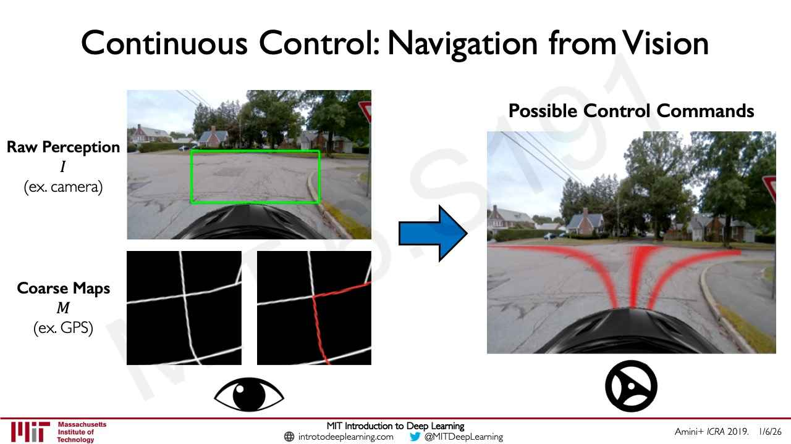

*Slide 64 — inputs are the raw camera image and a coarse route map; the output is a set of possible control commands.*

Control is not one number: at any moment there is a distribution of possible actions, possibly
multimodal — the car could turn left or right — so this is a distributional learning problem, which
"we'll talk about later in the class" (≈54:03). Slide 65 gives the probabilistic output as a mixture of
$K$ Gaussians over the control $\theta$, given the camera image $I$ and the map $M$:

$$P(\theta \mid I, M) = \sum_{i=1}^{K} \phi_i \thinspace \mathcal{N}(\mu_i, \sigma_i^2)$$

where, from the fully connected layer's outputs $a_i$, the weights are $\phi_i = \frac{e^{a_i}}{\sum_{j=1}^{K} e^{a_j}}$,
the means $\mu_i = a_i$ and the standard deviations $\sigma_i = \exp(a_i)$. The training loss is

$$L = -\log(P(\theta \mid I, M))$$

(the slide prints it with only one closing parenthesis). When a routed map is given as an extra input,
the model can also output a single "Deterministic Control". The lecture does not go through these equations aloud. To summarize the example, it is "the same
feature extractors that we saw before using convolutions, pooling, and then finally learning on the other
side" (≈54:03–54:49).

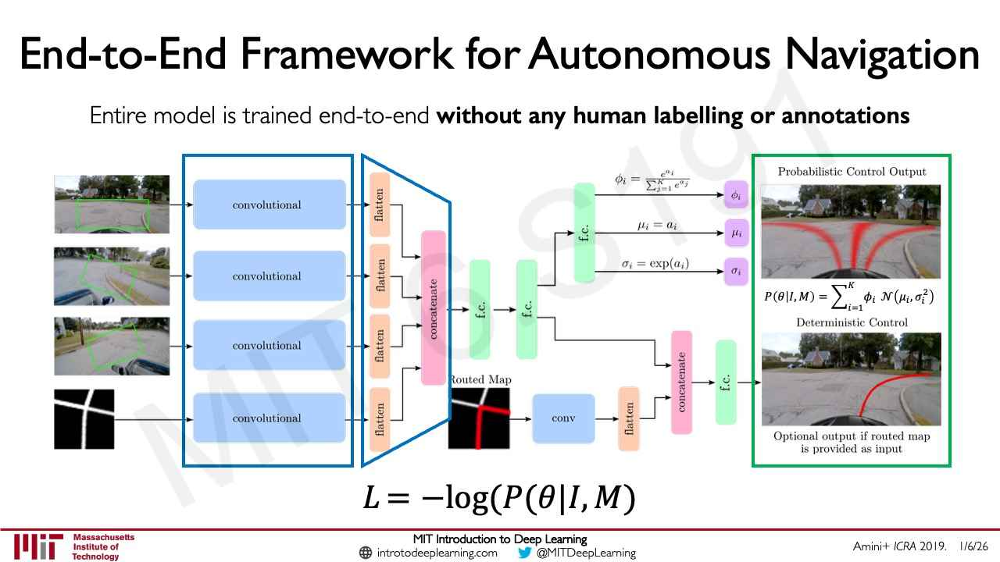

*Slide 65 — one convolutional branch per camera and for the map, concatenated into fully connected layers that output a mixture over steering commands.*

## 21. Summary (54:49–55:36)

CNNs are an "incredibly general-purpose" operation, working on 2D images and on one-dimensional
sequences alike, and their impact goes well beyond the examples in the lecture (slide 67, ≈54:49). The
lecture went from defining features by hand and understanding where they come from, to learning them
with convolutional neural networks, to applications that keep the feature-extraction part and change the
later part (≈54:49–55:36). Slide 68's summary has three columns: foundations (why computer vision,
representing images, convolutions for feature extraction), CNNs (architecture, application to
classification, ImageNet) and applications (segmentation, image captioning, control; security, medicine,
robotics). ImageNet and image captioning appear on that slide but are not discussed in the lecture.

## 22. Lab 2 and the next lecture (55:36–56:46)

In today's lab (slide 69, "Lab 2: Facial Detection Systems") students build their own classifier and a
facial detection system, and learn to debias them, "because one big problem is that you want to make sure
that your features that you're learning cover a full spectrum of the distribution of your data"
(≈55:36). Next comes Ava Amini's lecture on generative modeling, about generating new things rather than
predicting (≈55:36–56:22; slide 70: "Lecture 4: Generative Modeling starting soon!"). That is
[lecture 4](04-deep-generative-modeling.md), which returns to the debiasing lab and the role a VAE plays
in it (its section 14).

## Related pages

- [Convolutional neural networks](convolutional-neural-networks.md) — convolution, filters, feature maps,
  the output volume, ReLU, pooling and the CNN architecture.
- [Computer vision](computer-vision.md) — images as numbers, hand-engineered versus learned features,
  and the tasks: classification, detection, segmentation, control.
- [Neural network layers](neural-network-layers.md) — the fully connected layers that a CNN's
  classification head reuses, and why they suit images badly.
- [Activation functions](activation-functions.md), [loss functions](loss-functions.md),
  [what is deep learning?](what-is-deep-learning.md) — lecture 1 topics this lecture builds on.
