# Lecture 4 — Deep Generative Modeling

**MIT 6.S191, 2026 edition. Lecturer: Ava Amini. Delivered 6 January 2026.**
[Video](https://www.youtube.com/watch?v=R8V8CbuxryI) ·
[Slides (PDF)](https://introtodeeplearning.com/slides/6S191_MIT_DeepLearning_L4.pdf) ·
[Slide-by-slide transcription](../raw/slides/04-deep-generative-modeling.md) ·
[Transcript](../raw/transcripts/04-deep-generative-modeling.md) ·
[Verbatim captions](../raw/transcripts/original/04-deep-generative-modeling.md)

This lecture, the second of day two, turns from networks that learn patterns in labelled data to
networks that **learn the probability distribution of the data itself**, so that they can be sampled
to produce brand-new data instances (≈0:05–0:51). That, Amini stresses, is the core principle of
generative modeling. It builds two foundational families. **Autoencoders** compress data into a small
set of latent variables and learn by reconstructing their input. **Variational autoencoders (VAEs)**
make that latent space probabilistic, which needs a regularization term with a Normal prior and the
reparametrization trick to train. **Generative adversarial networks (GANs)** skip the latent model
and train a generator against a discriminator until the generator's samples cannot be told from real
data. Diffusion models are left for later lectures (slide 82).

Timestamps such as (≈23:21) point into the [transcript](../raw/transcripts/04-deep-generative-modeling.md);
"slide N" is page N of the PDF (the deck prints no slide numbers). See also the topic pages
[generative modeling](generative-modeling.md), [autoencoders and VAEs](autoencoders-and-vaes.md) and
[generative adversarial networks](generative-adversarial-networks.md).

## 1. Which face is real? (0:05–2:25)

Amini opens with the course's traditional poll: three faces, labelled A, B and C, and the question
"Which face is real?" (slide 2). The room's votes split, with few for A and roughly equal numbers for B
and C (≈0:51–1:37). In past years the trick was that all three were fake and generated by AI. This year
she switched it up, because the models have become so powerful that "for the first time it was truly
indistinguishable between what is fake … and what is real": **C is the real photograph**, and A and B
were generated by Google's latest Gemini model (≈1:37–2:25; the slide credits "Google Gemini").

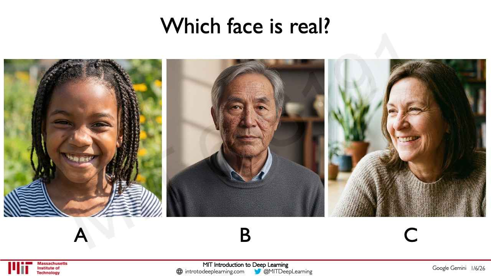

*Slide 2 — the opening poll: A and B were generated by Gemini; C is the real photograph.*

## 2. Supervised versus unsupervised learning (2:25–3:57)

The first three lectures — feed-forward networks, recurrent models, CNNs — all fall under **supervised
learning** (≈2:25–3:11). There the data come in pairs $(x, y)$, where $x$ is the data and $y$ its label,
and the goal is to learn a function mapping $x \rightarrow y$: classification, regression, object
detection, semantic segmentation and so on (slide 3).

**Unsupervised learning** is the larger class of problems where only the data $x$ are given, with no
labels, and the goal is to learn the "hidden or underlying structure" of the data — that is, the
distribution itself (slide 4, ≈3:11–3:57). Clustering and dimensionality reduction are familiar
unsupervised methods; generative modeling is a powerful way to tackle the same kind of problem.

## 3. Generative modeling: learning a distribution (3:57–6:17)

The goal, as slide 5 states it: "Take as input training samples from some distribution and learn a
model that represents that distribution." Amini insists this is the heart of the subject — "it really
amazes me that even at very advanced levels, people often don't realize that this is really the core
fundamental principle of generative modeling. Capturing and learning probability distributions over
data" (≈3:57–4:44). It is used in two closely related ways (≈4:44–5:32):

**Density estimation**: given samples that fall along some distribution, learn a model of the
underlying probability distribution they came from. Slide 5 draws this as a curve fitted over a row of
one-dimensional samples, high where the samples are dense.

**Sample generation**: once a distribution has been learned, sample from it to generate new instances
that did not exist in the training data. Slide 5 sets a grid of training photographs, "Training data
$\sim P_{data}(x)$", beside a grid of generated ones, "Generated $\sim P_{model}(x)$".

In both cases the fundamental question is the one at the bottom of slide 5: how can we learn
$P_{model}(x)$ similar to $P_{data}(x)$, a model distribution as close as possible to the true
distribution of the data (≈5:32)?

*Slide 5 — the two uses of a learned distribution: a density fitted to samples (left), and new samples drawn from it (right).*

## 4. Why generative models? (6:17–8:35)

It is not just about hyper-realistic images (≈6:17). Three uses are given.

**Debiasing.** A generative model can uncover the **underlying features** in a dataset (slide 6).
Datasets collected in the real world often carry fundamental biases, and models trained on them
capture the same biases. A model that has learned the data distribution can be used to debias, towards
"more fair and representative data sets and distributions" (≈6:17–7:02). Slide 6 contrasts a grid of
faces with "Homogeneous skin color, pose" against one with "Diverse skin color, pose, illumination",
and marks this as the day's **software lab**.

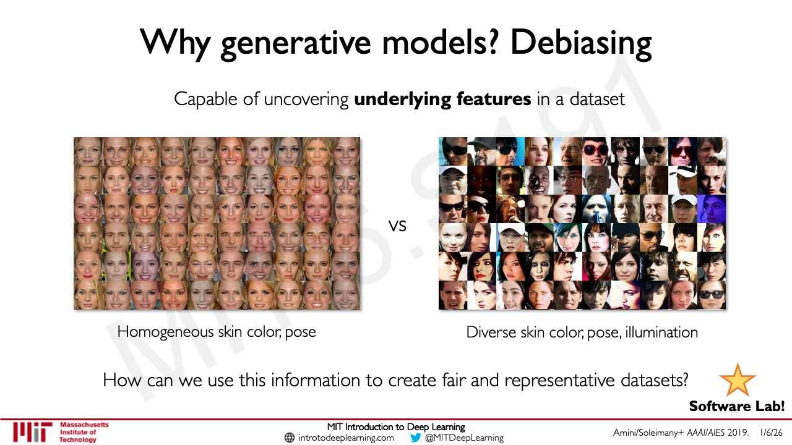

*Slide 6 — a homogeneous face dataset against a diverse one: the problem the day's lab tackles with a generative model.*

**Outlier detection.** In self-driving or medicine, the problems come from the really rare edge cases,
not from the bulk of the distribution; a generative model can detect when an event is rare, an
outlier, and so correct for it (≈7:02–7:47). Slide 7 puts typical driving at the peak of a
distribution — "95% of Driving Data: (1) sunny, (2) highway, (3) straight road" — and edge cases, harsh
weather and pedestrians in its tail, with the strategy "Leverage generative models, detect outliers in
the distribution" and "Use outliers during training to improve even more!" (Amini says "90% of the
distribution" aloud; the slide prints 95%. It credits Amini+ *IROS* 2018.)

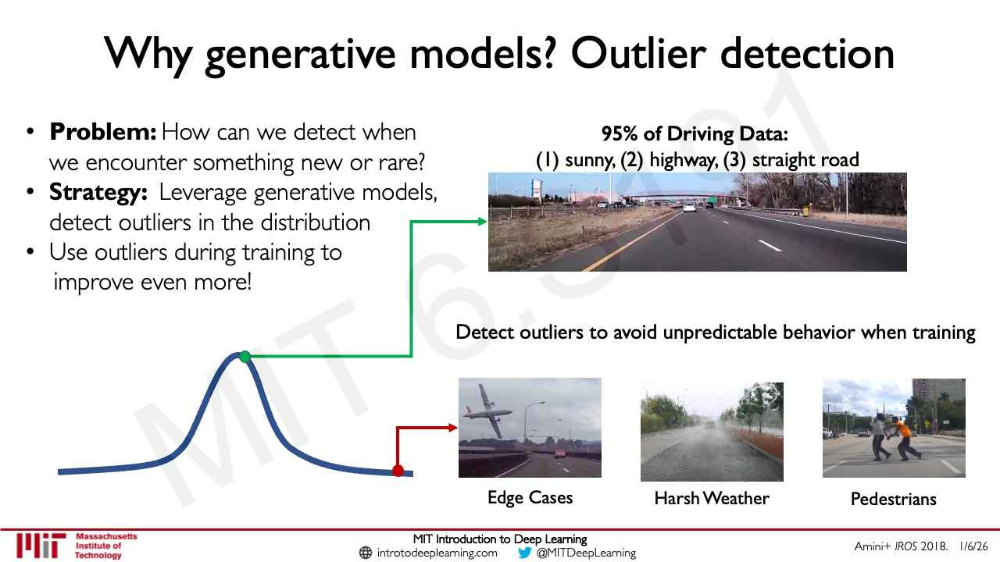

*Slide 7 — common data (sunny highway) at the peak of the distribution, rare cases in its tail.*

**Sample generation.** Because a generative model has learned a probability distribution, sampling
from it gives new data instances. This is "the backbone of the generative AI advances" behind language
models such as GPT and the image generators students may have played with (the captions name "nano
banana", "copilot designer" and one model they give as "Dolly", which is unclear), and it reaches into
biology and chemistry, for example drug discovery (≈7:47–8:35). Slide 8 shows examples for natural
language, images and molecules, and flags language and molecules as topics of 6.S191 guest lectures.

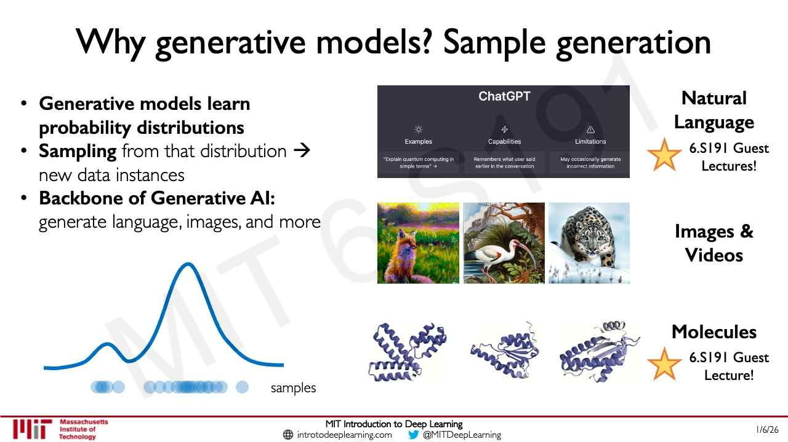

*Slide 8 — sampling a learned distribution yields new data: text, images and molecular structures.*

## 5. Latent variable models, and the Myth of the Cave (8:35–11:40)

The lecture builds up two foundational classes (slide 9, ≈8:35–9:20): **autoencoders and variational
autoencoders**, which are **latent variable models** and still very widely used, and **generative
adversarial networks (GANs)**, "previously the dominant paradigm for sample generation".

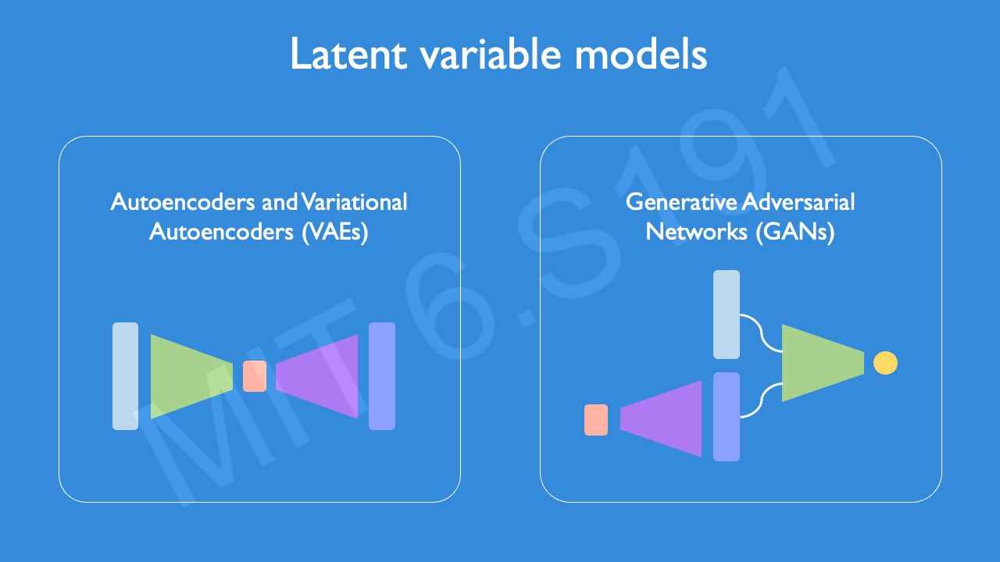

*Slide 9 — the lecture's two families: the autoencoder's hourglass (left) and the GAN's generator and discriminator (right).*

To explain what a latent variable is, Amini tells Plato's Myth of the Cave from the *Republic* (slides
10–11, ≈9:20–10:54). A group of prisoners are made to sit facing a wall. All they ever see are shadows
cast on the wall by objects passing behind them, lit by a fire. To them, the shadows are the truth,
their observations of reality. They cannot observe or measure the objects themselves, but they can
sense that the objects exist because the shadows are being cast.

Latent variable modeling has the same goal. The data we observe fall across some distribution, but
underneath there are variables governing the core "axes of variability" in that distribution. The aim
is to use neural networks to capture them numerically, encoding the information in a finite set of
**latent variables** (≈10:54–11:40). Slide 11 asks: "Can we learn the true explanatory factors, e.g.
latent variables, from only observed data?"

*Slide 10 — the Myth of the Cave: prisoners see only shadows (observed data) of objects they cannot see (latent variables).*

## 6. Autoencoders (11:40–17:53)

The dominant approach is **encoding**, and it started with **autoencoders** (≈11:40). Raw data — say,
images — pass through many neural network layers down to a low-dimensional latent space, a set of
latent variables $z$, which can be thought of as a representation of the core features of the data.
The **encoder** learns this mapping from the data $x$ to the low-dimensional latent space $z$ (slide 13,
≈11:40–12:26).

Two questions follow (≈12:26–13:13). Why care about a low-dimensional $z$? Because it is a form of
**compression**: the data may be "very very very complex", but distilling their axes of variability
into something lower-dimensional captures the key patterns. And how can it be learned with no labels?
The idea is "quite clever": we have the data themselves, so the model can be tasked with
**reconstructing** them, and that serves as the training signal.

So a **decoder** maps back from $z$ to the original input space, producing a reconstruction written
$\hat{x}$ ("x hat"). There is no $y$ here, no label; the prediction is over the data space itself
(slide 14, ≈13:59). The loss simply compares the input with its reconstruction — for images, a
pixel-wise difference (slide 15, ≈13:59–14:46):

$$\mathcal{L}(x, \hat{x}) = \Vert x - \hat{x} \Vert^2$$

As slide 15 puts it, "Loss function doesn't use any labels!!" The model trains on a loss that depends
only on the input and its reconstruction (≈14:46).

*Slide 15 — an autoencoder: the encoder (green) narrows a handwritten 2 to a small latent z, the decoder (purple) rebuilds it, and the loss compares input with reconstruction.*

From here on the lecture abstracts the layers into symbols: a green trapezoid for the encoder and a
purple one for the decoder (slide 16, ≈14:46–15:33).

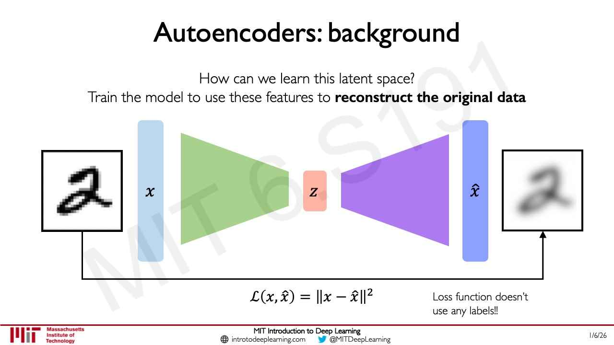

*Slide 16 — the same autoencoder in the symbols the rest of the lecture uses: encoder and decoder as funnels either side of z.*

**The size of the latent space is a bottleneck.** Because autoencoding is compression, the dimension of
$z$ limits how much information the latent variables can capture: a smaller latent space forces a
larger bottleneck, a larger one less of a bottleneck — but it should not be too large, or there is no
point in learning a small set of latent variables (≈15:33–16:20). Slide 17 ("Dimensionality of latent
space → reconstruction quality") shows reconstructions of handwritten digits from a 2D latent space,
blurry and often unrecognizable, from a 5D latent space, much sharper, and the ground truth.

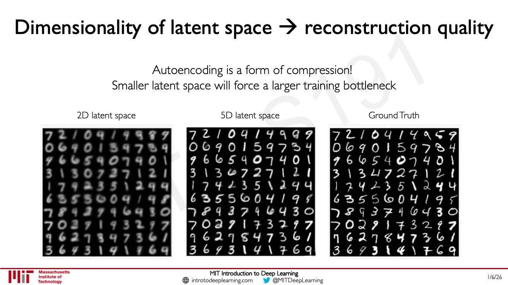

*Slide 17 — the same 100 digits reconstructed through a 2D and a 5D latent space, beside the originals: a wider bottleneck keeps more detail.*

This is autoencoding as **representation learning** (slide 18, ≈16:20–17:07). The bottleneck hidden
layer forces the network to learn a compressed latent representation. The reconstruction loss forces
that representation to capture as much "information" about the data as possible. And the name says
what it does: "Autoencoding = **Auto**matically **encoding** data; 'Auto' = **self**-encoding".

**The limitation: autoencoders are deterministic.** Once a traditional autoencoder (slide 20) is
trained, passing the same input $x$ in always gives exactly the same reconstruction. There is no
variability and no probability distribution, so it is elegant but "not so useful for generating new
samples" (≈17:07–17:53).

## 7. Variational autoencoders: a probabilistic twist (17:53–19:26)

**Variational autoencoders (VAEs)** were proposed to get towards sample generation and better
representation learning (≈17:53). In place of the deterministic latent layer $z$, a VAE has a
**sampling operation**. Instead of learning the latent variables directly, it learns a mean and a
variance for each latent variable, which together parameterize a probability distribution for that
variable; sampling from those distributions then produces new data instances (≈18:40). Concretely, the
encoder now outputs a vector of means $\mu$ and a vector of standard deviations $\sigma$ (Amini says
"standard deviations or variances"; slide 22 labels them "mean vector" and "standard deviation
vector"), and the latent sample $z$ is computed from them. "Variational autoencoders are a
probabilistic twist on autoencoders!" (slide 22). On either side of the middle, the architecture looks
very similar to a traditional autoencoder (≈18:40–19:26).

*Slide 22 — the VAE's one change: the encoder outputs a mean vector and a standard deviation vector, and z is sampled from them.*

## 8. VAE optimization: reconstruction plus regularization (19:26–21:47)

Formally, the encoder is no longer a deterministic mapping. It computes a probability distribution
over the latent variables given the input data, $q_{\phi}(z \mid x)$, and the decoder computes a
probability distribution over the data space given the latent variables, $p_{\theta}(x \mid z)$ (slide
23, ≈19:26). The weights $\phi$ (encoder) and $\theta$ (decoder) are what the network learns (slide 25,
≈20:13).

The loss has two terms (slide 24, ≈20:13–20:59):

$$\mathcal{L}(\phi, \theta, x) = (\text{reconstruction loss}) + (\text{regularization term})$$

The **reconstruction loss** is as before: some way of comparing inputs with reconstructed outputs —
"e.g. log-likelihood, $\Vert x - \hat{x} \Vert^2$" (slide 26, ≈20:59–21:47). The **regularization
term**, "which may also be termed a distributional loss", enforces the learning of good probability
distributions in the latent space (≈20:59). The loss depends on both sets of weights, $\phi$ and
$\theta$, and it is with respect to both that training performs gradient descent (≈20:59; see
[gradient descent](gradient-descent.md)).

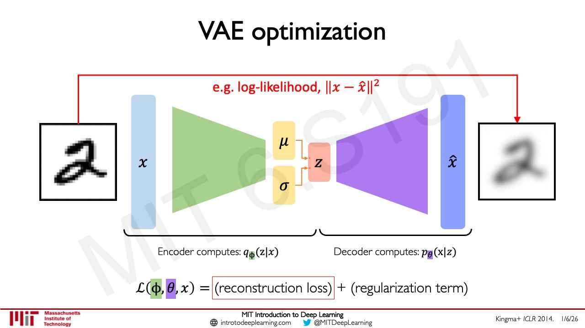

*Slide 26 — the VAE loss, with the reconstruction term boxed: it compares the input with the reconstruction, like an autoencoder's.*

## 9. The regularization term and the Normal prior (21:47–24:08)

The regularization term is where "things get a bit more interesting" (≈21:47). Like the reconstruction
loss it computes a distance, but a **distributional** distance. The encoder infers a latent
distribution $q_{\phi}(z \mid x)$; we place a **prior** $p(z)$ on what that distribution should look
like; and the regularization term $D$ measures how similar the shape of the learned distribution is to
the shape of the prior (slide 27, ≈21:47–22:35):

$$D\left(q_{\phi}(z \mid x) \Vert p(z)\right)$$

Slide 27 labels the first argument "Inferred latent distribution" and the second "Fixed prior on
latent distribution". Without a prior the network would be unregularized, with no constraint at all on
the shape the distribution could take (≈22:35).

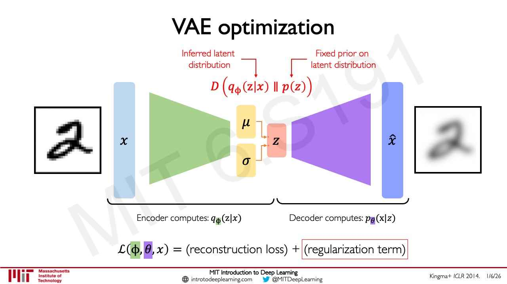

*Slide 27 — the regularization term boxed: a distance D between the inferred latent distribution and a fixed prior.*

**The usual prior is a Normal Gaussian.** No matter how large the encoder and decoder, it is very
typical to use a normal, or standard Gaussian, distribution as the prior, and the distance term can
then be thought of as a divergence between the learned distribution and that Normal prior (≈23:21–24:08).
Slide 28 writes the prior as

$$p(z) = \mathcal{N}(\mu = 0, \sigma^2 = 1)$$

and gives two reasons for it: it "Encourages encodings to distribute encodings evenly around the center
of the latent space", and it will "Penalize the network when it tries to 'cheat' by clustering points
in specific regions (i.e., by memorizing the data)". Slide 29 names $D$ as the **KL-divergence**
between the two distributions and prints its expansion over the latent dimensions $j = 0, \dots, k-1$,
where $\mu_j$ and $\sigma_j$ are the encoder's mean and standard deviation for latent variable $j$:

$$D\left(q_{\phi}(z \mid x) \Vert p(z)\right) = -\frac{1}{2}\sum_{j=0}^{k-1}\left(\sigma_j + \mu_j^2 - 1 - \log \sigma_j\right)$$

The lecturer does not read this expansion aloud or explain it; she refers to the term only as a
divergence. As printed, each bracketed term is zero when $\mu_j = 0$ and $\sigma_j = 1$ and positive
otherwise, so with the leading minus sign the expression is never positive; read literally, it does
not behave as a distance to be minimized, and the slide does not comment on this.

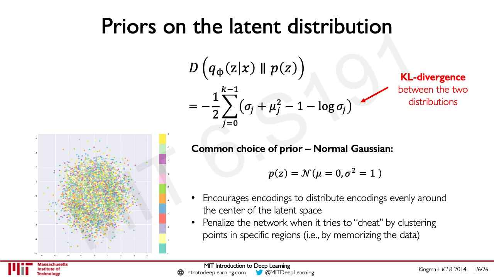

*Slide 29 — the KL-divergence term as the deck prints it, and latent encodings regularized into one evenly mixed cloud around the origin.*

The scatter plots on slides 28–29 show what the prior is for: thousands of encodings, coloured by
class, forming a single round cloud centred on the origin with the colours thoroughly mixed rather than
clustered.

## 10. Why the Normal prior: continuity and completeness (24:08–28:47)

To see why, ask what makes a good latent space (slide 30, ≈24:08–24:54):

- **Continuity**: points that are close in latent space should give similar content after decoding.
- **Completeness**: sampling from the latent space should give "meaningful" content after decoding;
  there is a semantic structure learned and captured in the space.

Without regularization both properties can be lost (≈24:54–25:41). Points may be close in latent space
but decode to totally different things: slide 30's example has two nearby points, one decoding to a
square and the other to a triangle. And parts of the latent space may be meaningless, so a point there
decodes to nothing consistent. Regularizing aims to counteract both, so that close points decode to
similar, meaningful things (≈25:41).

*Slide 30 — without regularization, nearby latent points decode to unrelated shapes and some points decode to nothing meaningful; with it, nearby points decode alike.*

Can any prior do this? Not necessarily (≈25:41–27:14). Encoding as a distribution does not by itself
guarantee these properties (slide 31). If the variances — the spread of each distribution, drawn as
shading — are too small, the distributions are pointed, and as soon as you step off the point nothing
decodes meaningfully. If the means differ, not zero-centred, the latent variables can end up very far
apart, leaving discontinuities where sampling gives nothing meaningful. The **Normal prior** promotes
continuity and completeness because it centres the means and regularizes the variances (slides 31–32,
≈27:14): "Regularization with Normal prior helps enforce **continuity & completeness** in the latent
space" (slide 32).

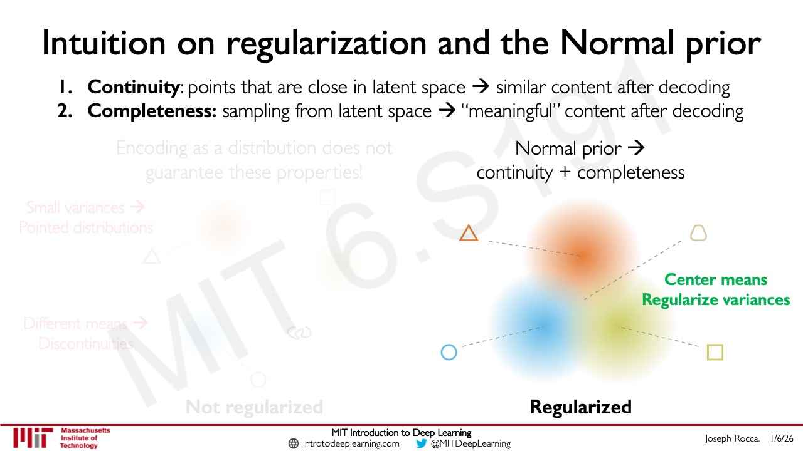

*Slide 31 — caught mid-transition: the unregularized case (pointed distributions, different means) fades out; the Normal prior centres the means and widens the variances.*

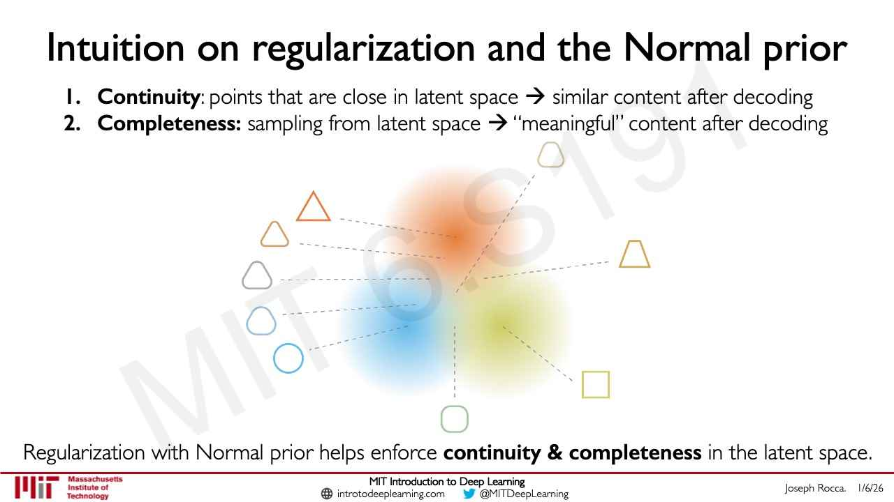

*Slide 32 — overlapping Gaussians in latent space: moving between them changes the decoded shape gradually, from triangle to circle.*

Does this mean all the latent variables end up with mean 0 and variance 1? No (≈28:00). The loss still
has the reconstruction term, and the regularization only keeps a distributional distance between the
inferred distributions and the prior. With "proper weighting" of the two terms, the latent space stays
informative.

## 11. Backpropagation through sampling: the reparametrization trick (28:00–30:20)

The final piece is training by backpropagation (≈28:00). The architecture, inputs, outputs and loss
are all defined, but there is a problem: "We cannot backpropagate gradients through sampling layers!"
(slide 34, ≈28:47). The sampled $z$ is inherently probabilistic, and gradients cannot pass through it.
See [backpropagation](backpropagation.md).

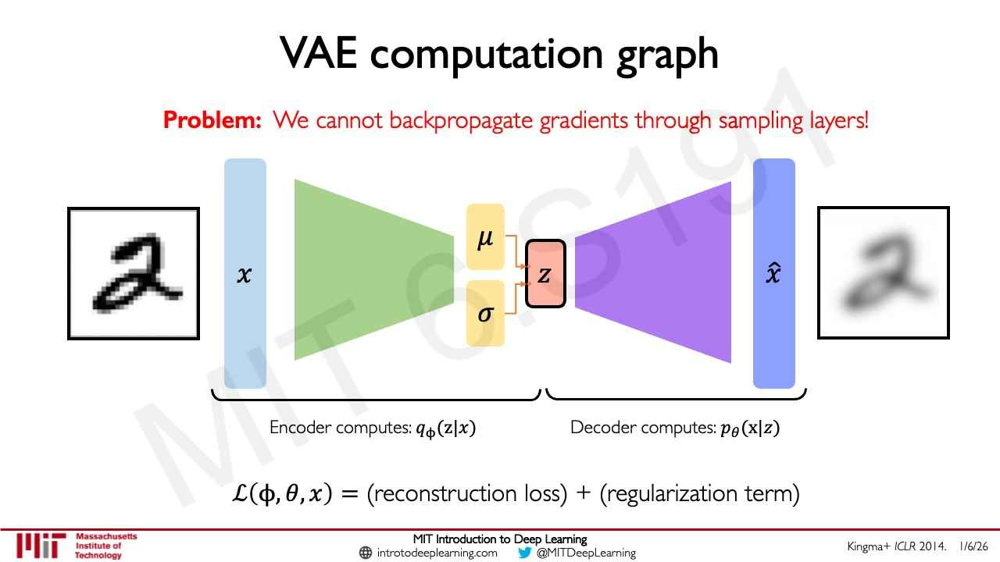

*Slide 34 — the problem: the sampled latent z (outlined) sits between encoder and decoder, and gradients cannot pass through a sampling step.*

The fix is to **reparametrize** the sampling layer (slide 35, ≈28:47–29:34). In principle the latent
variables are sampled from a Normal distribution, $z \sim \mathcal{N}(\mu, \sigma^2)$, which the slide
strikes through. In practice, consider the latent vector as the sum of a fixed $\mu$ vector and a fixed
$\sigma$ vector scaled by random constants drawn from the prior distribution:

$$z = \mu + \sigma \odot \varepsilon, \quad \text{where } \varepsilon \sim \mathcal{N}(0, 1)$$

Here $\odot$ is element-wise multiplication. The distribution is still parameterized by $\mu$ and
$\sigma$, but all the variability — the stochasticity — is moved into the random variable
$\varepsilon$, which is not learned and so never needs to be backpropagated through (≈29:34).

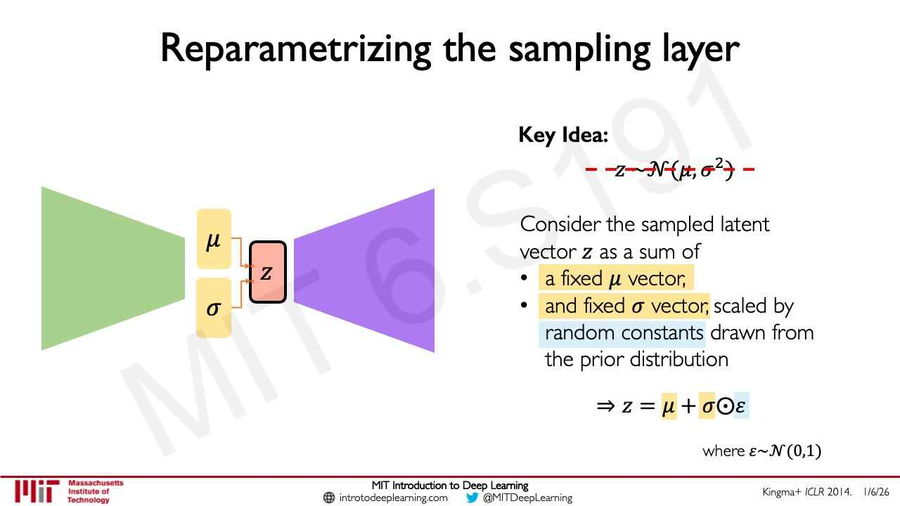

*Slide 35 — the key idea: instead of sampling z directly, write it as mu plus sigma times a random epsilon.*

Slides 36–37 show it as computation graphs, with blue diamonds for deterministic nodes and orange
circles for stochastic ones (≈29:34–30:20). In the **original form**, $z \sim q_{\phi}(z \mid x)$ is a
stochastic node between the weights $\phi$, the input $x$ and the output $f$, and backpropagation is
blocked at it. In the **reparametrized form**, $z = g(\phi, x, \varepsilon)$ is deterministic, and the
randomness sits in a separate stochastic input $\varepsilon \sim \mathcal{N}(0,1)$. The gradients
$\frac{\partial f}{\partial z}$ and $\frac{\partial f}{\partial \phi}$ can now flow back through $z$
to the weights.

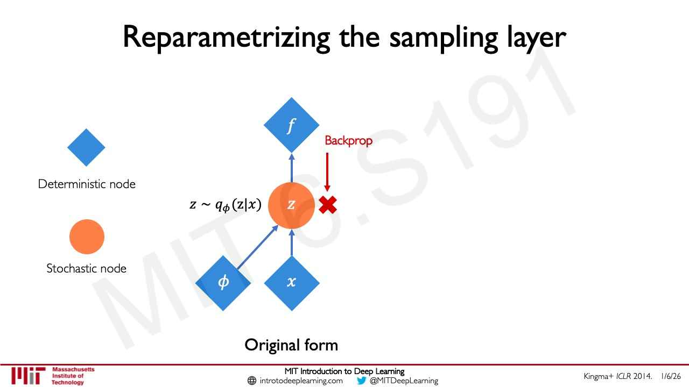

*Slide 36 — the original form: z is a stochastic node, and backpropagation stops there (red cross).*

*Slide 37 — the reparametrized form beside it: z becomes deterministic, the noise epsilon is a separate input, and gradients reach phi.*

## 12. A question: why not sample at the output? (30:20–31:54)

A student asks whether one could keep the latent space as a distribution, compute a distribution at
the output instead, sample from that, and compare it with the input (≈30:20). Amini's answer:
absolutely — that is another paradigm for generative modeling, suited to when you do not care so much
about a fixed feature representation and your goal really is sample generation. You define noise or
variability in the transformation of input directly to reconstructed output and train on that signal.
This is closely related to the principles of diffusion models, introduced more recently and covered in
"tomorrow's lecture six" (≈31:08–31:54). The general lesson: what you want from the network informs
the architecture. VAEs are the choice when you care about the latent space — a compressed set of
variables to use as a representation and to sample from (≈31:54).

## 13. Latent perturbation and disentanglement (31:54–33:26)

Because a VAE learns latent variables, it gives some interpretability, or control, over sampling
(≈31:54–32:41). In a high-quality, well-trained VAE the latent variables capture individual features:
slowly increase or decrease a **single latent variable**, keep all the others fixed, decode, and the
output changes subtly in one way (slide 39). The different dimensions of $z$ encode "different
interpretable latent features" (≈32:41). On slide 39, one latent variable turns the head pose of a
face.

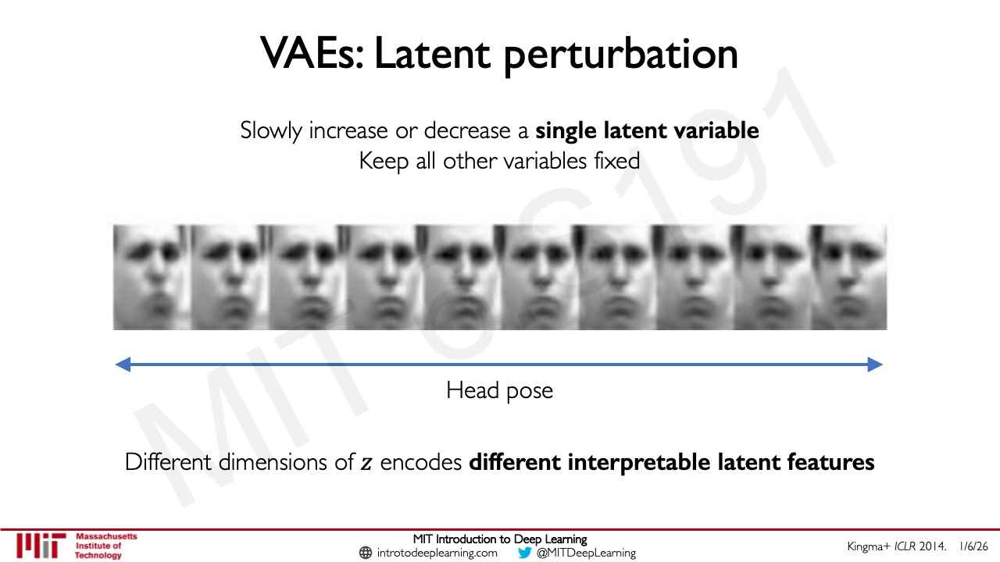

*Slide 39 — perturbing a single latent variable while the others stay fixed: the decoded face turns, and nothing else changes.*

Slides 40 and 41 take this further, but they are not discussed aloud; what follows is from the slides
only. Slide 40 shows a grid of faces in which one latent variable changes the smile (down the rows)
and another the head pose (along the columns), and states the goal: "Ideally, we want latent variables
that are uncorrelated with each other. Enforce diagonal prior on the latent variables to encourage
independence" — **disentanglement** (credited Kingma+ *ICLR* 2014; Chen+ *NeurIPS* 2018).

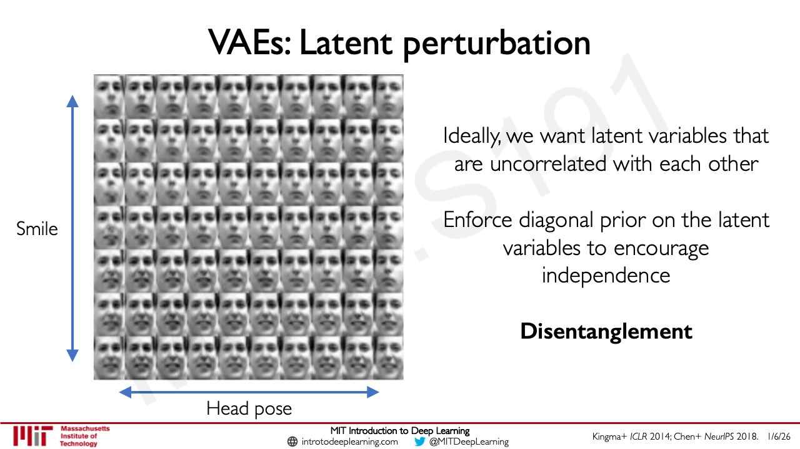

*Slide 40 — two latent variables, two features: smile changes down the rows, head pose along the columns.*

Slide 41, "Latent space disentanglement with β-VAEs" (credited Higgins+ *ICLR* 2017), prints the loss

$$\mathcal{L}(\theta, \phi; \mathbf{x}, \mathbf{z}, \beta) = \mathbb{E}_ {q_{\phi}(\mathbf{z} \mid \mathbf{x})}\left[\log p_{\theta}(\mathbf{x} \mid \mathbf{z})\right] - D_{KL}\left(q_{\phi}(\mathbf{z} \mid \mathbf{x}) \Vert p(\mathbf{z})\right)$$

with the expectation underlined as the "Reconstruction term" and the KL-divergence as the
"Regularization term". An empty red box stands in front of $D_{KL}$ (nothing is printed inside; $\beta$
appears only among the loss's arguments, so the box apparently marks where it would weight the term), and the labels "Standard VAE loss:" and "β-VAE loss:" are
printed on top of each other, apparently two animation states caught in one frame. The
slide's rule is that "β > 1: constrain latent bottleneck, encourage efficient latent encoding →
disentanglement". Its two grids of faces rotating in azimuth make the point: with a standard VAE
($\beta = 1$), "Smile also changing!"; with a β-VAE ($\beta = 250$), "Smile relatively constant!".

*Slide 41 — rotating a face with a standard VAE drags the smile along; with a beta-VAE (beta = 250) the smile stays put.*

## 14. Debiasing, the lab, and a VAE summary (33:26–34:13)

The lecture comes back to its opening motivation (≈33:26). In the day's lab on facial detection
systems and debiasing, students put CNNs ([lecture 3](03-convolutional-neural-networks.md)) and VAEs
together to train an approach for debiasing facial detection systems, using the latent distribution
(slide 42: "How can we use latent distributions to create fair and representative datasets?").

The VAE summary (slides 43–47, ≈33:26–34:13) lists five points:

1. Compress representation of world to something we can use to learn.
2. Reconstruction allows for unsupervised learning (no labels!).
3. Reparameterization trick to train end-to-end.
4. Interpret hidden latent variables using perturbation.
5. Generating new examples.

## 15. GANs: when we just want to sample (34:13–35:46)

Sometimes the goal is different: no need for an explicit set of interpretable latent features, just
new samples. Of the approaches built for that, the one that "kicked things sort of off" was the
**generative adversarial network (GAN)** (≈34:13). Slide 49 sets out the reasoning: "**Idea:** don't
explicitly model density, and instead just sample to generate new instances. **Problem:** want to
sample from complex distribution – can't do this directly! **Solution:** sample from something simple
(e.g., noise), learn a transformation to the data distribution." A **generator** network $G$ learns to
map random noise $z$ to a representation that captures the data distribution, and its generations
should be as close to the real thing as possible (≈34:58–35:46).

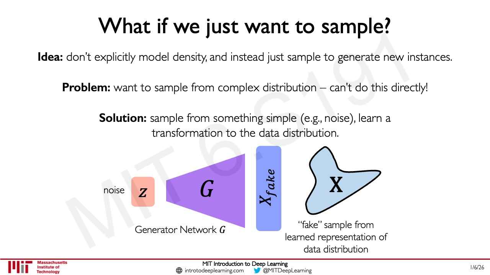

*Slide 49 — the GAN idea: start from simple noise z and learn a generator G that turns it into a sample X_fake from the data distribution.*

## 16. Generator versus discriminator (35:46–37:18)

The clever part is how the generator is trained: by pitting two separate neural networks against each
other in a loss that captures their competition (slide 50, ≈35:46). The captions here are muddled ("an
encoder that is a discriminative encoder"); the slide names the two networks.

- The **generator** "turns noise into an imitation of the data to try to trick the discriminator".
- The **discriminator** takes examples that may be real or fake and outputs a probability score of
  whether each is real or fake: it "tries to identify real data from fakes created by the generator"
  (≈36:31).

The audience played the discriminator at the start of the lecture, judging which face was real
(≈36:31). The competition is whether the generator can produce better and better fakes to fool it
(slide 50 credits Goodfellow+ *NeurIPS* 2014).

*Slide 50 — the GAN: G turns noise z into X_fake; D sees both X_real and X_fake and outputs y, its judgement of real or fake.*

## 17. The intuition: points on a line (37:18–39:35)

Slides 51–68 build the competition up step by step on a one-dimensional line (≈37:18–39:35). Each
point is a data instance; green points are real data and pink points the generator's fakes.

The generator starts from random noise, with a random initialization, so its first samples land
somewhere on the line (slide 51). The discriminator sees these fakes and the real examples (slides
52–53) and is tasked with classifying them: real or fake? Its predictions, drawn as grey bars of the
probability of being real up to a dashed line at $P(real) = 1$, start out poor (slide 55, ≈37:18–38:04).

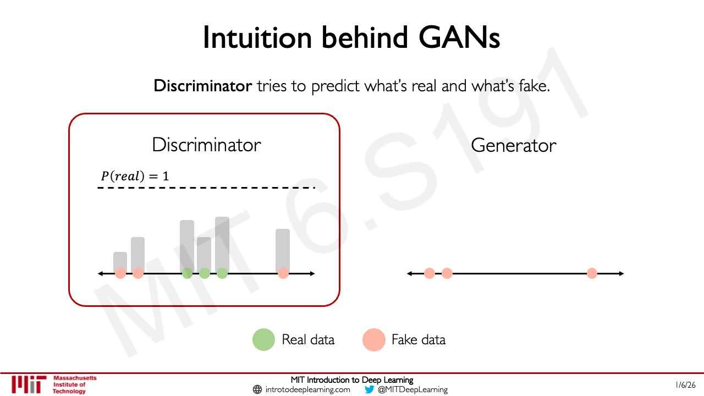

*Slide 55 — the untrained discriminator's guesses: grey bars of P(real) over the real (green) and fake (pink) points, none of them confident.*

As the discriminator trains, it raises the probability that real instances are real and lowers it for
the fakes, until "eventually we get perfect separation" (slides 56–57, ≈38:04).

*Slide 57 — perfect separation: the discriminator gives the real points P(real) = 1 and the fakes nothing.*

Then it is the generator's turn. It sees where the real data lie and, over its training, moves its
generations closer and closer to them (slides 58–60, ≈38:04–38:50).

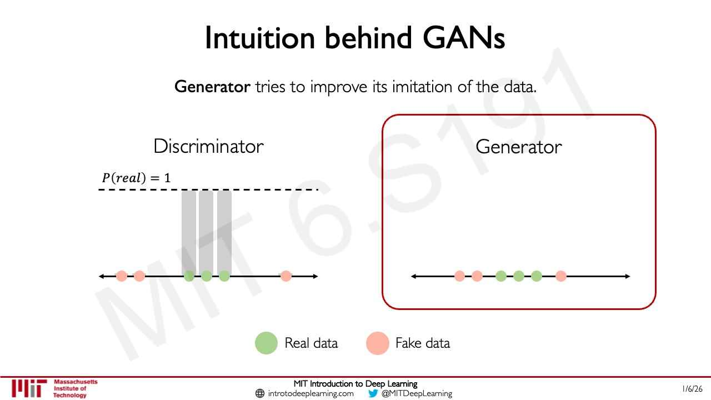

*Slide 60 — the generator's turn: its fake points have moved in until they sit right beside the real ones.*

Back to the discriminator, which estimates again how likely each point is to be real. Because the
fakes have moved closer to the real instances, they are now given a higher probability of being real
(slides 61–62, ≈38:50).

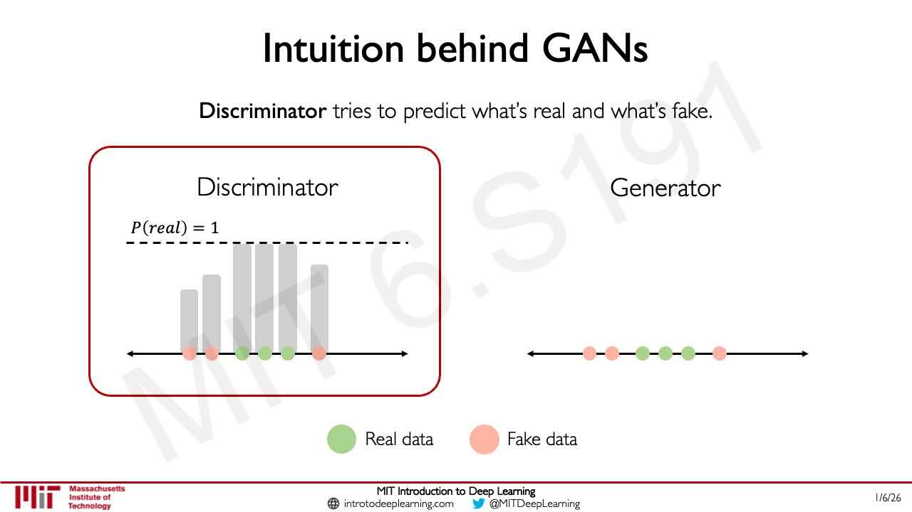

*Slide 62 — fooled for now: the fakes, close to the real points, get fairly high probabilities of being real.*

But with training the discriminator adjusts and gets better at telling them apart again (slides 63–64).

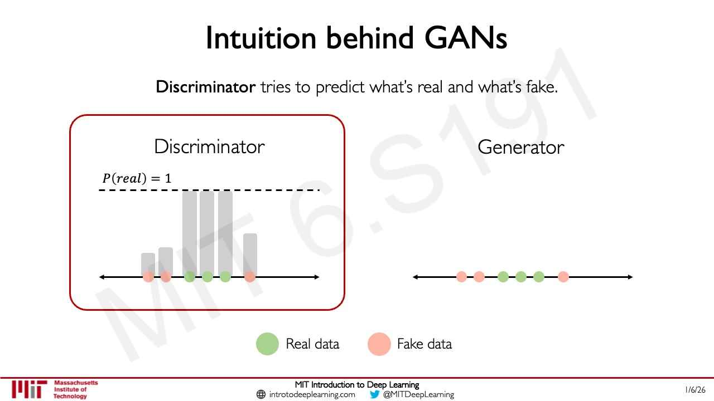

*Slide 64 — the discriminator retrained: the real points back at P(real) = 1, the fakes pushed down again.*

The generator repeats its move, bringing its samples closer still (slides 65–67), until it is very
hard for the discriminator to distinguish them, because the generated instances are so close in
distribution to the real data (≈38:50–39:35). Slide 68 sums up the two roles: "**Discriminator** tries
to identify real data from fakes created by the generator. **Generator** tries to create imitations of
data to trick the discriminator."

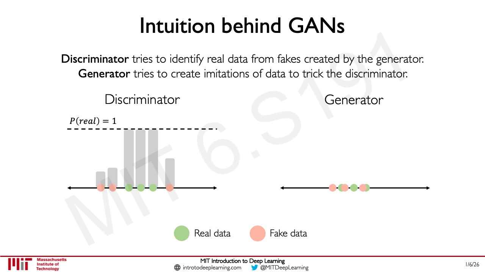

*Slide 68 — the end state: the generator's fakes overlap the real data, which is what makes them hard to discriminate.*

## 18. Training GANs: the adversarial objective (39:35–42:43)

Formally (slide 69, ≈39:35–40:23): $D$ tries to identify the synthesized instances, $G$ tries to
synthesize fake instances that fool $D$, and training means **adversarial objectives** for $D$ and $G$.
The **global optimum** is that $G$ reproduces the true data distribution exactly.

The objective "looks perhaps a little scary at first" and is taken one network at a time (≈40:23). The
discriminator's goal is to maximize the probability that fake data are identified as fake and real data
as real. Slide 70 prints it as

$$\arg\max_{D} \mathbb{E}_ {\mathbf{z},\mathbf{x}}\left[\log D(G(\mathbf{z})) + \log\left(1 - D(\mathbf{x})\right)\right]$$

where $G(\mathbf{z})$ is the generator's output for noise $\mathbf{z}$ and $\mathbf{x}$ is real data.
The slide underlines the first term "Fake" and the second "Real". Amini reads the first term as "the
probability that the discriminator correctly assigns a fake instance as fake", and the second as "the
probability that the discriminator correctly assigns a real instance as real", and together they are
maximized with respect to the discriminator (≈40:23–41:09).

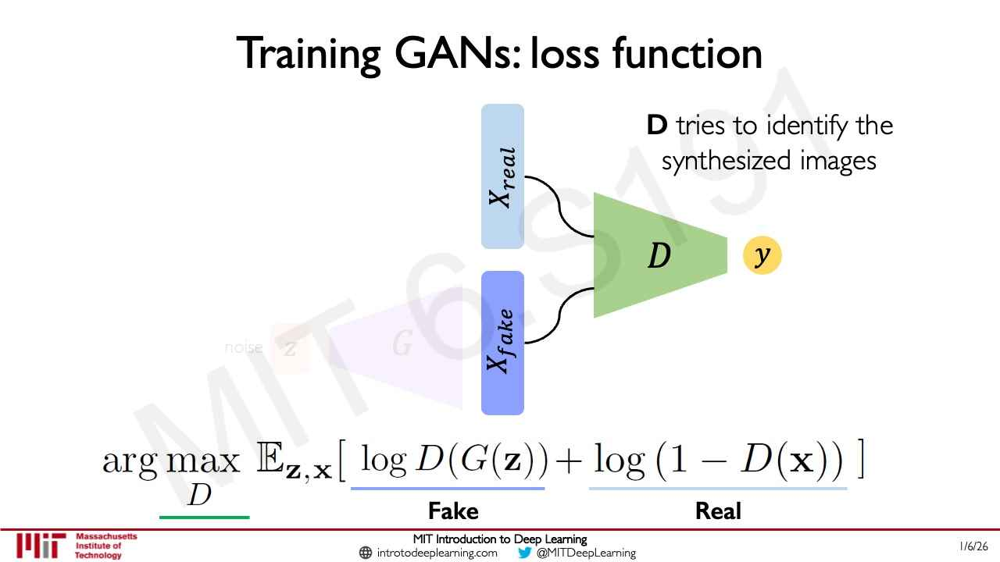

*Slide 70 — the discriminator's side of the objective, with the fake term and the real term underlined as the deck prints them.*

Read that way, $D(\cdot)$ in this formula is the discriminator's probability that its input is
**fake**. The number-line slides (54–68) instead plot the discriminator's probability that a point is
**real**. The lecture does not remark on the difference; the formula is reproduced here as printed.

The generator cannot directly affect the discriminator's objective, but it can produce instances as
close to real as possible, so its loss amounts to **minimizing the probability that the generated data
are identified as fake** (slide 71: the same expression under $\arg\min_{G}$, ≈41:09). Putting the two
together (slide 72, ≈41:58), the generator minimizes the objective while the discriminator maximizes
it:

$$\arg\min_{G} \max_{D} \mathbb{E}_ {\mathbf{z},\mathbf{x}}\left[\log D(G(\mathbf{z})) + \log\left(1 - D(\mathbf{x})\right)\right]$$

That is, $G$ "tries to synthesize fake images that fool the *best* $D$" (slide 72). The captions
garble the sentence that names this ("the principle of adversarial in again", ≈41:58).

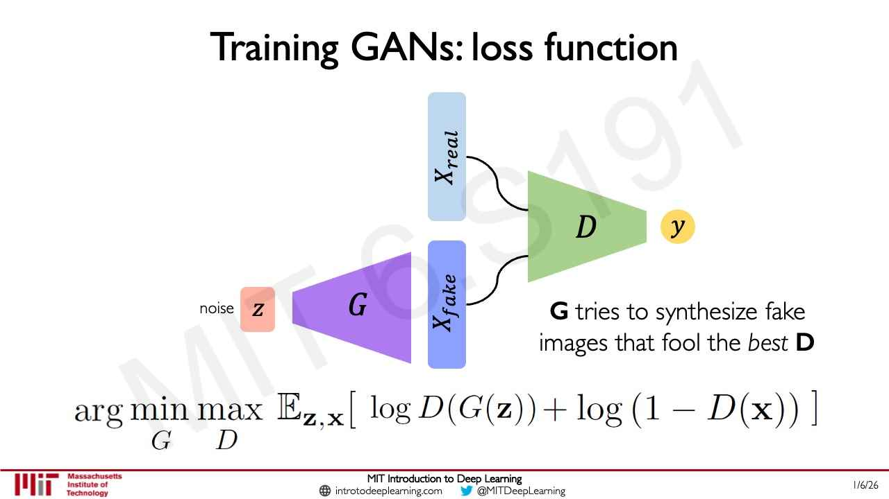

*Slide 72 — the full min-max objective: G minimizes what D maximizes.*

**In practice GANs are hard to train.** These adversarial objectives make it tricky to get the model
to train stably, and over the years there have been many advances to improve the training stability
and scalability of GANs, with varying success (≈41:58–42:43). GANs are still used in some domains, but
other approaches have moved beyond them (≈42:43).

## 19. GANs as distribution transformers (42:43–44:16)

After training, the discriminator is set aside and the generator alone creates new data "that's never
been seen before" (slide 73, ≈41:58). The generator is a **distribution transformer**: it maps pure
random noise to the learned target distribution (≈42:43). That seems crazy at first, but because the
two networks are adversarial, gradient descent and backpropagation can learn weights that do this
transformation (≈43:29).

Slide 74 draws the mapping: a point of Gaussian noise $z \sim \mathrm{N}(0,1)$ goes through the
trained generator to an image — a photograph of a bird — that lies inside the learned data
distribution. A sample of noise from one part of the distribution produces a particular instance, and a
sample from another part produces a different one (slides 74–75, ≈43:29).

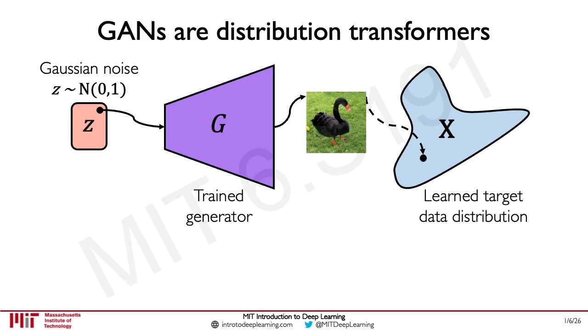

*Slide 74 — a GAN as a distribution transformer: one point of Gaussian noise becomes one image inside the learned data distribution.*

So one can **traverse the Gaussian noise space** and create instances that shift in a semantically
consistent way (≈43:29–44:16). Slide 76 (credited Brock+ *ICLR* 2019) joins two noise points with a
line, maps the line through the generator to a path through the data distribution, and shows the
result as a strip of eight images morphing from one bird into another.

*Slide 76 — walking a straight line between two noise points gives a smooth path of images, one bird morphing into another.*

## 20. CycleGAN: from one data distribution to another (44:16–46:37)

A standard GAN goes from Gaussian noise to a target data distribution, or "landscape". Some variants
instead transform one data landscape into another (slide 77, ≈44:16): "GANs: Gaussian noise → target
data manifold"; "CycleGANs: data manifold X → data manifold Y".

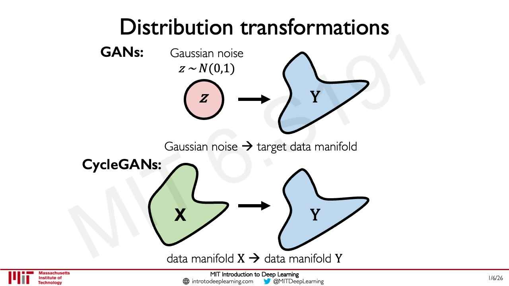

*Slide 77 — a GAN maps noise to a data manifold; a CycleGAN maps one data manifold to another.*

A **CycleGAN** has two separate generators and two separate discriminators and performs **unpaired
image-to-image translation**: it takes instances in one domain and produces instances in the other
without needing paired examples (≈44:16–45:02). Generations in the target domain should follow the
target distribution, given the instance in the first domain as a starting point, and this is achieved
by a **cyclic loss** connecting the two domains (≈45:02). Slide 78 ("CycleGAN learns transformations
across domains with unpaired data", credited Zhu+ *ICCV* 2017) draws the domains $X$ and $Y$, the
mappings $G$ from $X$ to $Y$ and $F$ back from $Y$ to $X$, the discriminators $D_X$ and $D_Y$, and a
video turning a horse into a zebra.

*Slide 78 — CycleGAN: two mappings, G from X to Y and F back, each judged by its own discriminator; a horse becomes a zebra.*

The principle is not limited to images (≈45:02–45:49). Speech can be transformed from one style of
waveform to another, either directly in the audio space or by converting the waveform into an image
representation, a spectrogram, and applying a CycleGAN (slide 79).

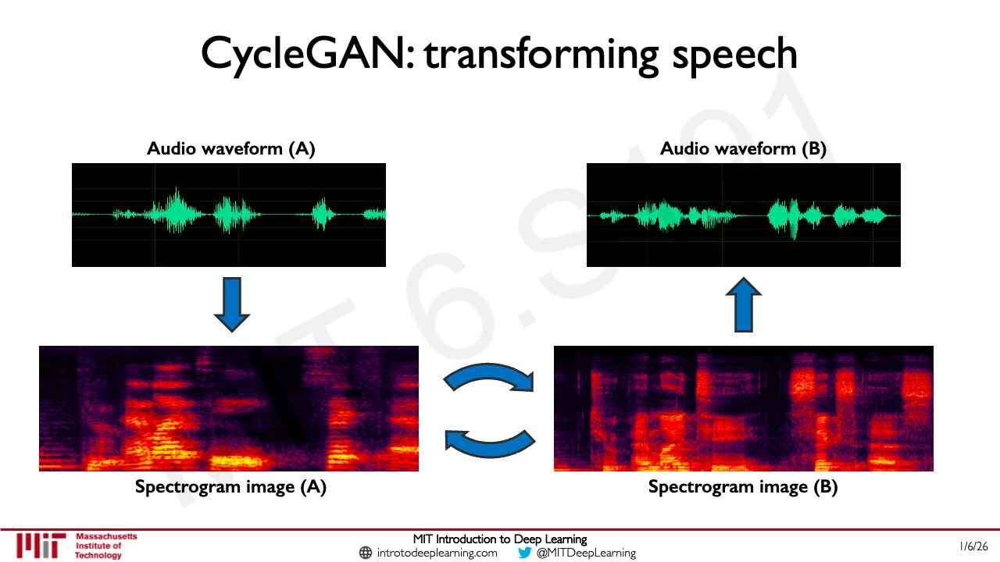

*Slide 79 — speech through a CycleGAN: waveform A becomes a spectrogram, is translated to spectrogram B, and becomes waveform B.*

Audio generation has come a long way since, but the course's own early experiment used a CycleGAN for
audio-to-audio synthesis, taking Alexander Amini's voice and producing "the Obama style voice" a few
years back (≈45:49). The clip plays — "Hi everybody, and welcome to MIT 6.S191" — and Amini recalls it
took many takes in a conference room to get good samples (≈46:37). Slide 80 shows the video, captioned
"Original (Amini)" and "Synthesized (Obama)", with audio waveforms and spectrograms beneath each side.

## 21. Summary, and what comes next (46:37–end)

The lecture covered two foundational generative modeling approaches (slide 81, ≈46:37–47:22).
**Autoencoders and VAEs** "learn lower-dimensional **latent space** and **sample** to generate input
reconstructions": they are about feature encoding, learning a representation in latent variables that
captures the key axes of variability in the data. **GANs** use "competing **generator** and
**discriminator** networks" and are primarily about generating new instances.

These foundations set the stage for what came after. Generations are now of very, very high fidelity,
as the opening faces showed, and not only for images but for video, text and other modalities
(≈47:22–48:08). Lecture 6 will cover the newer frameworks that use noise to do reconstruction and
have unlocked a new level of generation quality (≈48:08): slide 82 announces **diffusion models**,
"...more to come in Lectures 6 and 7!".

The lecture closes on logistics (≈48:08–48:54): the software labs, with entry into the lab
competitions as a perk, and course t-shirts at the end of the next day's class. Slide 83 is Lab 2,
"Facial Detection Systems" (open it in Google Colab, fill in the `#TODOs`, and come to 32-123 for help),
and slide 84 the announcements.

## Spoken versus printed

- **Outliers**: Amini says the rare cases matter "versus … 90% of the distribution" (≈7:02); slide 7
  prints "95% of Driving Data".
- **Variance or standard deviation**: she speaks of learning "a mean and a variance" and "standard
  deviations or variances" (≈18:40); slides 22 and 35 label $\sigma$ the standard deviation vector.
- **The KL-divergence** is named and expanded only on slide 29; aloud it is "a divergence" (≈23:21).
  See the note on its sign in section 9.
- **Disentanglement and β-VAEs** (slides 40–41) are on the slides only.
- **The GAN objective** as printed on slides 70–72 has the discriminator's term on $G(\mathbf{z})$
  labelled "Fake"; read as the lecturer reads it, $D$ there is the probability of fake, while the
  number-line slides plot the probability of real (section 18).
- **Spelling**: slides 35–37 say "Reparametrizing" and "Reparametrized"; slide 45 says
  "Reparameterization trick".
- **Diffusion models**: aloud, "tomorrow's lecture six" (≈31:54) and "lecture six tomorrow" (≈48:08);
  slide 82 says "Lectures 6 and 7".
