# Lecture 5 — Reinforcement Learning

**MIT 6.S191, 2026 edition. Lecturer: Alexander Amini. Delivered 7 January 2026.**
[Video](https://www.youtube.com/watch?v=1ij3dweHu-0) ·
[Slides (PDF)](https://introtodeeplearning.com/slides/6S191_MIT_DeepLearning_L5.pdf) ·
[Slide-by-slide transcription](../raw/slides/05-reinforcement-learning.md) ·
[Transcript](../raw/transcripts/05-reinforcement-learning.md) ·
[Verbatim captions](../raw/transcripts/original/05-reinforcement-learning.md)

The catalog lists this lecture as "Reinforcement Learning"; its title slide reads "Deep Reinforcement
Learning". It introduces the third paradigm of machine learning in the course, after supervised and
unsupervised learning: an **agent** learns by acting in an **environment** and collecting **rewards**,
with no pre-collected dataset at all, and its goal is to maximize the rewards it gathers over time
(≈0:05–5:28). The lecture builds the vocabulary — states, actions, rewards, the discounted return, the
**Q-function** and the **policy** — and then two families of deep reinforcement learning algorithms.
**Value learning** trains a deep Q network to predict the expected return of each action and acts by
picking the best one; it is shown beating human-level play on many Atari games. **Policy learning**
trains a network to output a probability distribution over actions directly, which handles stochastic
choices and continuous actions, and is trained with the **policy gradient**. The lecture closes with
the problem of learning in the real world (and the MIT VISTA simulator), and with AlphaGo.

Timestamps such as (≈23:08) point into the [transcript](../raw/transcripts/05-reinforcement-learning.md);
"slide N" is page N of the PDF (the deck prints no slide numbers). See also the topic pages
[reinforcement learning](reinforcement-learning.md), [Q-learning and deep Q networks](q-learning.md)
and [policy gradients](policy-gradients.md).

## 1. Learning in dynamic environments (0:05–2:24)

The past lectures dealt with pre-collected datasets, either with labels (supervised learning) or
without them (unsupervised learning). In reinforcement learning "we actually have neither": the data are
often collected actively while the model is learning, so the model learns in a very dynamic environment
— which, Amini notes, is much closer to how humans learn, by interacting with the world and learning
from those interactions (≈0:52; slide 2, "Learning in Dynamic Environments"). The lecture focuses on
**deep** reinforcement learning, meaning reinforcement learning models trained with deep neural
networks (≈0:05).

Slide 3 names three areas: robotics, game play and strategy, and language modeling. Robotics is the
obvious real-world application, but many of the original breakthroughs came in **games**, because games
are "perfectly defined worlds", much less uncertain and more predictable than our own, so the lecture's
case studies are games (≈1:37). The same holds for language: language modeling is more predictable than
the real world, and reinforcement learning has been extended to improve "the preferences and the
alignment of language models to interact with humans" (≈1:37–2:24; see section 22).

## 2. Three classes of learning problems (2:24–5:28)

Slides 4–6 set the three paradigms side by side, each with an apple example:

- **Supervised learning** (lectures 1–3): data $(x, y)$, where $x$ is the data and $y$ the label; the
  goal is to learn a function mapping $x \rightarrow y$. Shown a picture of an apple, the label says
  "This thing is an apple." (slide 4, ≈2:24–3:10).
- **Unsupervised learning** (lecture 4): data $x$ only, no labels; the goal is to learn the underlying
  structure. The algorithm learns not that this is an apple but "This thing is like the other thing."
  (slide 5, ≈3:10–3:56).
- **Reinforcement learning**: slide 6 prints "Data: state-action pairs" and "Goal: Maximize future
  rewards over many time steps". Aloud, Amini describes the data as **triplets** of states, actions and
  rewards, and the goal as taking those triplets and the actor in the environment and maximizing the
  reward over time (≈3:56). The apple caption is "Eat this thing because it will keep you alive."

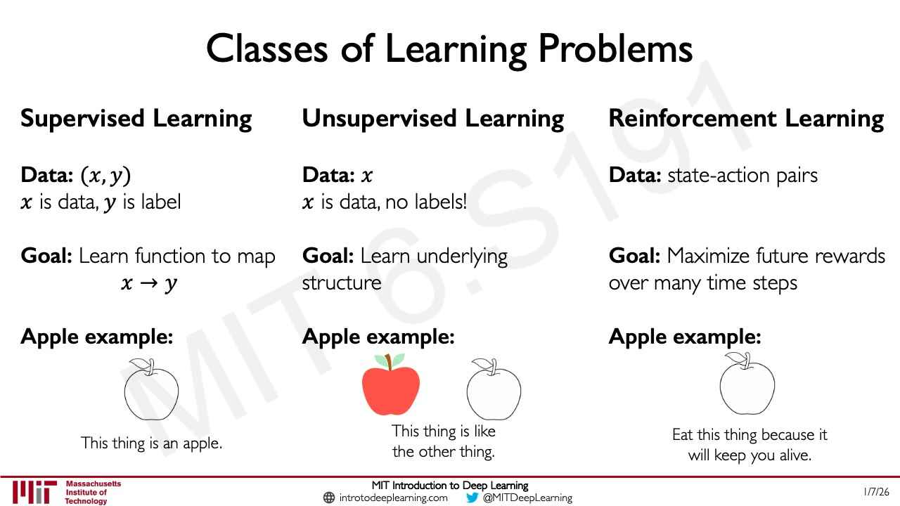

*Slide 6 — supervised, unsupervised and reinforcement learning side by side, each with its apple example.*

Reinforcement learning is therefore naturally **temporal**: it learns over a sequence and maximizes
rewards over the horizon of that sequence (≈4:42). In the apple analogy, you need no label saying that
apples are good to eat; by eating some apples and some unhealthy food you could observe that apples make
you live longer, and so learn to eat them in future (≈4:42). Slide 7 fades the first two columns and
announces "RL: our focus today."

## 3. Key concepts: agent, environment, actions, states (5:28–8:31)

The terminology of reinforcement learning differs from what came before, though with overlaps (≈5:28).
Slides 8–13 build one diagram, a loop between two icons.

- The **agent** "takes actions" (slide 8). If you train a drone to make deliveries, the drone is the
  agent; in a Super Mario game, Super Mario is the agent; in the real world, each of us is an agent
  (≈5:28–6:13).
- The **environment** is "the world in which the agent exists and operates" (slide 9, ≈6:13).
- The agent sends **actions** to the environment, drawn as a red arrow along the bottom of the loop.
  An action is "a move the agent can make in the environment", and the **action space** $A$ is "the set
  of possible actions an agent can make in the environment" (slide 10). For simplicity it is taken to
  be a finite set, a vocabulary of actions available at every time step. In a simplified
  two-dimensional world the actions could be forwards, backwards, left and right, so $A$ holds four
  actions — the four small arrows above the label "Action: $a_t$" on slide 10 (≈6:13–6:58).

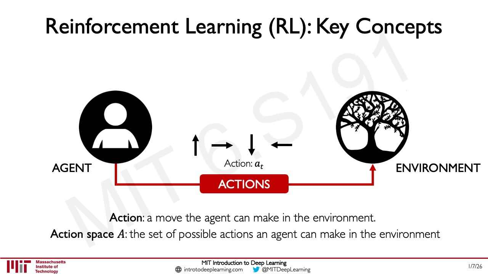

*Slide 10 — the agent (left) sends actions to the environment (right); the four arrows are a four-action action space.*

- In the other direction the environment responds with **observations**, drawn as a blue arrow along
  the top (slide 11). When the agent steps forward, what it sees around it changes, and that new
  observation comes back as a **state**: "a situation which the agent perceives" (slide 12). An action
  $a_t$ taken at time $t$ is answered with the state $s_{t+1}$, labelled "State changes: $s_{t+1}$" on the
  diagram (≈6:58–7:44).

## 4. Rewards and the return (8:31–10:04)

Along with the state, the environment returns a **reward** $r_t$: "feedback that measures the success
or failure of the agent's action" (slide 13, ≈7:44). In a two-dimensional world where the agent
collects coins, each step may collect one coin or none, and the coin is roughly the reward (≈8:31).
Rewards can be very **sparse**, or delayed: in chess you may get no reward until the last move, and
then all of it or none. Rewards need not arrive densely, and their sparsity is one of the big challenges
of the field (≈8:31).

The **total reward**, or **return**, $R_t$ is the sum of all rewards the agent collects from the current
time $t$ onwards (slides 14–15, ≈8:31–9:18):

$$R_t = \sum_{i=t}^{\infty} r_i = r_t + r_{t+1} \ldots + r_{t+n} + \cdots$$

It is often useful to **discount** future rewards rather than count them all equally. Amini's example:
offered five dollars today or five dollars a year from now, the reward is the same, but you
would rather have it today, because you discount the future (≈9:18). So each reward is weighted by
a discount factor $\gamma$ that compounds over time (slides 16–17, ≈10:04):

$$R_t = \sum_{i=t}^{\infty} \gamma^{i} r_i = \gamma^{t} r_t + \gamma^{t+1} r_{t+1} \ldots + \gamma^{t+n} r_{t+n} + \cdots$$

where $\gamma$ is the **discount factor**, $0 \lt \gamma \lt 1$ (slide 17).

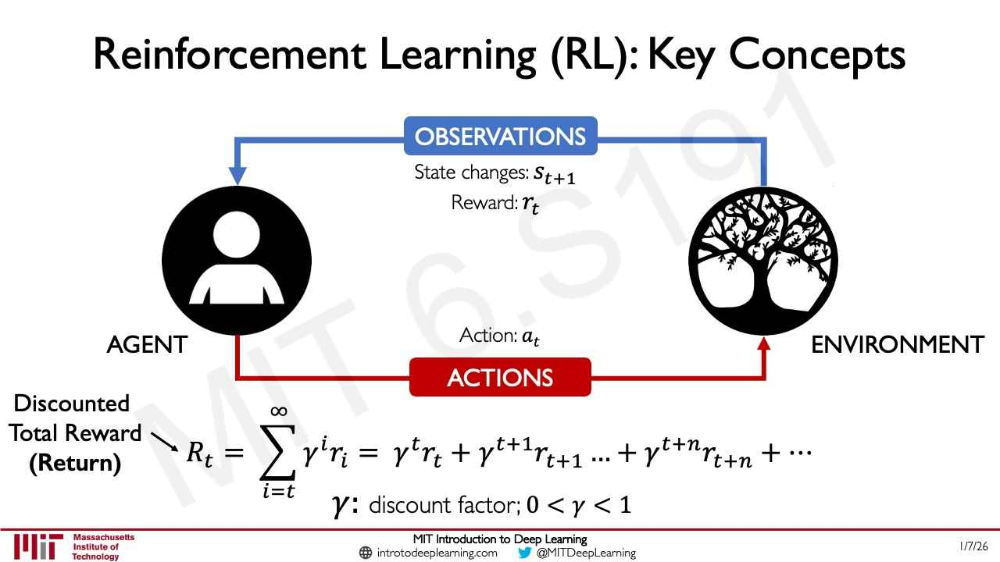

*Slide 17 — the complete loop: actions out, observations (new state and reward) back, and the discounted return.*

Slide 18 restates the return with the powers of $\gamma$ counted from the present instead:
$R_t = r_t + \gamma r_{t+1} + \gamma^{2} r_{t+2} + \cdots$, "the discounted sum of all rewards obtained from
time $t$". The two printed forms differ only by the constant factor $\gamma^{t}$ on every term, which
follows from setting the two expansions side by side.

## 5. Questions on rewards and states (10:04–13:07)

Several questions from the audience sharpened the definitions:

- **Can a reward be negative?** Absolutely. In chess you could give $+1$ for a win and $-1$ for a loss.
  It often helps to normalize rewards, and even when a problem's natural framing is a reward of zero or
  one (a coin collected or not), it can help to make it negative, as a penalty (≈10:04–10:50).
- **How is a reward that arrives only at the end discounted?** It is measured in exactly the same way:
  one time step far in the future carries the $+1$ or $-1$, and it is discounted back to the present.
  The hard part is that the agent must still learn what to do today from a reward that arrives far in
  the future (≈10:50–11:35).
- **What is the difference between a state and a reward?** A state is a snapshot of the environment —
  in chess, where all the pieces are. It does not depend on how good your action was: you see a state
  whatever you do (unless the game is lost entirely). The reward directly depends on the goodness of
  the action. Both arrive at every time step, though rewards may often be zero (≈11:35–12:22).

## 6. The Q-function (13:07–14:40)

The **Q-function**, the subject of about half the lecture, is a function of two things: the state $s_t$
at the current time and the action $a_t$ taken in it (≈13:07). It gives the expected return (slide 18):

$$Q(s_t, a_t) = \mathbb{E}[R_t | s_t, a_t]$$

"The Q-function captures the **expected total future reward** an agent in state, $s$, can receive by
executing a certain action, $a$" (slide 18). If you are in this state and take this action, what total
return should you expect as a result? A good action should show a higher total return than a bad one
(≈13:53).

## 7. From a Q-function to a policy (14:40–19:17)

Suppose you were handed this Q-function as a black box. In any state, how would you pick the optimal
action? A student answered: maximize the Q-function — plug in every possible action, see which one gives
the highest Q-value, and take it (≈14:40). What an agent ultimately needs is a **policy** $\pi(s)$: a
function of the state alone that returns "the **best action to take**" in that state (slide 19,
≈15:27). The strategy is that "the policy should choose an action that maximizes future reward":

$$\pi^{\ast}(s) = \underset{a}{\operatorname{argmax}}\thinspace Q(s, a)$$

Students pressed on what the expectation is over. Amini's answers: the Q-value is the expected value of
the returns over all future times, given the current state and action; it "does not capture the spread
of the distribution" (≈15:27–16:57). It is the mean of the future rewards you would get by taking this
action from this state — effectively a measure of the goodness of the action — and the spread comes
partly from the actions you might take afterwards, good or bad (≈16:57–18:31). Asked whether this means
searching the entire space, he replied that nothing has yet been said about how to compute the return:
the Q-function was simply given, and if you had it the problem would be trivial. Learning it is "the
whole part of the lecture" (≈18:31).

## 8. Two families of algorithms (19:17–20:03)

Slide 20 splits deep reinforcement learning algorithms into two families (≈19:17):

- **Value learning**: find $Q(s, a)$, then act with $a = \operatorname{argmax}_ {a} Q(s, a)$ — learn the
  Q-function and plug in every action, as above.
- **Policy learning**: find $\pi(s)$ directly and **sample** $a \sim \pi(s)$, skipping the Q-function.

Slide 21 fades the policy-learning panel: value learning comes first.

## 9. Why Q-values are hard to guess: Atari Breakout (20:03–24:40)

The game is Atari Breakout (slide 22). The agent is the paddle at the bottom; its actions are left,
right or staying still (Amini first says two actions, then corrects himself to three). A ball bounces
between the paddle and rows of coloured bricks at the top, and the goal is to break out all the bricks
by bouncing the ball into them (≈20:03–20:48). The point of the example is that "it can be very
difficult for humans to accurately estimate Q-values" (slide 22), and that the right answer is
intuitively surprising (≈20:03–20:48).

Two state-action pairs are shown. In **A**, the ball comes straight down onto the paddle and the paddle
stays still — a very conservative action. In **B**, the ball comes in from the side and the paddle moves
right to catch up with it (≈20:48). "Which $(s, a)$ pair has a higher Q-value?"

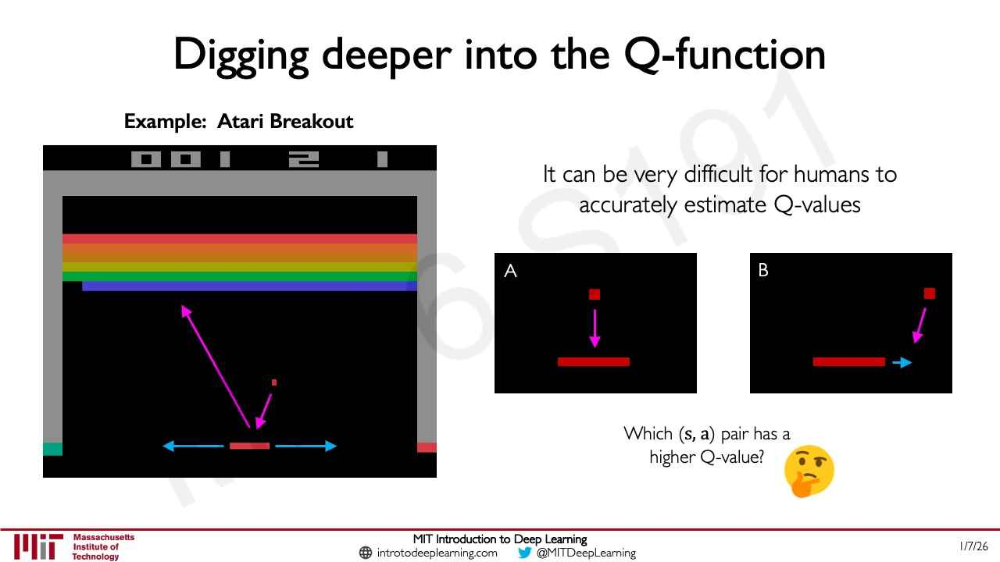

*Slide 22 — Atari Breakout; panel A is the conservative pair (ball straight down, paddle still), panel B the paddle chasing a ball from the side.*

The poll went about 10–20% for A and about 40% for B, with about half the room not voting (≈21:35). A
student asked whether the state should include which bricks remain; it should — the state is the whole
board — but for the demonstration the bricks are assumed the same (≈21:35). A student who voted A argued
that a perpendicular hit just keeps bouncing up and down and breaks through the rows; others gave
reasons against A, and that you want to clear all the bricks (≈21:35–23:08).

Videos of two trained policies settle it (slides 23–24, "Atari Breakout - Middle" and "Atari Breakout -
Side"). Policy A is conservative and does a good job, hitting the centre of the bricks; in isolation it
would not be a bad policy (≈23:08). Policy B "learns a hack in the system": it breaks off the corner and
unlocks a large gain of free blocks along the top (≈23:55). The lesson is that this is hard for humans
to forecast; reinforcement learning algorithms play millions of times, observe many scenarios, and arrive
at policies we would not develop ourselves. "So, B is the correct answer, but not necessarily for the
reason that a lot of people think" (≈24:40).

## 10. Deep Q networks (24:40–26:12)

If the Q-function is known the problem is easy, so the question is how to train a neural network to
learn it (≈24:40). Slides 25–26 show two ways to set up a **deep Q network (DQN)**:

1. **Action + state → expected return**: the network takes a state $s$ (a Breakout frame) and an action
   $a$ ("move right") and outputs one number, $Q(s, a)$.
2. **State → expected return for each action**: the network takes only the state and outputs a Q-value
   for every possible action, $Q(s, a_1), Q(s, a_2), \ldots, Q(s, a_n)$.

The second is more efficient: rather than running the network once per action, you run it once for the
current state and get all the Q-values at once, then pick the action to execute. It is usually the way
this is implemented in practice (≈25:26).

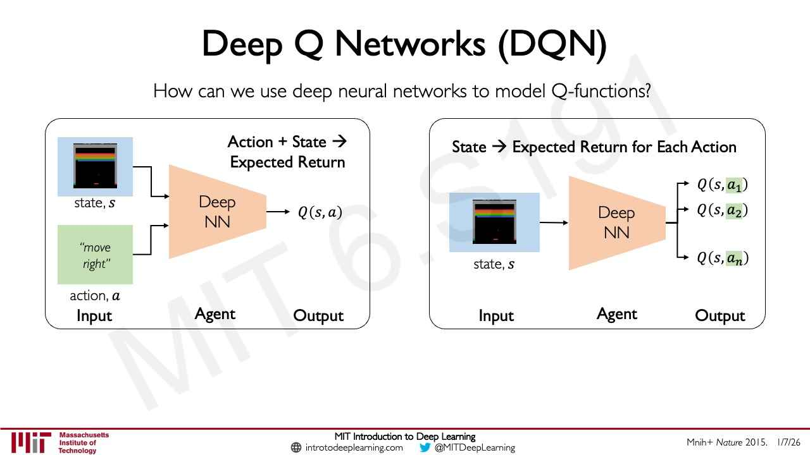

*Slide 26 — left, state and action in, one Q-value out; right, the state in, one Q-value per action out.*

## 11. Training a DQN: target, prediction and the Q-loss (26:12–27:44)

Training asks what would happen in the best case: "What happens if we take all the best actions?"
(slide 27). Then the target return would be maximized, and that maximum can serve as the ground truth
for the agent: a continuous number (≈26:12). Slide 28 writes the **target** as

$$\left( r + \gamma \max_{a'} Q(s', a') \right)$$

which Amini reads as the reward at the current time plus the action that maximizes the expected return
over all future states, with the discount factor in front: the target captures both the current time
step and the discounted future (≈26:12–26:58). The slide does not define the primed symbols further;
$s'$ and $a'$ stand in that reading for the future state and the action taken there. The network's
**prediction** is simply its output $Q(s, a)$ for the state-action pair (slide 29, ≈26:58).

With a ground-truth target and a predicted number, the two form a loss, and the network is trained to
match the target (slide 30, labelled "Q-Loss"):

$$\mathcal{L} = \mathbb{E}\left[ \left\Vert \left(r + \gamma \max_{a'} Q(s', a')\right) - Q(s,a) \right\Vert^2 \right]$$

Aloud, the loss "subtracts them and takes their absolute value" (≈26:58); the slide prints the
expectation of the squared norm of the difference.

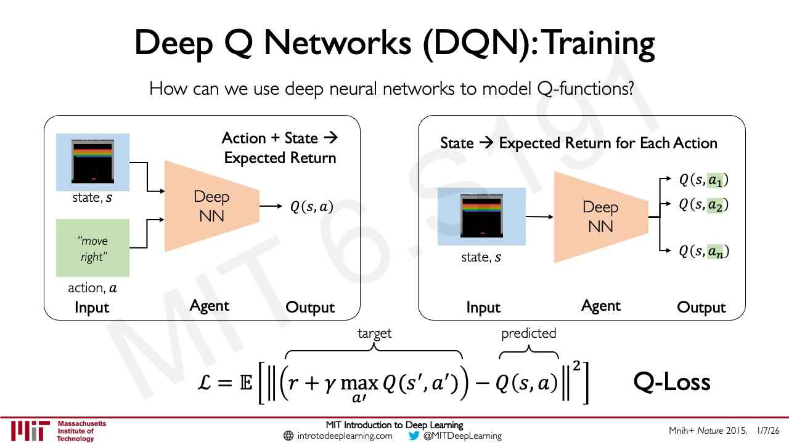

*Slide 30 — the Q-loss: the bracketed target (reward plus discounted best future Q-value) against the network's predicted Q-value.*

## 12. The DQN end to end (27:44–30:47)

Slide 31 summarizes: "Use NN to learn Q-function and then use to infer the optimal policy, $\pi(s)$".
Given a Breakout state, the network outputs one Q-value for each of three actions: $Q(s, a_1) = 20$ for
moving left, $Q(s, a_2) = 3$ for staying still and $Q(s, a_3) = 0$ for moving right. The policy takes the
maximum, $\pi(s) = \operatorname{argmax}_ {a} Q(s, a) = a_1$, so the agent moves left (≈27:44–28:29; the
captions render the spoken values as "23 or zero", and the transcript notes the slide's 20, 3 and 0).
The action is sent back to the environment, the next state comes back, and the network is trained with
backpropagation against the target values obtained from a whole rollout of the game (≈28:29).

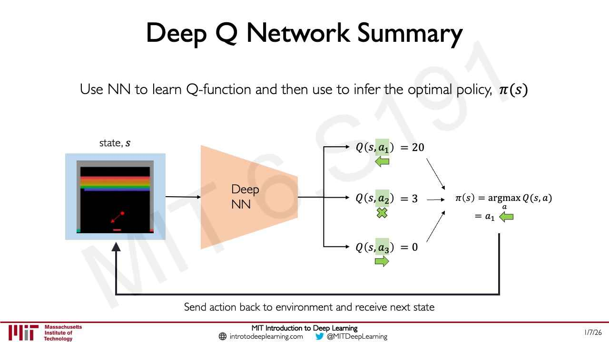

*Slide 31 — one forward pass gives a Q-value per action (20, 3, 0); the argmax, move left, is sent back to the environment.*

A student asked how this works in chess, where ten moves in it is very hard to know the reward
(≈28:29–29:14). Amini's answer: the two kinds of game are not different, because "you always play the
game to the end", collecting all the rewards until it finishes, and that is how the target value is
obtained. You then rewind the game and look at what you did at each moment. "The network does not learn
the reward, the network observes the reward from the game." Whether an individual action actually
contributed to winning or losing is noise to the model, which is why it is a hard learning problem
(≈29:14–30:47). Confirming a student's reading, he added that the reward of 20 in the Breakout example
is not a label from any human: there is no human labelling, but the game has predefined rewards at
predefined points in time (≈30:47).

## 13. DQN on Atari (30:47–32:20)

This approach, scaled up, was one of the first big breakthroughs in deep reinforcement learning, by
DeepMind in 2015 on the Atari games (≈30:47–31:35; slides 25–30, 32 and 33 credit "Mnih+ *Nature*
2015."). The
network was a **convolutional neural network**, as in [lecture 3](03-convolutional-neural-networks.md):
it took the raw pixels of the game screen and predicted the Q-function, trained with exactly the
algorithm above (≈31:35). Slide 32 draws it as two convolution layers and two fully connected layers,
with a ramp-shaped activation icon between the layers, ending in 18 outputs — "No input", eight joystick directions,
fire, and the eight directions each combined with fire.

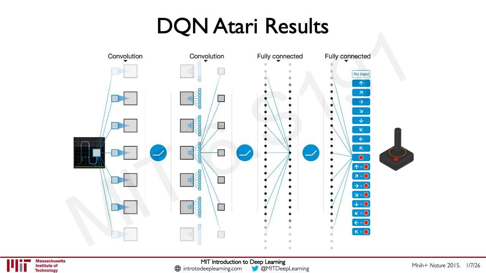

*Slide 32 — screen pixels pass through two convolution and two fully connected layers to one output per joystick action.*

For an algorithm implementable "in probably a few dozen lines of code", the result was impressive: Amini
says it surpasses human-level performance on over 50% of the Atari games, with no labels and no prior
information about how the games are played (≈31:35–32:20). Slide 33 is the chart: DQN's score as a
percentage of human-level performance on 49 games, sorted from Video Pinball (2539%), Boxing (1707%)
and Breakout (1327%) down to Montezuma's Revenge (0%), beside a grey bar for the "Best Linear Learner".
A vertical line divides "Surpass human-level" (29 games, ending with H.E.R.O. at 76%) from "Below
human-level" (20 games, starting with Asterix at 69%). On the chart's own numbers, seven games on the
"surpass" side score under 100% (Enduro 97% down to H.E.R.O. 76%); the slide does not state the
threshold the line marks. The linear learner beats DQN clearly on Double Dunk (about 175% against 17%)
and by smaller margins on a few others; the [slide transcription](../raw/slides/05-reinforcement-learning.md)
lists every game.

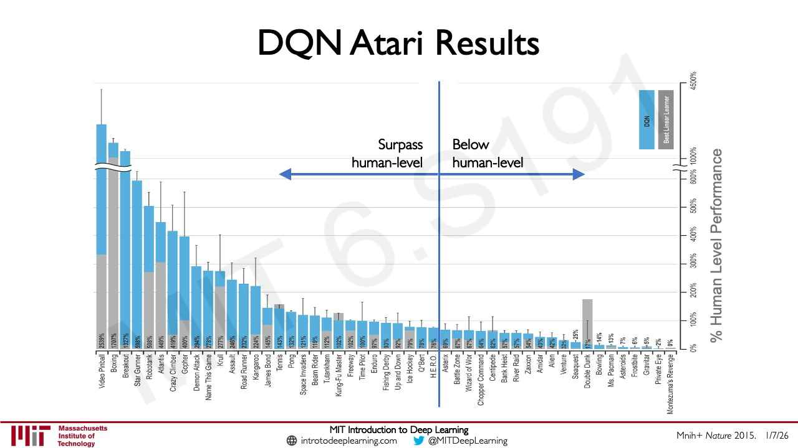

*Slide 33 — DQN (blue) against the best linear learner (grey), as a percentage of human-level play; games left of the line are labelled "Surpass human-level".*

## 14. Downsides of Q-learning (32:20–34:39)

Slide 34 lists the downsides (≈32:20–33:52):

- **Complexity**: Q-learning "can model scenarios where the action space is discrete and small" and
  "cannot handle continuous action spaces". The actions come from a predefined vocabulary, while real
  actions are often continuous.
- **Flexibility**: the "policy is deterministically computed from the Q function by maximizing the
  reward → cannot learn stochastic policies". Many games have probabilistic components, and always
  picking the maximum does not optimize for them.

To address these, slide 34 introduces "a new class of RL training algorithms: Policy gradient methods".

A student then returned to the loss: does the target not rely on the network itself, since it contains
a Q-value, and could the actual rewards from the rollout not be used instead? Amini answered: "No, it is
the actual reward. So, probably it's a misnomer in the notation. So, the Q is then defined as like the
true Q that's actually observed as the function of the rollout", a ground-truth value for the predictor
(≈33:52–34:39). The wiki reports the answer as given; slide 30's target is printed with $Q(s', a')$.

## 15. Policy learning: optimize the policy directly (34:39–37:44)

Policy learning (slide 35) skips the Q-function and learns the policy $\pi(s)$, a function of the state
alone. It is not deterministic: the policy is a probability distribution, and the action is sampled from
it (≈34:39). Slides 36–37 set the two side by side. A DQN approximates the Q-function and infers the
policy with an argmax (slide 36); **policy gradient** methods "directly optimize the policy $\pi(s)$"
(slide 37, ≈35:25).

For the same Breakout state, the policy network outputs a probability for each action:
$P(a_1|s) = 0.9$ (left), $P(a_2|s) = 0.1$ (stay) and $P(a_3|s) = 0$ (right). Being probabilities they sum
to one, $\sum_{a_i \in A} P(a_i|s) = 1$, so together they form a distribution, and the action is sampled
from it, $\pi(s) \sim P(a|s)$, rather than taken as the argmax (slide 37, ≈36:12–36:58). Here the sample
is $a_1$, left. Each output is "the probability that any given action is going to result in the highest
likelihood return to the agent" (≈36:12).

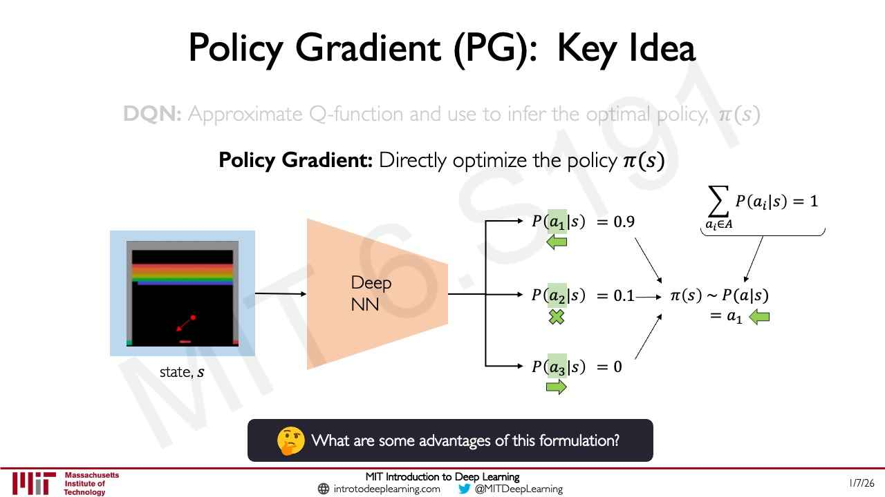

*Slide 37 — the policy network outputs probabilities (0.9, 0.1, 0) that sum to one, and the action is sampled.*

Sampling builds in **stochasticity**: the model can be encouraged to move left 90% of the time and stay
still 10% of the time, which never happens in Q-learning, where the argmax is always taken (≈36:58).
That gives flexibility beyond deterministic environments. Slide 37 asks "What are some advantages of
this formulation?", and the subtler one follows.

## 16. Discrete versus continuous action spaces (37:44–38:31)

A **discrete action space** asks "which direction should I move?": left, stay or right, each with its
own probability, drawn as three bars of $P(a|s)$ over $a$ — Left tall, Stay short, Right almost nothing
(slide 38, ≈37:44).

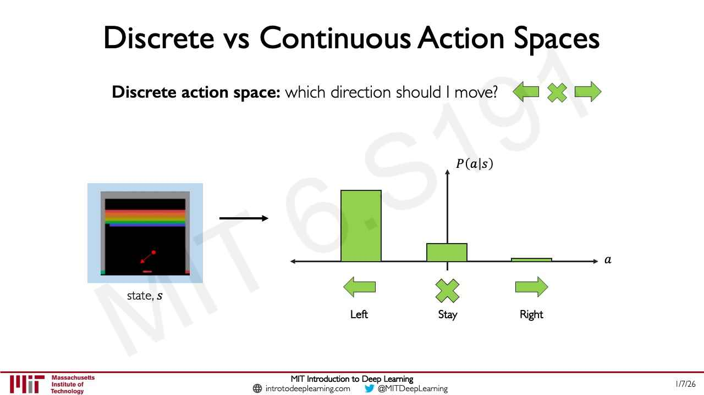

*Slide 38 — a discrete action space: one probability for each of left, stay and right.*

A **continuous action space** asks "how fast should I move?" (slide 39, with an example of 0.7 m/s to
the left). Instead of three bins, the horizontal axis becomes a speed: farther right means faster to
the right, farther left faster to the left, and the policy is a full distribution across this
continuous space — a density over infinitely many bins (≈37:44–38:31).

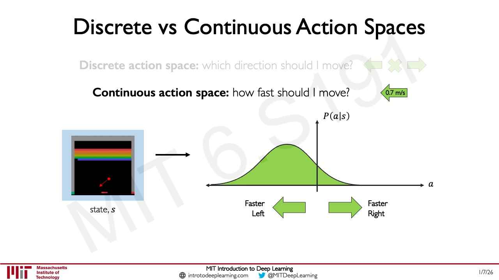

*Slide 39 — a continuous action space: a density over speed, from faster left to faster right.*

## 17. A Gaussian policy for continuous actions (38:31–41:35)

To model a continuous distribution, the network predicts the parameters of a distribution rather than
one value per action — which will look familiar from the [VAEs of lecture 4](04-deep-generative-modeling.md),
whose encoders output a mean and a standard deviation (≈38:31; the captions are unclear at "that I have a
gave", noted in the transcript). Slide 40: "Policy Gradient: Enables modeling of continuous action space".
Given the Breakout state, the network outputs a mean $\mu = -1$ and a variance $\sigma^2 = 0.5$, which
define a Normal distribution over the action,

$$P(a|s) = N(\mu, \sigma^2)$$

and the action is sampled from it, $\pi(s) \sim P(a|s)$: on the slide the sample is $-0.8$ m/s, moving
left (slide 40, ≈39:16). The sample is not the peak: $-1$ m/s is only the mean of the distribution, not
"the optimal action" (≈39:16–40:03). The density still integrates to one, which slide 40 prints as
$\int_{a=-\infty}^{\infty} P(a|s) = 1$ (≈40:03).

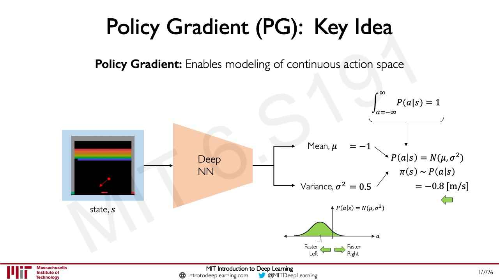

*Slide 40 — the network outputs a mean and a variance; the action (−0.8 m/s) is sampled from the resulting Normal distribution.*

Two questions followed. **Why a Normal distribution?** It is an arbitrary choice: it makes sense here
because it is unimodal, it is common, it is easy to learn (two numbers) and it is a good approximator for
most tasks, but other problems may need a multimodal distribution, and the network could output any
number of parameters for any other distribution (≈40:03–40:50). **What does $P(a|s)$ mean?** "It is the
probability that any given action results in the maximum return on future investment for that given
state" (≈40:50–41:35).

## 18. Training policy gradients: a self-driving case study (41:35–45:26)

Slide 41 returns to the reinforcement learning loop with a case study, self-driving cars, where every
variable is intuitive (≈41:35–42:21). The **agent** is the vehicle; the **state** is what its camera,
lidar and other sensors observe (for simplicity, the car's position in the lane); the **action** is the
steering wheel angle, one continuous value; and the **reward** is the distance travelled before a crash
— drive as far as possible without crashing or needing a human to intervene (≈42:21).

The training algorithm, on slide 42 (credited "Williams *Reinforcement Learning* 1992."):

1. Initialize the agent.
2. Run a policy until termination.
3. Record all states, actions, rewards.
4. Decrease probability of actions that resulted in low reward.
5. Increase probability of actions that resulted in high reward.

Initializing means a randomly initialized network: it takes a state and outputs a distribution over
actions, which is random at first. So the first run crashes very quickly, but along the way every
triplet of state, action and reward has been recorded (≈43:08). Slide 42 draws the run as a car
trajectory on a road, each point labelled with its triplet — $(s_0, a_0, r_0)$, $(s_1, a_1, r_1)$, and so
on to $(s_4, a_4, r_4)$ at the crash (the third label prints $a_3$ where the pattern suggests $a_2$) —
with the early part shaded green and the part near the crash red.

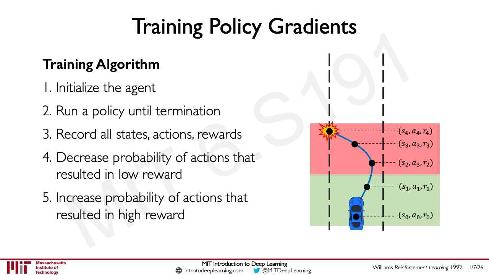

*Slide 42 — the first run: each point records a (state, action, reward) triplet; the actions near the crash (red) are discouraged, the earlier ones (green) encouraged.*

The update in steps 4 and 5, as Amini describes it, takes the actions closest to the crash — say the last
50% — and decreases the probability of ever taking them again in those states, and increases the
probability of the first 50%, which were less correlated with the crash (≈43:55). "All we've done here
is we're saying let's decrease the probability of ever doing anything that we did close to an
accident" and increase the probability of what we did far from it (≈43:55–44:41). Trained by gradient
descent and run again, the car travels farther; the process repeats until convergence, when the car
stably follows the lane (≈44:41). Slides 43–45 show this progression: a second run crashing at the
right-hand line, a third that gets farther before crashing at the left, and finally a trajectory that
stays in the lane the whole way.

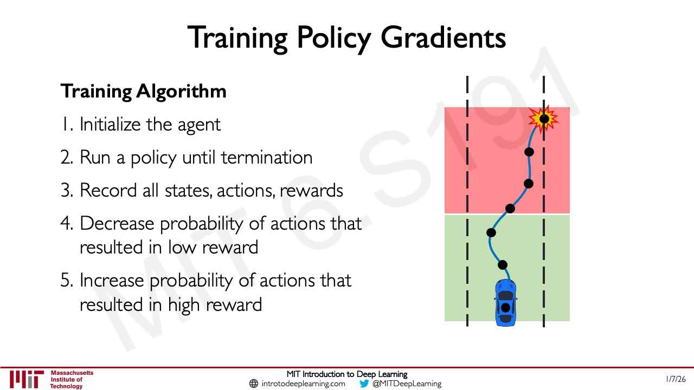

*Slide 43 — a second trajectory, crashing at the right lane line, again split into encouraged (green) and discouraged (red) actions.*

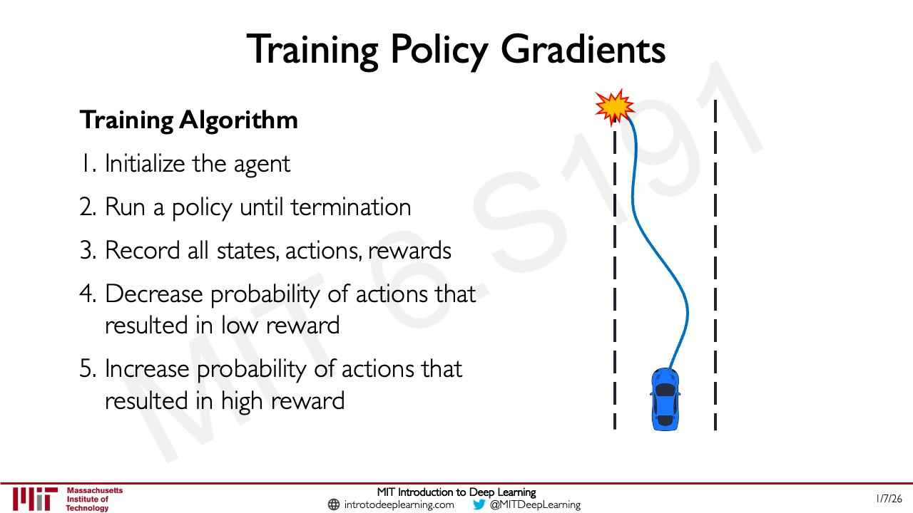

*Slide 44 — a third trajectory gets farther up the road before crashing.*

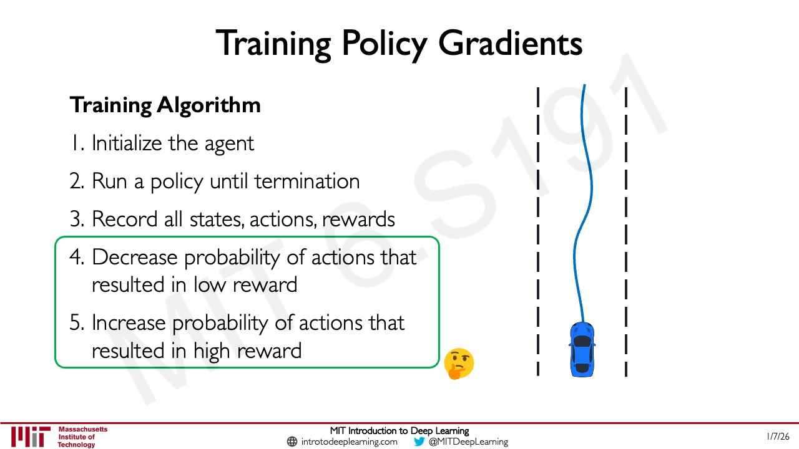

*Slide 45 — after repeated updates the car follows the lane to the top; steps 4 and 5 of the algorithm are boxed.*

## 19. The loss and the policy gradient (45:26–48:30)

What remains is how to carry out steps 4 and 5: a loss that decreases the probability of actions close
to bad rewards and increases it for actions close to good ones (≈44:41–45:26). Slide 46:

$$\mathbf{loss} = -\log P(a_t|s_t)\thinspace R_t$$

The loss has two terms: the **log-likelihood of the action** $a_t$ taken in state $s_t$ — the
probability of that action resulting in the maximum return — and the **total discounted reward** $R_t$
(≈45:26). Amini walks through the cases (≈46:13–46:58). A likely action that brought a large reward gives
two big numbers multiplied together; with the minus sign, the loss is very negative, which is a very good
loss, since the loss should be low. A likely action that brought a low reward gives the opposite, which
is to be discouraged. And an unlikely action that brought a very high reward is also encouraged to
happen again, again because of the negative sign.

Plugged into gradient descent, the update is (slide 46, under "Gradient descent update:"):

$$w' = w - \nabla \mathbf{loss}$$

$$w' = w + \nabla \log P(a_t|s_t)\thinspace R_t$$

where $w$ are the network's weights; the slide prints no learning rate. The boxed term
$\nabla \log P(a_t|s_t)\thinspace R_t$ is labelled "Policy gradient!": the method is called policy
gradients because it takes the gradient of the policy itself — "a very simple naming convention" (≈46:58).
See [gradient descent](gradient-descent.md) and [loss functions](loss-functions.md).

Two questions followed on what the policy never tries (≈46:58–48:30). An action that is extremely
unlikely may never be executed during training, even if it would have earned a high reward, so it is
never learned: "yes, it's true and that's a downside of the approach". That is why random initialization
matters, so that many actions are seen at the start, and why randomness is often still encouraged during
training, so that the model explores other states — the **exploration versus exploitation** trade-off:
even on a good path, you always want some exploration rather than only exploiting it (≈47:44). Asked
whether non-sampled trajectories can be included deliberately, Amini answered yes: much of the nuance
lies in how the policy is run and sampled, and sampling in different ways gives diverse data, not always
the exploitative strategy (≈47:44–48:30).

## 20. Reinforcement learning in real life: simulation and VISTA (48:30–51:35)

Which of the five steps makes this impractical in the real world (≈48:30–49:16)? A student suggested
step 3, recording everything; but a car on the road records data anyway, so that is cheap. The answer is
**step 2**, "Run a policy until termination", boxed in red on slide 47: the algorithm explicitly requires
running to a terminal state — crashing the car — in order to learn (≈49:16–50:03).

So **simulation** has become a very big field for reinforcement learning, and game play is a big part of
it because "it's very safe to die in games" (≈50:03). But most simulators are model-based and look
game-like rather than natural, which makes it hard to translate a policy learned in them to reality
(≈50:03–50:48). Amini highlights MIT work on a **data-driven** photorealistic simulator: from real data
of a drive down a road, it simulates an autonomous car driving down that road and taking different
actions. Slide 48 names it **VISTA**: "Photorealistic and high-fidelity simulator for training and
testing self-driving cars" (credited "Amini+ *IEEE RA-L* 2020."). The roads in its video are real roads,
with real cars beside them at real times of day, but driven in simulation (≈50:48).

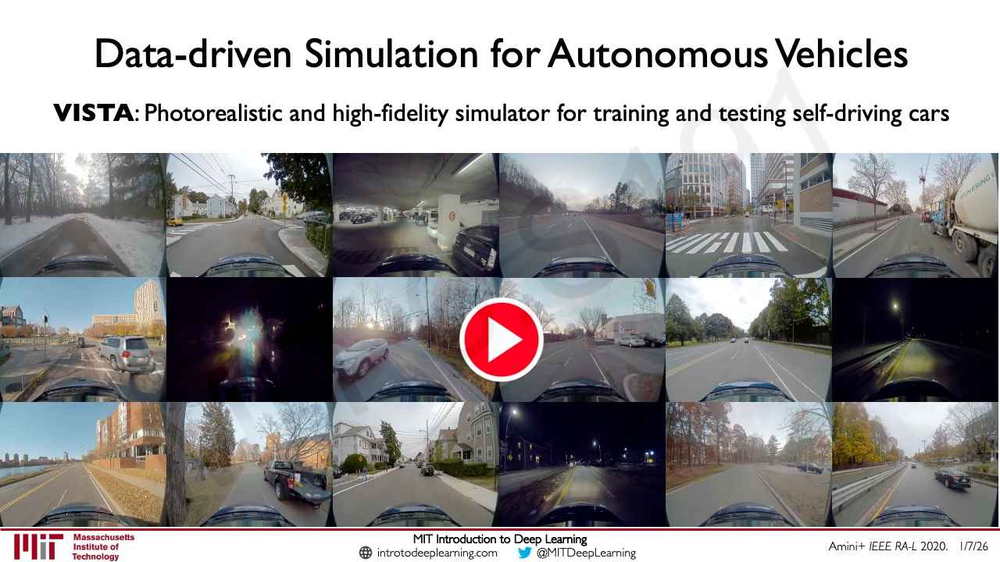

*Slide 48 — VISTA: eighteen simulated camera views on real roads, in snow, daylight, night and autumn.*

The team trained a policy in that simulator and deployed it on the same autonomous car Amini mentioned in
[lecture 3](03-convolutional-neural-networks.md), "just downstairs one floor below here" (≈50:48–51:35).
Slide 49: "Policy Gradient RL agent trained entirely within VISTA simulator", then "End-to-end agent
directly deployed into the real-world", and "First full-scale autonomous vehicle trained using RL
entirely in simulation and deployed in real life!". Aloud, this was in 2020 and "the first time any
autonomous vehicle was ever trained end-to-end in simulation" and successfully deployed in the real
world (≈51:35).

## 21. The game of Go and AlphaGo (51:35–53:53)

Reinforcement learning now permeates large systems such as LLMs, but much of it started with games
(≈51:35). Go was a huge test of reinforcement learning agents against human champions (slides 50–51).
It is played on a 19 by 19 grid by two players, black and white, and the aim is to "Get more board
territory than your opponent" (slide 52, ≈52:21). It is a massive combinatorial problem: slide 52's
table counts the positions for each board size — $3^{n^2}$ for an $n \times n$ board — and the share that
are legal, ending with $1.740896506 \times 10^{172}$ positions and $2.08168199382 \times 10^{170}$ legal ones
for a $19 \times 19$ board, "Greater number of legal board positions than atoms in the universe." (credited "Source:
Wikipedia.").

Google DeepMind's AlphaGo aimed not only to beat existing AIs but to outperform the human champions
(≈52:21). Its pipeline (slides 53–56, credited "Silver+ *Science* 2016.") has three stages:

1. **"Initial training: human data"**: a **supervised learning** policy network is trained by
   classification on human expert positions, to predict from a state the action a champion would take —
   imitation (≈52:21–53:07).
2. **"Self-play and reinforcement learning → super-human performance"**: the bootstrapped model is played
   against itself. Each game returns a reward, so the **RL policy network** can now be trained by
   reinforcement learning; the other player is effectively the simulator. The cycle repeats (≈53:07).
3. **"“Intuition” about board state"**: a **value network** is trained by regression on self-play data to
   judge whether a board state is a good one to reach, so the model can steer away from bad states
   (≈53:53).

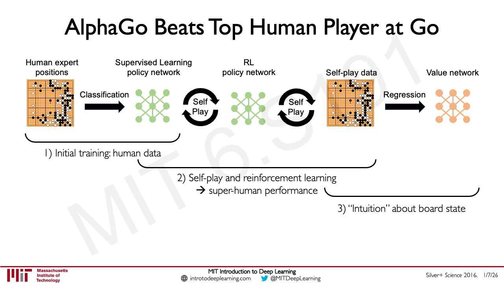

*Slide 56 — AlphaGo: supervised imitation of human positions, then self-play reinforcement learning, then a value network for board intuition.*

## 22. Beyond imitation: language models, and learning from scratch (53:53–57:42)

Amini draws the parallel to large language models, to be covered later in the course (lecture 6
covers next-token prediction and says only that base models are then tuned to act as chatbots; see
[large language models](large-language-models.md)): LLMs are first
trained to imitate text from the internet by next-word prediction, exactly like AlphaGo's first stage,
and then face a "preference alignment problem" — going beyond imitation to optimize for what humans like
and dislike in their answers. The thumbs up and thumbs down you give a chatbot "are exactly training a
reward model for reinforcement learning algorithm to maximize the thumbs up and minimize the thumb down"
(≈53:53–54:39). This passage has no slide of its own beyond slide 3's "Language Modeling" panel.

A student asked whether a model could skip the human data and learn from scratch. Amini showed a slide he
had not planned to — it is **not in the published deck** — and answered yes: starting from a random
network, imitating humans first had only accelerated learning in self-play. Training from scratch
reaches the baseline models' performance (shown in green) very quickly, and the result carries across
games: Go, but also chess, against Stockfish, and others (≈54:39–55:25). Asked whether different board
sizes mean different input sizes, and whether the system looks at pictures of the board, he said all of
them use a matrix representing the board; the board sizes do differ, and each model is trained
separately for its own game, though you could bring them all up to the biggest board's resolution —
chess is 8 by 8 and Go 19 by 19 (≈55:25–56:56). A last question asked whether the policy network and the
value network are two alternative ways to pick a move; the answer was that stage 3 informs the policy
itself, since the value network's intuition about good and bad board positions helps steer the actions
toward good states (≈56:56–57:42).

## 23. Summary, and what comes next (57:42–end)

Slide 57 summarizes the lecture in three columns (≈57:42):

- **Foundations**: agents acting in an environment; state-action pairs → maximize future rewards;
  discounting.
- **Q-learning**: the Q function is the expected total reward given $s$, $a$; the policy is determined by
  selecting the action that maximizes the Q function.
- **Policy gradients**: learn and optimize the policy directly; applicable to continuous action spaces.

The labs will give hands-on experience with these algorithms, including a chance to use reinforcement
learning while fine-tuning models (≈57:42–58:29). The next lecture looks back at recent work and
highlights next-generation models and the field's remaining limitations; T-shirts and guest lectures
come the following day (≈58:29). Slide 58, "T-Shirts Coming Tomorrow!", lists project sign-ups due
"TMRW 1/8 11:59pm ET", lab competitions and prizes with an "EXTENDED DEADLINE: Friday 1/9 11:00am ET",
project and lab submission links on the syllabus, and a resume drop to sponsoring companies.

## Spoken versus printed

- **What the data are**: aloud, "triplets" of states, actions and rewards (≈3:56); slide 6 prints
  "Data: state-action pairs".
- **The discounted return**: slide 17 writes the powers of $\gamma$ as $\gamma^{t}, \gamma^{t+1}, \ldots$
  and slide 18 as $1, \gamma, \gamma^{2}, \ldots$ from the present; the two differ by the factor
  $\gamma^{t}$ (section 4).
- **The Q-loss**: aloud, the target and prediction are subtracted and the "absolute value" taken
  (≈26:58); slide 30 prints the expectation of the squared norm.
- **The Q-values of slide 31**: the captions read "23 or zero" (≈27:44); the slide prints 20, 3 and 0,
  and Amini goes on to say "20 in this case is the maximum".
- **The target**: slide 30's target contains $Q(s', a')$; asked whether it relies on the network, Amini
  calls it "the actual reward" and the notation "probably … a misnomer" (≈33:52–34:39).
- **Atari results**: aloud, human-level performance surpassed "on over 50% of the Atari games" (≈31:35);
  slide 33 puts 29 of its 49 games on the "Surpass human-level" side of its line, seven of them scoring
  under 100%.
- **Slide 42** labels its third point $(s_2, a_3, r_2)$, breaking the pattern of the others.
- **The first RL-trained vehicle**: slide 49 says "First full-scale autonomous vehicle trained using RL
  entirely in simulation and deployed in real life!"; aloud, "the first time any autonomous vehicle was
  ever trained end-to-end in simulation" and deployed (≈51:35).
- **Not in the deck**: the learning-from-scratch slide shown in answer to a question (≈54:39–55:25), and
  the discussion of language-model preference alignment (≈53:53–54:39), which has no slide beyond
  slide 3's panel.
