# Lecture 8 — AI for Science

**MIT 6.S191, 2026 edition. Guest lecturer: Chris Bishop, Technical Fellow, Microsoft Research AI for Science. Delivered 8 January 2026.**
[Video](https://www.youtube.com/watch?v=rZACoZD8AG8) ·
[Slides (PDF)](https://introtodeeplearning.com/slides/6S191_MIT_DeepLearning_L8.pdf) ·
[Slide-by-slide transcription](../raw/slides/08-ai-for-science.md) ·
[Transcript](../raw/transcripts/08-ai-for-science.md) ·
[Verbatim captions](../raw/transcripts/original/08-ai-for-science.md)

A guest lecture on using deep learning to accelerate scientific discovery. Chris Bishop starts from what
he calls the greatest scientific discovery ever made: the world is described by simple mathematics, with
extraordinary precision. The catch, which Paul Dirac pointed out in 1929, is that the equations are far
too hard to solve. Bishop's answer is the **deep learning emulator**. A conventional simulator solves the
equations many times, ahead of time, and its output becomes training data for a neural network. The
trained network then gives the simulator's answers thousands of times faster. He frames this through the
**no free lunch theorem**, which says a model needs data plus assumptions (inductive bias), and Rich
Sutton's **bitter lesson**, which says more data eventually beats hand-built assumptions. Emulators
reconcile the two by turning the equations themselves into data.

The examples climb in scale, from the Earth's atmosphere down to crystals, molecules and proteins:

- **Aurora**, a foundation model for the Earth system: weather forecasts and air pollution.
- **MatterGen**, a conditional diffusion model that generates new stable crystals with desired properties.
- **Skala**, a learned exchange-correlation functional for **density functional theory**, the most
  extended story of the talk. Density functional theory turns the exponentially costly Schrödinger
  equation into a cubic-cost problem, exactly, except for one term nobody has been able to write down.
- **Emulators for protein dynamics**: molecular dynamics run on an emulator, and a model that samples a
  protein's shapes directly.

A plug for his textbook, *Deep Learning: Foundations and Concepts*, and four questions from students
close the lecture.

Timestamps such as (≈24:10) point into the [transcript](../raw/transcripts/08-ai-for-science.md). "Slide
N" is page N of the PDF; the deck prints no slide numbers. Several slides have no title, and the
[slide transcription](../raw/slides/08-ai-for-science.md) names them by what they show. Where the
lecturer plays a video ("this is a little video of the denoising process", ≈23:16), the PDF holds a single
frame.

## 1. Introduction (0:12–0:59)

A member of the course staff introduces Bishop as the course's first guest speaker of 2026. He is a
Technical Fellow at Microsoft, "the highest technical distinction that one can receive", and the founder
of Microsoft Research AI for Science. It is a global organization working at the intersection of machine
learning, AI and the natural sciences. He comes from physics and machine learning, and has written books
on machine learning and deep learning (≈0:12–0:59; slide 1).

The introduction calls Bishop the first guest speaker, so this talk came before Douglas Blank's
([lecture 7](07-three-laws-of-ai.md)), although the catalog numbers it after it. The course site's page
source dates this lecture 8 January 2026 and lecture 7 9 January.

## 2. The greatest scientific discovery (0:59–3:17)

Bishop asks the class to think of the greatest scientific discovery ever made. His own answer is "the fact
that our world is described by mathematics" (≈0:59–1:45). It is not obvious that "making marks on a piece
of paper allows you to predict the future". And the mathematics is simple. Slide 2 prints a handful of
equations without naming them:

- an equation for $\Psi$, which he later identifies as Schrödinger's equation (≈9:26);
- the equations of motion he later uses for molecular dynamics (slide 27);
- an inverse-square force law $F = G\frac{m_1 m_2}{r^2}$;
- four equations relating the fields $\mathbf{E}$ and $\mathbf{B}$.

These equations, "perhaps a little bit of relativity sprinkled on top", describe everything we experience
in everyday life without specialist equipment (≈1:45).

They are also extraordinarily precise. The electron is "like a little magnet", and theory can calculate
the strength of that magnet (slide 3, "Magnetic dipole moment of the electron"). The theoretical value
carries error bars because terms of a series expansion are neglected; the experimental value carries
experimental error bars (≈2:31). Slide 3 prints them as

$$\text{Theory: } g/2 = 1.001\thinspace 159\thinspace 652\thinspace 181\thinspace 13\thinspace (\pm 86)$$

$$\text{Experiment: } g/2 = 1.001\thinspace 159\thinspace 652\thinspace 180\thinspace 73\thinspace (\pm 28)$$

and Bishop says "these agree to 13 significant figures. That's just staggering precision" (≈2:31). So for
the Earth's atmosphere, materials and new drugs, we have equations that describe them very precisely, and
"we ought to be able to just design a new drug on a computer and we're done" (≈2:31).

## 3. Dirac: the laws are known, the equations cannot be solved (3:17–4:02)

"But we can't" (≈3:17). The equations are simple to write down and extremely hard to solve. Slide 4 quotes
Paul Dirac, 1929:

> The underlying physical laws necessary for the mathematical theory of a large part of physics and the
> whole of chemistry are thus completely known. The difficulty is only that the exact application of these
> laws leads to equations much too complicated to be soluble.

Chemistry here includes biochemistry, "which is just complex chemistry" (≈3:17). For a century, then, we
have had beautiful, simple equations of exquisite precision that we cannot solve for most real-world
applications. The question of the lecture is how to use the knowledge of those equations to accelerate
scientific discovery (≈3:17–4:02).

## 4. The scientific discovery loop, and where AI enters (4:02–7:54)

Slide 5 draws the discovery process as a loop. A scientist (in practice, often a team from many
disciplines) formulates **hypotheses**, which are tested by **experiment**; the **observations** inform
the scientist, who refines the hypotheses (≈4:02–4:49). In drug discovery, for example, you dream up
candidate molecules, synthesize them, test them against proteins, see which bind, and refine the list.
The scientist also talks to other scientists and reads the literature, the cloud of "Other scientists &
collective knowledge" on the slide (≈4:49).

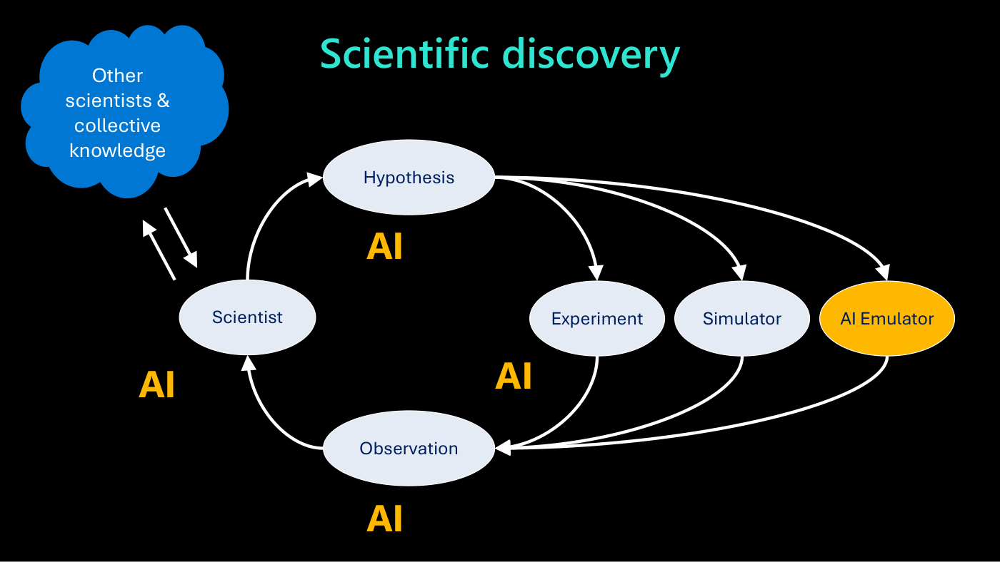

*Slide 5 — the discovery loop: hypotheses tested by experiment, by simulator or by AI emulator, with the orange "AI" labels marking where AI enters.*

Digital computers, from the 1960s, added a second route beside experiment: **simulation**. Because the
equations are accurate, solving them numerically gives "a different kind of oracle", very expensive but
complementary to experiment (≈4:49–5:35). AI now touches every part of the loop. It can propose hypotheses
("design a million molecules rather than half a dozen"), analyze experimental data, drive automated wet
labs, and read the literature of millions of papers that no human can (≈5:35–6:21). Microsoft's
"Discovery Platform", an agentic AI platform built on frontier LLMs, works on this; it is not the
subject of the talk (≈6:21–7:07).

The subject is a third pathway, a third kind of oracle: the **AI emulator**, the orange ellipse on slide
5 beside "Experiment" and "Simulator" (≈7:07). Bishop was excited enough by it that four years earlier
he gave up his lab director job and formed the AI for Science team around it (≈7:07).

## 5. The no free lunch theorem: data and inductive bias (7:54–9:26)

To explain emulators, Bishop steps back to "a very important theorem at the heart of machine learning",
the **no free lunch theorem**. It says that "you cannot learn purely from data". You can learn only in the
context of some assumption, variously called prior knowledge or **inductive bias**, and a prediction
combines data with assumptions (≈7:54).

Slide 6 draws two balance scales. In **large language models** the scale tips towards data. They use data
at an unprecedented, internet scale, and that scale is what gives them their capabilities. Their
inductive bias is "fairly lightweight": attention, in which the prediction of the next token depends to
greater or lesser degrees on previous tokens, with data-dependent weighting. That is a very general
assumption (≈7:54–8:40; see [attention and transformers](attention-and-transformers.md)). **Scientific AI
models** are in the opposite regime. Data is scarce and expensive (it can take a student a year to work
out the 3D structure of one protein, which is one data point), but science uniquely has a rich inductive
bias: "We know the equations that describe the world" (≈8:40–9:26).

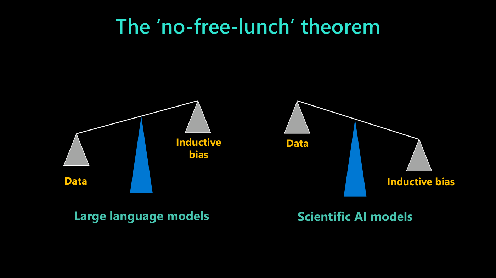

*Slide 6 — for large language models the balance tips towards data; for scientific AI models, towards inductive bias.*

## 6. Inductive bias in science (9:26–11:45)

Slide 7 lists the kinds of prior knowledge science offers. The first is **Schrödinger's equation**, "an
equation for an object called psi, the wave function", which describes matter at the atomic level
(≈9:26). Bishop promises no mathematics in the talk; the slide prints it as

$$\left(-\sum_{i=1}^{N}\frac{\hbar^2}{2m_e}\nabla_i^2+\frac{1}{2}\sum_{j\neq i}^{N}\sum_{i=1}^{N}\left(\frac{e^2}{4\pi\epsilon_0}\right)\frac{1}{|\mathbf{r}_ i-\mathbf{r}_ j|}-\sum_{i=1}^{N}\sum_{\alpha=1}^{K}\left(\frac{e^2}{4\pi\epsilon_0}\right)\frac{Z_\alpha}{|\mathbf{r}_ i-\mathbf{R}_ \alpha|}\right)\Psi=E\Psi$$

without defining its other symbols, and the lecture does not go through its terms.

The second is **invariance and equivariance** (≈10:13). Rotate an isolated molecule and its energy must
not change, because space is isotropic. The coordinates of its nuclei, which are what the neural network
receives, all change "in some complicated-looking way", but the output must stay the same: that is
**invariance**. If the molecule has a magnetic moment, the moment must rotate with the molecule: that is
**equivariance**. This idea is the foundation of a subfield, **geometrical deep learning** (≈10:13–10:59).
Slide 7 shows a molecule and its rotated copy.

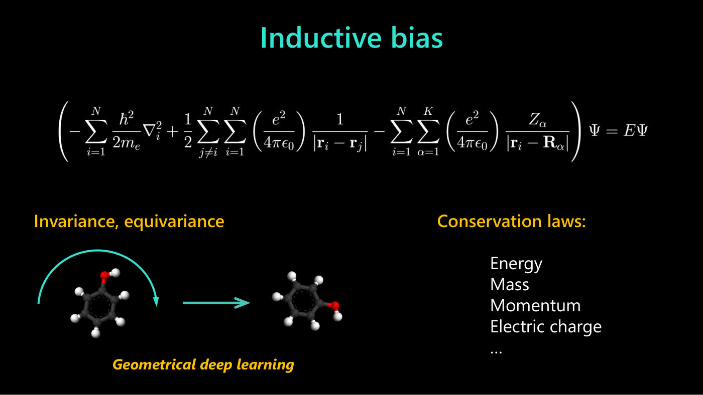

*Slide 7 — inductive biases from physics: Schrödinger's equation, invariance and equivariance under rotation (the molecule and its rotated copy), and conservation laws.*

The third is **conservation laws**: energy, mass, momentum, electric charge and so on are conserved
exactly, and a model should respect them (≈10:59). There are several ways to exploit such inductive
biases (≈10:59–11:45):

- **Bake them into the architecture.** Instead of a general multi-layer perceptron, structure the network
  so that whatever its weights, it always satisfies a conservation or equivariance property.
- **Put the equation in the loss.** Any equation can be written as "something equals zero", so the
  something squared can be a term of the loss function; driving it to zero satisfies the equation.
- Many other ideas people have explored. "They work. They can be quite good. But there's a little catch."

## 7. The bitter lesson (11:45–13:18)

The catch is **the bitter lesson**, a 2019 blog post by Rich Sutton, "one of the pioneers of reinforcement
learning" (≈11:45; slide 8 shows the first part of the essay, "The Bitter Lesson", Rich Sutton, March 13,
2019). Bishop tells everyone to read it by the end of the day, and anyone working in the field to reread
it on the first day of every month: "It could save you a lot of pain" (≈12:31).

Its message, in his summary: over the years many people have improved machine learning systems by baking
in more prior knowledge, but they have always lost out to someone who simply had more data. Computers have
grown exponentially faster, so models and datasets have grown, and "provided data is available, an
important caveat", more compute and more data eventually overtake the clever prior knowledge (≈12:31). The
essay's own opening, on slide 8, says that "general methods that leverage computation are ultimately the
most effective, and by a large margin".

So there is a dilemma: we have beautiful equations we will not ignore, yet data eventually wins (≈13:18).

## 8. Deep learning emulators (13:18–15:38)

The resolution is the **deep learning emulator**, "a sort of shift of mindset" (≈13:18). Normally we would
solve Schrödinger's equation to predict a property of one molecule, but the cost grows exponentially with
the number of electrons, which confines us to small systems. Instead (≈14:05):

1. **Generate data.** Ahead of time, solve the equation many times for many different systems. This is
   expensive, but done once, and it produces a training set.
2. **Train.** Train a neural network on that synthetic data. This also costs something, but far less than
   training a frontier LLM: because the data is expensive to compute, the datasets, and so the models, are
   not huge.
3. **Use.** The trained network is the emulator. The conventional software that solves the equation is
   the **simulator**; it produces the data the emulator is trained on. If it is done right, the emulator
   gives the answer the simulator would, "very, very much faster". Solving differential equations is an
   iterative, computationally intensive numerical process, while the trained network is a feedforward
   function that can be evaluated extremely quickly (≈14:51).

Slide 9 draws this as the equation, an arrow to "Training data", and an arrow to a neural network
labelled "deep learning *emulator*".

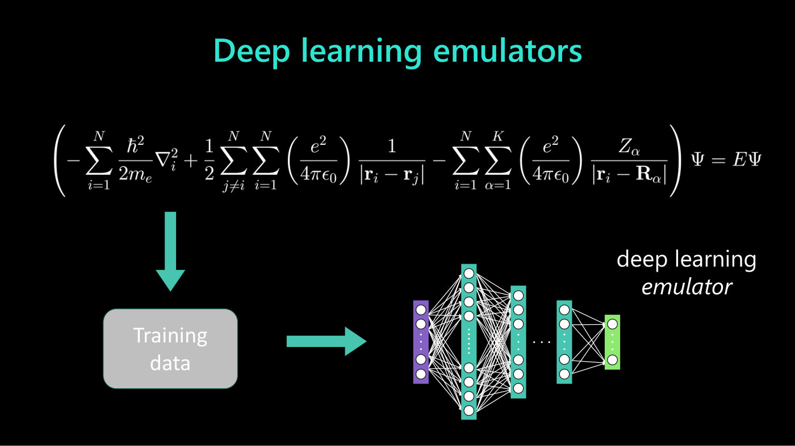

*Slide 9 — the equation generates training data, which trains a neural network: the deep learning emulator.*

Done once, this would not make sense. The point is to use the emulator thousands or millions of times and
**amortize** the cost of data generation and training over those uses (≈15:38).

## 9. Why emulators pay off (15:38–18:41)

Slide 10 lists the benefits, and Bishop goes through them (≈15:38–18:41):

- **Training on synthetic data generated by simulation**: conventional solvers, around for decades, slow
  and expensive.
- **Data that is richly and perfectly labelled.** Images are easy to collect, but labelling them ("this is
  a bicycle, this is a tree") is the expensive part. Here, once the equation is solved, any property can
  be calculated from the solution.
- **No GDPR or privacy issues.** There is no personally identifiable information, unlike, say, patients'
  medical records; "we're just dealing with the solution of differential equations".
- **Quantity limited "only" by compute budget.** People training frontier LLMs complain of running out of
  data. "We'll never run out of data here", and the problems are so vast that more data will always
  improve the results.
- **Exploiting under-utilized compute.** Data generation does not need huge clusters of interconnected
  top-end GPUs: single GPUs, even CPUs, will do. The jobs are massively parallel, so they can soak up
  compute that sits idle (at night in some region, say), even if some jobs are preempted when a customer
  needs the compute.
- **Massive acceleration** over simulation, printed as "≈ $10^3 - 10^{4+}$". In Bishop's words: "more than
  three orders of magnitude. Usually the first thing you try, you're about a few thousand times faster
  than the original simulator", and sometimes much more, depending on the domain. "A factor of a thousand
  is quite transformational" (≈18:41).

## 10. Weather and the Earth system: Aurora (18:41–22:30)

The everyday example is **weather forecasting** (≈18:41). A phone's forecast comes from **numerical weather
prediction**: solving partial differential equations, derived from fundamental physics, for how air flows
under the Coriolis force, pressure gradients, condensation and so on. That needs a supercomputer, fine time
steps, a rich 3D spatial grid, and speed, because the forecast has to "overtake the reality" (≈19:27–20:13).
National centres such as the UK Met Office and NOAA launch such jobs every 6 hours or so (≈20:13).

This is a great target for an emulator: for decades, organizations have been simulating the atmosphere
on supercomputers, so a huge amount of simulated data exists, much of it public. Several teams have
trained weather emulators successfully (≈20:13–20:59). Microsoft's team went a step further. Rather than
emulate one simulator, they trained on very diverse data from many simulators, at different length scales,
resolutions and time scales, to force the model to learn the dynamics of the Earth system, atmosphere and
oceans, more fundamentally. It is a **foundation model**: it can be fine-tuned for particular applications
(≈20:59).

The slides name it: slide 12 shows the first page of the Nature article "A foundation model for the Earth
system" (published online 21 May 2025), whose abstract introduces "Aurora, a large-scale foundation model
trained on more than one million hours of diverse geophysical data", and slide 13 is titled "Aurora" over
a rendering of the globe with no labels or colour scale. Bishop does not say the name aloud. Slide 11,
before them, is an untitled picture of a spiral storm over the ocean, which the talk does not mention.

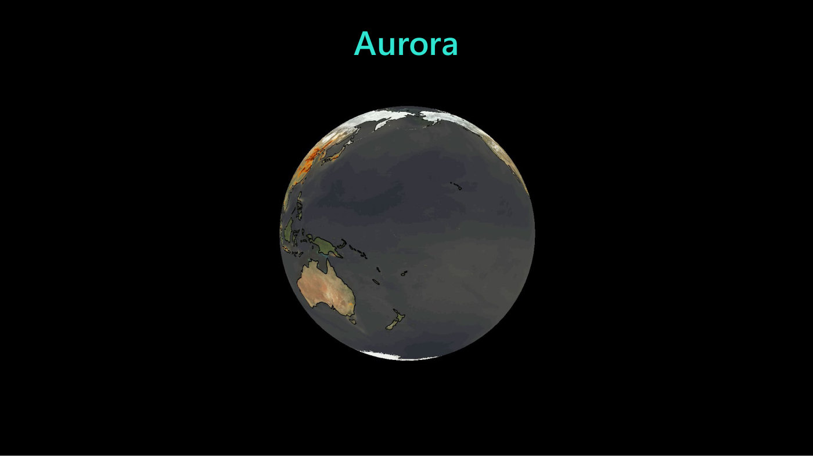

*Slide 13 — "Aurora": a rendering of the globe centred on the Pacific; the slide prints no labels or colour scale.*

One fine-tuning application is predicting the flow of air pollutants, particularly nitrogen oxides
(≈20:59–21:44). Pollution sensors are much sparser than weather sensors, so a model trained on pollution
data alone does not do well. A foundation model trained on weather data and then fine-tuned for pollution
is "the state of the art for predicting pollution flow through the atmosphere" (≈21:44). And it is several
thousand times faster than running simulators: "we can produce the UK 8-day weather forecast in 1 minute
on a single A100 GPU". That is not just faster but "very disruptive": it changes the way we think about
weather forecasting (≈22:30).

## 11. Molecules and materials: MatterGen (22:30–26:21)

The rest of the talk is at the molecular scale, the focus of Bishop's team (≈22:30). Slide 14 lists
application areas under "Molecules and materials": semiconductors, drugs, CO₂ capture, superconductors,
energy storage, catalysts, proteins and batteries.

**MatterGen** (slide 15) applies the idea of [diffusion models](diffusion-models.md) to crystals
(≈23:16). Image diffusion adds noise to images and trains a network to denoise them step by step; MatterGen
does the same for crystals. A crystal is periodic, so it is specified by its **unit cell**: the axes of
the cell, the types and number of atoms, and where they are. Known stable crystal structures are noised
and the model learns to denoise them. Slide 15 shows a rendered crystal (a box of cells holding spheres of
three colours) beside the first page of the Nature article "A generative model for inorganic materials
design" (published online 16 January 2025).

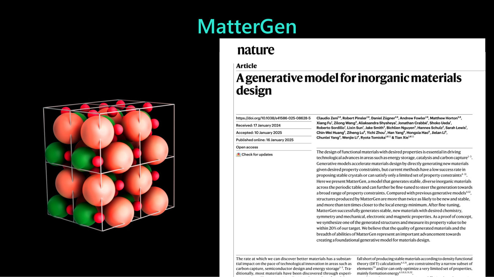

*Slide 15 — MatterGen: a rendered crystal, its unit cells drawn as a wireframe, beside the Nature article.*

A video showed the denoising process; slide 16, a hazy cloud of blobs in a skewed cell, appears to be a
frame of it. The process starts from random and
denoises the types of atoms, the geometry of the unit cell and the atom positions, ending in a stable
configuration (≈23:16–24:03). Put atoms down at random and let go, and "they'd all rearrange themselves.
They wouldn't like it."

MatterGen is a **conditional** diffusion model: it takes desired properties (electronic, magnetic,
mechanical and so on) as input, so it generates new stable crystals with properties of interest rather
than at random (≈24:03). Slide 17's grid of 264 small crystal structures shows "examples of different
crystals generated by MatterGen having different desired physical characteristics" (≈24:50).

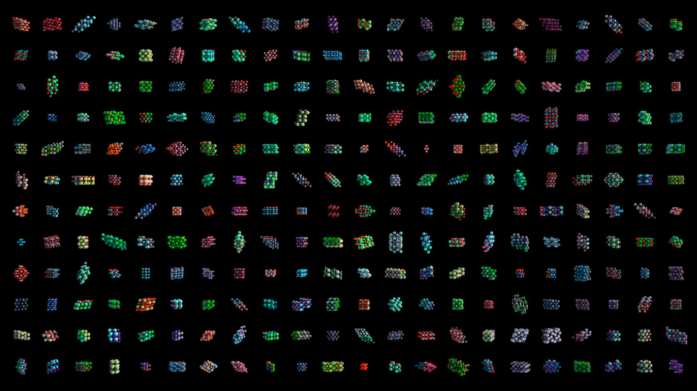

*Slide 17 — a grid of 12 by 22 crystal structures, examples generated by MatterGen for different target properties.*

Why this matters: materials and molecule design is a search problem over a vast space (≈24:50–25:35). The
number of small organic molecules with drug-like characteristics is about $10^{60}$, "like the number of
atoms in the solar system"; materials are probably an even bigger space, and proteins a colossal
combinatorial one. MatterGen does not produce "the miracle material" in one shot. It focuses the search on
a region of chemical space where good candidates are more likely, and the candidates are then screened by
another emulator that calculates the property, thousands of times faster (the captions name it "Matta
Sim"; the slides do not name it). Rather than generating crystals at random and testing them, you ask:
"Please generate magnets that have relatively low rare earth metal content", a further acceleration
(≈25:35–26:21).

## 12. The fundamental trilemma and chemical accuracy (26:21–28:39)

What is the goal, one level down, when looking for a new material or molecule? A trade-off between three
things, slide 18's **fundamental trilemma**: **accuracy**, **speed** and **generality**. "You can have
any two of those, no problem at all, but you need all three" (≈26:21–27:07). Speed means computation, or
cost. Generality means predicting beyond what is already known, at least to similar parts of chemical
space. Accuracy must be sufficient to be of practical value. The work of Bishop's team is finding regions
of this space with better trade-offs than before (≈27:07).

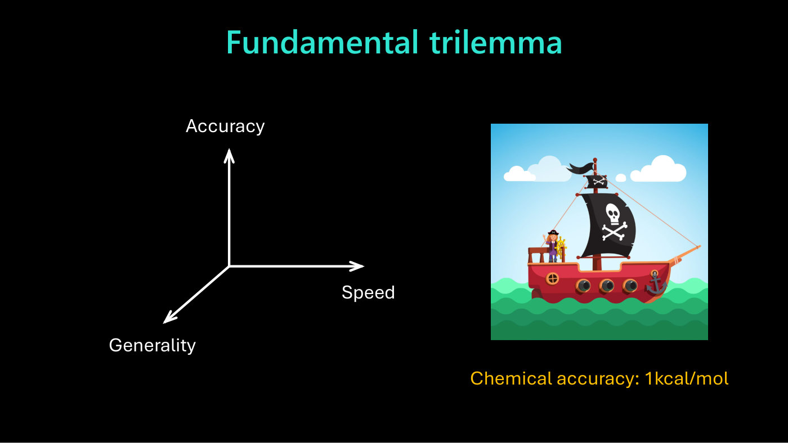

*Slide 18 — accuracy, speed and generality as three axes, and a ship captioned "Chemical accuracy: 1kcal/mol", which goes with the "weigh the captain" analogy.*

The threshold of accuracy is **chemical accuracy**, about a kilocalorie per mole (slide 18, "Chemical
accuracy: 1kcal/mol"; ≈27:07). Roughly, it is the accuracy at which a computational model is as good as
experiment, so that computational experiments could replace many laboratory ones (≈27:53). It is a very
high bar, and Bishop's analogy explains why (≈27:53–28:39). To weigh the captain of a boat, you could weigh
the boat with and without the captain and subtract. That is exact, but the boat is much heavier than the
captain, so both weighings need very high precision. In chemistry, the energy changes of a reaction are
everything, yet they are a small fraction of the system's total energy, so the total energy has to be
calculated with very high precision.

## 13. The wave function and the curse of dimensionality (28:39–30:55)

Next comes "a fairly intense" stretch, the story of one of the team's core projects (≈28:39). Schrödinger's
equation is an equation for the **wave function** $\Psi$, a function over a very high-dimensional space
(slide 19):

$$\Psi(\mathbf{x}_ 1,\ \ldots,\ \mathbf{x}_ N)$$

where $\mathbf{x}_ 1$ to $\mathbf{x}_ N$ are the positions in space of the $N$ electrons, and $\Psi$ is a
function jointly across all of them (≈29:24). The caffeine molecule has two dozen atoms and about 100
electrons, so its $\Psi$ is a function on a 300-dimensional space.

With a simplification that is "not incorrect", imagine solving by dividing the space into a grid
(≈29:24–30:09). In one dimension, 1,000 points; in two, 1,000 by 1,000, a million; in three, a billion.
The number of grid points grows exponentially with the dimension, and so the cost of solving Schrödinger's
equation grows exponentially with the number of electrons. Slide 19's diagram shows the cells multiplying
from $D=1$ to $D=3$. Caffeine, smaller than many drug molecules, is already out of reach: "Nobody's been
able to calculate directly the properties of the caffeine molecule by direct solution of Schrödinger's
equation" (≈30:09). This is the difficulty Dirac meant.

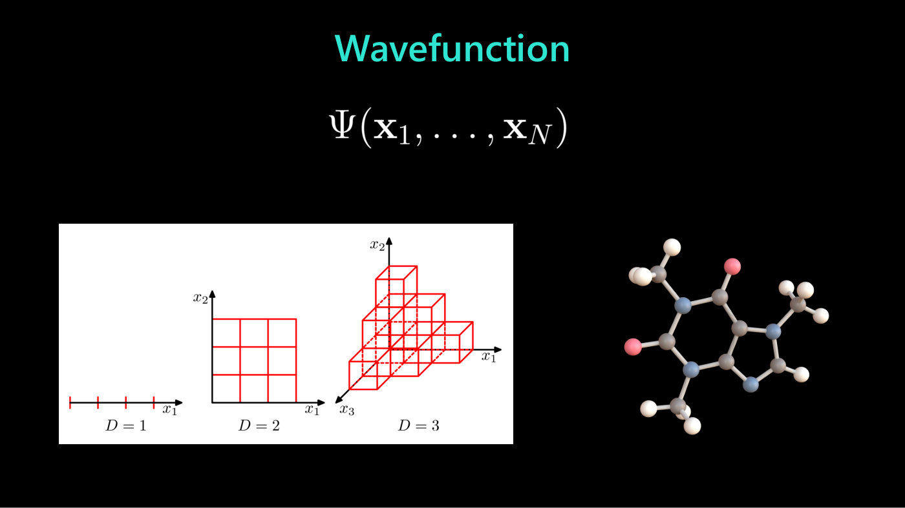

*Slide 19 — the wave function of N electrons; a grid's cells multiply with each added dimension (D = 1, 2, 3), so the cost grows exponentially.*

## 14. Density functional theory (30:09–33:15)

"But, something really interesting happened in 1965" (≈30:09). Walter Kohn discovered that we do not need
the wave function at all. We can instead compute a much simpler quantity, the **electron density**: the
density of electronic charge over space, a function of just three dimensions. Computing the wave function
costs exponentially, but the density costs only cubically in the number of electrons, and everything we
want to know can be calculated from it (≈30:55). Slide 20 writes this as

$$\Psi(\mathbf{x}_ 1,\ \ldots,\ \mathbf{x}_ N)\rightarrow\rho(\mathbf{x})$$

with the computational cost going from $\exp(N)$ to $N^3$, and the word "Exact!".

That is the extraordinary part (≈31:41). Computer science is full of exponentially or combinatorially hard
problems with approximation schemes that work well in practice. This is not an approximation but "an exact
transformation of an exponential problem into a cubic problem". In 1998 Kohn received the Nobel Prize in
Chemistry for the discovery of **density functional theory** (DFT; ≈31:41). It became one of the most
highly cited topics in all of science. Slide 20's bar chart of citations per year grows from about 200 in
1987 to about 17,800 in 2022, as computers made DFT more and more practical. Roughly, it is "the only
practical method we have of solving Schrödinger's equation for realistic systems" (≈31:41–32:28). Slide 20's
pie chart, from a national supercomputer centre in the US, shows DFT as the largest share of its
scientific simulation workload; Bishop says it is "maybe a third" (≈32:28).

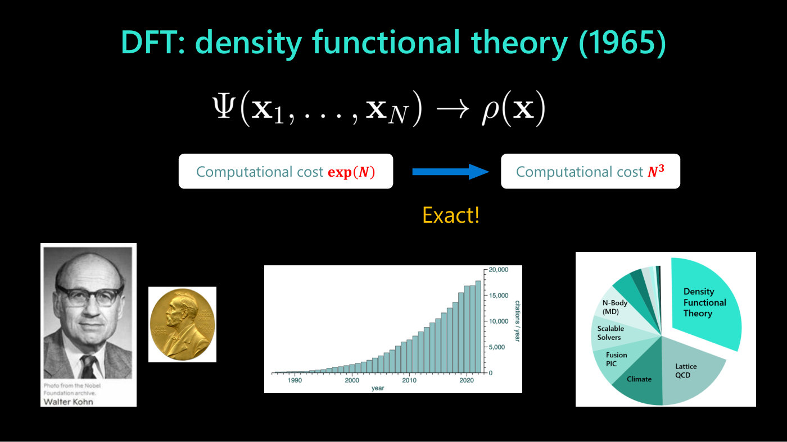

*Slide 20 — DFT replaces the wave function by the electron density, from exponential to cubic cost; Walter Kohn and his Nobel medal, DFT's citations per year, and its share of a supercomputer centre's workload.*

Slide 21 is "a little cartoon analogy to help you remember this" (≈32:28–33:15): a plastic molecular model
in three-dimensional space stands for the complicated wave function, and its shadow on the wall, which
spells "DFT", is the lower-dimensional projection we work with instead. Bishop adds that the photograph is
not AI-generated: "somebody did actually plug these bits of plastic together".

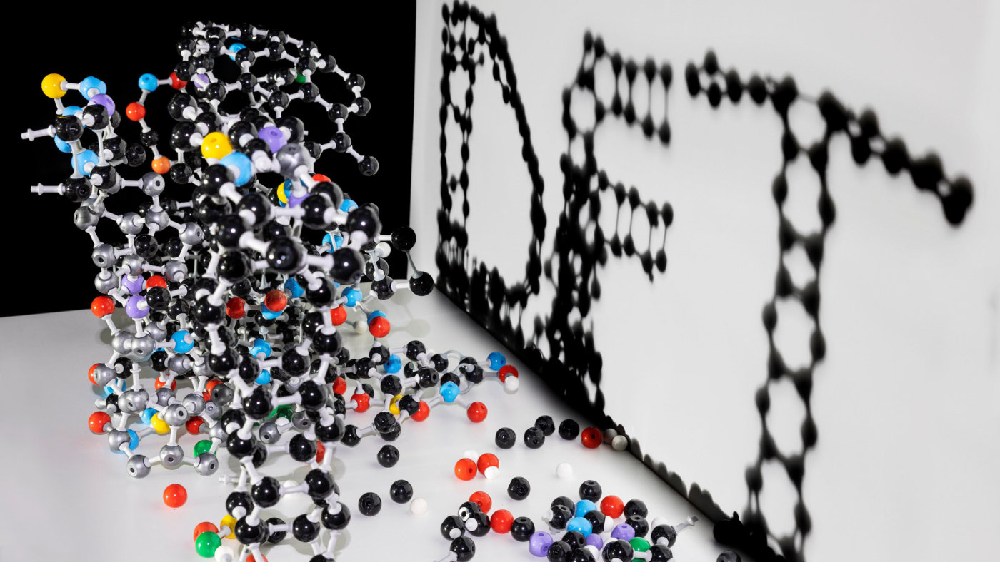

*Slide 21 — the analogy: the molecular model is the wave function, its shadow (which reads "DFT") the electron density.*

## 15. The catch: the exchange-correlation functional (33:15–35:33)

An exact, cubic-time solution of an exponentially hard problem sounds too good to be true, "and in a way,
it is" (≈33:15). Kohn wrote down the **Kohn-Sham equations**, iterative equations solved instead of
Schrödinger's equation, with cubic cost. But they contain a small term, the **exchange-correlation
functional**, written $E_{\mathrm{XC}}[\rho]$ on slide 22 (≈34:02). Because chemistry needs such high
precision, this small term has to be accurate.

Kohn showed that it is **universal**: a single exchange-correlation functional describes the whole of
molecular space, crystals, proteins, molecules, everything (slide 22, "It's universal!"; ≈34:02). But he
could not write down its explicit form, "so it's a mystery" (≈34:02). Over the last 60 years people have
invented **handcrafted approximations** instead: about 800 are in use today (≈34:48). They are
sometimes called "the zoo", or **Jacob's ladder**, because they can be arranged in a sequence from cheap
and inaccurate to expensive and accurate. Each suits a sub-domain (molecules, crystals, metals), and the
universal functional is what is missing (≈34:48). Slide 22 shows these as a word cloud of functional names
(B3LYP, PBE, LSDA and dozens more). It also shows the 2002 Science perspective "In Pursuit of the "Divine"
Functional" by Ann E. Mattsson, which lamented that the field had gone down a rabbit hole of handcrafted
functionals and lost sight of DFT being an exact theory with a universal functional (≈34:48–35:33).

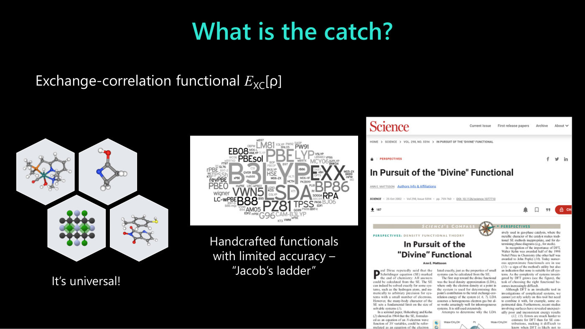

*Slide 22 — the exchange-correlation functional is universal, but in practice it is replaced by handcrafted approximations (the word cloud of their names, "Jacob's ladder"); right, the 2002 Science perspective "In Pursuit of the "Divine" Functional".*

## 16. The DFT zoo (35:33–36:19)

Slide 23, "The DFT zoo", shows the trade-off (≈35:33–36:19). Bishop describes its vertical axis as "the
error in kilocalories per mole" (the axis prints no label); the blue band at the bottom, up to about 1, is
chemical accuracy. The horizontal axis is computational scaling, with four positions: $N^3$, $N^3$
(larger prefactor), $N^4$ and $N^5$. Four handcrafted functionals are plotted, one at each position, using
two to five features:

| Functional | Features | Scaling | Error (read by eye) |
| --- | --- | --- | --- |
| revPBE-D3 | 2 | $N^3$ | about 8.7 |
| B97M-rV | 3 | $N^3$ (larger prefactor) | about 6.7 |
| wB97M-V | 4 | $N^4$ | about 3.7 |
| wB97M(2) | 5 | $N^5$ | about 2.0 |

The cubic ones on the left are "very affordable, but the accuracy is terrible"; the $N^5$ ones start to
approach chemical accuracy but get very expensive (≈36:19). A red curve falls through the points, and a
Nobel medal and the label "Universal functional" sit at the lower left, inside the cubic, chemically
accurate corner. That is where Kohn's result says a single universal functional should be: chemical
accuracy or better at cubic scaling (≈36:19).

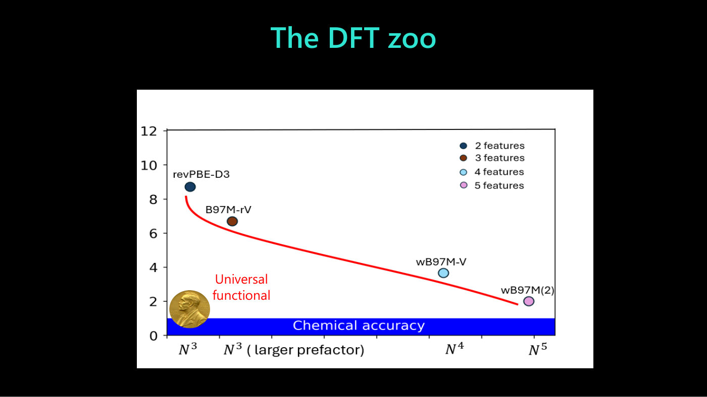

*Slide 23 — handcrafted functionals trade cost against error; the universal functional should sit in the cheap, chemically accurate corner.*

## 17. Learning the functional: Skala (36:19–40:08)

So why not **learn** the exchange-correlation functional? "Kind of an obvious idea really", and many have
tried; the most accurate learned functionals have been very slow, and none has been both accurate and fast
(≈36:19–37:05). Bishop's team has worked on this since the team began, more than three years, "kind of
under the radar", going public a few months before the talk (≈37:05). The result is **Skala**, "from the
Italian for ladder" (slide 24, which cites arXiv:2506.14665). Two things are different.

**The architecture** (≈37:05–38:36; slide 24). Within the Kohn-Sham equations the electron density is
updated iteratively, and the energy is needed at each step. Most of its terms (slide 24 lists the
"Hartree energy, KS kinetic energy, electron-nucleus Coulomb potential") are easy to calculate but not
accurate enough without the final, exchange-correlation term, and that is where machine learning comes in.
The electron density is represented as a point cloud, perhaps a million points. The energy depends on the
density non-locally, and even pairwise interactions among a million points ("a million times a million")
would be out of hand. So the model uses a lower-dimensional representation centred on the atoms: **message
passing** from the point cloud to the atom centres, between atom centres, and back out to the point cloud.
That makes it scalable while still learning the functional accurately.

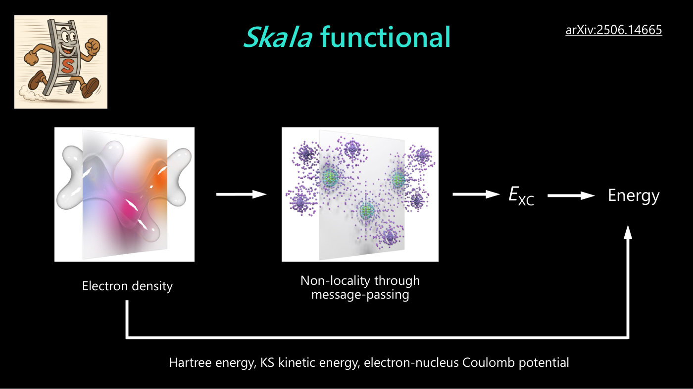

*Slide 24 — Skala: the electron density passes through message-passing layers to give the exchange-correlation energy E_XC; the other energy terms are calculated directly.*

**More data** (≈38:36). Over three years the team solved Schrödinger's equation with standard quantum
chemistry methods to produce highly accurate training data for the functional. How much more than before
is garbled in the captions ("For an order of magnitude than the totality of all the public data previously
available"); the comparison is with all the public data previously available.

**The results** (slide 25; ≈38:36–39:22). The chart plots eight functionals by their error on two
benchmarks, both in kcal/mol. The horizontal axis is "Error on general main-group chemistry"; the vertical
axis, which Bishop describes as "the total energy of the molecule", is labelled "Error on atomization
energies". Dashed lines and green shading mark chemical accuracy, 1 kcal/mol, on each axis. Marker shape
gives nominal complexity: circles $O(N^3)$, triangles $O(N^4)$. Colour gives functional class: GGA,
meta-GGA, non-local meta-GGA, hybrid.

| Functional | Class | Complexity | General chemistry | Atomization energies |
| --- | --- | --- | --- | --- |
| revPBE | GGA | $O(N^3)$ | about 8.3 | about 8.05 |
| r²SCAN | meta-GGA | $O(N^3)$ | about 7.25 | about 4.45 |
| B3LYP | hybrid | $O(N^4)$ | about 6.4 | about 3.8 |
| B97M-V | meta-GGA | $O(N^3)$ | about 5.55 | about 2.85 |
| M06-2X | hybrid | $O(N^4)$ | about 4.85 | about 3.0 |
| ωB97X-V | hybrid | $O(N^4)$ | about 3.95 | about 2.6 |
| ωB97M-V | hybrid | $O(N^4)$ | about 3.2 | about 2.05 |
| **Skala** | non-local meta-GGA | $O(N^3)$ | about 3.9 | about 1.05 |

(Values read by eye from the chart.) In Bishop's words, Skala "achieves chemical accuracy on the
fundamental question of atomization energy and is comparable with other functionals having quartic
scaling for more general chemistry", while being plotted as a cubic-complexity circle (≈39:22).

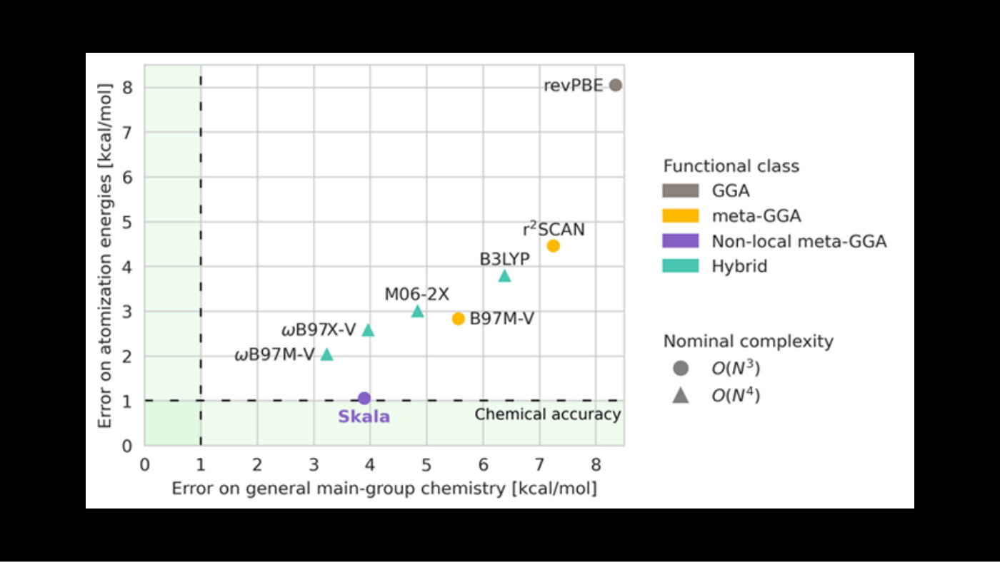

*Slide 25 — Skala (purple) is the only functional at the chemical-accuracy line for atomization energies, and sits among the quartic hybrids on general chemistry.*

The limitations of Skala today: it applies only to molecules, not yet materials, and only to the so-called
main-group elements, not yet transition metals (≈39:22). Even so it generalizes quite well, perhaps
because what is being learned is a universal functional. Bishop calls it "a 50-year-old grand challenge at
the heart of physics" (≈39:22–40:08).

## 18. Biology: sequence, structure, function (40:08–41:40)

How far can this go? "Biology looks crazy big and complicated" (≈40:08). Slide 26 is "the whole of
biology in one slide": DNA sequence leads to RNA sequence, which specifies the amino-acid sequence of a
protein; the protein folds into a 3D structure; and structure, together with the protein's dynamics,
determines **function** (≈40:08–40:53). Sequencing DNA and proteins earned two Nobel prizes, both to Fred
Sanger in Cambridge ("the other Cambridge"), and protein structure has had its Nobel prizes recently (the
captions are unclear on when). What really matters is function, and function is about **dynamics**:
proteins open and close, dock with other proteins, and interact with molecules. Dynamics is "the last big
piece of this puzzle" (≈40:53).

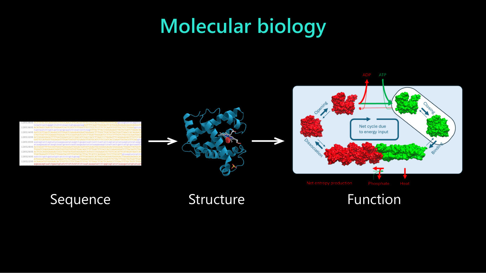

*Slide 26 — molecular biology: sequence determines structure, which determines function, drawn as a protein cycling between open and closed forms as ATP is used.*

## 19. Molecular dynamics and the curse of sequentiality (41:40–43:57)

In principle we know the equations, so we can compute: this is **molecular dynamics** (MD; ≈41:40). Each
atom (the position of its nucleus) has a position $\mathbf{x}_ i$ and a velocity $\mathbf{v}_ i$, treated
classically with Newton's second law, and updated step by step through time. Slide 27 prints

$$\frac{d\mathbf{x}_ i}{dt}=\mathbf{v}_ i$$

$$m_i\frac{d\mathbf{v}_ i}{dt}=-\nabla_i U(\mathbf{x}_ 1,\ \ldots,\ \mathbf{x}_ N)$$

with the force term boxed in red. Here $m_i$ is the atom's mass and the right-hand side is the force, the
gradient of the energy $U$. That energy comes from quantum physics, determined by the electrons (≈41:40).

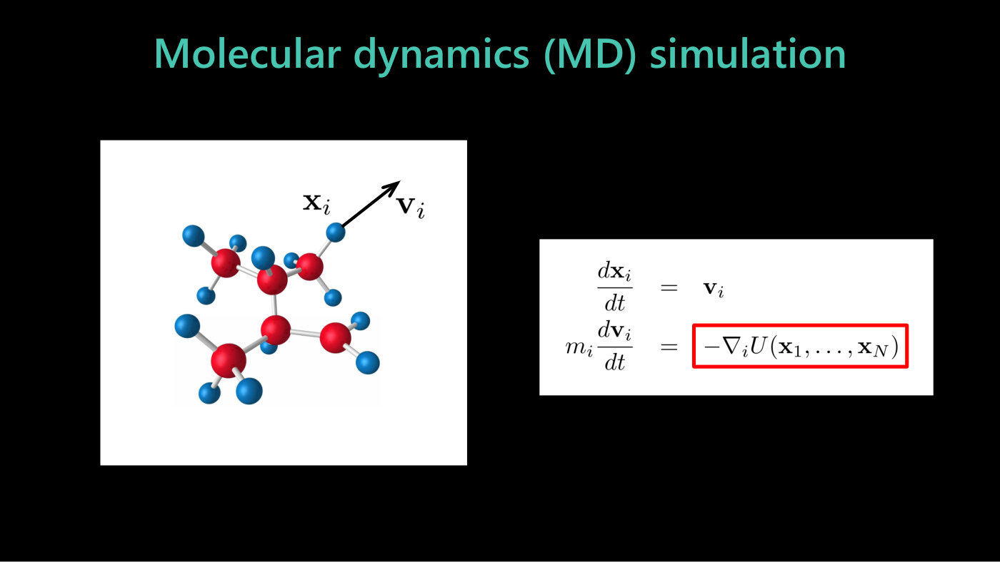

*Slide 27 — molecular dynamics: each atom's position and velocity, updated by Newton's second law, with the quantum-mechanical force term boxed.*

That gives two massive challenges (≈41:40–42:25). The first: at each integration step we should, in
principle, solve Schrödinger's equation, which is extremely hard. The second is the **curse of
sequentiality** (slide 28). On a log scale of time, atoms vibrate and rotate on a femtosecond scale, so
to follow them the time step must be about a femtosecond. But the interesting processes, protein folding
for example, take milliseconds (≈42:25). So "we need something between 10 to the 6 or even 10 to the 15
sequential steps" (≈43:11; slide 28, "Simulations with current MD technology require $10^6$ to $10^{15}$
sequential steps"), each needing quantum-mechanical forces.

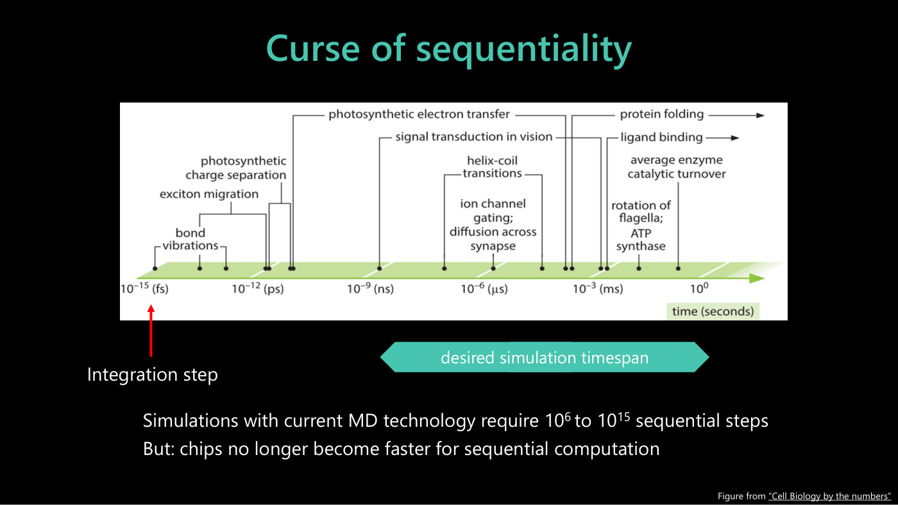

*Slide 28 — biological processes on a log time axis from femtoseconds to seconds: the MD integration step sits at the femtosecond end, far below the desired simulation timespan.*

Waiting for faster computers does not help, because the computation is intrinsically sequential and clock
speeds have not changed for years; if anything, chips are getting slightly slower. The speed-up from GPUs
comes from massive parallelism, which a sequential process cannot use (slide 28, "But: chips no longer
become faster for sequential computation"; ≈43:11). "So, it's sort of a double whammy."

## 20. Emulating protein dynamics (43:57–45:29)

Work from "a couple of years ago" tackles this with emulation and several carefully controlled
approximations (≈43:57). Slide 29 names it: the Nature article "Ab initio characterization of protein
molecular dynamics with AI²BMD" (published online 6 November 2024); Bishop does not say the name aloud.
A protein is split into **chunks** of atoms, and the forces between the chunks are computed with DFT.
Bigger chunks mean fewer things to integrate but more complicated forces, so the chunks are as big as
possible while still giving an accurate machine-learned emulator. DFT computes the forces for many
configurations, an emulator is trained on them, and molecular dynamics then runs on the chunks with each
update "just a call to a trained emulator", with no iteration (≈43:57–44:43). This allows MD for proteins
of up to about 10,000 atoms, against a starting point where caffeine was out of reach (≈44:43). It is the
same hierarchy as before: data from one level trains the emulator at the next.

A step further avoids the dynamics altogether (≈44:43–45:29). Data from MD simulations is combined with
experimental data to **sample directly from the equilibrium distribution** of a protein's shapes. That
work was published in Science a few months before the talk, and the editors put it on the cover (slide 30:
Science, 14 August 2025, "PROTEIN SHAKE", "Generative deep learning powers emulation of protein
ensembles"). In the questions Bishop calls the project "a biomolecular emulator" and adds that it was
trained on molecular dynamics data and then fine-tuned on experimental X-ray diffraction data (≈47:47,
≈56:13). See section 22.

## 21. The book (45:29–47:00)

Bishop closes with "a shameless plug" (slide 31): *Deep Learning: Foundations and Concepts*, by Christopher
M. Bishop with Hugh Bishop, his son, who also works in machine learning (≈45:29–47:00). It is freely
available online at bishopbook.com as a high-resolution digital version. The hardback is bound with
"stitched signatures", sheets printed, folded, trimmed and stitched with cord, so it lies flat and lasts,
unlike glued bindings whose pages fall out (≈46:15). It has been Springer Nature's best-selling book for
two years running, out of about 13,000 new titles a year (≈46:15; slide 31, "Springer-Nature's
best-selling book of 2024 and 2025!"). The slide shows the cover and an online reader open at pages
392–393, from the chapter on transformers.

## 22. Questions (47:00–58:31)

**How is the team working on protein function?** (≈47:00–48:33). The main project is a **biomolecular
emulator**, whose first major output was the Science paper on the cover. Sequencing is cheap (your entire
DNA "for \$1,000 or whatever it is"), and structure is "sort of largely solved"; what is unsolved is
protein dynamics. The ambition is to solve "what's sometimes called the sampling problem": how to sample
efficiently from a complex distribution (≈48:33). Running molecular dynamics forever would sample every
well of the energy surface in the correct proportion, but that is an infinitely expensive route. The goal
is to know the wells and their relative proportions directly. A well might be, say, the open or closed
conformation of the spike protein of the COVID-19 virus (≈49:19). Crossing a high energy barrier is a rare
event, so plain MD is very inefficient at finding it. The first paper is "the first light dawn" that
direct sampling may be possible, so far for one protein in vacuum. Next come proteins interacting with
each other and in water, closer to clinical and biological relevance (≈49:19–50:05).

**Does the no free lunch theorem limit emulators? Can a model trained on two- or three-electron systems
solve harder ones? And why emulate weather when there is plenty of data?** (≈50:05–53:55). Bishop takes
it as at least three questions:

- **Invariances, without baking them in.** Rather than build rotational equivariance into the
  architecture, replicate the data: rotate a molecule into a hundred orientations, all labelled with the
  same energy. That is **data augmentation**: simple, it allows more general architectures, and the model
  learns the invariance, though not exactly. "Really, what the bitter lesson is telling us at the end of
  the day, just more data and just learn these things" (≈50:51–51:36).
- **Why keep DFT in the hierarchy?** He reads the second question in terms of his own work. Why spend three
  years generating quantum chemistry data to learn a functional for DFT, which is still iterative and
  cubic, rather than train a fast emulator directly on the quantum chemistry data (≈51:36–52:23)? Because
  DFT carries a great deal of inductive bias. For instance, the wave function must be antisymmetric (Pauli's
  exclusion principle, "why atoms exist"). Much of the energy is straightforward to calculate, and only the
  exchange-correlation term is hard; "to throw away all of that physics is to give up an enormous amount"
  (≈52:23–53:08). The answer does not take up weather separately.
- **Generalization.** Besides the physics DFT embeds, the functional is universal. Handcrafted functionals
  each suit one domain, but a learned universal functional should generalize. The team sees "remarkable
  generalization to chemistry problems outside the domain" and hypothesizes that universality is part of
  the reason (≈53:08–53:55).

**With simulated data, is there a second no free lunch, a gap between simulated and real data?**
(≈53:55–56:58). Experimental data plays two roles. First, it is always fundamental: "If it doesn't agree
with experiment, we're wrong", and the scientific method does not change. Second, it complements
computational data. The biomolecular emulator was trained on MD data and then fine-tuned on experimental
data from X-ray diffraction (≈55:27–56:13). Combining prior knowledge with data remains "a fundamental
cornerstone of machine learning". Generating data from the equations is a way of "extracting that prior
knowledge in the form of data", in the spirit of the bitter lesson (≈56:13).

**Could AI-driven biomolecular dynamics predict off-target interactions of therapeutics before in vivo
studies?** (≈56:58–58:31). "I certainly hope so." The whole machinery of a cell is "orders and orders of
magnitude more complex still". Bishop does not expect a first-principles simulation of an entire human
cell from Schrödinger's equation in his lifetime, or perhaps the next 100 years (≈57:45). But off-target
interactions of drugs could be informed by MD simulations accelerated with emulators. Many drugs fail at
the clinical stage through toxicity and off-target interactions, so catching them at discovery makes drug
discovery faster and cheaper, and he hopes for real clinical relevance "within the next two or three
years or so" (≈57:45–58:31).

## Spoken versus printed

- **"13 significant figures"** (≈2:31): slide 3's two values, 1.001 159 652 181 13 and
  1.001 159 652 180 73, share their first 12 significant figures and differ by 40 in their last two
  printed digits, which is within the theory's stated ±86.
- **Unnamed aloud**: Aurora (slides 12–13) and AI²BMD (slide 29) are named only on the slides.
- **Slide 23's vertical axis** prints no label; Bishop calls it the error in kilocalories per mole.
- **Slide 25's vertical axis** is labelled "Error on atomization energies [kcal/mol]"; Bishop describes it
  as "just the total energy of the molecule" (≈38:36).
- **Protein size**: aloud, MD "for proteins up to about 10,000 atoms" (≈44:43); slide 29's abstract says
  "various proteins comprising more than 10,000 atoms".
- **The book's year**: the captions give "published at the end of 2003" (≈45:29), an [Ed] note in the
  transcript. Slide 31 prints no year, and calls it Springer-Nature's best-selling book of 2024 and 2025;
  Bishop says it has been the best seller "for 2 years running since this was published" (≈46:15).
- **Not discussed**: slide 11's storm, slide 14's application areas beyond "you can see some of them listed
  here" (≈23:16), the Nature article pages of slides 12, 15 and 29, and the screenshot pages of the book
  on slide 31.

## Where this connects

- [AI for science](ai-for-science.md) — the topic page for this lecture's ideas: emulators, inductive bias
  against data, and the examples.
- [Diffusion models](diffusion-models.md) — MatterGen is a conditional diffusion model for crystals;
  [lecture 6](06-language-models-new-frontiers.md) (section 20) introduces diffusion for molecules and
  proteins.
- [Large language models](large-language-models.md) and [attention and transformers](attention-and-transformers.md)
  — the data-heavy, lightly biased end of slide 6's balance.
- [Generative modeling](generative-modeling.md) — sampling new examples from a learned distribution, here
  crystals and protein conformations.
- [Reinforcement learning](reinforcement-learning.md) — the field of Rich Sutton, author of "The Bitter
  Lesson".
