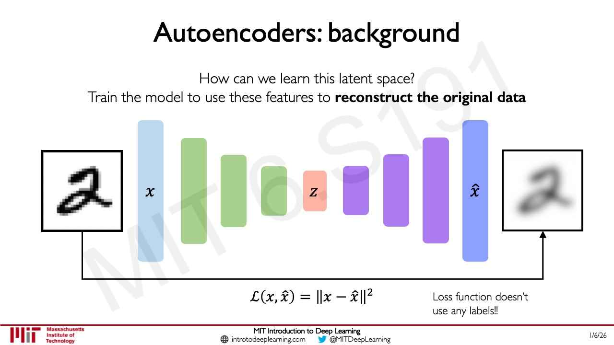
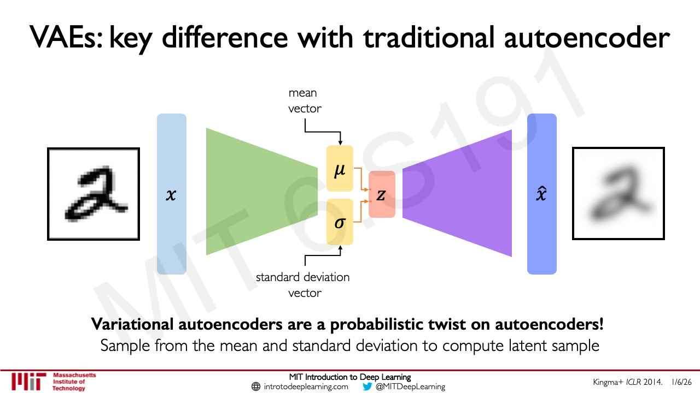
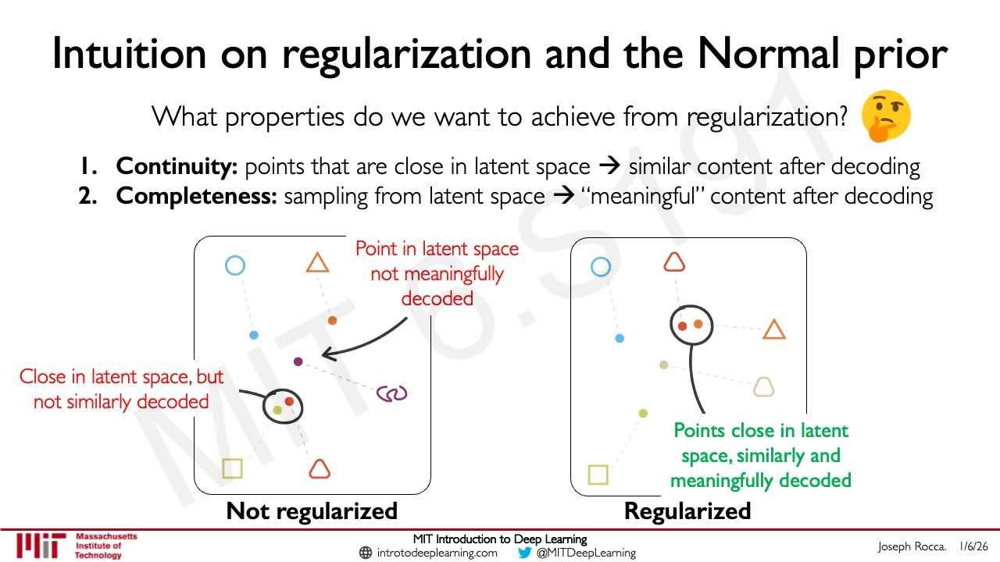
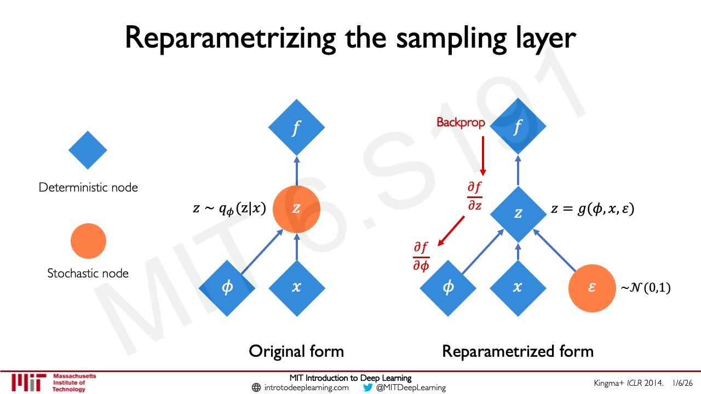
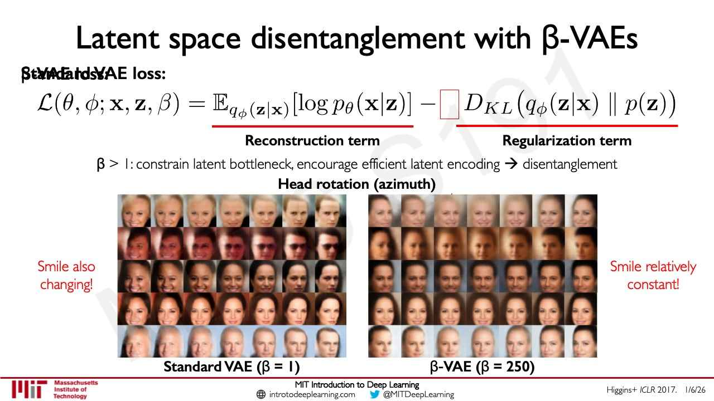

# Autoencoders and variational autoencoders (VAEs)

An **autoencoder** learns to compress data into a small set of latent variables and to rebuild the
data from them, using the reconstruction itself as the training signal, so it needs no labels. A
**variational autoencoder (VAE)** makes that latent space probabilistic, so that it can be sampled to
generate new data. This page follows MIT 6.S191 [lecture 4](04-deep-generative-modeling.md), sections
6–14 (≈11:40–34:13). For the wider context see [generative modeling](generative-modeling.md).

Notation: $x$ is the input, $\hat{x}$ its reconstruction, $z$ the latent variables; $\mu$ and $\sigma$
are the vectors of means and standard deviations a VAE's encoder outputs; $\phi$ and $\theta$ are the
encoder's and decoder's weights.

## Autoencoders

The **encoder** maps the input $x$ — an image, say — through layers of a network down to a
low-dimensional latent space $z$, which can be thought of as a representation of the core features of
the data (lecture 4, slide 13, ≈11:40–12:26). A low-dimensional $z$ is a form of **compression**:
complex data distilled into their main axes of variability (≈12:26–13:13).

With no labels, the trick is to have the model **reconstruct its own input** (≈13:13). A **decoder**
maps back from $z$ to a reconstruction $\hat{x}$, and the loss compares the two — for images, a
pixel-wise difference (slides 14–15, ≈13:59–14:46):

$$\mathcal{L}(x, \hat{x}) = \Vert x - \hat{x} \Vert^2$$

"Loss function doesn't use any labels!!" (slide 15). See [loss functions](loss-functions.md).

*Lecture 4, slide 15 — encoder, latent z, decoder, and a loss comparing the input digit with its blurred reconstruction.*

The latent dimension sets a **bottleneck**: a smaller latent space forces more compression, a larger
one less, though too large defeats the purpose of learning a small set of latent variables
(≈15:33–16:20). Slide 17 shows handwritten digits reconstructed through a 2D latent space (blurry) and
a 5D one (much sharper). The bottleneck forces a compressed representation, and the reconstruction loss
forces it to keep as much "information" about the data as possible: this is **representation
learning** ("Autoencoding = Automatically encoding data", slide 18, ≈16:20–17:07).

A traditional autoencoder is **deterministic**: the same input always gives the same reconstruction,
so there is no distribution to sample and it is "not so useful for generating new samples"
(slide 20, ≈17:07–17:53).

## Variational autoencoders

A VAE replaces the deterministic latent layer with a **sampling operation** (≈17:53–18:40). The encoder
outputs, for each latent variable, a mean and a standard deviation — a "mean vector" $\mu$ and a
"standard deviation vector" $\sigma$ (slide 22; the lecturer says "a mean and a variance") — and the
latent sample $z$ is drawn from the distribution they define. "Variational autoencoders are a
probabilistic twist on autoencoders!" (slide 22).

*Lecture 4, slide 22 — the encoder outputs a mean vector and a standard deviation vector; z is sampled from them.*

The encoder now computes a distribution over the latent variables given the input, $q_{\phi}(z \mid x)$,
and the decoder a distribution over the data given the latent variables, $p_{\theta}(x \mid z)$
(slide 23, ≈19:26–20:13). The loss has two terms, and depends on both sets of weights (slide 24,
≈20:13–20:59):

$$\mathcal{L}(\phi, \theta, x) = (\text{reconstruction loss}) + (\text{regularization term})$$

The **reconstruction loss** compares input and output as before ("e.g. log-likelihood,
$\Vert x - \hat{x} \Vert^2$", slide 26). The **regularization term**, also called a distributional
loss, is a distance $D$ between the inferred latent distribution and a fixed **prior** $p(z)$ (slide 27,
≈21:47–22:35):

$$D\left(q_{\phi}(z \mid x) \Vert p(z)\right)$$

## The Normal prior

The usual prior is a standard Gaussian, $p(z) = \mathcal{N}(\mu = 0, \sigma^2 = 1)$, whatever the size
of the encoder and decoder (slide 28, ≈23:21). It encourages encodings to spread evenly around the
centre of the latent space, and penalizes the network for "cheating" by clustering points in specific
regions, that is, by memorizing the data (slide 28). Slide 29 names $D$ the **KL-divergence** and
prints its expansion; the lecture does not discuss it, and as printed its sign makes it never positive
(see [lecture 4](04-deep-generative-modeling.md), section 9).

Why a Normal prior? A good latent space should have **continuity** — nearby points decode to similar
content — and **completeness** — any sampled point decodes to something meaningful (slide 30,
≈24:08–25:41). An unregularized encoding can lose both: nearby points that decode to a square and a
triangle, and regions that decode to nothing. Not every prior fixes this: if the variances are small
the distributions are pointed, and if the means differ the space has discontinuities (slide 31,
≈26:28–27:14). The Normal prior **centres the means and regularizes the variances**, which promotes
continuity and completeness (slides 31–32, ≈27:14). It does not collapse every latent variable to mean
0 and variance 1, because the reconstruction term pulls the other way; the two terms are balanced by
weighting (≈28:00).

*Lecture 4, slide 30 — what regularization buys: nearby latent points decoding alike, and no meaningless regions.*

## Training: the reparametrization trick

Gradients cannot be backpropagated through a sampling step (slide 34, ≈28:47). The fix is to
**reparametrize** the sampling (slide 35, ≈28:47–29:34): treat the latent vector as a fixed $\mu$ plus a
fixed $\sigma$ scaled by random noise drawn from the prior,

$$z = \mu + \sigma \odot \varepsilon, \quad \varepsilon \sim \mathcal{N}(0, 1)$$

so that the randomness sits in $\varepsilon$, which is not learned, while $z$ becomes a deterministic
node that gradients can pass through to the encoder's weights $\phi$ (slides 36–37, ≈29:34–30:20). See
[backpropagation](backpropagation.md).

*Lecture 4, slide 37 — original form (left): backpropagation stops at the stochastic z; reparametrized form (right): the noise is a separate input and gradients reach phi.*

## Interpreting and using the latent space

In a well-trained VAE the latent variables capture individual features: perturb one, keep the others
fixed, decode, and the output changes in one interpretable way — a face's head pose, for instance
(slide 39, ≈31:54–33:26). The slides (not the talk) go on to **disentanglement**: latent variables
should ideally be uncorrelated, which a diagonal prior encourages (slide 40), and a **β-VAE** adds a
parameter $\beta$ to the loss — slide 41 lists it among the loss's arguments and leaves an empty box in
front of the regularization term — with the rule "β > 1: constrain latent bottleneck, encourage
efficient latent encoding → disentanglement" (slide 41, credited Higgins+ *ICLR* 2017). Slide 41's faces rotate with the
smile changing too under a standard VAE ($\beta = 1$), and with the smile "relatively constant" under a
β-VAE ($\beta = 250$).

*Lecture 4, slide 41 — standard VAE against beta-VAE: only the beta-VAE separates head rotation from smile.*

The course's second lab uses a VAE's latent distribution together with a CNN to debias a facial
detection system (slide 42, ≈33:26). Sampling the latent space and decoding generates new examples.

The lecture's summary (slides 43–47): compress a representation of the world into something usable for
learning; reconstruction allows unsupervised learning; the reparameterization trick trains end-to-end;
perturbation interprets the hidden latent variables; and the model generates new examples.

## Where this comes up

- [Lecture 4 — Deep Generative Modeling](04-deep-generative-modeling.md), sections 5–14.
- [Lecture 5 — Reinforcement Learning](05-reinforcement-learning.md), section 17: a policy over a
  continuous action that, like a VAE's encoder, outputs a mean and a variance and is sampled.
- [Lecture 6 — Language Models and New Frontiers](06-language-models-new-frontiers.md), sections 13–14: VAEs and GANs
  generate in one shot, which [diffusion models](diffusion-models.md) replace with iterative denoising.
