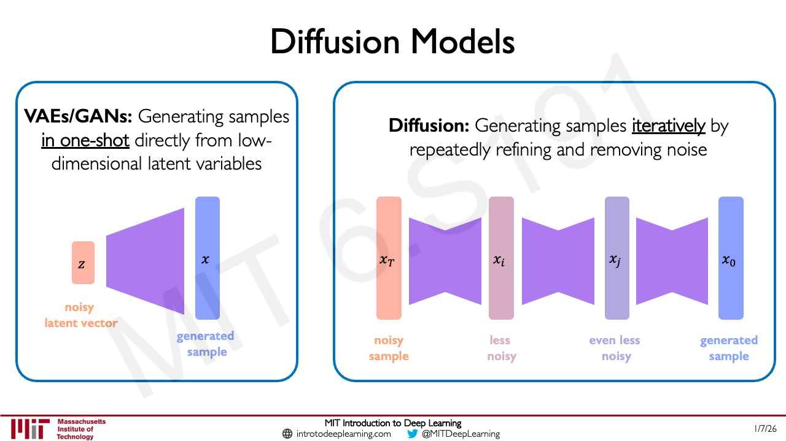
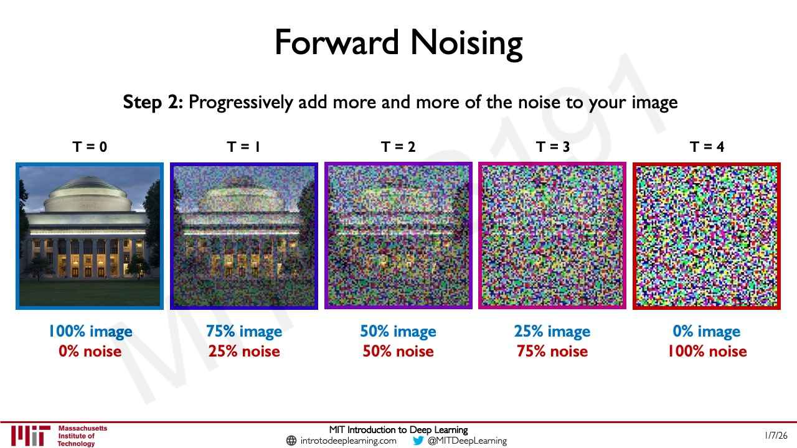
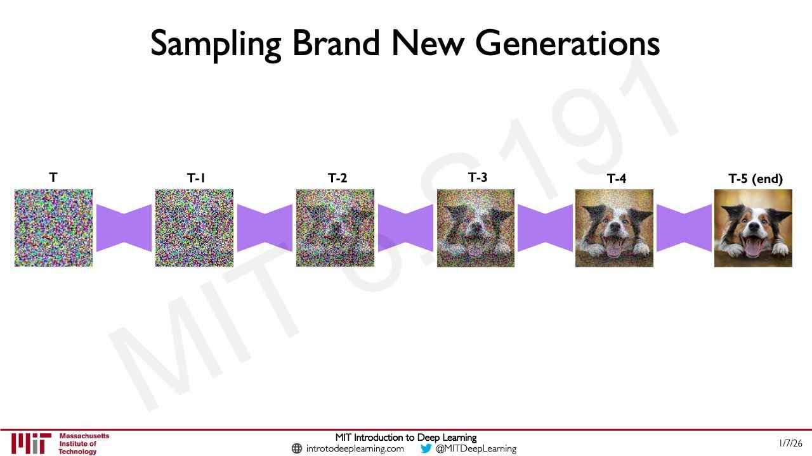
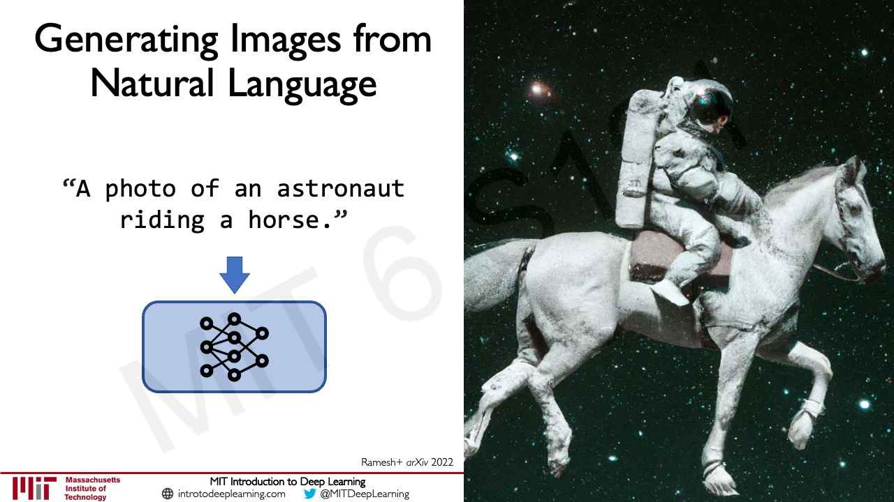

# Diffusion models

A **diffusion model** generates data by starting from random noise and removing it a little at a time.
It is trained on pairs made by doing the opposite — adding noise to real data step by step — so that a
network learns to undo one step of noise. Lecture 6 presents diffusion as one of the dominant paradigms
of generative modeling today and the backbone of most text-to-image systems (≈30:22–31:08). Citations
are to [lecture 6](06-language-models-new-frontiers.md) unless another lecture is named; "slide N" is page
N of that lecture's PDF. For the foundations — learning a data distribution, autoencoders, VAEs and GANs —
see [generative modeling](generative-modeling.md).

## Why a new approach

Lecture 4's VAEs and GANs have notable limitations (slide 48, ≈29:37–30:22). They can collapse to
generating average instances — slide 48 prints "Mode collapse"; aloud, Amini says "model collapse" — so it
is hard for them to generate instances that stretch the data distribution ("Generating OOD"). GANs in
particular are "Hard to train", with two networks posed against each other (see
[generative adversarial networks](generative-adversarial-networks.md)). The resulting challenges are
training stability, training efficiency, and the quality and novelty of the samples.

In lecture 4 a student had already asked whether one could inject the noise into the transformation from
input to output and sample there; Amini said that is another paradigm, related to diffusion models, suited
to when sample generation is the goal (lecture 4, ≈30:20–31:54).

## One shot versus many small steps

VAEs and GANs generate a sample in **one shot**: a network maps noise, or a low-dimensional set of latent
variables, directly to the data space (slide 50, ≈31:08). Diffusion instead decomposes generation into
**iterative** steps, each easier than the whole: generate by "repeatedly refining and removing noise"
(slide 50, ≈31:08–31:53). On slide 50, a noisy latent vector $z$ goes through one network to a generated
sample $x$, while a noisy sample $x_T$ passes through a chain of denoising blocks to $x_i$ ("less noisy"),
$x_j$ ("even less noisy") and finally the generated sample $x_0$.

*Lecture 6, slide 50 — VAEs and GANs map a latent vector to a sample in one step; diffusion refines a noisy sample through repeated denoising.*

## The two processes

A diffusion model has two processes (slide 51, credited "Sohl-Dickstein+ *ICML* 2015; Ho+ *NeurIPS*
2020.", ≈31:53–32:40):

- **Forward noising** (data to noise) takes a training image and adds noise iteratively until the details
  are wiped out and the image is pure random noise. Amini calls it "the deterministic forward noising
  process" (≈31:53); it is not learned. Its intermediate images are the training samples.
- **Reverse denoising** (noise to data) is what the neural network learns.

### Forward noising

Step 1: given an image, sample a random noise pattern. Step 2: progressively add more and more of the noise
to the image (slides 52–53, ≈33:26). Slide 53 shows five time steps, from $T = 0$ (100% image, 0% noise)
through 75/25, 50/50 and 25/75 to $T = 4$ (0% image, 100% noise); each differs from the last by a
step-wise addition of random noise.

*Lecture 6, slide 53 — the clean image is noised in four steps until it is all noise.*

### Reverse denoising: the training signal

The network's task: "Given image at **T**, can we **learn** to estimate image at **T-1**?" (slide 54,
credited "Ho+ *NeurIPS* 2020.", ≈33:26–34:12). The forward process has already produced each pair of
neighbouring images, so it supplies the training pairs for this task (≈35:43).

How to train it was worked out with the class (≈34:12–35:43). The noise is random Gaussian noise, sampled
and applied, so two neighbouring images differ by exactly that addition. Comparing them — the difference in
pixel values between, say, the images at $T = 3$ and $T = 2$ — gives the loss: "a mean squared error style
loss" (≈35:43; for mean squared error see [loss functions](loss-functions.md)). Trained on these stepwise
pairs, the model learns to remove the noise, and "predicting the difference, which is the noise, is a very,
very effective way to train these diffusion models" (≈35:43). Lecture 6 prints no formula for this loss.

## Sampling new data

To generate (slides 55–61, ≈36:28–37:14): start from a pattern of pure noise; use the trained network to
predict the residual difference and so produce the image at the next time step, with less noise; repeat
step by step until, at the last step, the result is back in image space as a new sample.

*Lecture 6, slide 61 — pure noise at T is denoised step by step into a dog at "T-5 (end)".*

Why it works well (≈37:14–38:01): decomposing generation into steps makes each step simple to learn, while
starting from random noise keeps a very high information capacity at the outset. So diffusion models
produce diverse, high-quality samples, and different starting noise can yield a strikingly different image.

A student asked whether this means the "noise" is not really noise, but has some order in it (≈38:01).
Amini's answer: the noise itself is not structured meaningfully in any way. The signal the model learns
from is the *difference* between the image at step T and the image at step T minus 1, which the forward
process created, and that comparison is enough supervision to bring semantic structure to the problem
(≈38:47–39:34).

On notation: slide 53 numbers the forward process from $T = 0$ (clean) to $T = 4$ (pure noise), while the
sampling slides start at T (noise) and count down, labelling the final image "T0 (end)" on slide 60 and
"T-5 (end)" on slide 61.

## Conditioning on text

The sampling above is **unconditional generation**: images with no text injected (≈39:34). For
text-to-image generation, signal from the text guides the generation (≈40:20–41:51). The prompt is
tokenized and turned into a vector by a language-based encoder or embedding model; signal from that vector
is mixed with signal from the image, so the model learns patterns between the two representations. In
training, some percent of the time uses the text prompts and some percent the images alone, which aligns
generations with the prompt's semantic content while keeping their quality high. The embedding model is
often trained separately and used as a prior, though it can also be refined on the image training
(≈41:51). Slides 64–65 show examples, among them "A photo of an astronaut riding a horse." (credited
"Ramesh+ *arXiv* 2022").

*Lecture 6, slide 64 — a text prompt and the image generated from it.*

## Beyond images

Diffusion applies to other continuous data (≈41:51–43:21). In **molecular design**, the input can be the
3D coordinates of the atoms in a molecule or a protein, and diffusion runs over them in continuous space
just as it does over pixel values. Slide 66 shows a molecule emerging from noise ("Chemistry: Generating
Molecules in 3D") and generated protein structures ("Biology: Generating Novel Proteins"), with their
citations, and marks the topic for a guest lecture.

In [lecture 8](08-ai-for-science.md), Chris Bishop's guest lecture, **MatterGen** applies the same idea
to crystals (slide 15, ≈23:16–24:50). A crystal is specified by its unit cell: the cell's axes, and the
types, number and positions of its atoms. Known stable structures are noised, and a network learns to
denoise them, starting from random and ending in a stable arrangement of atoms. MatterGen is a
**conditional** diffusion model: it takes desired electronic, magnetic or mechanical properties as input,
so that it generates new crystals with those properties rather than at random (slide 17). See
[AI for science](ai-for-science.md).

## Where this comes up

- [Lecture 6 — Language Models and New Frontiers](06-language-models-new-frontiers.md), sections 13–20.
- [Lecture 4 — Deep Generative Modeling](04-deep-generative-modeling.md), sections 12 and 21, where
  diffusion models are announced.
- [Lecture 8 — AI for Science](08-ai-for-science.md), section 11: MatterGen, conditional diffusion for
  crystals.
