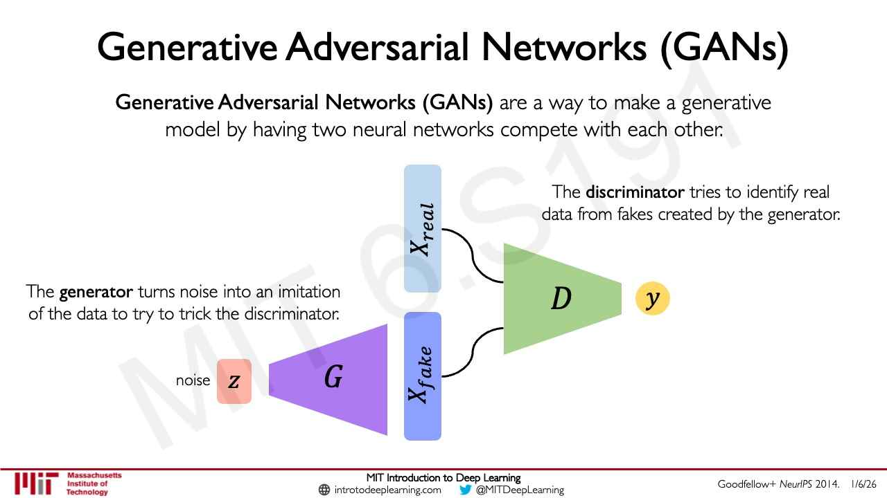
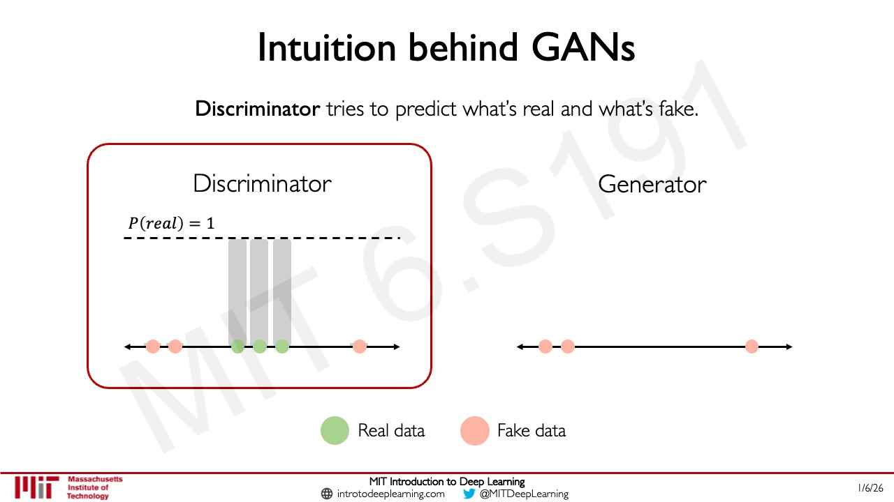
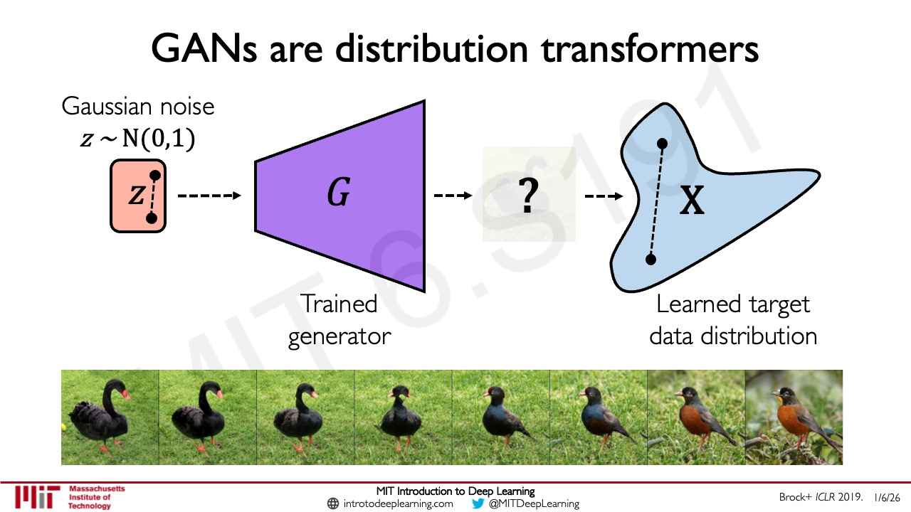
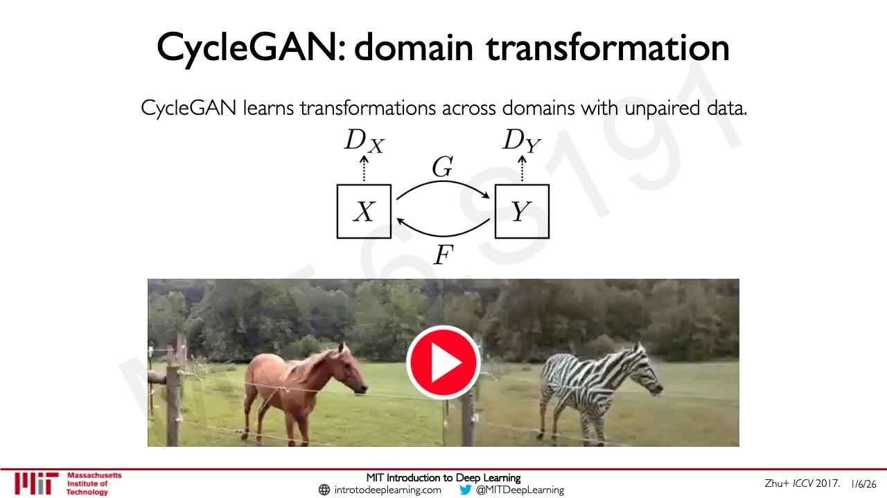

# Generative adversarial networks (GANs)

A **generative adversarial network** generates new data by training two networks against each other:
a **generator** that turns random noise into imitations of the data, and a **discriminator** that
tries to tell real data from the generator's fakes. This page follows MIT 6.S191
[lecture 4](04-deep-generative-modeling.md), sections 15–20 (≈34:13–46:37). For the wider context see
[generative modeling](generative-modeling.md).

Notation: $G$ is the generator and $D$ the discriminator; $\mathbf{z}$ is a sample of noise and
$G(\mathbf{z})$ the generator's output for it; $\mathbf{x}$ is real data.

## The idea: sample without modeling the density

When the goal is only to generate new samples, with no need for interpretable latent features, a GAN
does not model the density explicitly at all (lecture 4, ≈34:13). Sampling directly from a complex data
distribution is not possible, so a GAN samples from something simple — noise — and learns a
transformation from it to the data distribution (slide 49, ≈34:58–35:46). GANs "kicked off" this line
of work and were "previously the dominant paradigm for sample generation" (≈9:20, ≈34:13).

## Generator and discriminator

The generator is trained by pitting it against a second network (slide 50, ≈35:46–37:18):

- The **generator** "turns noise into an imitation of the data to try to trick the discriminator".
- The **discriminator** takes examples that may be real or fake and outputs a probability of whether
  each is real or fake; it "tries to identify real data from fakes created by the generator".

*Lecture 4, slide 50 — G turns noise z into X_fake; D judges X_real and X_fake and outputs y.*

Lecture 4 builds the competition up on a one-dimensional line (slides 51–68, ≈37:18–39:35). The
discriminator first learns to separate real points from the generator's fakes until the separation is
perfect. The generator then moves its fakes towards the real data. The discriminator, now fooled into
giving the moved fakes higher probabilities of being real, retrains and separates them again. The
generator moves again, and so on, until the fakes are so close in distribution to the real data that
the discriminator can hardly tell them apart.

*Lecture 4, slide 57 — the discriminator after its first round: real points (green) at P(real) = 1, fakes (pink) at zero; next the generator moves its fakes.*

## The objective

$D$ tries to identify the synthesized instances, and $G$ tries to synthesize instances that fool $D$;
training uses **adversarial objectives** for the two, and the global optimum is a generator that
reproduces the true data distribution (slide 69, ≈39:35–40:23). Lecture 4 prints the discriminator's
objective (slide 70) as

$$\arg\max_{D} \mathbb{E}_ {\mathbf{z},\mathbf{x}}\left[\log D(G(\mathbf{z})) + \log\left(1 - D(\mathbf{x})\right)\right]$$

with the first term labelled "Fake" and the second "Real". Ava Amini reads them as the probability that
the discriminator correctly identifies a fake instance as fake and a real instance as real (≈40:23–41:09),
which makes $D(\cdot)$ in this formula the probability of fake; the number-line slides plot the
probability of real instead, and the lecture does not reconcile the two. The generator minimizes the
same expression — it minimizes the probability that its output is identified as fake (slide 71,
≈41:09) — so the whole game is (slide 72, ≈41:58)

$$\arg\min_{G} \max_{D} \mathbb{E}_ {\mathbf{z},\mathbf{x}}\left[\log D(G(\mathbf{z})) + \log\left(1 - D(\mathbf{x})\right)\right]$$

The generator "tries to synthesize fake images that fool the *best* $D$" (slide 72). See
[loss functions](loss-functions.md).

These adversarial objectives make GANs tricky to train stably; many later advances aimed at training
stability and scale, with varying success, and other approaches have since moved beyond GANs, though
they are still used in some domains (≈41:58–42:43).

## GANs as distribution transformers

After training, the generator alone produces new data (slide 73). It is a **distribution
transformer**: it maps Gaussian noise to the learned target data distribution, so one noise sample
gives one instance and another gives a different one (slides 74–75, ≈42:43–43:29). Traversing the
noise space produces instances that change in a semantically consistent way; slide 76 (credited Brock+
*ICLR* 2019) interpolates between two noise points and gets a strip of images morphing from one bird
into another (≈43:29–44:16).

*Lecture 4, slide 76 — a line between two noise points becomes a smooth path through the data distribution.*

## CycleGAN: one data distribution to another

Where a GAN maps noise to a data manifold, a **CycleGAN** maps one data manifold to another (slide 77,
≈44:16). It has two generators and two discriminators and does **unpaired** image-to-image
translation: instances in one domain become instances in the other without paired examples, and a
**cyclic loss** connects the two domains (≈44:16–45:02). Slide 78 (credited Zhu+ *ICCV* 2017) draws the
mappings $G$ from domain $X$ to $Y$ and $F$ back, with a discriminator for each domain, and a horse
turned into a zebra.

*Lecture 4, slide 78 — CycleGAN's two mappings, G and F, and their discriminators; a horse becomes a zebra.*

The same idea works beyond images. Speech can be converted to a spectrogram image and transformed with a
CycleGAN (slide 79, ≈45:02–45:49); the course once used this for audio-to-audio synthesis that turned
Alexander Amini's voice into "the Obama style voice" (slide 80, ≈45:49–46:37).

## Where this comes up

- [Lecture 4 — Deep Generative Modeling](04-deep-generative-modeling.md), sections 15–21.
