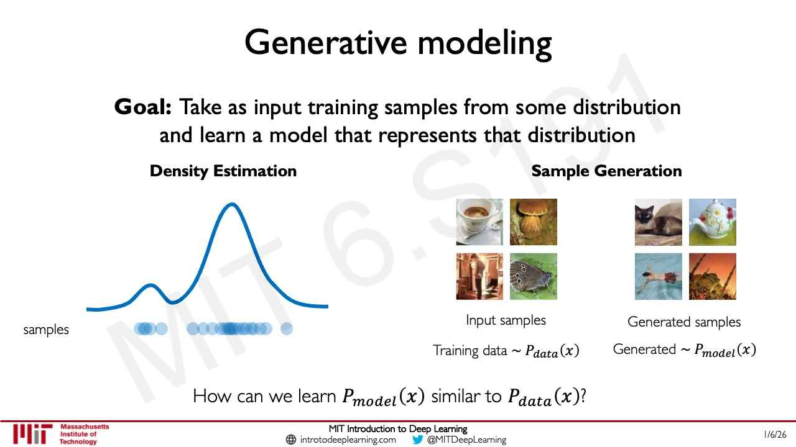
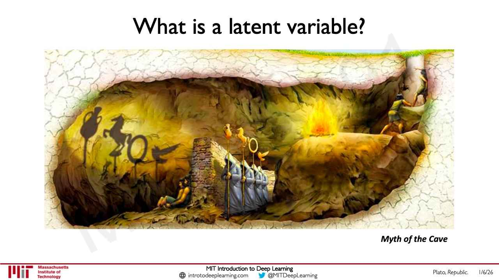

# Generative modeling

A **generative model** learns the probability distribution that a set of data came from, so that it
can describe that distribution and sample from it to create new data instances. This page follows MIT
6.S191 [lecture 4](04-deep-generative-modeling.md), sections 1–5 and 21 (≈0:05–11:40, 46:37–48:08).
The two families the course builds have their own pages:
[autoencoders and VAEs](autoencoders-and-vaes.md) and
[generative adversarial networks](generative-adversarial-networks.md).

Notation: $x$ is a data instance, $y$ a label; $P_{data}(x)$ is the true distribution of the data and
$P_{model}(x)$ the distribution a model has learned.

## Supervised and unsupervised learning

The networks of lectures 1–3 learn by **supervised learning**: the data come as pairs $(x, y)$, and
the goal is to learn a function mapping $x \rightarrow y$ — classification, regression, object
detection, semantic segmentation (lecture 4, slide 3, ≈2:25–3:11). In **unsupervised learning** only the
data $x$ are given, with no labels, and the goal is to learn the "hidden or underlying structure" of
the data: in effect, the distribution itself (slide 4, ≈3:11–3:57). Clustering and dimensionality
reduction are unsupervised methods; generative modeling is another, and a powerful one.

## The goal: learn the distribution

"Take as input training samples from some distribution and learn a model that represents that
distribution" (lecture 4, slide 5). Ava Amini calls this the point most often missed: "it really
amazes me that even at very advanced levels, people often don't realize that this is really the core
fundamental principle of generative modeling. Capturing and learning probability distributions over
data" (≈3:57–4:44). A learned distribution is used in two ways (≈4:44–5:32):

- **Density estimation**: describe the underlying probability distribution from which the samples were
  generated.
- **Sample generation**: draw from the learned distribution to generate brand-new instances that were
  not in the training data.

Both come down to one question: how can we learn $P_{model}(x)$ similar to $P_{data}(x)$ (slide 5,
≈5:32)?

*Lecture 4, slide 5 — density estimation (a curve fitted to samples) and sample generation (new images drawn from the learned distribution).*

## Why it is useful

Lecture 4 gives three uses beyond hyper-realistic images (≈6:17–8:35):

**Debiasing.** Real-world datasets carry biases, and models trained on them inherit those biases. A
generative model uncovers the underlying features of a dataset, which can be used to build fairer and
more representative datasets and models (slides 6 and 42). This is the subject of the course's second
software lab, on facial detection systems, which combines CNNs and VAEs ([lecture 3](03-convolutional-neural-networks.md),
section 22; lecture 4, ≈33:26).

**Outlier detection.** In self-driving or medicine, the dangerous cases are the rare ones in the tail
of the distribution. A model of the distribution can detect when an input is rare, and the rare cases
can be used in training to improve the model (slide 7, ≈7:02–7:47).

**Sample generation.** Because the model has learned a distribution, sampling it produces new data.
This is "the backbone" of generative AI: language models, image generators, and applications in biology
and chemistry such as drug discovery (slide 8, ≈7:47–8:35).

## Latent variables

Many generative models are **latent variable models**. Lecture 4 explains the idea with Plato's Myth of
the Cave (slides 10–11, ≈9:20–11:40): prisoners facing a wall see only the shadows of objects passing
behind them, never the objects themselves, yet can sense that the objects exist. Observed data are like
the shadows. Underneath them are variables that govern the main "axes of variability" of the data, and
a latent variable model uses a neural network to capture those in a finite set of **latent
variables** — "Can we learn the true explanatory factors, e.g. latent variables, from only observed
data?" (slide 11).

*Lecture 4, slide 10 — the Myth of the Cave: the shadows are what we observe; the objects casting them are the latent variables.*

## The families covered, and choosing between them

Lecture 4 covers two foundational families (slides 9 and 81):

- **Autoencoders and variational autoencoders (VAEs)** learn a lower-dimensional latent space and
  sample it to generate reconstructions. They are the choice when the latent representation itself
  matters: compressed, interpretable features, which can also be sampled. See
  [autoencoders and VAEs](autoencoders-and-vaes.md).
- **Generative adversarial networks (GANs)** train a generator against a discriminator and are
  primarily about generating new instances, without an explicit model of the density. See
  [generative adversarial networks](generative-adversarial-networks.md).

The choice follows the task: "how does your model inform your task and vice versa … What are you
actually trying to do with the neural network you build, and how does that inform the architecture
choice?" (≈31:54). A student's question (≈30:20) points to a third paradigm — inject the noise in
the transformation from input to output and sample there, when sample generation is all that
matters — which Amini relates to **diffusion models**. Those are announced for later lectures ("more
to come in Lectures 6 and 7", slide 82), and lecture 6 covers them: see [diffusion models](diffusion-models.md).

Generation quality is now "very, very, very high fidelity", across images, video, text and other
modalities (≈47:22–48:08) — high enough that, in lecture 4's opening poll, two of three faces were
generated and the room could not tell which one was real (slide 2, ≈0:51–2:25).

## Where this comes up

- [Lecture 4 — Deep Generative Modeling](04-deep-generative-modeling.md), sections 1–5, 12 and 21.
- [Lecture 3 — Convolutional Neural Networks](03-convolutional-neural-networks.md), section 22: the
  facial detection and debiasing lab.
- [Lecture 6 — Language Models and New Frontiers](06-language-models-new-frontiers.md), sections 13–20: the
  limitations of VAEs and GANs, and diffusion models.
- [Lecture 8 — AI for Science](08-ai-for-science.md), sections 11 and 20: generating new crystals with
  MatterGen, and sampling a protein's equilibrium shapes directly.
